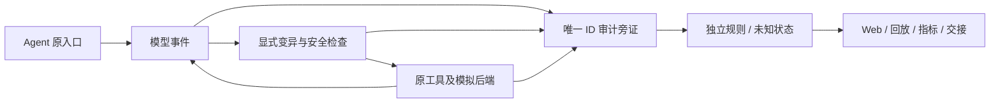

# Ticket Agent

## 2026-10-18：V3.2 审计旁证与八种变异（当前版本）

保留 Agent.chat 的十字段及原六变异，新增版本化 `audit_runs.jsonl`、唯一 Trace ID、参数校验与实际执行证据、独立规则判定和 Web 诊断/回放。M7 `hallucinated_train` 在工具可见结果注入假车次；M8 `concurrent_duplicate_order` 使用独立临时影子库和屏障调度，正常数据库约束不改。

V3.2 的定位是智能体质量保障平台：出行 Agent 是被测对象，故障注入、可审计 Trace、独立断言和可复现证据构成质量验证闭环。A 提供这些开发能力，B 仍负责正式测试方案与质量评价。

本轮真实 API **0 请求、0 新增 Token、0 API 费用**，正式 5/5 账本和历史证据未改。A 完整环境自测 **180 项通过**；复用 B 原断言的隔离结果及分环境跳过数见 [最终回归](docs/evidence/v32/20261018-negation-fix/offline/verification.json)。这不是 B 已独立完成 V3.2 正式测试的声明。

[A 开发报告](docs/handoff/v3/A_V3.2_Trace与八种变异开发报告.md) · [B 测试手册](docs/handoff/v3/B_V3.2_Trace与变异测试手册.md) · [C 演示说明](docs/handoff/v3/C_V3.2_演示与验收说明.md) · [八种变异对照](docs/handoff/v3/V3.2_八种变异对照表.md) · [实际证据与分母](docs/evidence/v32/20261018-negation-fix/report.json) · [持续记录](docs/v32_development_log.md)。新增 Live M7 表现、B 正式评价和 C 人工验收仍待完成。

```powershell
# 无 Key、无真实请求；输出目录必须全新
.\.venv-deepseek\Scripts\python.exe scripts/verify_v32_offline.py --out artifacts/runtime/v32-new-evidence
```



状态面板分别展示注入、检出、识别、恢复、安全停止及业务结果，不能把故意缺陷的测试符合预期解释成 Agent 已恢复。25 条离线对照记录中 13 条实际注入并检出；幻觉规则 6 条可判定样本符合预期，另 2 条待判定。这些有限样本不是完整 Live 得分。以下章节按原日期保留历史背景，当前状态以上述 V3.2 说明为准。

## 2026-10-18：V3.1 六种 Live 缺陷注入

六种变异已进入LangChain实际工具执行路径，并分别取得真实DeepSeek注入证据。默认Live仍只读；`skip_lock`和`infinite_loop`需要显式`full_sandbox`、新隔离库和正数测试预算。原Legacy六变异语义保留。跨模式统一配置为`AGENT_MUTATIONS` JSON或`Agent(mutations=...)`，默认关闭。

A完整自测153项通过；隔离复用B原判据回归：Legacy101/101、LangChain Mock100/100、六变异55/55，专项44通过/3 N/A。真实12场景共27次请求，输入42038/输出3733 Token，实际费用未知。六种唯一变异均实际触发，另有2次未触发样本完整保留；不把注入成功等同于Agent缺陷检出或恢复成功，正式Live质量结果待B评定。

- [A：实现、验证、真实证据与风险](docs/handoff/v3/A_Live缺陷注入开发报告.md)
- [B：隔离配置、Trace与独立判定](docs/handoff/v3/B_Live缺陷注入测试手册.md)
- [C：真实证据演示说明](docs/handoff/v3/C_Live缺陷注入演示说明.md)
- [六种变异支持范围对照](docs/handoff/v3/V3_Mock与Live六种变异对照表.md)
- [实际证据与用量](docs/evidence/deepseek/v31-live-faults-20261018/summary.json)

只预检：`python scripts/verify_live_faults.py`（0请求）；带`--run --out <全新artifacts/runtime目录> --cases <场景>`才会真实计费。Web勾选后会显示实际注入旁证；修改配置会清空当前内存会话，保留历史Trace。历史章节按当时结果保留，当前状态以本节及V3.1手册为准。

## 2026-10-17：手动 DeepSeek 对话可取消累计次数限制

经用户授权，新增 `DEEPSEEK_MAX_REQUESTS=0`：不限制累计模型请求数，仍逐次保存请求状态与 Token 用量。未配置时仍默认 5 次，原受限测试行为保留。只读工具白名单、单轮调用上限、超时与零自动重试保持不变。此次只做离线验证，没有新增真实 API 请求，也没有清空或修改历史账本。

使用说明与实际验证见 [手动使用取消累计请求限制](docs/handoff/v3/DeepSeek手动使用取消累计请求限制_20261017.md)。以下按日期保留历史结果；历史章节中的“当前禁止 Live / 预算 5/5”描述对应当时测试阶段，不覆盖本节的新授权与手动配置。

## 2026-10-17：DeepSeek最小接入复核

复用现有ChatDeepSeek/create_agent和两工具只读白名单，没有新Provider框架，也没有改Mock或六Mutation。本次仅补DeepSeek完整Trace及已加载Key的脱敏，新增8个离线测试；A自测122通过、legacy Mock101/101、Mutation55/55。旧LangChain判据98/100与恢复点相同，X15/X16规则冲突保留，不宣称B正式全部通过。

**真实API新增0，预算仍5/5；可以手动配置Key，当前不能发送Live。** [最小接入、Mock/DeepSeek切换、隐藏输入Key及离线证据](docs/handoff/v3/DeepSeek最小接入与离线验证_20261017.md)。本节为当前状态，以下为历史开发记录。

## 2026-10-16：DEF-06 / DEF-07 定向修复

当前仅离线修复购买冲突澄清与只读守卫误报；真实 API 新增0，预算仍5/5。A自测114通过，复用B原判据：legacy101/101、LangChain **98/100**（X15/X16旧判据与本轮新要求冲突，保留失败）、变异55/55、新增专项37通过/3 N/A。**有条件交接，交回成员B独立回归，不宣布V3全部通过。**

[A 修复报告](docs/handoff/v3/A_DEF06_DEF07定向修复报告_20261016.md) · [B 独立复测说明](docs/handoff/v3/B_DEF06_DEF07独立复测说明_20261016.md) · [C 演示补充](docs/handoff/v3/C_DEF06_DEF07演示补充_20261016.md)。以下各阶段成绩属于历史记录，当前状态以本节为准。

项目讲解材料：[代码与功能介绍 阅读打印版](docs/handoff/v3/Ticket_Agent_V3_代码与功能介绍_20261016.html) · [Markdown版](docs/handoff/v3/Ticket_Agent_V3_代码与功能介绍_20261016.md)。

成员 B 新机器接手先读 [B_先读我](B_先读我.md) 和 [安装运行/API Key 详解](docs/handoff/v3/B_安装运行与APIKey配置详解.md)。当前真实 API 仍冻结，教程配置不等于新增请求授权。

面向智能体测试比赛的模拟出行服务助手。**所有车次、航班、政策和支付均为自建虚构数据，不连接真实票务或支付系统。**

保留原 MVP 结构及 `docs/contract.md`。成员 A 开发被测 Agent；B 设计和执行正式测试；C 持续跟进、组织验收与作品报告/录屏。

## V3 只读冻结前质量修复（2026-10-16）

修复源码 `e216fdf57ec8f34b84134ba2b30b05e5d6ff5985`：独立只读 Prompt、越界最终文字拒绝、失败工具与部分用量留证；Web/CLI 的历史验证状态已校正。新环境102项A离线自测通过，真实API新增0。可以冻结只读候选交B测试，正常契约不变；错误抛DeepSeekError，B需捕获并读取失败旁证。新Prompt未联网回归，预算仍0，旧bff292cd压缩包不能代表修复版。

- [A 修复报告](docs/handoff/v3/A_V3只读冻结质量修复报告_20261016.md)
- [B 冻结测试交接](docs/handoff/v3/B_V3只读冻结测试交接_20261016.md)
- [C 冻结演示说明](docs/handoff/v3/C_V3只读冻结演示说明_20261016.md)
- [持续记录](docs/readonly_freeze_development_log.md)

## DeepSeek Live 已有证据审查结论（2026-10-16）

**已有真实 API / Function Calling 证据：仅 `query_tickets`、`search_policy` 两个只读工具。当前冻结在线请求，5 次生成请求已用尽，剩余 0；不要执行下方历史章节中的在线运行命令。** 本次只审查保存的证据并完成离线回归，没有新增模型调用或改动业务代码。

已有运行输入 Token 4,796、输出 563；实际费用未知，等待供应商账单。两个独立场景不证明真实多轮、完整八工具或 B 的正式 100 条通过。原数据库/历史 Trace/预算账本未变；新环境 A 自测 88 项通过。

- [A：真实证据、用量、风险与离线回归](docs/handoff/v3/A_DeepSeekLive验证审查_20261016.md)
- [B：正式测试交接、100 条 Mock 复用与成绩分组](docs/handoff/v3/B_DeepSeek正式测试交接_20261016.md)
- [C：已验证 Live 历史证据的离线演示](docs/handoff/v3/C_DeepSeek已验证证据演示_20261016.md)
- [原始 Live 报告](docs/evidence/deepseek/api-20261016-001224-2c3484/report.json)、[只读审查](docs/evidence/deepseek/review-20261016/audit.json)

**成员 A 开发交接状态：有条件交接。** B 可开始正式测试接入、离线 Mock 回归与已有证据核验；新增 Live 测试需先获得新的明确预算授权。只读能力话术现已通过专用 Prompt 与输出拒绝守卫修复（仅离线验证）；C 可拍历史回放，不能声称改后模型已在线回归或八工具 Live 已通过。以下 V1/V2/V3 阶段说明均保留历史时间背景，最新状态以本节为准。

## DeepSeek 官方 API 接入历史记录（2026-10-15）

独立分支 `codex/ticket-agent-deepseek-live` 使用 `ChatDeepSeek` 复用原 `create_agent()`，模型 `deepseek-flash`，显式关闭思考，仅开放 `query_tickets` / `search_policy`。原 8 工具与 legacy/Mock 保留；使用独立 `.venv-deepseek` 和 `requirements-deepseek-lock.txt`。密钥只读 `DEEPSEEK_API_KEY`，5 次生成请求持久预算、超时和 0 自动重试。

**10 月 15 日历史状态：当时缺少密钥，在线请求 0 次；10 月 16 日已有真实证据见上方。** 新环境 88 项 A 自测通过；SDK 协议桩与 Mock 结果分别标注。真实调用、真实多轮表现及正式 B/C 验收仍待完成。

- [A 接入报告](docs/handoff/v3/A_DeepSeek真实API接入报告.md)
- [B 配置、测试与安全预算](docs/handoff/v3/B_DeepSeek真实模型测试对接说明.md)
- [C 演示与拍摄说明](docs/handoff/v3/C_DeepSeek真实模型演示说明.md)
- [Mock/DeepSeek 对照](docs/handoff/v3/Mock与DeepSeek真实模型对照.md)
- [安全与费用记录](docs/handoff/v3/DeepSeek_API安全与费用记录.md)
- [持续开发记录](docs/deepseek_development_log.md)

本地预检：`.\.venv-deepseek\Scripts\python.exe scripts/check_deepseek_api.py`。`--run` 会访问 API；历史配置共用 5 次额度，现已用尽且禁止重跑，先阅读最新 B/C 说明。未知 Token/请求错误会抛脱敏 `DeepSeekError`、另存失败证据，不把未知用量伪装为正常契约里的 0。

## V3 真实前端补充（2026-10-13）

绿色工作空间已接入 `web/app.py`：实际对话、余票/订单/政策卡片、执行轨迹、完整工具结果、Trace 下载、历史回放和源码导览。卡片来自本轮工具返回值，不增加工具调用或契约字段。67 项 A 自测通过，实际浏览器 5 轮 LangChain Mock 操作通过；真实大模型仍待联网实测。

使用独立分支 `codex/ticket-agent-v3-live-ui`，见 [真实前端使用说明与启动命令](docs/handoff/v3/V3真实前端使用说明.md)、[实际新界面截图](docs/evidence/v3_live_ui/delivery_browser/01-query.png)、[持续开发记录](docs/v3_live_ui_development_log.md)。原 HTML 设计稿和旧截图仍是历史材料。

## V3 增量交付（2026-10-13）

独立分支 `feat/a-ticket-langchain-v3`：真正使用 LangChain 1.x `create_agent` 执行模型/工具循环，先验证两工具原型，再接入全部8工具。使用 `InMemorySaver` 隔离会话、middleware记录原契约Trace，并独立核验模拟写操作授权。原V2引擎仍默认可用。

- [A V3开发报告](docs/handoff/v3/A_V3开发完成报告.md)
- [B V3测试对接](docs/handoff/v3/B_V3测试对接手册.md)
- [C V3验收拍摄](docs/handoff/v3/C_V3验收与拍摄说明.md)
- [V2/V3技术对照](docs/handoff/v3/V2_V3技术对照报告.md)
- [V3交付清单](docs/handoff/v3/V3最终交付清单.md)
- [V3持续记录](docs/v3_development_log.md)、[实际框架证据](docs/evidence/v3/final_framework/verification.json)

新增[界面与讲解材料](docs/showcase/v3/README.md)：6张独立设计效果图、3张真实Streamlit Mock截图、可打开的HTML/CSS/JS源码，以及功能/架构/核心代码介绍和比赛讲解稿。设计稿使用历史Mock数据回放，与现有应用实际截图分别标注；查看图与页面无需安装渲染依赖。

实际A自测：V3环境56项通过；原V2环境旧28项通过、新框架28项明确跳过。两套环境每套10项入口/服务检查通过；LangChain Mock 11轮API覆盖8工具及CLI/Web通过。真实大模型尚未联网实测；B正式成绩、C人工验收待完成，状态为**有条件交接**。

V3使用独立 `.venv-v3`，保留原 `.venv` 与旧依赖锁文件。已有原环境时：

```powershell
.\.venv\Scripts\python.exe -m venv .venv-v3
.\.venv-v3\Scripts\python.exe -m pip install -r requirements-v3-lock.txt
$env:PYTHONIOENCODING="utf-8"
$env:AGENT_ENGINE="langchain"
$env:AGENT_PROVIDER="mock"
$env:AGENT_LC_TOOLSET="all"
$env:AGENT_USE_HTTP="0"
$env:AGENT_VECTOR_RAG="0"
$runId = Get-Date -Format "yyyyMMdd-HHmmss"
$env:AGENT_DB_PATH="$PWD\artifacts\runtime\v3-$runId\tickets.db"
$env:AGENT_TRACE_DIR="$PWD\artifacts\runtime\v3-$runId\langchain_mock"
.\.venv-v3\Scripts\python.exe data/seed.py
.\.venv-v3\Scripts\python.exe -m streamlit run web/app.py
```

首次没有Python环境先运行 `py -3.12 -m venv .venv`；已有环境不重复创建。只读原型改 `AGENT_LC_TOOLSET=read_only`；切回V2改 `AGENT_ENGINE=legacy` 并重启。六种变异仅legacy开放。可运行示例为 `scripts/v3_api_example.py --output-dir 新目录`，框架验证为 `scripts/verify_v3.py --toolset all --output-dir 新目录`；均使用V3解释器，拒绝覆盖既有输出。

Live沿用原4个模型环境变量，新验证入口 `scripts/validate_langchain_live.py` 默认只预检；有效Key且显式--run才远端调用。SDK桩验证不是实测模型成绩。下方V2章节保留作为历史说明，默认入口仍legacy。

## V2 历史交付（2026-10-13）

独立分支 `feat/a-ticket-v2`：已修复交通切换席别、切回高铁、售罄回复、重复支付提示和支付政策路由五项问题。A 实际通过 28 个自测、10 项入口/服务检查、32 条 Mock Trace；六变异仍可触发。B 正式 V2 全量回归与真实模型运行待完成，不能宣称正式 100/100。

- [A V2 开发报告](docs/handoff/A_V2开发完成报告.md)
- [B V2 测试对接](docs/handoff/B_V2测试对接说明.md)
- [C V2 验收演示](docs/handoff/C_V2验收演示说明.md)
- [V1/V2 缺陷对照](docs/handoff/V1_V2缺陷修复对照.md)
- [V2 最终清单](docs/handoff/A_V2最终交付清单.md)
- [V2 持续开发记录](docs/v2_development_log.md)、[V2 实际证据](docs/evidence/v2/regression/verification.json)

`scripts/smoke.py` 现在默认新建 V2 证据目录并拒绝覆盖已有目录。V1 标签 `handoff-a-20261012`、原库/Trace/文档/证据均保留。交接状态：**有条件交接**，B 可正式回归、C 可拍摄 Mock；真实模型无 Key，仅提供独立预检/显式运行入口 `scripts/validate_real_provider.py`。

## Windows PowerShell 快速运行

建议安装 Python 3.12。如果 `python --version` 没有输出或打开商店，使用实际 Python 安装路径建立环境。

```powershell
python -m venv .venv
.\.venv\Scripts\python.exe -m pip install -r requirements-lock.txt
$env:PYTHONIOENCODING="utf-8"
$env:AGENT_PROVIDER="mock"
$env:AGENT_USE_HTTP="0"
$env:AGENT_VECTOR_RAG="0"
$env:AGENT_DB_PATH="$PWD\artifacts\runtime\manual\tickets.db"
$env:AGENT_TRACE_DIR="$PWD\artifacts\runtime\manual\traces"
.\.venv\Scripts\python.exe data/seed.py
.\.venv\Scripts\python.exe cli.py once "帮我查明天上海到杭州的高铁"
.\.venv\Scripts\python.exe cli.py chat
.\.venv\Scripts\python.exe cli.py batch cases/demo.json
.\.venv\Scripts\python.exe -m streamlit run web/app.py
```

数据库已存在时 seed 默认拒绝覆盖。若明确需要重建上述**隔离测试库**，关闭 CLI/Web/HTTP 后运行 `python data/seed.py --reset`。换新 Trace 目录保留既有记录。

不安装任何包也能运行 Mock + CLI（标准库），`python run_demo.py` 默认独立目录；Web/HTTP/真实 Provider 需对应依赖。`requirements-lock.txt` 是本次实际验证环境的完整冻结，`requirements.txt` 为原有可选依赖范围。

## V1 历史交接与证据

- [成员 A 开发完成报告](docs/handoff/A_开发完成报告.md)
- [成员 B 测试对接手册](docs/handoff/B_测试对接手册.md)
- [成员 C 验收与演示手册](docs/handoff/C_验收与演示交接手册.md)
- [最终交付清单](docs/handoff/A_最终交付清单.md)
- [持续开发记录](docs/development_log.md)、[接口契约](docs/contract.md)
- [实际验证记录](docs/evidence/verification.json)、[32 条 Mock Trace](docs/evidence/mock_traces.jsonl)

```powershell
.\.venv\Scripts\python.exe -m unittest discover -s tests -v
.\.venv\Scripts\python.exe scripts/smoke.py
.\.venv\Scripts\python.exe scripts/handoff_example.py
```

这是成员 A 的实现自测与入口冒烟，不是成员 B 的正式测试方案或比赛成绩。

## 真实模型与当前边界

适配器使用 OpenAI 风格 Chat Completions function calling。设置 `AGENT_PROVIDER=openai`、`AGENT_API_KEY`、`AGENT_BASE_URL`、`AGENT_MODEL` 后重启进程。Key 只通过环境变量安全注入，不能写入仓库或截图。无 Key 会给出配置错误，不会假冒真实模型运行。

**截至 10 月 16 日：DeepSeek 两个只读场景已真实运行；真实多轮/异常/安全的系统性质量、完整八工具 Live、可选向量检索、正式比赛测试与人工验收仍待完成。** 固定模拟用户身份，不提供生产登录系统；候补只返回任务凭据；实际改签、儿童/学生票折扣和身份证核验尚未实现。已有原数据库不会自动扩展或按天刷新，新库覆盖生成当天及之后六天，共 2100 条记录。

每轮默认追加 `traces/traces.jsonl`，可用 `AGENT_TRACE_DIR` 隔离。GitHub 私有仓库为 `8xbAdx8/ticket-agent`，V1 与 V2 独立分支/标签保留；V2 不合并或覆盖原默认分支。
