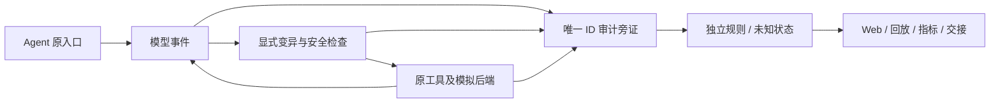

# Ticket Agent

## 当前项目状态入口（2026-10-30）

**连续追问修复（未提交）**：修复固定候选耗尽、无新工具调用时丢失前文证据、旧回答遮挡最新推荐三处问题。新增基于实际班次字段的比较问题，模型每轮仅接收最多6个未问过的候选；可复用同会话成功运行的原始证据快照，保留源run/event编号，不把历史库存冒充当前库存，新空结果不回退旧库存。每条回答独立追加保存，最新回答优先显示，剩余1条有效建议也不再被整组隐藏。DeepSeek/Qwen离线SDK替身各完成10轮点击续聊（Qwen第5轮超时后回退继续），专项3项与23子项通过，相关回归51项通过；最后的请求载荷脱敏调整另复验10轮通过。历史重新读取未增加请求，十字段/五字段契约保持。本次真实模型/Embedding/LangSmith请求均0，未重跑全仓回归；只验证有足够真实模拟证据的连续场景，证据耗尽仍不虚构追问。日志及逐轮记录见 `artifacts/runtime/followups-continuous-20261030-121139/`。

**用户端智能追问 MVP（未提交）**：DeepSeek / Qwen 用户会话勾选原有真实请求确认并点击发送后，自动复用本轮 Provider 和模型生成2～3条追问，不再设置单独开关。先从本轮实际查票结果或政策证据建立候选，再让模型以 JSON 选择，拒绝候选之外的内容；已问过的问题不再推荐，不足两条时不凑数。每轮额外最多1次、零重试，保留现有 HTTP 守卫、用量日志、超时和 Token 安全检查，不恢复历史累计预算限制。无授权、失败、格式错误、空结果或 Token 预算不足时确定性回退；Mock 始终离线。点击问题仍进入原有 `Conversation.send()`，沿用会话、费用确认和业务操作确认。通用自由文本推荐及复杂语义去重不在本 MVP 范围内。

追问保存在各会话 `traces/followups.jsonl`，含 run_id、Provider、模型、提示词版本、输入哈希、问题、生成来源/回退原因及源事件/文档编号；生成过程写入同一 run_id 的 `run_events.jsonl`。历史只读取保存快照，不重新生成，不补造旧对话追问。辅助用量单独记录，不改 `Agent.chat()` 十字段及工具五字段契约。两家真实 SDK 的成功/异常通过离线 HTTP 替身验证，**本次没有新的真实模型、Embedding 或 LangSmith 验收**。专项命令：`.\.venv-v35\Scripts\python.exe scripts/v37_tests.py --case tests/test_followups_mvp.py --out artifacts/runtime/自行指定的新目录`；开发与测试记录位于 `artifacts/runtime/followups-mvp-20261030/`。

上一轮MVP离线回归（连续追问修复前）：**956项通过、124子测试通过，0失败、0跳过**；新增追问专项23项通过（已含在956项内），覆盖两家 SDK 离线工具往返、合并后的费用确认、生成/回退、保存/回放和点击续聊。完整报告、JUnit、日志及源码指纹见 `artifacts/runtime/regression-center/20261030-115605-6c331731/`；5336个受保护文件未变，未发生外部连接。可选性能检查未执行，RAG附加诊断使用离线哈希向量，不算真实Embedding或回答质量验收。原A端UI请求数测试现分别检查主对话2次与追问1次；B正式断言未改。仅做了Streamlit AppTest交互验收，本次没有新增浏览器截图验收。

`rag_start / rag_result / rag_error` 在实际检索边界记录，复用同一run_id及独立 `run_events.jsonl`；请求内回调更新紧凑状态，完成后按回答关联证据回放，**没有后台实时推送或定时器模拟进度**。每条回答有默认折叠的政策证据面板，保留实际doc_id、原文、分数、模式与事件；版本/排名缺失显示“未记录”。“进入模型请求”须同时匹配本轮实际执行、call_id及工具消息原文；历史仅有调用ID不能据此推断。检索命中、进入请求、支持回答三者分别展示，支持性未证实始终标“尚未验证”。旧Trace不补造事件。

上一轮政策 UI 代码的独立离线副本回归（智能追问 MVP 之前）：**933项通过、124子测试通过，0失败、0跳过**；本轮新增50项专项包含追问点击、跨会话/跨run隔离、失败/空结果、未知字段和两个Mock引擎。补齐了首次请求失败、尚无历史回答时的检索失败展示；回归源码复制清单补入当前CSS，避免验收副本沿用旧主题。完整日志、JUnit、源码/测试集指纹及保护核验见 `artifacts/runtime/regression-center/20261030-104637-79633148/`；回归前后受检5334个原文件均未变，运行期间源码未变化。浏览器在1440px桌面与390px窄屏检查点击、展开、深浅主题和滚动，截图及本轮保护清单见 `artifacts/runtime/v37-policy-interaction-20261030/`。窄屏输入区可纵向滚动访问，未做固定底栏。本次自动化验收的真实模型/Embedding/LangSmith请求均为0；RAG千题内容、划分、旧结果未改。与最早快照相比，两份共享用量日志有追加，原字节前缀一致，未回滚；10:48的DeepSeek请求对应另一个用户会话web-e830fb8bdd18，区别于本次离线会话web-b8d95d18adb3。详细差异保存在同目录 `verification.json`，不把共享会话用量算成本次离线验收，也不声称共享运行目录全阶段均未变化。

复现：双击 `启动_离线模式.cmd` → 用户端发送“锁座后多久必须完成支付？” → 点击回答下追问 → 展开对应的“已检索知识库”。专项命令：`.\.venv-v35\Scripts\python.exe scripts/v37_tests.py --case tests/test_user_policy_chat.py --out artifacts/runtime/自行指定的新目录`；完整离线回归：`.\.venv-v35\Scripts\python.exe scripts/regression_center.py`。未知主题不推荐；推荐覆盖依赖现有政策锚点，不是通用语义推荐器。本轮未改变八工具Schema、授权与业务流程。

**RAG千题评测工程（2026-10-30，未提交候选版）**：独立 `data/rag1000/v1.1.1/` 已编写1000条、九类配额齐全；430条直接政策/口语题通过AI来源核对和确定性校验，570条复杂标注仍待B语义复核，**不能声称1000条全部已验证**。505个意图组按固定种子划为699/151/150，旧48题与原政策/索引不覆盖。独立CLI `scripts/rag_benchmark.py validate`、`run --split development --mode keyword`；Vector/Hybrid仅接受兼容真实缓存，缺缓存明确阻塞，不自动联网。检索成绩、回答忠实度、标注审查分别统计，源码指纹与原始逐题结果随批次保存。接口、判定规范、B复核和C演示见 [RAG千题评测手册](docs/architecture/RAG千题评测手册.md)；本轮不调用模型、Embedding或LangSmith，不提交或推送Git。

**离线回归中心（未提交）**：测试控制台的“离线回归中心”复用现有pytest、V3.7离线RAG和数据库并发脚本，按环境、证据副本、pytest、RAG、启动器、可选并发、原文件保护逐步执行。使用P0 v2包中的哈希校验冻结夹具，加当前源码形成独立副本；不覆盖原索引或恢复原目录。缺依赖、失败、阻塞和未执行分别展示。pytest判定直接读取结构化报告，保留setup/teardown异常、子测试和失败用例，不以空失败列表推断成功。RAG“评估执行完成”不代表质量达标，仍为离线哈希向量。报告、HTML、JUnit和日志保存在 `artifacts/runtime/regression-center/<批次>/`，页面可下载脱敏证据包；历史可按源码、测试集及运行配置指纹筛选，不混成单一趋势。原数据库并发能力保留为可选检查。运行期间页面按真实步骤更新；尚未实现后台任务队列、跨浏览器进度订阅或主动取消。CLI：`.\.venv-v35\Scripts\python.exe scripts/regression_center.py --node tests/test_p0_evidence_chain.py`，完整回归省略`--node`；可加`--performance`，不调用真实API。

**UI Pro 工作区改造（未提交）**：三个板块共用 `web/design.py` / `web/design.css` 的主题、状态、指标、空状态与证据表格。默认浅色，可切深色；用户端限制阅读宽度，区分用户/助手消息，保留实际票务卡片、政策抽屉和操作确认；四步 Mock 演示新增实际进度条。执行动画仅更新执行器已发出的事件，不展示或推测内部思维链。开发者端使用三个独立滚动面板，点击已保存的事件可在右侧查看对应原始证据；窄屏自动纵排，也可手动切换。公共证据表超过20行时可排序，筛选、排序与CSV导出保持一致，不改原始记录。

UI专项与相关回归已运行27项通过；最终源码副本的完整离线回归 **778项通过、117子测试通过、0失败、0跳过**（最终RAG展示调整后复跑94.54秒），原始日志/JUnit/逐项结果见 `artifacts/runtime/ui-pro-max-20261029/full-regression-r2/`。截图与安全检查统一保存在同一父目录。浏览器以独立离线实例检查1600px桌面、390px窄屏、深浅主题、政策原文、节点选择及假车次失败状态，并实际完成Mock四步购票；没有新增真实API请求。工作流当前展示完成后的事件回放，请求中的提示由真实回调刷新；设计决策说明仍为静态文档，未变成可编辑编排器。历史B成绩仍标原日期/SHA，不冒充当前回归。运行方式继续使用根目录 `启动_离线模式.cmd` 或 `启动_在线模式.cmd`；本轮验收没有验证新的Live请求。

**V3.7 工作区升级（未提交）**：新增独立 `run_events.jsonl`，与公共 Trace 共用 run_id；用户端和开发者调试请求按实际事件回调刷新，完成后可回放，尚无跨进程后台推送或强制取消。`data/v37/policies.json` 包含60条模拟政策，57条有效、3条攻击/过期/冲突测试文档；旧15条和历史索引未覆盖。可通过启动环境 `AGENT_POLICY_PATH=data/v37/active-policies.md` 选择有效扩展语料；新语料必须使用独立 RAG_INDEX_DIR。本轮独立 Chroma 评估使用离线哈希向量，不能当成真实Embedding成绩；标题型开发集也不是独立泛化评测，无答案8题仍误召回8题。

测试控制台新增“V3.7 离线验收”：`scripts/v37_tests.py --out artifacts/runtime/新目录 [--case tests/文件.py::节点]` 执行现有 A pytest、保存原始日志/JUnit/判定及SHA和dirty状态，不冒充B的103条正式用例执行器。`scripts/v37_performance.py --out artifacts/runtime/新目录` 运行1/10/50客户端单波同锁下单，保留原始请求并清理本次模拟数据库；首次清理连接错误保留在失败记录，r2已修正。暂无可靠RSS、锁等待和独立超时计量，报告为null。

已使用本机旧环境只读抽取 `订票.doc`，内容是“核心功能体现”“mock测试”“贴合赛事评分要求”等项目笔记，没有可核实的正式赛事条款；不据此填写官方映射。真实模型/Embedding/LangSmith请求本轮均不自动执行。

**P0 第二轮（未提交）**：开发者端新增三栏与窄屏纵向选项，读取 framework_events 和 fault_report 中的原始事件，在请求完成后回放；无统一时间/关联字段时明确未记录。规则关联 B 历史用例及原 SHA，不自动转为当前通过；政策证据关联本轮 Trace、实际文档和引用文本。官方比赛要求原件未找到，七维度官方映射仍待核实。尚未实现后台实时推送及全规则自动证据覆盖。

**三板块 P0 开发中（未提交）**：应用内新增用户端、开发者端和测试控制台导航；用户端提供独立 Mock 四步演示，锁座下单和模拟支付均须点击确认。开发者端显示真实基础/只读提示词、工具 Schema 与已有 Trace；静态工作流说明不是实时编排图。正式测试仍由 B 独立执行。完整事件联动、规则与测试逐项映射、实时工具执行进度和 60 秒时限尚待验证或实现；不得将离线演示当作真实模型或正式成绩。改造依据为用户提供的《新大纲.docx》，不纳入仓库。

当前源码基线为 `feat/ticket-agent-v36-stabilization`，HEAD `04b9a42a47e8ca81ce77cca352655708a1e1ea63`；实际运行版本请以本地 Git 状态为准。当前 Live 支持八个模拟票务工具，界面提供模拟操作确认；订单和支付不连接真实票务或支付系统。下方按日期保留的“两工具只读”等描述属于旧版本，不代表当前工具集。单轮步数和工具调用仍有防循环限制，累计模型请求不设本地上限，真实 API 可能计费。

V3.6 开发、已知问题和历史验证见 [V3.6 交接报告](docs/handoff/v36/A_V3.6_Git整理与完整回归报告.md)、[Bug 与风险](docs/handoff/v36/A_V3.6_Bug清单与修复证据.md) 和 [真实 Live 复验](docs/handoff/v36/A_V3.6_真实Live专项复验报告.md)。历史 768 项通过基于当时的源码和环境，不代表本次重新执行，也不是 B 当前正式成绩。当前版本的正式测试结果应由成员 B 独立确认。

先前 V3.6 精简交接 ZIP 排除了 `docs/evidence/`，但部分测试仍依赖该目录；新机器完整回归可能缺少证据文件。请勿删除历史证据或以修改断言代替修复交接，需安全整理最小证据并在干净环境复测。测试与验收边界见 [B 手册](docs/handoff/v36/B_V3.6_独立测试手册.md) 和 [C 说明](docs/handoff/v36/C_V3.6_验收与演示说明.md)。

2026-10-27 补充：[Windows 一键启动修复说明](docs/handoff/unlimited-live/一键启动修复说明.md)。已修复在线双击启动时项目模块找不到的问题，离线入口也完成实际本地启动检查；仅配置百炼 Key 和地址时会自动打开 Qwen。更新后请先关闭旧启动窗口，再重新双击。

## 历史记录：2026-10-27 所有 Live 入口取消本地累计请求上限

DeepSeek、Qwen3.8-Flash、text-embedding-v4、真实 RAG、出行助手和测试实验室现在使用相同的**非限额用量记录**。旧 5/5、4/4、5/8 账本只作历史证据，不再决定能否调用 API；无需增额、重置账本或创建验证批次。旧 `*_MAX_REQUESTS` 和共享总额配置不再生效。真实 API 可能产生费用，服务商认证、配额与限流仍适用。

双击 [启动_在线模式.cmd](启动_在线模式.cmd)，在页面选择模型、确认费用后发送；更新代码后先在原启动窗口按 Ctrl+C，再重启。Vector/Hybrid 未命中缓存时须另外确认 Embedding 网络访问。保留单轮执行步数、超时、零自动重试、两个只读工具、密钥脱敏、索引保护与本地 Trace。本轮开发与回归**没有发送任何真实模型、Embedding 或 LangSmith 请求**。

当前实现、测试结果、A 旧断言的显式迁移及历史文件校验见 [移除上限报告](docs/handoff/unlimited-live/本地请求上限移除报告.md)；运行、API Key、用量日志和 B 测试步骤见 [使用与测试迁移说明](docs/handoff/unlimited-live/使用与测试迁移说明.md)。统一离线命令：`.\.venv-v35\Scripts\python.exe scripts/verify_unlimited_live_offline.py --current-only`。此前 ZIP 和以下按日期保留的限额描述均属于历史版本，未覆盖旧包或旧证据。

## 历史记录：2026-10-27 团队交接入口

最新修复见 [Trace、回复与质量一致性报告](docs/handoff/v352/Trace回复与质量一致性修复报告.md)：正常澄清不再被非票务引文误拦截，运行错误与未知判定分别记录原因，Token状态依据响应证据，网页区分原模型回答和未返回占位。新增27项专项；完整离线 **622通过、0失败、0跳过，另96子测试通过**，外部模型/Embedding/LangSmith请求0。修复分支与SHA见报告。以下已发出的交接ZIP仍对应957e5cb0，未自动覆盖。

首次使用请读 [先读我_团队交接](先读我_团队交接.md)，其中统一说明安装、双击启动、DeepSeek/百炼/LangSmith Key配置、B测试、C演示、代码导航与当前限制。ZIP包含冻结真实RAG索引与查询缓存，不含真实Key、虚拟环境、个人运行库或Git元数据；版本与文件哈希由打包工具写入根目录清单。

当前包含千问/LangSmith界面修复：Qwen会话切页不再自动切回DeepSeek，费用确认按会话隔离，无执行记录时明确提示不能导出，深浅主题文字可读。应用完整离线回归 **595通过、0失败、0跳过，另94子测试通过**；该修复仅离线与真实浏览器验证，外部请求0。Live仍只有query_tickets/search_policy两个只读工具；双模型历史全文忠实度仍待B人工复核。详见[修复说明](docs/handoff/v352/千问LangSmith界面修复说明.md)。

新解压ZIP安装完整 `requirements-v35-lock.txt` 后，可用 `python scripts/check_team_package.py` 零网络验证，不要求存在.git；本次解压实测结果看ZIP旁 `.verification.json`。日常Web手动对话不设累计请求上限，每次发送可能收费；正式测试必须单独设定授权范围。下方各日期章节保留历史原状，不代表当前在线额度或最新测试数量。

## 2026-10-26：V3.5.2 真实双模型RAG验收与原索引保护（历史版本）

用户明确授权后已实际完成**5次Embedding＋4次生成**：Qwen3.8-Flash、DeepSeek Flash各2次HTTP200，都自主调用search_policy并收到相同Chroma政策P11，实际ToolMessage和系统Prompt hash一致。原回复、保护层、最终展示分别留证；**全文语义忠实度均indeterminate，待B独立复核**，不把工具闭环当准确率100%。

新48题全部三模式已测：Keyword合计Recall@1/3=.84375/1、MRR=.9375；Vector/Hybrid各.96875/1、MRR1；无答案均0/32。开发/保留各24单列，旧30另列。真实Token：Embedding504，Qwen输入1921/输出143，DeepSeek1878/133；费用未知、重试0、LangSmith0，全部新额度已用完。

原Chroma禁止原地open/build，实际读取/回归使用独立副本，源前后hash。3933原文件和旧账Qwen4/4、正式DeepSeek5/5、Embedding5/8均未变。首轮Qwen配置拒绝0HTTP及修复后仅用剩余2次的记录完整保留。离线502项通过、0失败/0跳过，另89子测试；原矩阵和两组变异通过，SDK桩与Live分开。

```powershell
# 均为离线复验，输出目录必须全新；不要添加 --run
.\.venv-v35\Scripts\python.exe scripts/verify_v352_offline.py --current-only --out artifacts/runtime/v352-my-review
.\.venv-v35\Scripts\python.exe scripts/evaluate_v352_rag.py --out artifacts/runtime/v352-my-quality
```

[A实现与真实报告](docs/handoff/v352/A_V3.5.2_真实RAG与索引保护报告.md) · [B独立手册/API Key](docs/handoff/v352/B_V3.5.2_独立测试与判定手册.md) · [C演示](docs/handoff/v352/C_V3.5.2_双模型RAG演示说明.md) · [质量指标](docs/handoff/v352/V3.5.2_双模型对照与质量指标.md) · [费用账本](docs/handoff/v352/V3.5.2_API预算与真实验证记录.md) · [最新证据摘要](docs/evidence/v352/summary.json)。B新克隆使用真实RAG离线复验缓存ZIP，禁止覆盖旧索引。页面是已发生真实证据的离线回放，新增Live需再授权。**有条件交接**，正式成绩由B提供。下方章节保留各历史时间背景。

## 2026-10-26：V3.5.1 RAG质量强化（历史版本）

新增有限政策范围/缺失条件门控、向量主导的加权RRF、逐句出处与数值/条件检查及两Provider政策工具往返的SDK离线验证。原30题保持不变，另冻结开发/保留集各24题；不修改B正式断言。真实API新增 **0**，旧Embedding **5/8**、Qwen生成 **4/4**不变。

最终pytest **472通过、0失败、0跳过，另89子测试通过**；原多环境、smoke和两组变异检查通过。保留首次失败与索引留存事件，不将后续成功覆盖它们。

固定30题的缓存真实向量离线重放：Hybrid Recall@3/MRR由0.980769/0.923077升为1/1，三模式无答案误召回均0/4。新保留集Keyword正样本Recall1、MRR0.875，负样本0/16误召回；两题正确文档仍第二。新48题没有真实查询向量，Vector/Hybrid未运行；真实模型拒答和修复后Live往返未验证，不能把这些数字当模型整体准确率。

第一次全量测试发现Chroma读取期间原运行索引3文件字节变化；未自动恢复。隔离副本核对15个文档/元数据/向量与原真实导出一致，后续回归改读本轮副本。票务业务库、历史Trace及API账本未变。详见[留存事件](docs/evidence/v351/chroma-retention-incident.json)，交接保留该风险。

```powershell
# 纯离线，输出目录必须全新。新机器只运行当前环境可加 --current-only
.\.venv-v35\Scripts\python.exe scripts/verify_v351_offline.py --out artifacts/runtime/v351-my-review
.\.venv-v35\Scripts\python.exe scripts/evaluate_v351_rag.py --out artifacts/runtime/v351-my-quality
# 仅输出未来验收方案，没有联网开关，不创建额度
.\.venv-v35\Scripts\python.exe scripts/prepare_v351_acceptance.py
```

[前后对照](docs/handoff/v351/RAG优化前后对照报告.md) · [无答案专项](docs/handoff/v351/无答案专项测试结果.md) · [Hybrid诊断](docs/handoff/v351/Hybrid融合诊断报告.md) · [忠实度专项](docs/handoff/v351/回答忠实度专项报告.md) · [B独立验收](docs/handoff/v351/B独立验收手册.md) · [C演示说明](docs/handoff/v351/C真实RAG演示说明.md) · [待授权真实方案](docs/handoff/v351/真实验收方案.md)。当前**有条件交接**，真实新验收需另授权，旧4/4不能再请求。下方是按日期保留的历史结果。

## 2026-10-26：V3.5 Qwen3.8-Flash 与真实 RAG（历史基线）

已实际调用 `text-embedding-v4`，将15条政策的15个1024维向量持久化到 Chroma；支持 Keyword、Vector、RRF Hybrid、独立检索/回答审计、固定30题和8种隔离 RAG 变异。Qwen3.8-Flash 已完成真实查票 Function Calling 闭环，以及基于真实检索证据的政策回答和无答案拒答。原 Mock、DeepSeek、原八变异及接口契约保留。

真实请求：Embedding **5/8，1122 Token**；生成 **4/4，输入3205/输出413 Token**；费用未知、重试0。生成额度已满，不删除账本或创建别名继续请求。政策工具的 Agent 真正两轮往返、DeepSeek同证据生成、本轮完整语义忠实度仍待验证。Vector 在26条有答案题 Recall@3/MRR 均为1，但4条无答案仍误召回3条；不把检索分数当回答准确率。最终离线390项通过、0失败、0跳过，旧环境兼容结果详见报告。

新机器先安装 `requirements-v35-lock.txt` 到 `.venv-v35`，再双击 [启动_离线模式.cmd](启动_离线模式.cmd)，进入“测试工作台→RAG知识库”。页面指标来自保存的实际证据；新机器未带运行索引时如实显示未建库。旧在线脚本仍是 DeepSeek 入口。

```powershell
# 以下只做本地检查，不请求模型/Embedding
.\.venv-v35\Scripts\python.exe scripts/rag.py plan
.\.venv-v35\Scripts\python.exe scripts/rag.py status
.\.venv-v35\Scripts\python.exe scripts/live_providers.py --provider bailian --profile v35
# 输出目录必须全新；阻断外部Python网络的完整离线回归
.\.venv-v35\Scripts\python.exe scripts/verify_v35_offline.py --out artifacts/runtime/v35-my-review
```

[A开发报告](docs/handoff/v35/A_V3.5真实RAG开发报告.md) · [B测试与Key配置](docs/handoff/v35/B_V3.5_RAG质量测试手册.md) · [C演示验收](docs/handoff/v35/C_V3.5_RAG演示与验收说明.md) · [质量标准](docs/handoff/v35/V3.5_RAG质量集与判定标准.md) · [API用量与预算](docs/handoff/v35/V3.5真实API用量与预算记录.md) · [证据摘要](docs/evidence/v35/summary.json) · [持续开发记录](docs/v35_development_log.md)。当前**有条件交接**，B正式质量结论另行提供。下方按日期保留历史结果。

## 2026-10-25：V3.4.1 回答与工具数据一致性（历史修复）

新增九字段检查、按车次/日期/路线/席别匹配、用户引用与否定范围、明确错配/无法判定的安全停止。原百炼四处时刻错配已全部离线复现；原回复和V3.4证据未改。新74项专项及完整355项离线回归通过，V3跳过65、V2跳过151，均无失败。**本轮真实请求0、修复后Live未复验**，旧4/4和正式5/5不变。

```powershell
# 纯离线入口，目录必须全新；不会调用模型或LangSmith
.\.venv-deepseek\Scripts\python.exe scripts/verify_v341_offline.py --out artifacts/runtime/v341-my-review
```

[A修复报告](docs/handoff/v3/A_V3.4.1_回答数据一致性修复报告.md) · [B准确性测试手册](docs/handoff/v3/B_V3.4.1_真实模型准确性测试手册.md) · [C缺陷演示](docs/handoff/v3/C_V3.4.1_真实缺陷演示说明.md) · [历史对照](docs/handoff/v3/V3.4.1_DeepSeek与百炼历史证据对照表.md) · [待授权Live复验计划](docs/handoff/v3/V3.4.1_真实复验计划.md)。字段检查是有限规则，不把工具一致性当作模型整体准确率。

**一键启动：** 双击根目录 [启动_离线模式.cmd](启动_离线模式.cmd)（完整模拟业务，无需Key）。在线入口及预算见 [启动说明](启动说明.md)：V3.3 旧共享3次额度与 V3.4 独立4次验收额度均已用尽，不删除账本或自动增额。在线发送会计费，原正式5/5与旧手动账本不变。

## 2026-10-25：V3.4 API 审计与真实验收（历史状态）

DeepSeek、百炼本轮各2次真实请求，都完成query_tickets真实工具协议闭环；DeepSeek本次回答与模拟库一致，**百炼发生车次时刻错配，业务核验失败**。新增保守保护已离线复现，后置修复未追加Live复验。LangSmith合成记录1次上传，经另行授权的额外只读GET核验成功（累计1POST+2GET），不是模型全对话上传。

新双账同request_id原子预留/结算，4/4逐条匹配；旧3条未知保留，正式5/5未变。最终完整离线281通过，V3跳过59、V2跳过145，均0失败；不是B正式成绩。实际输入3698/输出592 Token，费用未知。Live仅两只读工具，本轮未Live验证政策、多轮或异常矩阵。

```powershell
# 仅本地预检，不发送真实请求。当前额度已耗尽，不带执行标志。
.\.venv-deepseek\Scripts\python.exe scripts/live_providers.py --provider deepseek --profile v34
.\.venv-deepseek\Scripts\python.exe scripts/live_providers.py --provider bailian --profile v34
```

[A审计报告](docs/handoff/v3/A_V3.4_API全量适配审计报告.md) · [B配置与验收手册](docs/handoff/v3/B_V3.4_API与预算验收手册.md) · [C真实证据演示](docs/handoff/v3/C_V3.4_真实API演示说明.md) · [机器可读证据](docs/evidence/v34/api_audit_summary.json) · [开发记录](docs/v34_development_log.md)。当前**有条件交接**，协议通过不能代替百炼业务通过。

## 2026-10-25：V3.3 多模型与可选 LangSmith（历史增量）

V3.3当时实现百炼适配器、四模型选择、隔离预算、运行元数据和过滤LangSmith核验；该开发阶段仅离线验证、真实请求0。当前以上方V3.4带版本证据为准，不能把配置存在或SDK桩当Live成功。

```powershell
# 默认仅本地预检，无真实请求；百炼须配置 DASHSCOPE_API_KEY/BASE_URL/MODEL
.\.venv-deepseek\Scripts\python.exe scripts/live_providers.py --provider bailian
# 历史 --serve 入口仍保留，但额度耗尽会拒绝，不绕过预算
```

真实验证必须由用户显式执行 --run，初次两 Provider 合计最多三次，一轮工具闭环通常需两次；不自动增加预算、重试或回退 Mock。LangSmith 默认关闭，还需每次范围确认；原本地 Trace 始终保留。

[A 多模型报告](docs/handoff/v3/A_V3.3_真实多模型接入报告.md) · [B 配置与测试手册](docs/handoff/v3/B_V3.3_多模型测试手册.md) · [C 演示说明](docs/handoff/v3/C_V3.3_多模型演示说明.md) · [实施架构](docs/architecture/V3.3_Provider与LangSmith架构.md)。

## 2026-10-25：V3.3 双工作空间与质量可视化（此前交付）

默认 `web/app.py` 已升级：出行助手 + 测试总览、实验室、Trace 分析、质量分析、模型对比、集成中心。支持深浅主题、实际工具卡片、常见模拟操作确认、独立用户/实验数据库、八变异、原始/变异对照、JSON 搜索与脱敏导出。旧界面作为 `web/legacy_app.py` 保留兼容。

图表分别展示 B 的 V3.2 独立 Mock 结果、A 历史离线自测与当前隔离实验，不把 101、100、69、45、10 相加。T04 漏检、R01 不适用和 F15/M12 非 C5 命中继续保留；没有虚构历史趋势、第二个真实模型成绩或精确阶段耗时。

此前 UI 交付未发送模型 API / LangSmith 请求。其新增自测、三环境回归与启动预检见 [原离线验证](docs/evidence/v33/20261025/report.json)；截图见 [原视觉验收记录](docs/evidence/v33/20261025/视觉验收记录.md)。LangGraph 自定义图、持久化恢复尚未实现；百炼与 LangSmith 后续实际接入状态以上方当前增量报告为准。

[A 开发报告](docs/handoff/v3/A_V3.3_UI重构开发报告.md) · [B 前端验收手册](docs/handoff/v3/B_V3.3_前端与数据展示验收手册.md) · [C 演示说明](docs/handoff/v3/C_V3.3_演示说明.md) · [未来集成设计](docs/architecture/V3.3_未来框架与模型集成设计.md)。

```powershell
# 无 Key、无真实请求；请使用尚不存在的输出目录
.\.venv-deepseek\Scripts\python.exe scripts/verify_v33_offline.py --out artifacts/runtime/v33-my-review
```

## 2026-10-18：V3.2 审计旁证与八种变异（历史版本）

保留 Agent.chat 的十字段及原六变异，新增版本化 `audit_runs.jsonl`、唯一 Trace ID、参数校验与实际执行证据、独立规则判定和 Web 诊断/回放。M7 `hallucinated_train` 在工具可见结果注入假车次；M8 `concurrent_duplicate_order` 使用独立临时影子库和屏障调度，正常数据库约束不改。

V3.2 的定位是智能体质量保障平台：出行 Agent 是被测对象，故障注入、可审计 Trace、独立断言和可复现证据构成质量验证闭环。A 提供这些开发能力，B 仍负责正式测试方案与质量评价。

本轮真实 API **0 请求、0 新增 Token、0 API 费用**，正式 5/5 账本和历史证据未改。A 完整环境自测 **180 项通过**；复用 B 原断言的隔离结果及分环境跳过数见 [最终回归](docs/evidence/v32/20261018-negation-fix/offline/verification.json)。这不是 B 已独立完成 V3.2 正式测试的声明。

[A 开发报告](docs/handoff/v3/A_V3.2_Trace与八种变异开发报告.md) · [B 测试手册](docs/handoff/v3/B_V3.2_Trace与变异测试手册.md) · [C 演示说明](docs/handoff/v3/C_V3.2_演示与验收说明.md) · [八种变异对照](docs/handoff/v3/V3.2_八种变异对照表.md) · [实际证据与分母](docs/evidence/v32/20261018-negation-fix/report.json) · [持续记录](docs/v32_development_log.md)。新增 Live M7 表现、B 正式评价和 C 人工验收仍待完成。

```powershell
# 无 Key、无真实请求；输出目录必须全新
.\.venv-deepseek\Scripts\python.exe scripts/verify_v32_offline.py --out artifacts/runtime/v32-new-evidence
```



状态面板分别展示注入、检出、识别、恢复、安全停止及业务结果，不能把故意缺陷的测试符合预期解释成 Agent 已恢复。25 条离线对照记录中 13 条实际注入并检出；幻觉规则 6 条可判定样本符合预期，另 2 条待判定。这些有限样本不是完整 Live 得分。以下章节按原日期保留历史背景，当前前端状态以页首 V3.3 说明为准。

## 2026-10-18：V3.1 六种 Live 缺陷注入

六种变异已进入LangChain实际工具执行路径，并分别取得真实DeepSeek注入证据。默认Live仍只读；`skip_lock`和`infinite_loop`需要显式`full_sandbox`、新隔离库和正数测试预算。原Legacy六变异语义保留。跨模式统一配置为`AGENT_MUTATIONS` JSON或`Agent(mutations=...)`，默认关闭。

A完整自测153项通过；隔离复用B原判据回归：Legacy101/101、LangChain Mock100/100、六变异55/55，专项44通过/3 N/A。真实12场景共27次请求，输入42038/输出3733 Token，实际费用未知。六种唯一变异均实际触发，另有2次未触发样本完整保留；不把注入成功等同于Agent缺陷检出或恢复成功，正式Live质量结果待B评定。

- [A：实现、验证、真实证据与风险](docs/handoff/v3/A_Live缺陷注入开发报告.md)
- [B：隔离配置、Trace与独立判定](docs/handoff/v3/B_Live缺陷注入测试手册.md)
- [C：真实证据演示说明](docs/handoff/v3/C_Live缺陷注入演示说明.md)
- [六种变异支持范围对照](docs/handoff/v3/V3_Mock与Live六种变异对照表.md)
- [实际证据与用量](docs/evidence/deepseek/v31-live-faults-20261018/summary.json)

只预检：`python scripts/verify_live_faults.py`（0请求）；带`--run --out <全新artifacts/runtime目录> --cases <场景>`才会真实计费。Web勾选后会显示实际注入旁证；修改配置会清空当前内存会话，保留历史Trace。历史章节按当时结果保留，当前状态以本节及V3.1手册为准。

## 2026-10-17：手动 DeepSeek 对话可取消累计次数限制

经用户授权，新增 `DEEPSEEK_MAX_REQUESTS=0`：不限制累计模型请求数，仍逐次保存请求状态与 Token 用量。未配置时仍默认 5 次，原受限测试行为保留。只读工具白名单、单轮调用上限、超时与零自动重试保持不变。此次只做离线验证，没有新增真实 API 请求，也没有清空或修改历史账本。

使用说明与实际验证见 [手动使用取消累计请求限制](docs/handoff/v3/DeepSeek手动使用取消累计请求限制_20261017.md)。以下按日期保留历史结果；历史章节中的“当前禁止 Live / 预算 5/5”描述对应当时测试阶段，不覆盖本节的新授权与手动配置。

## 2026-10-17：DeepSeek最小接入复核

复用现有ChatDeepSeek/create_agent和两工具只读白名单，没有新Provider框架，也没有改Mock或六Mutation。本次仅补DeepSeek完整Trace及已加载Key的脱敏，新增8个离线测试；A自测122通过、legacy Mock101/101、Mutation55/55。旧LangChain判据98/100与恢复点相同，X15/X16规则冲突保留，不宣称B正式全部通过。

**真实API新增0，预算仍5/5；可以手动配置Key，当前不能发送Live。** [最小接入、Mock/DeepSeek切换、隐藏输入Key及离线证据](docs/handoff/v3/DeepSeek最小接入与离线验证_20261017.md)。本节为当前状态，以下为历史开发记录。

## 2026-10-16：DEF-06 / DEF-07 定向修复

当前仅离线修复购买冲突澄清与只读守卫误报；真实 API 新增0，预算仍5/5。A自测114通过，复用B原判据：legacy101/101、LangChain **98/100**（X15/X16旧判据与本轮新要求冲突，保留失败）、变异55/55、新增专项37通过/3 N/A。**有条件交接，交回成员B独立回归，不宣布V3全部通过。**

[A 修复报告](docs/handoff/v3/A_DEF06_DEF07定向修复报告_20261016.md) · [B 独立复测说明](docs/handoff/v3/B_DEF06_DEF07独立复测说明_20261016.md) · [C 演示补充](docs/handoff/v3/C_DEF06_DEF07演示补充_20261016.md)。以下各阶段成绩属于历史记录，当前状态以本节为准。

项目讲解材料：[代码与功能介绍 阅读打印版](docs/handoff/v3/Ticket_Agent_V3_代码与功能介绍_20261016.html) · [Markdown版](docs/handoff/v3/Ticket_Agent_V3_代码与功能介绍_20261016.md)。

成员 B 新机器接手先读 [B_先读我](B_先读我.md) 和 [安装运行/API Key 详解](docs/handoff/v3/B_安装运行与APIKey配置详解.md)。当前真实 API 仍冻结，教程配置不等于新增请求授权。

面向智能体测试比赛的模拟出行服务助手。**所有车次、航班、政策和支付均为自建虚构数据，不连接真实票务或支付系统。**

保留原 MVP 结构及 `docs/contract.md`。成员 A 开发被测 Agent；B 设计和执行正式测试；C 持续跟进、组织验收与作品报告/录屏。

## V3 只读冻结前质量修复（2026-10-16）

修复源码 `e216fdf57ec8f34b84134ba2b30b05e5d6ff5985`：独立只读 Prompt、越界最终文字拒绝、失败工具与部分用量留证；Web/CLI 的历史验证状态已校正。新环境102项A离线自测通过，真实API新增0。可以冻结只读候选交B测试，正常契约不变；错误抛DeepSeekError，B需捕获并读取失败旁证。新Prompt未联网回归，预算仍0，旧bff292cd压缩包不能代表修复版。

- [A 修复报告](docs/handoff/v3/A_V3只读冻结质量修复报告_20261016.md)
- [B 冻结测试交接](docs/handoff/v3/B_V3只读冻结测试交接_20261016.md)
- [C 冻结演示说明](docs/handoff/v3/C_V3只读冻结演示说明_20261016.md)
- [持续记录](docs/readonly_freeze_development_log.md)

## DeepSeek Live 已有证据审查结论（2026-10-16）

**已有真实 API / Function Calling 证据：仅 `query_tickets`、`search_policy` 两个只读工具。当前冻结在线请求，5 次生成请求已用尽，剩余 0；不要执行下方历史章节中的在线运行命令。** 本次只审查保存的证据并完成离线回归，没有新增模型调用或改动业务代码。

已有运行输入 Token 4,796、输出 563；实际费用未知，等待供应商账单。两个独立场景不证明真实多轮、完整八工具或 B 的正式 100 条通过。原数据库/历史 Trace/预算账本未变；新环境 A 自测 88 项通过。

- [A：真实证据、用量、风险与离线回归](docs/handoff/v3/A_DeepSeekLive验证审查_20261016.md)
- [B：正式测试交接、100 条 Mock 复用与成绩分组](docs/handoff/v3/B_DeepSeek正式测试交接_20261016.md)
- [C：已验证 Live 历史证据的离线演示](docs/handoff/v3/C_DeepSeek已验证证据演示_20261016.md)
- [原始 Live 报告](docs/evidence/deepseek/api-20261016-001224-2c3484/report.json)、[只读审查](docs/evidence/deepseek/review-20261016/audit.json)

**成员 A 开发交接状态：有条件交接。** B 可开始正式测试接入、离线 Mock 回归与已有证据核验；新增 Live 测试需先获得新的明确预算授权。只读能力话术现已通过专用 Prompt 与输出拒绝守卫修复（仅离线验证）；C 可拍历史回放，不能声称改后模型已在线回归或八工具 Live 已通过。以下 V1/V2/V3 阶段说明均保留历史时间背景，最新状态以本节为准。

## DeepSeek 官方 API 接入历史记录（2026-10-15）

独立分支 `codex/ticket-agent-deepseek-live` 使用 `ChatDeepSeek` 复用原 `create_agent()`，模型 `deepseek-flash`，显式关闭思考，仅开放 `query_tickets` / `search_policy`。原 8 工具与 legacy/Mock 保留；使用独立 `.venv-deepseek` 和 `requirements-deepseek-lock.txt`。密钥只读 `DEEPSEEK_API_KEY`，5 次生成请求持久预算、超时和 0 自动重试。

**10 月 15 日历史状态：当时缺少密钥，在线请求 0 次；10 月 16 日已有真实证据见上方。** 新环境 88 项 A 自测通过；SDK 协议桩与 Mock 结果分别标注。真实调用、真实多轮表现及正式 B/C 验收仍待完成。

- [A 接入报告](docs/handoff/v3/A_DeepSeek真实API接入报告.md)
- [B 配置、测试与安全预算](docs/handoff/v3/B_DeepSeek真实模型测试对接说明.md)
- [C 演示与拍摄说明](docs/handoff/v3/C_DeepSeek真实模型演示说明.md)
- [Mock/DeepSeek 对照](docs/handoff/v3/Mock与DeepSeek真实模型对照.md)
- [安全与费用记录](docs/handoff/v3/DeepSeek_API安全与费用记录.md)
- [持续开发记录](docs/deepseek_development_log.md)

本地预检：`.\.venv-deepseek\Scripts\python.exe scripts/check_deepseek_api.py`。`--run` 会访问 API；历史配置共用 5 次额度，现已用尽且禁止重跑，先阅读最新 B/C 说明。未知 Token/请求错误会抛脱敏 `DeepSeekError`、另存失败证据，不把未知用量伪装为正常契约里的 0。

## V3 真实前端补充（2026-10-13）

绿色工作空间已接入 `web/app.py`：实际对话、余票/订单/政策卡片、执行轨迹、完整工具结果、Trace 下载、历史回放和源码导览。卡片来自本轮工具返回值，不增加工具调用或契约字段。67 项 A 自测通过，实际浏览器 5 轮 LangChain Mock 操作通过；真实大模型仍待联网实测。

使用独立分支 `codex/ticket-agent-v3-live-ui`，见 [真实前端使用说明与启动命令](docs/handoff/v3/V3真实前端使用说明.md)、[实际新界面截图](docs/evidence/v3_live_ui/delivery_browser/01-query.png)、[持续开发记录](docs/v3_live_ui_development_log.md)。原 HTML 设计稿和旧截图仍是历史材料。

## V3 增量交付（2026-10-13）

独立分支 `feat/a-ticket-langchain-v3`：真正使用 LangChain 1.x `create_agent` 执行模型/工具循环，先验证两工具原型，再接入全部8工具。使用 `InMemorySaver` 隔离会话、middleware记录原契约Trace，并独立核验模拟写操作授权。原V2引擎仍默认可用。

- [A V3开发报告](docs/handoff/v3/A_V3开发完成报告.md)
- [B V3测试对接](docs/handoff/v3/B_V3测试对接手册.md)
- [C V3验收拍摄](docs/handoff/v3/C_V3验收与拍摄说明.md)
- [V2/V3技术对照](docs/handoff/v3/V2_V3技术对照报告.md)
- [V3交付清单](docs/handoff/v3/V3最终交付清单.md)
- [V3持续记录](docs/v3_development_log.md)、[实际框架证据](docs/evidence/v3/final_framework/verification.json)

新增[界面与讲解材料](docs/showcase/v3/README.md)：6张独立设计效果图、3张真实Streamlit Mock截图、可打开的HTML/CSS/JS源码，以及功能/架构/核心代码介绍和比赛讲解稿。设计稿使用历史Mock数据回放，与现有应用实际截图分别标注；查看图与页面无需安装渲染依赖。

实际A自测：V3环境56项通过；原V2环境旧28项通过、新框架28项明确跳过。两套环境每套10项入口/服务检查通过；LangChain Mock 11轮API覆盖8工具及CLI/Web通过。真实大模型尚未联网实测；B正式成绩、C人工验收待完成，状态为**有条件交接**。

V3使用独立 `.venv-v3`，保留原 `.venv` 与旧依赖锁文件。已有原环境时：

```powershell
.\.venv\Scripts\python.exe -m venv .venv-v3
.\.venv-v3\Scripts\python.exe -m pip install -r requirements-v3-lock.txt
$env:PYTHONIOENCODING="utf-8"
$env:AGENT_ENGINE="langchain"
$env:AGENT_PROVIDER="mock"
$env:AGENT_LC_TOOLSET="all"
$env:AGENT_USE_HTTP="0"
$env:AGENT_VECTOR_RAG="0"
$runId = Get-Date -Format "yyyyMMdd-HHmmss"
$env:AGENT_DB_PATH="$PWD\artifacts\runtime\v3-$runId\tickets.db"
$env:AGENT_TRACE_DIR="$PWD\artifacts\runtime\v3-$runId\langchain_mock"
.\.venv-v3\Scripts\python.exe data/seed.py
.\.venv-v3\Scripts\python.exe -m streamlit run web/app.py
```

首次没有Python环境先运行 `py -3.12 -m venv .venv`；已有环境不重复创建。只读原型改 `AGENT_LC_TOOLSET=read_only`；切回V2改 `AGENT_ENGINE=legacy` 并重启。六种变异仅legacy开放。可运行示例为 `scripts/v3_api_example.py --output-dir 新目录`，框架验证为 `scripts/verify_v3.py --toolset all --output-dir 新目录`；均使用V3解释器，拒绝覆盖既有输出。

Live沿用原4个模型环境变量，新验证入口 `scripts/validate_langchain_live.py` 默认只预检；有效Key且显式--run才远端调用。SDK桩验证不是实测模型成绩。下方V2章节保留作为历史说明，默认入口仍legacy。

## V2 历史交付（2026-10-13）

独立分支 `feat/a-ticket-v2`：已修复交通切换席别、切回高铁、售罄回复、重复支付提示和支付政策路由五项问题。A 实际通过 28 个自测、10 项入口/服务检查、32 条 Mock Trace；六变异仍可触发。B 正式 V2 全量回归与真实模型运行待完成，不能宣称正式 100/100。

- [A V2 开发报告](docs/handoff/A_V2开发完成报告.md)
- [B V2 测试对接](docs/handoff/B_V2测试对接说明.md)
- [C V2 验收演示](docs/handoff/C_V2验收演示说明.md)
- [V1/V2 缺陷对照](docs/handoff/V1_V2缺陷修复对照.md)
- [V2 最终清单](docs/handoff/A_V2最终交付清单.md)
- [V2 持续开发记录](docs/v2_development_log.md)、[V2 实际证据](docs/evidence/v2/regression/verification.json)

`scripts/smoke.py` 现在默认新建 V2 证据目录并拒绝覆盖已有目录。V1 标签 `handoff-a-20261012`、原库/Trace/文档/证据均保留。交接状态：**有条件交接**，B 可正式回归、C 可拍摄 Mock；真实模型无 Key，仅提供独立预检/显式运行入口 `scripts/validate_real_provider.py`。

## Windows PowerShell 快速运行

建议安装 Python 3.12。如果 `python --version` 没有输出或打开商店，使用实际 Python 安装路径建立环境。

```powershell
python -m venv .venv
.\.venv\Scripts\python.exe -m pip install -r requirements-lock.txt
$env:PYTHONIOENCODING="utf-8"
$env:AGENT_PROVIDER="mock"
$env:AGENT_USE_HTTP="0"
$env:AGENT_VECTOR_RAG="0"
$env:AGENT_DB_PATH="$PWD\artifacts\runtime\manual\tickets.db"
$env:AGENT_TRACE_DIR="$PWD\artifacts\runtime\manual\traces"
.\.venv\Scripts\python.exe data/seed.py
.\.venv\Scripts\python.exe cli.py once "帮我查明天上海到杭州的高铁"
.\.venv\Scripts\python.exe cli.py chat
.\.venv\Scripts\python.exe cli.py batch cases/demo.json
.\.venv\Scripts\python.exe -m streamlit run web/app.py
```

数据库已存在时 seed 默认拒绝覆盖。若明确需要重建上述**隔离测试库**，关闭 CLI/Web/HTTP 后运行 `python data/seed.py --reset`。换新 Trace 目录保留既有记录。

不安装任何包也能运行 Mock + CLI（标准库），`python run_demo.py` 默认独立目录；Web/HTTP/真实 Provider 需对应依赖。`requirements-lock.txt` 是本次实际验证环境的完整冻结，`requirements.txt` 为原有可选依赖范围。

## V1 历史交接与证据

- [成员 A 开发完成报告](docs/handoff/A_开发完成报告.md)
- [成员 B 测试对接手册](docs/handoff/B_测试对接手册.md)
- [成员 C 验收与演示手册](docs/handoff/C_验收与演示交接手册.md)
- [最终交付清单](docs/handoff/A_最终交付清单.md)
- [持续开发记录](docs/development_log.md)、[接口契约](docs/contract.md)
- [实际验证记录](docs/evidence/verification.json)、[32 条 Mock Trace](docs/evidence/mock_traces.jsonl)

```powershell
.\.venv\Scripts\python.exe -m unittest discover -s tests -v
.\.venv\Scripts\python.exe scripts/smoke.py
.\.venv\Scripts\python.exe scripts/handoff_example.py
```

这是成员 A 的实现自测与入口冒烟，不是成员 B 的正式测试方案或比赛成绩。

## 真实模型与当前边界

适配器使用 OpenAI 风格 Chat Completions function calling。设置 `AGENT_PROVIDER=openai`、`AGENT_API_KEY`、`AGENT_BASE_URL`、`AGENT_MODEL` 后重启进程。Key 只通过环境变量安全注入，不能写入仓库或截图。无 Key 会给出配置错误，不会假冒真实模型运行。

**截至 10 月 16 日：DeepSeek 两个只读场景已真实运行；真实多轮/异常/安全的系统性质量、完整八工具 Live、可选向量检索、正式比赛测试与人工验收仍待完成。** 固定模拟用户身份，不提供生产登录系统；候补只返回任务凭据；实际改签、儿童/学生票折扣和身份证核验尚未实现。已有原数据库不会自动扩展或按天刷新，新库覆盖生成当天及之后六天，共 2100 条记录。

每轮默认追加 `traces/traces.jsonl`，可用 `AGENT_TRACE_DIR` 隔离。GitHub 私有仓库为 `8xbAdx8/ticket-agent`，V1 与 V2 独立分支/标签保留；V2 不合并或覆盖原默认分支。

## V3.11-R1 测试工作台：五板块

测试工作台内部导航现在只有五项，顺序固定：

1. **AI 场景总测试**：读取当前用户对话，唯一启动整轮生成、校验、执行、AI 判定与汇总。
2. **质量分析**：客观断言与 AI Judge 分列，展示功能准确性、工具调用和证据下钻。
3. **RAG / 多轮 / 安全**：共享本轮 RAG、跨轮上下文和安全测试的维度切片。
4. **边界与异常测试**：五类边界注入与检出证据。
5. **性能测试**：本轮 P50/P95、工具耗时、并发与 Trace；无并发时明确显示“本轮未执行并发场景”。

五个板块绑定同一个 `run_id`；板块 2–5 只读，不各自启动测试。未完成本轮测试时只显示“请先在「AI 场景总测试」完成一次 AI 测试。”，不展示历史成绩或虚构 0/0。旧九页入口只保留为底层历史兼容，不再出现在导航。用户工作空间、开发者工作空间不受影响。运行：`streamlit run web/app.py`（或项目启动脚本）；本 UI 改造不需要模型 API。
