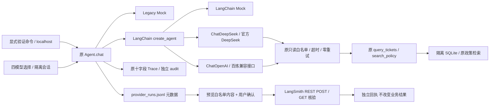

# V3.3 Provider 与 LangSmith 实施架构

日期：2026-10-25。实现基于 V3.3 UI 交付 `be3efcf934b292db5f51cadf3b48a9074a5f3b69`。本轮只离线验证，没有真实模型请求或 LangSmith 上传。

## 当前实现

没有重写工具、Mock 决策或票务业务。模型负责理解、真实 tool_calls 和回答；LangChain 执行循环；Python 工具负责参数、模拟库存和业务约束。`target/live_providers.py` 是简单配置函数，不新增多层继承框架。

## Provider 配置

| 选择 | 模型实现 | 凭据与配置 | 工具 |
|---|---|---|---|
| `mock` + `legacy` | 原 MockProvider | 无模型 Key | 原 8 工具 |
| `mock` + `langchain` | 原 LangChainMockModel | 无模型 Key | 原 8 工具 |
| `deepseek` + `langchain` | 原 ChatDeepSeek | `DEEPSEEK_API_KEY`，原 AGENT_MODEL/BASE_URL 配置 | 默认两工具只读 |
| `bailian` + `langchain` | ChatOpenAI | `DASHSCOPE_API_KEY/BASE_URL/MODEL` | 仅两工具只读 |

百炼不读取 AGENT_API_KEY，不继承 DeepSeek 地址或模型。必须配置地域/工作空间/套餐匹配的官方 HTTPS 兼容地址；拒绝明文、认证信息 URL、查询串、重定向、任意用户 OSS 域名和 coding/token-plan 地址。官方域名白名单未来新增地域时可能需要适配，不能随意放宽到任意地址。

不默认指定模型或地域，避免暗示账户有权限。手册中的北京按量 `qwen-plus` 是官方示例，不保证当前账户可调用。Qwen 请求设置 `enable_thinking=false`；其他模型需独立验证协议，当前不宣称支持全部百炼模型。真实 Tool Calling 必须有模型返回的结构化调用和工具结果回传，普通文本不算。

## 安全、预算与错误

- 新命令和新 UI 使用 `artifacts/runtime/v33-live-providers/deepseek/requests.db`、`bailian/requests.db` 独立账本，各最多 3；`initial-total.db` 是两 Provider 合计最多 3 的初次验证上限。
- 先事务预留再发 HTTP，SDK `max_retries=0`，HTTP 不自动重试/跟随重定向。超时或崩溃不退预算；预算预留量不等于可确认收费量。
- 旧正式 DeepSeek 5/5 和旧手动账本不迁移、不清空。原 DeepSeek 手动运行配置保留；新版选择器另外使用本轮三次初始上限。其他客户端、删除账本或手动换路径不受本程序完整控制。
- 两只读工具以外的 lock_seat/create_order/pay_order/cancel_order/query_order/monitor_seat 在模型工具清单、HTTP 请求检查及实际执行层受原代码限制，不能仅靠 Prompt。
- 400/401/402/403/404/422/429/500/503、连接和超时分类；百炼部分 400 的 Arrearage、Model、InvalidApiKey 代码进一步识别，不记录原响应正文/认证头。
- 未知 Token 沿用现有 Live 策略：保存 null 用量和失败旁证，抛出安全异常，不伪造公共契约里的 0。B 应同时检查错误分类与 sidecar；不把异常轮当成功 JSON。
- `stop` 只是结束；sidecar 的 `business_success=null`，未自动赋值。工具闭环不代表语义正确、政策忠实或最终比赛成绩通过。

## 本地元数据与兼容

`Agent().chat(session_id,message)` 不变；十字段/calls 五字段不变。`traces.jsonl` 与版本化 `audit_runs.jsonl` 保留。新增 `provider_runs.jsonl` 保存 Trace ID、provider、请求/实际返回模型、模式、case ID、Git SHA、请求时间、模型/总耗时、真实或未知用量、实际工具事件、错误与本地保存状态。只有 API 返回的模型名才写 actual_models，不从 Mock 猜测。

失败轮可能没有成功的公共 Trace 行，但 audit 和 provider sidecar 仍保存；`local_trace_saved` 与 `local_sidecar_saved` 分别说明。Trace 页按唯一 ID 关联旁证。当前 Live 对比只展示独立记录，不混入离线统计，也不自动生成两个真实模型的质量排名。

## LangSmith：显式、过滤、独立

接受 LANGCHAIN_API_KEY/TRACING_V2/PROJECT/ENDPOINT，兼容 LANGSMITH_API_KEY/TRACING/PROJECT/ENDPOINT。两套同义变量冲突时拒绝，不默选秘密值。可选工作空间 ID 映射 x-tenant-id。

框架 invoke 始终位于 `tracing_context(enabled=False)`；环境启用标记仅允许本应用的显式导出。图不会自动全量上传。每次导出还需要 UI 预览/勾选/点击，或命令 `--upload-langsmith --confirm-upload`。

上传白名单：本轮用户输入、固定只读系统提示部分、最终回复、只读工具的明确参数/有限结果、模型/用量/耗时/错误和关联 ID。不是完整模型请求、完整历史消息、原始 audit 或订单。嵌套结果也限制字段，删除秘密、认证头、reasoning_content，隐藏手机号/邮箱/身份证格式；任意自由文本姓名等不能保证自动识别，用户必须检查预览，禁止真实个人数据。

直接调用官方 REST 接口：一次 POST `/runs`，成功后一次 GET `/runs/{id}`，核对 ID、inputs、outputs 及摘要。最多 2 次远端 HTTP/导出，和模型生成次数分开计数；没有 `/info`、后台批处理或重试。GET 因索引延迟失败时保持未验证/失败，不伪造成功，不自动重发 POST。

独立 `langsmith_exports.jsonl` 保存本地状态、远端状态、ID、HTTP 次数、错误与是否回读验证。远端失败不改模型回复、本地 JSON 或业务状态。`verification_origin=offline_transport_fixture` 的桩回执不是实际远端成功；真正验证须 `remote_http` 且回读匹配。集成中心显示配置状态及最近单次回执，不把配置存在当实时健康。

## 官方资料与本地版本

2026-10-25 仅只读核对：[百炼地址与套餐](https://help.aliyun.com/en/model-studio/base-url)、[百炼 Function Calling](https://help.aliyun.com/zh/model-studio/qwen-function-calling)、[LangChain ChatOpenAI](https://docs.langchain.com/oss/python/integrations/chat/openai)、[LangSmith REST 追踪](https://docs.langchain.com/langsmith/trace-with-api)。

沿用原锁定依赖：LangChain 1.4.5、langchain-openai 1.7.1、langchain-deepseek 1.1.1、LangGraph 1.2.15、LangSmith 0.14.8、Streamlit 1.65.0；没有升级依赖。REST 模式不依赖 SDK 自动观测设置，也不意味着当前已有远端成功证据。
