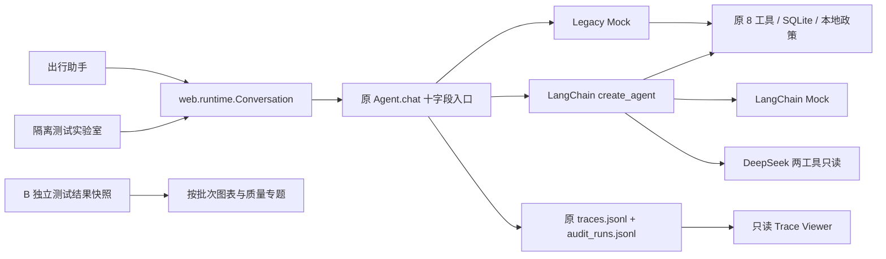

# V3.3 未来框架与模型集成设计

日期：2026-10-25。本文区分已运行路径与预留接口；本轮不调用 DeepSeek、百炼或 LangSmith。

## 当前运行路径

前端不实现第二套票务流程。模型负责理解、工具选择和回复；LangChain 执行模型—工具循环；原 Python 工具负责校验、模拟库存、订单身份和幂等。Trace 来源仍是原执行器的真实事件，而非最终文字推断。

V3.3 通过 `web.runtime.Conversation` 提供共享 UI 调用路径。每个用户/实验会话使用独立 Agent、SQLite 与 Trace 目录。Legacy 模块配置需要临时切换，因此所有新版 UI 渲染及调用使用同一可重入锁，调用后恢复配置。普通用户显式使用独立 MockProvider，不继承全局变异。该锁用于本地 UI 配置一致性，**不是**后端订单幂等锁，也不代表多用户吞吐能力已验证。

## LangGraph

【已实现并验证】本地安装 LangChain 1.4.5、LangGraph 1.2.15。`target/langchain_agent.py` 已调用 `create_agent()`，配置 `InMemorySaver` 和 `thread_id`；框架图执行基础与进程内多轮状态已存在。

【尚未实现】应用自定义 StateGraph 节点/条件边、持久化 checkpointer、跨进程长期记忆、interrupt 人工确认、故障恢复图与完整节点遥测。普通用户 UI 的模拟操作确认属于 UI 附加确认，并非 LangGraph interrupt。

`web.integrations.observation_envelope(audit)` 只包装已有执行旁证，`graph=None`、`remote_run_id=None`、`external_export_enabled=False`。没有真实状态图时前端显示“尚未启用”，不推断 DAG。未来应增加独立 sidecar 图事件 schema，保留节点 ID、真实起止时间、边条件及 resume 标识；不能改动公共十字段契约。

## LangSmith

【部分实现】SDK 已随原依赖安装；集成中心可检查环境配置是否存在。`sanitize()` 已用于本地显示与导出，删除认证信息与 reasoning_content，并隐藏个人字段。

【尚未实现】远端 run 上报、项目连通性、run ID 关联与远端评测。网页主动关闭 `LANGSMITH_TRACING` 和 `LANGCHAIN_TRACING_V2`，运行服务继续禁止外传；没有上传开关或假健康检查。

未来仅在明确配置/许可后，使用字段白名单、脱敏、大小上限、失败不阻断本地保存和独立上传预算。原本地审计应先落盘，再选择性导出；不得上传原始内部推理。远端失败不能把本地完整结果变成未知，也不能反过来以远端摘要替代本地原始证据。

## 阿里云百炼

【仅接口准备】`FutureModelConfig` 声明环境变量名：`DASHSCOPE_API_KEY`、`BAILIAN_BASE_URL`、`BAILIAN_REGION`、`BAILIAN_WORKSPACE_ID`、`BAILIAN_MODEL`、`BAILIAN_MAX_REQUESTS`。不保存 Key 值，不提供网络客户端、不注册 Agent Provider、不允许在实验室选择为已支持模型。

官方文档说明 OpenAI 兼容服务地址与地域/工作空间相关；本轮不写死地址或模型名，也不假定所有模型支持同一工具协议。真正接入时应核对目标地域、工作空间、模型 Tool Calling、Token 返回、思考内容协议和错误类型，再使用原工具适配及只读白名单。需要独立预算；不可复用/重置原 DeepSeek 正式账本。

## 扩展边界

| 接口 | 当前用途 | 后续要求 |
|---|---|---|
| `ProviderCapability` | 只声明实现、配置、验证、工具与限制 | 健康状态须来自真实验证，配置存在仅表示已配置 |
| `FutureModelConfig` | 百炼字段名称，不含秘密值 | 明确地域与账本、单轮/工具限制、零自动重试 |
| `observation_envelope()` | 已有审计转只读观测视图 | 真实图事件另加 sidecar，不修改公共 Trace |
| `web.evidence` | 不同来源/粒度转换与独立分母 | 不把测试、变异、后端检查或历史 Live 相加 |

未知 Token 不填零；SDK 桩 Token 不按真实费用统计；没有价格/账单依据的历史费用保持未知。`finish_reason=stop` 仅说明循环结束。

## 参考资料

2026-10-25 查阅官方公开文档（不发送模型生成请求）：[LangChain Agents](https://docs.langchain.com/oss/python/langchain/agents)、[LangGraph Persistence](https://docs.langchain.com/oss/python/langgraph/persistence)、[LangSmith Tracing](https://docs.langchain.com/langsmith/observability-quickstart)、[百炼 OpenAI 兼容接口](https://help.aliyun.com/zh/model-studio/compatibility-of-openai-with-dashscope)。本地实际 API 以锁定依赖和已运行源码为准。
