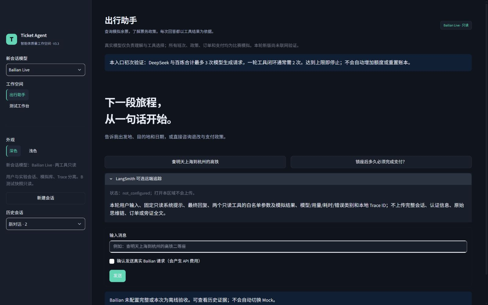
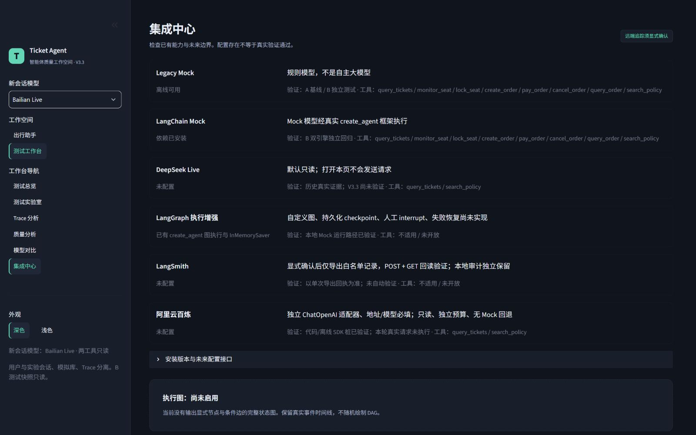

# V3.3 多模型实施：可核对证据

日期：2026-10-25；成员 A 自测。最终源码 `a405fb6e7195333bb6f5340af68a4077b0292f3f`。文档/证据提交不改变已测试的代码，最终交付版本执行 `git rev-parse HEAD`。

- `report.json`：冻结源码后的完整离线报告；`offline/` 为原始脱敏日志。完整环境 256 通过、V3 跳过59、V2跳过138，均0失败；同套测试不能相加。
- `audit-matrix/`：原八变异 25 条运行旁证与 8 个标注样本，全部离线；不能冒充 Live。
- `compatibility.json`：原公共契约/业务/工具/变异/依赖未变；旧 831 文件快照中3个预期源码变化、其余828不变；正式账本5/5及哈希保留。
- `security_review.json`：新/变更文本秘密扫描、环境 Key 存在性布尔和新预算状态。本轮 DeepSeek0、百炼0、LangSmith0；新增费用0以无请求为依据，未产生真实Token，不估算历史费用。
- `development-attempts/`：早期模块测试，以及首次检查与编辑重叠导致的保护失败报告。该失败没有删除或改成通过，最终使用新的冻结目录复验。
- `visual_review.json` 与 `screenshots/`：实际 localhost 原生 JPEG。4种模型可选择，百炼缺Key禁止发送，远端追踪说明可展开；集成中心如实显示实现/未配置/未验证。截图服务移除了Key并阻断外网，标签不代表真实API成功。

尚未完成：当前两个真实模型的在线调用、账户余额/权限、实际 Tool Calling、政策忠实度、LangSmith真实回读、B正式质量比较。已有历史DeepSeek证据单列，不借用为当前结论。

安全扫描和图片人工查看有范围，不能证明所有格式的秘密/个人信息都能自动识别。真实上传前必须检查过滤预览，禁止使用真实个人数据。
