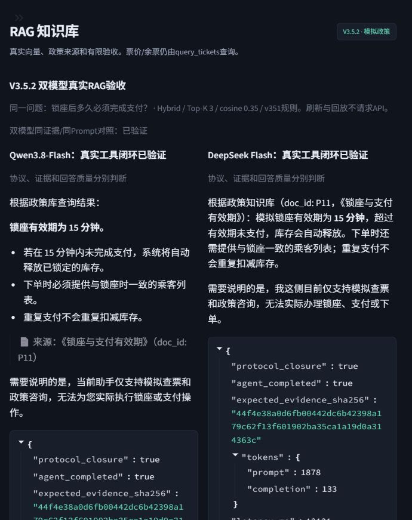
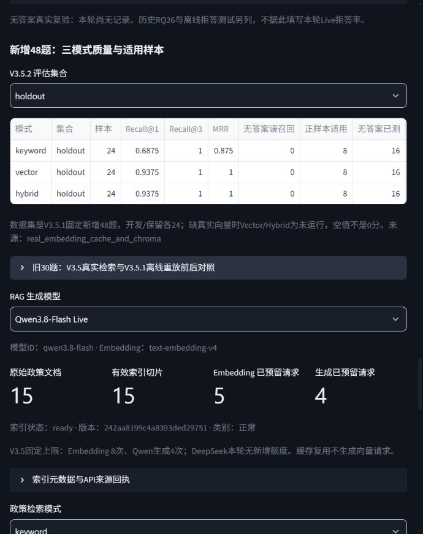

# V3.5.2 授权后的实际页面核验

2026-10-26，localhost只读回放，模型/Embedding/LangSmith请求均0；真实模型执行发生在此前已获授权的独立CLI中。

- 已核对“Qwen3.8-Flash：真实工具闭环已验证”“DeepSeek Flash：真实工具闭环已验证”，以及同证据/同Prompt已验证标签。
- 两模型原回复分别保留，P11/15分钟、真实Token/延迟可查看；协议与回答质量分判，faithfulness仍indeterminate，不改成通过。
- 新48题保留集：Keyword R@1=.6875/R@3=1/MRR=.875；Vector/Hybrid各.9375/1/1；每模式24题、8有答案、16无答案、0误召回。旧30题为独立历史分区。
- 页面使用断网保护、禁用本地密钥发现、显式清空Key的Python进程。仅绑定127.0.0.1:8552，未点击发送、付费或索引重建；原索引使用副本读取。
- 首次启动未显式绑定地址时，Streamlit默认外网IP探测被守卫阻断3次（8.8.8.8一次、checkip.amazonaws.com两次）。原阻断日志保留；停止该自建服务后改为显式127.0.0.1，未增加探测记录。这不是模型/Embedding请求或SDK重试，不隐瞒为“完全无外网尝试”。完整离线回归的外网尝试仍为0，详见独立回归报告。
- 侧栏在690×900视口会遮挡一列，实际折叠后截图；C正式宽屏/视频人工验收待完成。旧rag-acceptance.png为授权前画面，未覆盖。

下方V3.5预算/历史生成区域仍属于旧版本，不与V3.5.2新预算加算；最新新账见API预算报告与live/authorized-evidence-review.json。未新增无答案Live，不展示新的真实拒答率。
