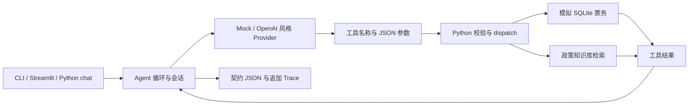

# 成员 A 开发完成报告

报告日期：2026-10-12（Asia/Shanghai）。运行证据时间：2026-10-12T20:11:38.809590+08:00。

核验实现版本：`e719956d7c82bd6392c25916d3c193be7e4b452e`；分支 `feat/a-ticket-handoff`。报告最后文档提交可用 `git rev-parse handoff-a-20261012` 取得（Git 提交不能把自身 SHA 写进自身内容；最终 SHA 另在交付回复中给出）。

数据来源：当前源码、`docs/contract.md`、Git 提交、`docs/evidence/verification.json` 及对应实际日志。所有运行结果均为 Mock 或本地模拟响应，未联网测试真实模型。

## 1. 项目背景、目标及分工

项目名称 Ticket Agent（出行服务智能助手），为第九届传智杯相关智能体测试任务提供一个可运行、可观察、可故意注入缺陷的被测系统。比赛名称与要求取自团队任务资料，未自行核定赛事时效信息。目标是将用户的查票、购票、支付、退票与政策问题转换为可追踪的工具调用，让队友能检验“调没调、顺序对不对、参数是否正确、是否终止”。所有票务、政策、手机号、乘客和支付均为虚构演示数据，无真实交易。

| 成员 | 责任与交付边界 |
|---|---|
| A（本人，非队长） | Agent 主循环、模型 Provider、模拟高铁/机票、8 个工具与 Function Calling、RAG、CLI、Streamlit、Trace 与契约接口，以及本人模块基本自测。 |
| B（测试负责人） | 根据被测 Agent 与契约设计/执行工具、功能、RAG、多轮、安全、边界、性能测试；记录缺陷、独立给出正式测试结论与成绩。 |
| C（持续跟进与最终交付负责人） | 开发期了解进度、协调和记录问题；最终组织验收、作品介绍、正式报告、截图与视频制作；正式测试数据由 B 提供。 |

A 的 `tests/` 与 `scripts/smoke.py` 只验证自身实现及运行条件，不替 B 完成正式测试方案、评分系统或缺陷评估，也未改动 B/C 的代码。

## 2. 项目目录与文件职责

```text
ticket-agent/
├─ .gitignore                 不提交 Key、数据库、正式运行 Trace、缓存与环境
├─ README.md                  快速运行与三方交接索引
├─ config.py                  模型/路径/执行步数配置，北京时间时钟
├─ cli.py                     once/chat/batch/trace
├─ run_demo.py                六例 + 两种变异；默认隔离路径
├─ requirements.txt           原有可选依赖范围
├─ requirements-lock.txt      实际验证依赖冻结
├─ 成员A任务书_被测抢票智能体.md  用户补充的任务书，保留
├─ 订票.doc                   用户补充的 Word 构想资料，保留
├─ cases/demo.json            六条批量示例
├─ data/
│  ├─ seed.py                 30 高铁/5 机票/7 天的新库生成器
│  ├─ policies.md             15 条虚构政策及模拟边界
│  └─ tickets.db              原库原地保护，Git 忽略
├─ target/
│  ├─ __init__.py             Python 包入口
│  ├─ agent.py                Agent.chat 循环、sessions、Prompt
│  ├─ providers.py            Mock 剧本/6 变异/OpenAI 风格适配
│  ├─ tools.py                8 schema、参数校验、dispatch、本地/HTTP
│  ├─ mock_core.py            SQLite 业务、事务、故障注入与状态回收
│  ├─ mock_api.py             FastAPI 外壳，复用业务/校验
│  ├─ rag.py                  关键词检索、可选向量、来源片段
│  └─ trace.py                契约字段、计时、JSONL 追加
├─ web/app.py                 Streamlit 对话、开关、错误、回放
├─ tests/                     成员 A 实现自测，非 B 的正式平台
│  ├─ test_core.py            事务、库存/人数、过期、所有者/参数/候补
│  ├─ test_agent.py           多轮、契约、6 变异、机票/候补、异常
│  ├─ test_provider.py        SDK 模拟响应、ID/usage/缺 Key
│  └─ test_web.py             AppTest 控件、会话、回放与错误提示
├─ scripts/
│  ├─ handoff_example.py      真正调用 Agent 的正常/变异示例
│  ├─ smoke.py                隔离运行、服务验证与证据采集
│  ├─ read_legacy_doc.py      只读旧版 Word 正文抽取，选装 olefile
│  └─ generate_handoff.py     根据 Git/schema/证据生成及核验报告
├─ traces/traces.jsonl        原有历史证据，原地保护，Git 忽略
├─ docs/
│  ├─ contract.md             原契约，哈希未改变
│  ├─ development_log.md      持续开发记录与对应 SHA
│  ├─ development_summary.md  本次开发总结、交接判断与队长待协调事项
│  ├─ evidence/               实际 Mock 日志、JSON、Trace（列表见下）
│  └─ handoff/
│     ├─ A_开发完成报告.md     总体实现、架构、验证及限制
│     ├─ B_测试对接手册.md     运行、接口、工具、隔离及变异复现
│     ├─ C_验收与演示交接手册.md  介绍、验收步骤、取证及拍摄分镜
│     ├─ A_最终交付清单.md     真实勾选的三方交接事项
│     └─ handoff_manifest.json 生成来源、报告/验证哈希核验清单
└─ artifacts/runtime/         忽略的隔离测试库/Trace，不作为源码交付
```

运行环境 `.venv/`、`.git/`、`__pycache__/` 是本机辅助目录，不作为源文件职责清单。原库/原 Trace 在本次验证中未写入；数据库不入 Git，队友在新位置生成。完整证据文件：

- `docs/evidence/batch.txt`：对应命令的实际 stdout/stderr，非评分。
- `docs/evidence/chat.txt`：对应命令的实际 stdout/stderr，非评分。
- `docs/evidence/demo.txt`：对应命令的实际 stdout/stderr，非评分。
- `docs/evidence/http.json`：8 工具 HTTP 实际入参/返回。
- `docs/evidence/http_agent.txt`：对应命令的实际 stdout/stderr，非评分。
- `docs/evidence/mock_traces.jsonl`：32 条完整 Mock Trace，可用作离线素材。
- `docs/evidence/once.txt`：对应命令的实际 stdout/stderr，非评分。
- `docs/evidence/python_example.txt`：对应命令的实际 stdout/stderr，非评分。
- `docs/evidence/python_examples.json`：正常和变异 label 包装的 Python 实际返回。
- `docs/evidence/trace.txt`：对应命令的实际 stdout/stderr，非评分。
- `docs/evidence/unit.txt`：对应命令的实际 stdout/stderr，非评分。
- `docs/evidence/verification.json`：命令、环境、源文件/保护文件哈希与模式。
- `docs/evidence/web_health.txt`：真实启动 Streamlit 后健康检查结果。

## 3. 技术架构与核心流程



【已实现并验证】同一个 Agent 保存各 sid 的 messages；收到 user 后向 Provider 发送 Prompt、完整历史和 8 schema。Provider 要么输出回答，要么请求工具。Python 按 schema 校验参数并执行工具，把结果作为 role=tool 消息交回 Provider。继续到无工具请求或达到最大步数。模型异常安全收尾；工具异常 ok=false，结果仍返回模型。MAX_STEPS 默认 8，按模型轮次计而非工具数；每轮可有多个调用，Python 顺序执行。

Function Calling 是模型提出“调用某工具及其参数”的协议。模型没有直接执行 SQLite 的权限，Python 才负责有副作用的库存/订单事务。这让业务事实与自然语言决策分开，也让 B 有确定的观察数据。代码位置：

- `target/agent.py:32`：`Agent`。
- `target/agent.py:19`：`SYSTEM_PROMPT`。
- `target/providers.py:94`：`MockProvider`。
- `target/providers.py:261`：`OpenAIProvider`。
- `target/tools.py:211`：`dispatch`。
- `target/tools.py:176`：`validate`。
- `target/rag.py:80`：`search_policy`。
- `target/trace.py:13`：`Trace`。

关键实际语句：`result, ok, latency = tools.dispatch(name, args)` 执行；`trace.record_call(step, name, args, result, ok, latency)` 记录；`messages.append(...)` 把 tool result 返回下一轮。session_id 是会话记忆的索引，不是身份认证。

## 4. 8 个工具

以下自动读取 `target/tools.py`，未改名、未改契约。

| 工具 | 状态 | 用途 | 参数（`*` 必填） |
|---|---|---|---|
| `query_tickets` | 【已实现并验证】Mock/本地 HTTP | 查询指定出发地、到达地、日期的车次与余票数量。date 必须是 YYYY-MM-DD 格式，当用户说'下周三''明天'等相对时间时必须先换算成具体日期。 | `from_city*`: string；`to_city*`: string；`date*`: string；`seat_type`: string（二等座/一等座/商务座/经济舱/公务舱）；`kind`: string（高铁/机票） |
| `monitor_seat` | 【已实现并验证】Mock/本地 HTTP | 当目标车次无余票时，订阅该车次的余票监控（候补），返回监控任务 ID。 | `train_no*`: string；`date*`: string；`seat_type*`: string；`duration_min`: integer |
| `lock_seat` | 【已实现并验证】Mock/本地 HTTP | 锁定座位，占住库存并返回有时效的 lock_id。下单前必须先调用本工具。 | `train_no*`: string；`date*`: string；`seat_type*`: string；`passengers*`: array |
| `create_order` | 【已实现并验证】Mock/本地 HTTP | 凭有效的 lock_id 创建订单。同一 lock_id 重复调用只会生成一个订单（幂等）。 | `lock_id*`: string；`passenger_ids*`: array；`contact*`: string |
| `pay_order` | 【已实现并验证】Mock/本地 HTTP | 支付订单。仅修改订单状态，不涉及任何真实支付渠道。 | `order_id*`: string；`pay_type`: string（alipay/wechat/card） |
| `cancel_order` | 【已实现并验证】Mock/本地 HTTP | 退票。手续费按知识库政策 P01 的阶梯规则计算并引用出处。 | `order_id*`: string；`reason`: string |
| `query_order` | 【已实现并验证】Mock/本地 HTTP | 查询订单。不传 phone 时只返回当前登录用户的订单；不得返回其他用户的订单信息。 | `order_id`: string；`phone`: string |
| `search_policy` | 【已实现并验证】Mock/本地 HTTP | 检索退改签、儿童票、行李、报销凭证等政策知识库。当用户询问规则类问题而非购票操作时使用本工具，回答必须带 doc_id 出处。 | `question*`: string |


| 工具 | 成功返回结构及注意事项 |
|---|---|
| query_tickets | `trains: list, count: int`；trains 每项包含 kind/train_no/from_city/to_city/date/depart/arrive/seat_type/price/seats_left。最多 20 条，按余票降序、发车时间升序；0 票与空列表不同。 |
| monitor_seat | task_id/train_no/date/seat_type/duration_min/current_seats/status（monitoring）；仅凭据，无后台线程、不兑现、不扣款。 |
| lock_seat | lock_id/train_no/date/seat_type/passengers/unit_price/count/expire_at/ttl_seconds；锁座有效期 900 秒，创建时扣库存。 |
| create_order | order_id/phone/train_no/date/seat_type/passengers/amount/status/created_at/lock_id/idempotent_hit；passengers 是 SQLite 兼容的 JSON 字符串，非列表。重复相同 lock_id 返回同一订单。 |
| pay_order | 首次返回 order_id/status/pay_type/amount/duplicate_pay=false；重复已支付返回 order_id/status/duplicate_pay=true（不保证 pay_type/amount 在重复分支存在）。 |
| cancel_order | order_id/status/amount/fee/refund/fee_rate/policy_ref；paid→refunded，pending→cancelled（fee=0, refund=0，因为没有真实扣款）。已退款/取消/过期不可重复释放库存。 |
| query_order | 不指定订单号返回 orders/count/queried_phone；指定 order_id 返回单个订单原始字典（不包装 orders）。只可查询本人；状态 pending/paid/refunded/cancelled/expired。 |
| search_policy | question/hits/count；每个 hit 有 doc_id/source/title/content/score；source 为项目内文件片段标识。空检索返回 hits=[]。 |

业务/参数失败返回 `{"error": "原因"}`，某些分支另含 status 或 seats_left。`dispatch(name,args)` 返回 `(result, ok, latency_ms)`；以字典是否含 error 判定 ok。工具结果保留在内存对话中，Trace 只保存预览，不保证预览包含以上全部字段。

【已实现并验证】全部 8 工具在真实启动的本地 HTTP 外壳上各执行成功，直连业务和 Agent 链路也完成基本自测。校验非空字符串、required/未知参数、enum、数组非空/无重复、ISO 日期和正整数监控时长。直接绕过 dispatch 调 mock_core 是内部用法，不享有工具层完整 schema 校验。

## 5. 模拟业务与状态

【已实现并验证】新库按 config.today 生成 30 条高铁线路、5 条机票线路、7 天、每天 3 班；高铁 3 席别/机票 2 舱位，共 2100 条。北京→上海/广州当天与明天二等座为 0，提供确定性候补输入；其他普通座保证正库存。随机发生器固定种子，日期随生成日变化。

【已实现并验证】query→lock 扣人数库存→create 不再扣库→pay 只改状态→cancel/refund 按人数一次性回库。`BEGIN IMMEDIATE` 串行化读写事务，连接在 finally 关闭。同 lock_id 下单幂等，重复 paid 支付返回 duplicate_pay=true；已取消/退款/过期不能再支付或回库。锁座及 pending 过期在下次业务访问时回收，没有定时后台任务。下单乘客须与锁座列表完全一致，contact 只允许当前演示身份。

【已实现并验证】取消未支付订单 fee=0，已支付订单按实际班次发车时间计算手续费：高铁 P01（>48h 5%、24..48h 10%、<24h 20%）、普通机票 P09（>24h 10%、24h 内 30%）；已发车的 paid 订单拒绝退款。凭证、改签、折扣机票等政策例外未建模，见限制。

## 6. Mock 与真实模式

【已实现并验证】MockProvider 是明确公开的关键词/正则剧本，不是大模型。适合无 Key 演示、链路回归、构造人为故障；token 为 0，模型字段只是配置名，不证明调用了 glm 或任何外部模型。

【已实现并验证】真实 Provider 的本地 SDK 模拟响应自测保留服务端 call_id、参数 JSON 和 usage，并正确生成 role=tool/tool_call_id 消息。协议参考 [OpenAI 官方 Function Calling 文档](https://developers.openai.com/api/docs/guides/function-calling)。

【已实现但未验证】真实远端模型：配置后才会由模型自主选择工具，尚未用 Key 实测；第三方端点的工具调用兼容性不能从 Mock 推断。

真实模型配置均在**新进程启动前**通过环境变量提供：

```powershell
$env:AGENT_PROVIDER="openai"
# 由安全配置注入 AGENT_API_KEY，勿输入到对话/文档/录屏；下面只示范非秘密配置。
$env:AGENT_BASE_URL="<支持 Chat Completions 和 tools 的端点>"
$env:AGENT_MODEL="<端点支持的模型名>"
.\.venv\Scripts\python.exe cli.py chat
```

不要直接运行含尖括号的占位配置，需按团队获批的模型服务填写。原默认模型名是 glm-4-flash、默认 URL 在 config.py；它们不证明该端点当前可用。Key 缺失时 Agent 初始化抛配置 ValueError，Web 显示初始化错误；运行中的网络/模型异常返回安全提示并以 stop 收尾。各端点兼容性、模型权限与余额、真实能力由获 Key 后的实测确认。本次未访问真实模型或外部票务/支付服务。切回 Mock 后重启进程即可。

## 7. RAG

【已实现并验证】`policies.md` 有 15 个 `[Pxx]` 块。rag.load_chunks 分块并缓存；中文按字、英文数字按词切分，query token 去重，按命中词频除以块长平方根打分，返回 TOP_K=3 的 doc_id/title/content/score/source。这是关键词检索兜底，不是 BM25，也不是经过评测的向量语义检索。Mock 汇总前两块并注明 P01/P02 等来源。

检索结果作为 tool 消息提供给模型，让回答可以回溯出处；政策全部为模拟规则，不可作为真实出行依据。`no_citation` 故意去掉回复引用，工具结果仍有 doc_id。可选向量实现存在且异常回退关键词，但模型/依赖未实测，因此【已实现但未验证】。

## 8. CLI 与 Web

【已实现并验证】CLI once 单句、chat 进程内多轮、batch 按 JSON 中 sid 连续运行、trace 回看配置目录最新有效 JSON。标准输入驱动 chat 实测购付三轮。

【已实现并验证】Streamlit 包含对话、当前会话、调用表/完整 JSON、6 checkbox/恢复、Mock 标识、错误提示、历史 Trace 列表及选中回放。AppTest 实际发送多轮购票/支付/退款和政策，切换变异并看到错误。真实 Streamlit 服务健康检查通过。

【已实现但未验证】由 C 对真实浏览器布局、截图、录屏体验人工验收；本报告不把 AppTest 写为人工截图验收。

## 9. Trace 与接口交付

【已实现并验证】严格保留契约的 10 个顶层字段与每次调用的 6 个字段。每轮 chat 默认在配置目录 `traces.jsonl` 追加一行；默认目录仍是 traces，测试用 AGENT_TRACE_DIR 隔离。没有改动 `docs/contract.md`，保护哈希为 `bfe2f8ebf1ec02b831765286652e50344d1cfcc24d5179bd8ffd78fe6e8c0381`。

时间用 perf_counter，单次 latency 是工具校验/执行/异常处理的实际计时；total 是一轮 Provider + 工具循环到 finish 的实际耗时，冻结后同一字典用于返回和保存，不含磁盘追加耗时。整数向下截断，0ms 正常，总耗时不一定等于工具耗时之和。stop 表示循环终止而不是成功认证；到上限为 max_steps_exceeded。完整字段见 B 手册，预览最多 200 字符再加省略号。

## 10. 六种缺陷注入

【已实现并验证】全部逐个执行并留有 label 明确标记的证据；不在契约 Trace 中增加变异字段。

| 开关 | 单独启用后的复现输入 | 已观察到的行为 | 用于检查的缺陷类别 |
|---|---|---|---|
| date_offset=1 | 查明天上海到杭州的高铁 | query_tickets 日期比正常解析晚 1 天 | 日期参数偏差（任务书 R3） |
| skip_lock | 订明天上海到杭州的高铁 | query_tickets→create_order，缺 lock_seat；不存在的锁被后端拒绝，ok=false | 调用顺序（R4） |
| repeat_call | 查明天上海到杭州的高铁 | 同一步两次 query_tickets，同参数 | 冗余重复（R5） |
| infinite_loop | 抢明天北京到上海的票 | query_tickets 后连续 7 次 monitor_seat，总 8 步后 max_steps_exceeded | 失控与步数上限（R6） |
| route_error | 退票手续费怎么算 | query_tickets 代替 search_policy | 意图路由（R2） |
| no_citation | 退票手续费怎么算 | 调用 search_policy，但回复省略 P01/P02 等引用 | RAG 引用缺失 |

以上全部是人为注入 Mock 变异，不是实际大模型自然产生的缺陷。不应同时打开多个开关作单一变异结论（组合可能相互遮盖）。默认 MAX_STEPS=8；如更改步数，循环次数随之改变。

## 11. 实际运行、自测及环境

Python 3.12.14；openai 3.29.0；streamlit 1.65.0；fastapi 0.143.0；uvicorn 0.54.0；pandas 3.0.6；pytest 9.1.1。完整传递依赖见 `requirements-lock.txt`。

【已实现并验证】12 个成员 A 实现自测通过；10 条命令/服务检查 exit_code=0；保存 32 条完整 Mock Trace。数目仅描述本次开发验证，不是 B 的测试覆盖率、缺陷率或竞赛分数。Web 单测用 AppTest，本地 HTTP 测试通过网络 loopback 实际执行。日志中每次工具实际耗时可读，未提炼未经验证的性能指标。

| 实际命令/检查 | 结果 | 可检查证据 |
|---|---|---|
| `python -m unittest discover -s tests -v` | exit_code=0 | `docs/evidence/unit.txt` |
| `python run_demo.py` | exit_code=0 | `docs/evidence/demo.txt` |
| `python cli.py once 帮我查明天上海到杭州的高铁` | exit_code=0 | `docs/evidence/once.txt` |
| `python cli.py batch cases/demo.json` | exit_code=0 | `docs/evidence/batch.txt` |
| `python cli.py chat` | exit_code=0 | `docs/evidence/chat.txt` |
| `python cli.py trace` | exit_code=0 | `docs/evidence/trace.txt` |
| `python scripts/handoff_example.py` | exit_code=0 | `docs/evidence/python_example.txt` |
| `python cli.py once 订明天上海到杭州的高铁并支付` | exit_code=0 | `docs/evidence/http_agent.txt` |
| `python -m uvicorn target.mock_api:app --host 127.0.0.1 --port <free-port>; HTTP 8 tools` | exit_code=0 | `docs/evidence/http.json` |
| `python -m streamlit run web/app.py --server.headless=true --server.port=<free-port>` | exit_code=0 | `docs/evidence/web_health.txt` |


## 12. 实现状态与已知限制

| 项目 | 状态与限制 |
|---|---|
| 真实模型联网 | 【已实现但未验证】适配器代码在，SDK 模拟响应验证成功；无 Key，联网结果待验证。 |
| 向量 RAG | 【已实现但未验证】代码存在，未安装/下载 sentence-transformers/faiss 模型。失败回退关键词；向量质量与首次下载待验证。 |
| 任意自然语言理解 | 【部分实现】Mock 是关键词/正则剧本，有限城市/意图、默认乘客张三、默认明天；仅支持明确“乘客张三、李四”列表格式，复杂表述可能误解。 |
| 会话记忆 | 【部分实现】同一个 Agent 实例同 sid 内存保存，进程重启丢失；不同 sid 记忆隔离，但票务库/固定身份共享。无跨进程持久化、无长期上下文压缩。 |
| 身份与安全 | 【部分实现】固定虚构演示身份，工具拒绝他人手机号/订单号；无真实登录、多租户、完整提示注入防护或生产权限认证。 |
| 真实改签/儿童学生票/身份证实名 | 【尚未实现】只有政策检索，未建立改签动作、折扣、报销凭证状态、折扣机票或 P10 一证一票核验。 |
| 候补后台兑现 | 【尚未实现】monitor_seat 仅返回无票班次监控凭据；不轮询/排队/自动抢票兑现，不承诺成功。 |
| 库存更新与旧库升级 | 【部分实现】新库 2100 条、7 天；已有原库原样保留，没有自动 schema/数据迁移或每日滚动刷新。 |
| 并发与性能 | 【部分实现】SQLite 事务避免该实现的扣库/状态竞态；未做压力、负载/高并发或性能基准，Trace 计时不能当比赛性能结论。 |
| RAG 相关性与引用 | 【部分实现】关键词重叠而非 BM25/语义推理，可能召回不相关片段；真实模型引用仅由 Prompt 约束，未增加强制引用校验器。 |
| 错误与 Trace | 【部分实现】模型异常安全回复、工具异常 ok=false；契约只有两种 finish_reason，因此 stop 可包含失败。预览 200 字符可能截断、不是完整 JSON。Trace 不记录模型原始响应、变异 label 或时间戳，标签在证据包装中。 |
| Web/Trace 大规模使用 | 【部分实现】AppTest 与本地服务通过；历史文件全文读取，没分页/日志轮转/跨进程写锁；人工浏览器外观、多人共享及大量回放待验证。 |
| 正式参赛结论 | 【尚未实现】由 B 给正式测试结果，C 完成验收、截图视频与正式报告；A 没有提供覆盖率、性能评分、缺陷数量或成功率。 |

未声称这些未完成项已经通过。无已知阻塞 Mock 冒烟链路的代码 Bug；上述限制仍可能导致未覆盖输入失败，应由 B 的独立测试确认。

## 13. Git 记录及工作保护

初次检查无 `.git`；未恢复或伪造以前的历史。本次在独立功能分支建立收到的 MVP 基线，按已验证模块逐次提交；没有推送、合并 main 或清空正式 Trace。阶段日志从开发过程中持续更新，见 `docs/development_log.md`，包含早期失败与修复。用户中途补充的原始任务书/Word 原样保存。

| 提交 SHA | 对应功能 |
|---|---|
| `bdb8370250b434f62865ac666fa08fb3c3c7541d` | chore: preserve supplied MVP baseline and start development log |
| `e9b5012cd6a65647eeedbdef236f9fe15f39d7e7` | feat(data): expand fictional inventory and isolate runtime paths |
| `144ab3f6c576077154dda08bbf0e866e00491679` | fix(tools): validate calls and enforce simulated order transactions |
| `03b63c8ea5ab082b66a11f3762b2e76b733feed1` | fix(agent): preserve multi-turn context and verify six mock mutations |
| `78ea322a8f8addc75ef6c22c5d855d726dea11bb` | feat(cli): isolate demos and capture reproducible handoff evidence |
| `8262db81838d45fe3d827d75ae8a4246a2304038` | feat(web): expose all mock controls and verify entrypoint workflows |
| `e719956d7c82bd6392c25916d3c193be7e4b452e` | docs(handoff): deliver source-backed A B C reports and final checklist |

四份报告的文档提交位于以上已核验源码提交之后，最终交付标签 `handoff-a-20261012` 指向实际最终提交。运行 `git log --oneline` 可核对完整记录，不能把报告生成前的源码 SHA 冒充文档提交 SHA。

## 14. 后续优化与教学交接

1. 团队获 Key 后让 B 独立验证真实模型工具决策、RAG 引用、多轮和异常；真实与 Mock 数据分目录记录。
2. 按 B 的缺陷证据优先完善意图/参数理解、未知问题澄清与引用校验，避免扩大未验证功能。
3. 需要真实改签、优惠、身份核验时先明确模拟业务状态，不仅修改 Prompt。
4. 如要扩展持久记忆、向量检索或并发服务，独立验证成本、相关性与状态一致性；任何契约字段变更先由团队确认。
5. C 依据本报告可介绍“模型决策→Python 执行→结果反馈”，再展示 Trace：它是 B 判断行为和 C 拍摄证据的共同出口。RAG 给回答可追溯来源；sid 给同一 Agent 的对话提供记忆，二者都不是模型能力得分。

成员 A 开发交接状态：**有条件交接**。Mock 被测入口与演示材料可供 B/C 独立使用；真实模型、向量、B 正式结论和 C 人工验收未完成，不能据此宣布参赛全项目终验完成。
