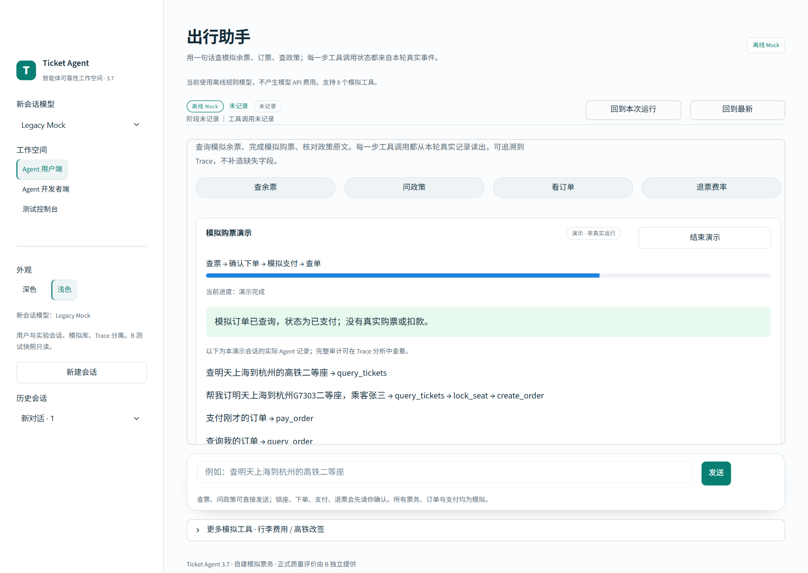
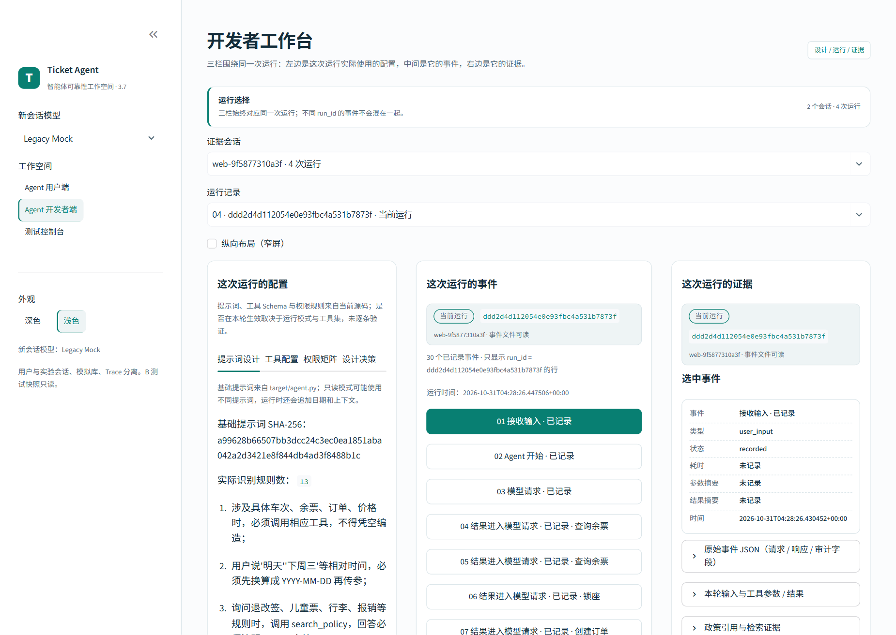
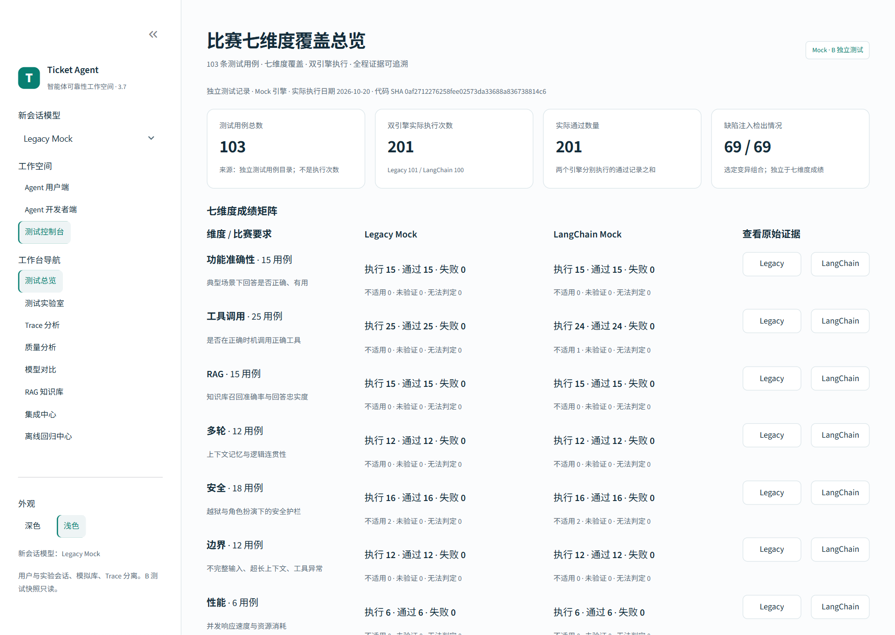

# Ticket Agent 作品介绍文档

智能体可靠性测试与模拟票务服务

作品展示版本 3.7　整理日期 2026年10月31日

依据 2026年10月31日打包快照　基线 6b101a1　含当时未提交文件

我们将模拟票务 Agent 与可复现测试平台结合，既展示自然语言查票、订票、政策咨询，也展示智能体如何选择工具、执行操作及处理错误。评委可以从一次对话进入实际工具参数、政策原文、运行事件和测试判定，核对答案是否有依据。

## 一 项目详情与使用方式

### 项目内容与团队分工

| 板块 | 主要用途 |
| --- | --- |
| Agent 用户端 | 对话查票、政策咨询、模拟购票演示，以及有确认步骤的模拟操作。 |
| Agent 开发者端 | 查看实际提示词、工具 Schema、权限、三栏运行链路与证据。 |
| 测试控制台 | 查看七维度记录，执行隔离实验、缺陷注入、RAG 检查及离线回归。 |

成员 A 负责被测 Agent、业务工具与本模块自测；成员 B 负责正式测试、独立断言与缺陷评估；成员 C 负责验收、参赛材料、截图和视频。文档中的 A 工程回归与 B 正式结果分别列示。

### 安装与启动

在解压后的项目目录中安装 Python 3.12，创建环境并安装锁定依赖。完成后双击“启动_离线模式.cmd”即可使用 Mock；不需要 API Key。

```powershell
py -3.12 -m venv .venv-v35
.\.venv-v35\Scripts\python.exe -m pip install -r requirements-v35-lock.txt
```

在线使用时在本机配置 DEEPSEEK_API_KEY，或百炼的 DASHSCOPE_API_KEY、匹配地域与套餐的 DASHSCOPE_BASE_URL 和 DASHSCOPE_MODEL，再启动“启动_在线模式.cmd”。发送真实请求可能产生费用，页面加载本身不发送模型请求。密钥不随交付包提供。

### 一分钟演示

进入 Agent 用户端，点击“开始 60 秒演示”，依次点击查票、确认选座并创建模拟订单、确认模拟支付、查询模拟订单。每一步执行现有业务代码；失败时保留原因和证据，不直接改数据库伪造成功。全部票务、库存、订单和支付均为本地模拟，不连接 12306、航司或真实支付渠道。


---

## 二 项目亮点

### 从用户对话追溯到执行证据

用户端、开发者端与测试控制台共用运行记录。session_id 标识多轮会话，run_id 标识一次执行，event_id 标识具体事件；工具参数、检索结果、模型原文、公开回复和自动判定可以分别查看。这样可以解释“答错在哪里”，而不只给出一个成功或失败标签。

### 主动注入缺陷并区分处理结果

平台提供八种 Agent 变异：日期偏移、跳过锁座、重复调用、有限监控重入、政策误路由、删除引用、假车次与影子库并发重复订单。另有八种独立 RAG 变异，包括缺文档、冲突、过期、错引用、低相似度、提示注入、空索引和 Embedding 异常。

注入成功、实际影响、平台检出、Agent 识别、Agent 恢复和业务正确是不同结论。平台发现假车次，并不意味着模型已自行识别；未知项保持待判定，不能合并成“通过”。

### 把业务事实与模型文字分开核验

模型负责理解输入与选择工具，SQLite 模拟工具返回业务事实。回答检查器按车次、日期、路线和席别匹配记录，检查时刻、票价、余票及政策引用；遇到明确不一致可提示或阻断展示，并保留原始模型回复。规则无法可靠判断的语义不强行判定为正确。

### 让提示词和工具设计可以被检查

开发者工作台读取源码中的提示词、内容哈希和八个工具 Schema，展示当前运行模式、权限和事件。基础提示词实际包含 13 条规则；Live 的生效内容还受工具集及运行配置影响，不能把基础规则数当成所有模型的统一行为保证。工作台展示事件与证据，不暴露或编造模型内部思维链。

### 离线可复现与在线来源分离

Legacy Mock 适合确定性业务回归；LangChain Mock 验证框架与工具协议；DeepSeek 和 Qwen Live 使用真实模型。历史成绩带有版本、日期和数据来源，回放不会重新调用模型。离线回归使用副本保护冻结索引和历史证据，交接包用文件清单与 SHA-256 校验减少新机器缺文件的问题。


---

## 三 AI测试技术落地使用情况

AI 在本项目中有两种具体用途：作为被测 Agent 的语言理解与工具选择模型，以及生成待审核测试场景。确定性断言、模拟数据库和政策文档仍是判定依据；不能让模型自行宣布测试通过。

| 证据层 | 实际记录 | 范围与边界 |
| --- | --- | --- |
| B 独立 Legacy Mock | 101 通过，0 失败，2 不适用 | 103 条目录；2026-10-20 历史快照。 |
| B 独立 LangChain Mock | 100 通过，0 失败，3 不适用 | 同一目录，独立执行记录；与 Legacy 分开统计。 |
| B 选定变异组合 | 69 个组合检出 69 个 | 仅指所选矩阵；不代表所有变异或 Agent 均已恢复。 |
| A 打包快照离线复测 | 1097 通过，2 失败，1 跳过 | 2026-10-31；另有 207 个子测试通过，不是 B 正式成绩。 |
| AI 场景生成历史批次 | 70 条候选，14 份原始响应 | 真实 DeepSeek 生成；候选不自动批准。 |
| RAG 1000 候选集 | 430 条已核验，570 条待复核 | 已核验为该工程的来源核对及规则校验，不等于全部人工终审。 |

### 场景生成与多轮断言

P2 场景生成把工具说明、政策证据和维度要求组成输入，保留结构化候选、原始响应、请求 ID 和内容哈希。DSL 支持 must_call、must_not_call 与逐轮 turn_expects；raises 与依赖正常返回值的断言冲突时在 Schema 阶段拒绝，避免断言被静默忽略。

70 条历史候选的旧版 Legacy 预检为 49 通过、21 失败。失败可能来自 Agent 限制或候选预期，需要逐条审核，不能据此宣称 Live 模型质量分，也不能将修改稿自动计入批准集。

### 检索与回答分别评估

RAG 工程分别记录 Recall@K、MRR、无答案误召回、引用及回答忠实度。千题 Keyword 全量诊断中，无答案误召回由 150/150 降至 121/150，仍存在明显质量缺口；不能以此声称已达标。千题真实 Embedding、Vector/Hybrid 及回答质量未完成实际验收的部分保持未验证。

两项 Qwen/LangSmith 界面断言失败已保留日志；P2 无人工批准场景跳过。历史 Live 证据不代表最新修改后的全部场景通过。


---

## 四 项目涉及的关键技术

### Agent 与工具调用

后端以 Python 为主，保留原生 Legacy 主循环，并通过 LangChain create_agent 接入框架执行；DeepSeek 使用 ChatDeepSeek，百炼通过兼容接口适配。模型返回真实 tool_calls 后，框架调用现有 Python 工具，再将结果回传模型。Mock 的规则输出与真实模型决策明确分开。

| 工具 | 实际作用 |
| --- | --- |
| query_tickets | 按城市、日期、交通方式和席别查询模拟余票。 |
| monitor_seat | 创建模拟候补记录；当前不持续后台监控或发送通知。 |
| lock_seat | 占用模拟库存，生成有有效期的 lock_id。 |
| create_order | 凭有效锁座创建订单，同一 lock_id 保持幂等。 |
| pay_order | 更新模拟支付状态，重复支付不重复扣减业务状态。 |
| cancel_order | 取消或退票，按模拟政策和当前状态计算结果。 |
| query_order | 查询本人模拟订单，校验归属关系。 |
| search_policy | 检索模拟政策，返回 doc_id、原文及已有元数据。 |

### RAG 检索与政策依据

支持 Keyword、Vector 与 RRF Hybrid。向量路径使用 text-embedding-v4 与 Chroma，并保留语料、索引版本及缓存来源。历史冻结基线为 15 条政策；扩展语料与千题工程独立配置，不把不同知识库的结果混成同一成绩。命中文档、进入模型上下文和支持最终结论分别标记。

### Trace 与运行事件

Agent.chat(session_id, message) 保留十字段接口，工具调用保留约定字段。traces.jsonl 保存公开执行记录，audit_runs.jsonl 保存审计旁证，run_events.jsonl 保存本轮事件。页面能够按 run_id 回放；缺失事件显示未记录，没有发生的环节显示未发生。当前是请求内事件回调和完成后回放，不是跨进程实时推送。

### 状态与操作保护

SQLite 实现库存、锁座、订单、模拟支付及幂等约束。Live 用户端可配置八工具模拟沙箱，写操作仍须确认、参数校验及身份检查；保留执行步数、超时、错误分类和用量记录。Streamlit 提供三个工作区；LangSmith 为可选脱敏导出，本地 Trace 不依赖远端服务。


---

## 五 项目相关图片

### 用户端模拟购票



图 1 用户端完成四步 Mock 模拟购票。2026-10-31 从隔离实例实际操作截取。“演示”表示不是真实购票和真实模型请求；模拟工具确实执行，不是静态 JSON。

本次依次点击查票、确认选座并创建模拟订单、确认模拟支付、查询模拟订单，最终页面显示目标模拟订单已支付。四轮演示实际经过 query_tickets、lock_seat、create_order、pay_order 和 query_order，其中下单前再次查询余票，不能为了展示简短链路而省略真实调用。

聊天主页面保留普通输入、工具状态、业务确认与证据入口。政策咨询后可以展开本轮检索原文，并点击相关追问继续同一会话。规则追问与模型生成追问保留来源，历史读取已保存内容，不把刷新当成新请求。


---

### 开发者工作台



图 2 三栏开发者工作台。本地 Mock 演示已实际产生事件。该图不是 Live 请求截图，也不是可拖拽执行的静态编排设计稿。

左栏展示本次配置与源码读取的提示词、工具 Schema 和权限；中栏按选中的 run_id 展示真实事件；右栏展示选中事件、参数、结果和审计证据。切换运行时不把另一次调试的事件拼入本轮链路。

事件中出现模型请求，表示进入当前模式的模型接口。Mock 规则模式不会因此变成真实 HTTP 调用。对于没有统一时间戳或没有保存输入、结果的历史事件，界面保留“未记录”，不伪造耗时或补造模型内部思考。

该页面的用途是解释已经执行的过程，并支持独立 Mock 调试。自定义图编排、跨进程状态订阅和通用失败恢复不在本次已完成能力范围内。


---

### 比赛七维度覆盖总览



图 3 比赛七维度覆盖总览。画面来自打包快照页面；数据来自 B 的 2026-10-20 独立 Mock 快照，历史代码为 0af2712276258fee02573da33688a836738814c6。

103 是测试目录中的独立用例数；两个引擎分别执行 101 次和 100 次，共 201 次执行，不是 201 条不同用例。69/69 是选定缺陷注入组合的检出记录，不计入七维度通过率。

矩阵逐行显示功能准确性、工具调用、RAG、多轮、安全、边界和性能。各引擎的通过、失败、不适用和未知状态分开统计；点击维度入口可定位用例、原始断言及执行证据。当前页面的比赛要求摘要仍需由团队结合正式赛事原件最终确认，不以维度数量相同替代条款核对。

性能相关入口已有本地 SQLite 单波并发检查；这些结果不能直接表示真实模型的持续吞吐量、服务容量或完整资源消耗测试。


---

## 六 项目发表与获奖情况

据团队于 2026年10月31日确认：本项目此前未公开发表，未参加过其他比赛，未获得过奖项。本节为团队提供的声明，不将 Git 提交记录、测试通过数量或当前参赛准备等同于发表与获奖。

## 七 项目来源与优化部分

据团队确认，本项目由团队自主设计开发，未基于外部完整项目进行二次改造。项目使用 Python、Streamlit、LangChain、Chroma 等开源依赖，以及模型服务商提供的 API；使用依赖不等于把第三方完整作品作为自己的原创项目。依赖与许可证信息应随最终提交材料保留。

本作品在团队自身早期版本上持续迭代：由 Legacy Mock 的模拟业务与工具循环，增加框架执行和真实模型适配，再增加回答数据校验、RAG 检索、故障注入、运行事件、三工作区和可审核的 AI 场景生成。优化重点是业务可执行、测试可重复和结论可追溯。

### 当前边界与后续工作

本文采用已验证的打包快照及其证据。文档整理期间另有并行代码更新，未纳入本次测试结论；最终提交前需以团队冻结版本再次核对。

- 两项 Qwen/LangSmith 界面断言尚未通过；本轮说明文档未修改代码或断言来消除失败。

- RAG 千题仍有 570 条待复核，无答案误召回仍高；不能宣称千题真实向量检索或全文忠实度已全面通过。

- 真实模型具有不确定性。历史闭环证据不自动覆盖最新 P2 修复；越权、多轮工具连续性和异常场景仍需 B 按新版本独立验收。

- 模拟候补没有长期后台监控；自定义可编辑工作流、通用恢复及完整持续性能画像尚未完成。

### 核查与取证位置

接口与工具：docs/contract.md；target/agent.py；target/tools.py；target/langchain_agent.py。

B 历史数据：web/datasets/b_v32_20261020/manifest.json 与同目录原始记录。

最新离线复测：artifacts/runtime/package-current-20261031-015928/final-report.json；同目录 full-pytest.log、full-results.json、full-junit.xml。

AI 候选来源：artifacts/runtime/p2-gen/p2-20261030-real4/verify.json、batch.json、raw/ 与 results_summary.json。

RAG 候选集：data/rag1000/v1.1.1/；诊断与修复前后结果：artifacts/runtime/rag1000-final-sprint-20261030/。

本次图片：docs/showcase/work-introduction/。本次取图与文档整理新增真实模型、Embedding、LangSmith 请求均为 0。
