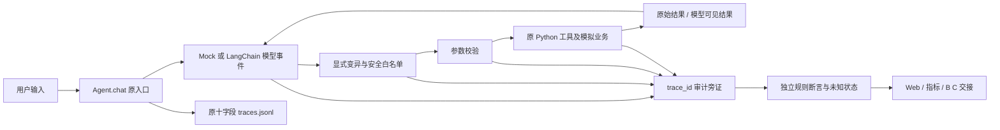

# A：V3.2 Trace 与八种变异开发报告

日期：2026-10-18。成员 A 开发；成员 B 独立正式测试；成员 C 验收、报告与视频。全部业务为虚构模拟。

## 实际范围与状态

| 项目 | 状态与边界 |
|---|---|
| 版本化审计旁证、唯一关联 ID、原始/变异/执行结果 | 已实现并离线验证 |
| 十字段 Agent.chat 与 calls 五字段兼容 | 已实现并验证；contract.md 未修改 |
| 原六变异的新证据与规则断言 | 已实现并通过确定性 SDK 桩；V3.1 真实证据保留 |
| M7 幻觉车次 | 已实现并验证 Legacy Mock、LangChain Mock、SDK 桩；新增真实模型验证未执行 |
| M8 并发重复订单 | 已实现并验证正常业务、独立影子库缺陷、七种场景、重复执行与清理 |
| Web 八开关、独立判定、并发入口、历史回放 | 已实现并通过 Streamlit AppTest；C 人工验收待完成 |
| 指标分母与未知状态 | 已实现并验证；不提供无依据的模型语义恢复率 |
| 本轮 DeepSeek 在线验证 | 尚未执行，明确禁止新增请求 |
| B 对 V3.2 的独立正式评价 | 尚未完成；A 复用原断言不等于 B 已签收 |

## 源码职责

- `target/diagnostics.py`：权威库只读快照、规范化八种事件、确定性断言、幻觉检测、指标、脱敏、旁证读写。
- `target/trace.py`：内部 trace_id，公开十字段不加字段；凭据脱敏。
- `target/tools.py`：ContextVar 执行观察器，记录参数验证与后端是否真正进入。
- `target/agent.py`：Legacy 入口接入审计；`last_audit_report` 是独立属性，不进入原返回结构。
- `target/langchain_agent.py`：从真实框架中间件记录模型请求、实际工具执行与错误，保留原始公开模型回复。
- `target/fault_injection.py`：统一八开关及 M7 工具结果注入；原六行为保留。
- `target/providers.py`：旧全局六开关保留；新八开关使用显式 Agent 配置。
- `target/mock_core.py`：线程局部数据库作用域，原创建订单事务、唯一约束、幂等逻辑不改。
- `target/concurrency_probe.py`：七场景并发正常组、受控影子库变异、独立不变量断言。
- `web/audit_view.py`、`web/app.py`：诊断及回放；不重新执行历史模型。
- `scripts/verify_v32_offline.py`：移除真实凭据、禁止非回环网络、生成可回放对照证据。
- `tests/test_diagnostics.py`、`test_v32_audit.py`、`test_concurrency_probe.py`、`test_web.py`：A 的模块自测；不是 B 正式断言。

## 证据链与兼容方案



正常返回仍是原十字段；calls 仍为 tool、args、ok、latency_ms、result_preview。trace_id 仅在对象内部、旁证和故障报告中关联，不增加公开字段。工具错误路径与原 DeepSeekError 语义兼容，不伪造正常成功记录；错误旁证有 contract_returned=false。

`audit_runs.jsonl` 的 schema_version 为 `ticket-agent-audit/3.2`。包括 public_trace、公开记录哈希、模型原始 tool_calls、执行参数及 validation、实际执行标记、original_result/result、规范化 mutation_events、权威库快照、raw_model_reply、error、judgement。框架被桩替换且观察不到实际派发时 executed=null，不能冒称已执行；安全拦截、参数拒绝为 false。

旁证只读权威数据库，不触发过期回收。Trace 主记录哈希针对脱敏凭据后、旁证个人数据屏蔽前的原公开契约；不能拿经过个人数据屏蔽的副本直接比较此哈希。Web 对保存的公开记录匹配哈希；多个相同内容记录要求明确选择 ID，旧记录无匹配则提示“该历史记录未包含此项诊断信息”。

超 32KiB 的旁证另存 audit_blobs/<SHA256>.json，JSONL 保存可追踪引用，回放检查路径和哈希。超 4MiB 不落完整大对象，明确证据不可用及 indeterminate。哈希用于完整性核对，不是数字签名。当前读取器面向 UTF-8 JSONL，文件编码本身损坏仍应保留文件并人工排查。

认证字段、已配置 Key、Bearer、隐藏 reasoning_content/chain_of_thought 不进入新增旁证。旁证电话屏蔽，乘客列表使用稳定伪名；公开契约保留正常模拟业务字段，只屏蔽认证信息。自由文本无法可靠识别所有个人资料，演示不要输入真实个人信息。

## 八种注入与具体证据

编号固定为现有六项顺序再追加：M1 日期、M2 跳锁、M3 重复、M4 有限循环、M5 错路由、M6 无引用、M7 假车次、M8 并发。不是八个新业务工具。

各事件含 mutation_id/name、enabled/applicable、status、injection_stage、target、before/after、reason、related_step/tool_call_id、timestamp、evidence_ref。旧 failed/prepared 规范化为 error；disabled、not_triggered、not_applicable、blocked、applied 分开。

| 变异 | 实际离线证据 |
|---|---|
| date_offset | 原模型日期 2026-10-18；实际执行 2026-10-19；原模型正确与注入错误分别断言 |
| skip_lock | 原 lock_seat 被改为带 LK_INJECTED_MISSING 的 create_order；后端实际进入、拒绝，订单 0 |
| repeat_call | 模型请求 1 次 query_tickets，派发观察器确认 Python 后端执行 2 次；同 call_id、不同 execution_index |
| infinite_loop | 模型请求 1 次 monitor_seat，有限执行 3 次，达到 max_steps_exceeded；另有工具上限/预算/单步阻断测试 |
| route_error | 原 search_policy 实际变为 query_tickets；不是交换出发城市 |
| no_citation | 原 hits.doc_id 保留，模型可见结果去除编号；编造 P11 的原始公开回复保留并由现有守卫拒绝 |
| hallucinated_train | 工具原始结果不含 G9999，权威库无此车次；可见结果前插测试假车次，模型/Mock 回复独立再检测 |
| concurrent_duplicate_order | 正常同锁座只产生 1 单；专用影子库通过屏障制造 2/4 单，唯一性断言失败并检出 |

Legacy 六开关原本部分在 Provider 内改参数，无法把其变异后脚本输出伪称为“注入前模型原参数”。这一维度标 indeterminate；SDK/框架路径有真正的前后参数。并发变异在普通 chat 中为 not_applicable，需要独立 runner，不让随机模型决定是否触发。

M7 不写入数据库，也不篡改最终模型回复。检测器分类主动肯定、用户引语、否定、假设和含糊句，只有有依据的肯定陈述与权威数据矛盾才报错。其目标是检测受控污染，不是证明 DeepSeek 自发幻觉。

M8 正常组真正调用原 create_order。受控组在全新临时影子库建表时移除该表 lock_id 唯一性，并让各线程在去重读取后经屏障同时继续，各自提交；不改源库约束、不使用随机 sleep。记录线程/请求/锁座/返回订单/落库订单/锁座状态/后续查询。应用没有新增全局串行锁；SQLite 自身仍是单写者，不能声称同时提交多个写事务。临时资源清理，证据保留。

## 自动判定及指标

judgement 保存 case_id、预期、实际行为、断言结果、失败原因、证据引用和 quality_verdict；受控脚本另给 test_verdict。故意制造两单时，quality_verdict=fail、平台检出=true，而 test_verdict=pass，三者不矛盾。

六个独立布尔/未知维度为 injection_applied、platform_defect_detected、agent_anomaly_recognized、agent_recovered、safe_stop、business_correct。没有行为依据为 null，不能用“我已发现错误”认定恢复；自测专门覆盖自我声称与实际修正查询的区别。工具调用成功不代表任务成功，缺引用、错路由、未正常结束也不得统计为业务成功。

最终 25 条对照证据中：13 条实际注入、13 条规则检出；12 条基线或不适用不进入检出分母。业务规则满足 13/25（其中有故意失败组，不代表模型产品通过率）；安全停止事实 2/13，其余并发记录不适用，不把这个混合集合解释为安全能力成功率。Agent 语义识别/恢复没有可评分分母，rate=null。

8 条独立幻觉样本：6 条可确定标签，TP=3、TN=3、FP=0、FN=0；2 条含糊/假设排除。6/6 仅描述这组有限规则样本，不是通用中文语义准确率。新增 Live M7 检出率尚未验证。

## 实际验证与证据

最终执行源码基线：`222947e`。最终回归数值及源码哈希见证据目录中的 offline/verification.json；A 完整 DeepSeek 环境 unittest 180 项通过。完整命令及分环境跳过、B 原断言复用结果见同文件，不把旧环境跳过项算通过。

```powershell
.\.venv-deepseek\Scripts\python.exe scripts/verify_v32_offline.py --out artifacts/runtime/v32-new-evidence
.\.venv-deepseek\Scripts\python.exe scripts/verify_v3_def06_def07_offline.py --b-root $env:B_RESULTS --baseline artifacts/runtime/v32-audit-20261018/baseline.json --out artifacts/runtime/v32-new-regression
.\.venv-deepseek\Scripts\python.exe -m pytest tests -q
```

以上为对应命令的可重跑形式（B_RESULTS 指向 B 原结果目录；新证据目录不得重用）。本轮实际 pytest 经移除凭据和网络阻断包装执行。既有 verify_v3_def06_def07_offline.py 在隔离副本复用 B 原文件，字节一致性和 712 项原项目证据、25 项 B 文件哈希逐项检查。具体日志收录 offline/；B 的独立 V3.2 判定仍待完成。

最终 A unittest/pytest 均为 180 项通过（较 V3.1 新增 27 个测试方法），pytest 另有 78 个子断言；V3 环境 122 通过、58 跳过，旧环境 71 通过、109 跳过。B 原判据隔离复用 Legacy101/101、LangChain Mock100/100、原变异55/55、新代码专项44通过/3不适用，B pytest 为101通过/2跳过，以日志原文为准。冒烟10个入口/命令通过，生成32条Mock记录；这些全是本轮离线重跑，不是复用历史成绩。

最终证据：`docs/evidence/v32/20261018-final/`；cases/ 内每例有 audit_runs.jsonl 和必要 blobs；report.json 保存 25 例、8 样本、分母与实际源文件哈希。`docs/evidence/v32/20261018/` 是首轮记录，按当时源码保留：后续修正了无引用和有限停止的业务完成统计，不覆盖旧文件。

**真实 API 新增 0，真实 Token 新增 0，本轮 API 费用 0；未新增或修改正式 5/5 账本记录。** SDK 桩内的 13/5 等是人工协议用量，不能计入真实费用。V3.1 的 27 次真实调用是历史证据，本轮未重新验证，也未将 M7/M8 算入历史 Live 成绩。

## Git、交接与限制

分支：`codex/ticket-agent-v32-audit-mutations`。V3.1 恢复点 `7e2947f0e82da63035ec6721106780e19d747e98`。

| 提交 | 功能 |
|---|---|
| 94ca27d | 纯审计、检测器、存储与确定性断言 |
| aefda78 | 唯一 ID、实际执行观察器、M7 结果注入 |
| e1a9a91 | 隔离并发正常/缺陷组及七场景 |
| 54d3040 | 关联证据测试、凭据脱敏、保守恢复判定 |
| baeb16e | Web 八开关、诊断与离线证据 runner |
| 222947e | 业务完成语义与旧 Trace 精确关联修复 |

文档/证据的最终提交及推送情况由 `git log -1` 和同目录交付状态记录确定；不能把本文件所在提交 SHA 写成其自身尚未生成的 SHA。持续记录见 `docs/v32_development_log.md`。

有条件交接：代码和离线证据可交 B 测试、C 演示；B 须独立扩充新断言、语义标注、Live M7 验证，C 须人工验收和录屏。新增旁证有磁盘/快照开销；跨进程同时写同一旁证文件不作强并发日志保障，应每个测试进程独立 TRACE_DIR。默认 Live 仍仅两个只读工具，写变异只在既有隔离沙箱控制下，不能推广为八工具 Live 全部通过。无新增大型依赖，无修改预算、安全白名单、main 或旧标签。
