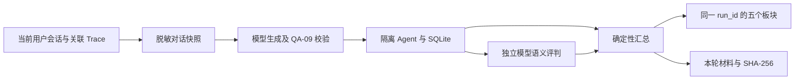

# Ticket Agent V3.11 C 端测试工作台实施报告

## 现场与实施范围

本轮在用户确认的 `D:\codexproject\ticket-agent` 实施。实际分支为 `feat/ticket-agent-v36-stabilization`，HEAD 为 `68f6a5c80ab6fadde3815d0e6e1a0371392d81c9`。开始前已有未提交源码、文档与一个已删除的历史 ZIP，均按开工状态保留。总体契约中的 E 盘目录不可访问。原评委 ZIP 从用户提供的微信目录只读复核，SHA-256 为 `8be7f0055a4d8dd07620d1067a0392458eee833df3c9fdca6f7976df6a4bff3f`。ZIP 有 15,043 个条目，未包含 Git 元数据。

## 选择性吸收

保留团队方案中的七维度展示、判定分布、M1–M8 下钻和四层证据视图。使用 D 盘现有 QA-09 规则、V3.10 DSL、Registry、SQLite 隔离和 Trace 作为执行基础。团队原稿对历史计数的硬编码、跨组漏检聚合、以最近订单或工具成功事件证明支付成功、将通用 UI 完成事件视为真实渲染状态等做法均未移植。评委入口和打包脚本只读审计，预检参数覆盖、`--force` 删除范围和旧 manifest 的问题留给整合者处理。A 端和 B 端示意图用于确认证据与界面职责，现有示例、草稿、审核与执行页保留。

## 一轮测试的证据流

使用单个 `run_id` 记录五阶段状态、起止时间、耗时、错误与证据。捕获当前选中用户会话的最后 12 个匹配轮次，以公开 Trace 哈希关联同会话的真实运行事件。候选需通过 DSL、QA-09、工具范围、重复性、来源轮次和覆盖节点检查，进入本轮临时隔离执行。既有正式候选库的人工审批和正式 103 条成绩不参与该流程。

用例只有捕获隔离 Agent 启动事件后才进入已执行数。客观断言与 AI 判定各自保存。缺少实际回复、Agent 事件或判定引用越界时，AI 轨道无法判定。覆盖只统计有实际检查证据的单元，注入场景可以覆盖节点，正常业务成功单独计算。B 方历史成绩保持原有归属。导出读取经过 SHA-256 与 run_id 复核的同一份汇总和证据。

## 五板块交付

| 板块 | 已实现 | 剩余条件 |
|---|---|---|
| AI 场景总测试 | 单一启动入口、阶段进度、对话与 Prompt 下钻、用例漏斗、覆盖矩阵、证据导出 | 整合者登记主导航，获批后验收真实模型 |
| 质量分析 | 客观和 AI 双轨、分布、M1–M8、按订单操作身份关联的四层证据 | A 端需提供实际 Agent 状态声明和 UI 渲染状态 |
| RAG / 多轮 / 安全 | 展示已执行结果和证据，可对比来源轮次实际出现的政策 ID，识别可证明的跨轮工具参数和权限拦截 | 政策 ID 复现样本需人工确认相关性，缺少覆盖所有攻击结果的分母，生产安全拦截率待专项验收 |
| 边界与异常 | 五类边界、计划与实际注入分开、复用 M1–M7 和 M8 后端探针 | 本轮验证 M8 实际触发，M1–M7 的新工作台端到端触发仍待逐项采集 |
| 性能测试 | 实测用例 P50/P95、响应分布、工具耗时、隔离并发证据，空样本有明确说明 | CPU、内存和应用吞吐量待压测 |

新入口位于 `web/consistency_audit_view.py`。该页面沿用现有设计组件。主导航由整合者改接，旧九个入口和公共签名仍可工作。本轮按对接要求未生成截图文件。

## 模型与证据

DeepSeek 和 Qwen 的生成与 Judge 接口接入项目既有 Provider、host 校验与持久化请求账本。页面点击前需要确认本轮额度，单轮至多 8 次 HTTP、输出至多 4096、零自动重试。隔离被测 Agent 使用源会话引擎，开发验证使用原有离线 Provider。真实请求为 0，本轮没有实际 Token 或费用数据。生成与评判使用可控替身验证，真实闭环 `NOT_RUN`。语义模型自评结果无法覆盖客观断言。模型上游语义鲁棒性与真实费用待授权验收。

四层审计只接受相同 session、operation、order、proposal 的结构化证据，业务层还要求实际数据库核验回执。现有 A 端缺少可独立核实的 Agent 声明与 UI 渲染状态，完整四层一致性在现有生产轨迹下仍为 `PARTIAL`。

测试和 SHA 见 `C-TEST-RESULTS.md`、`C-REGRESSION-REPORT.md` 和 `C-SHA256SUMS.txt`。待整合项见 `C-INTEGRATION-REQUEST.md`。
