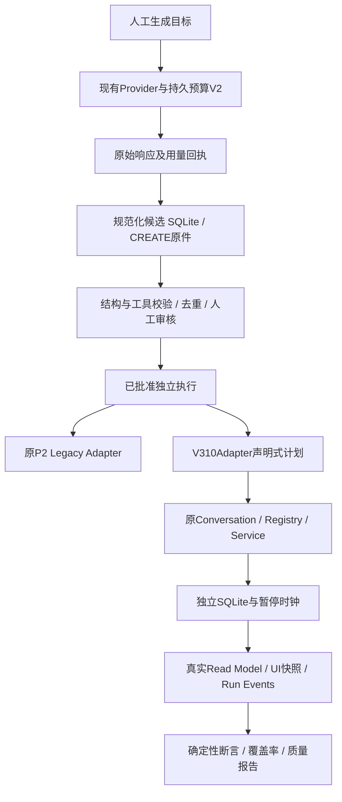

# Ticket Agent AI 测试体系 V2 实施报告

日期：2026-11-09；工程版本为现有V3.10的AI测试子系统V2增量，未改旧UI版本标签。**OVERALL: PARTIAL**。本报告不代表正式103计分或用户验收通过。

仓库 `D:\codexproject\ticket-agent`，分支 `feat/ticket-agent-v36-stabilization`，HEAD `c1620cb4e9e8df094494fc77ef3f0d07ef9928c3`。本轮没有Commit/Push/Merge/Tag。开工已有13个跟踪文件修改和多项未跟踪成果，均保留。原始证据根目录：`artifacts/runtime/ai-test-v2-20261109/`，下文简写为E。

## 1. 结论与验收边界

| 项目 | 实际状态 |
|---|---|
| DeepSeek/Qwen真实候选生成及独立持久化 | PASS：各5条，全部PENDING；不是Mock |
| 质量校验/去重/审核/版本/预算接线 | IMPLEMENTED、TESTED；当前指标及其分母明确 |
| 真实候选人工批准/执行 | NOT_RUN：用户人工批准0，AI候选V310执行0；不自动批准 |
| V310Adapter确定性集成 | PASS（已测子范围）：真实Registry/Service/SQLite/UI Read Model，16参考计划 |
| 查询、建单/hold、支付/QR、退款、改签 | OFFLINE_VERIFIED、DATABASE_VERIFIED；均为独立本地模拟业务 |
| 四层一致性 | PARTIAL：真实工具/数据库/UI快照及Trace；仅窄范围Mock回复规则，不是任意自然语言真实性验证 |
| 多轮/上下文、安全、异常 | PARTIAL：已列明确集合；长上下文、缺参补全、超时/截断/吞吐未完整验证 |
| RAG质量、Live Agent端到端 | NOT_RUN；RAG N/A，Live Agent 0/2；生成模型Live不等于Agent Live |
| 最终全套回归 | 已执行，1891/11/1 +199子测试；原失败/Skip逐ID无增减，不能标全绿 |
| 浏览器 | BROWSER_VERIFIED（列明操作范围），8规格51/51，17PNG |
| 保护清单 | PASS：5587项零非预期差异，含前轮5586；正式103仍BLOCKED |
| 独立审查 | CONDITIONAL PASS：首轮P1已整改，仅已测离线工程子范围；非外部人工验收 |
| ACCEPTED | PENDING_USER_ACCEPTANCE |

## 2. 现场审计和设计

读取上一轮状态、报告、预算、原P2、现有11铁路工具、Registry/Service、当前有效政策、只读静态数据和原测试。开工状态/源码SHA/保护项见E/opening.json；Provider配置仅保存无密钥元数据。没有接入新铁路API、支付服务、Embedding、LangSmith或Bridge，没有修改正式测试、公共Prompt/工具Schema/DIMENSIONS、D9/P01、业务状态机或旧数据库。

使用已安装frontend-design统一蓝白界面、模块内信息层级与窄屏展示；使用eval-audit检查评测身份、断言独立性和分母，采用write-code-eval落实确定性数据库/事件检查。没有采纳LLM Judge代替业务断言、自动批准候选、为覆盖率填满未知数据的做法。Skill指导不是验证证据。



保留 `ticket-ai-scenario/1` 元数据，V310增加 `execution_adapter`、`integration_steps`、`fixture_scenario`。计划支持tool、可信test_user确认、推进测试时钟、Mock chat、QR、历史只读/Feature Flag和跨用户负向检查。引用只解析受限JSON路径；没有eval、任意SQL、Shell或模型可传入的确认token。每步必须有明确检查，最多40步。未实现的P2断言/非空未绑定前置条件不能获批。

每次V310执行新建独立execution_id/会话/SQLite/暂停时钟，原件GTFS只读。固定Fixture并关闭铁路Live源，执行范围内硬阻断socket/DNS，真实候选生成在隔离执行范围外单独授权。沿用CALL_LOCK串行边界，恢复局部环境，不修改系统环境。

## 3. 文件变化

| 文件 | 本轮原因 |
|---|---|
| target/scenario_generator.py | 压缩证据载荷但保留Schema约束及来源SHA；原文先保存再解析；审核绑定计划/声明，分派V310，提供不可变CREATE视图 |
| target/scenario_v310.py（新） | 隔离适配器、真实服务执行、数据库/资金/库存/UI断言、确认与幂等凭据、断网和受控故障 |
| target/scenario_plans.py（新） | 16个版本化确定性参考计划，人工载入为PENDING，不标成AI生成 |
| target/scenario_quality.py（新） | 分子/分母/N/A、真实事件覆盖、模型原始质量和故障检出统计 |
| web/scenario_generator.py | 原页面内新增参考计划、质量/覆盖/模型比较折叠区及执行器说明；没有第四空间或全局CSS重构 |
| tests/test_ai_scenario_v2.py（新） | 46项新确定性测试；原生成器17项和预算7项原样复用 |
| PROJECT_STATUS.md | 增量记录本轮状态、证据、风险和下一步 |
| 本报告、independent-review-v2/（新） | 独立审查材料、源码、差异、SHA和测试证据索引 |

E下新增实验/核验脚本、原始响应、日志和截图。原13项跟踪修改不属于本轮业务变更；仅上述两个原有未跟踪源码在开工SHA基础上变化。完整Git差异含此前成果，不能归于本轮。两个未跟踪文件开工仅存SHA，没有文本备份，无法还原其精确开工逐行差异；交付当前完整文件补丁、原SHA和可运行源码快照，并明确这一审计限制。

## 4. 真实生成实验、失败原因与预算

复用现有配置：DeepSeek `deepseek-flash`；Qwen `qwen3.8-flash`。使用同一候选库和同一预算库，单请求最多4096输出Token、零自动重试，没有扩大50 HTTP/400000 Token上限。

1. 初次10次生成在HTTP前被request_payload_limit阻止，0HTTP；保留原请求载荷。
2. 压缩证据后10次HTTP派发尝试均连接失败，系统代理127.0.0.1:17015无监听。没有将未知请求退预算或Token记0。
3. 只为授权实验进程设置NO_PROXY后，两模型各一次生成1条、各一次生成4条，4次成功响应、共10真实候选。未修改系统代理、Key或模型配置。

| 指标 | DeepSeek | Qwen |
|---|---:|---:|
| 生成尝试（含HTTP前拦截） | 12 | 12 |
| 预算HTTP派发尝试 | 7 | 7 |
| 确认收到原始模型响应 | 2 | 2 |
| 候选持久化 | 5 | 5 |
| 规范化后元数据Schema | 5/5 | 5/5 |
| 引用工具合法（仅有工具引用用例） | 3/3 | 1/1 |
| 可静态解析的部分参数约束 | 3/3 | 1/1 |
| 重复提示 | 2/5 | 0/5 |
| 当前能力与去重门控PASS | 1/5 | 4/5 |
| 用户人工批准率 | N/A（无已验证人工标签） | N/A |
| 实际AI候选执行通过率 | N/A（未执行） | N/A |
| 已知Token | 10825 | 10951 |
| 每个成功响应平均Token | 5412.5 | 5475.5 |
| 成功请求平均时长 | 4.77秒 | 10.46秒 |
| 实际费用 | UNKNOWN | UNKNOWN |

“参数合法”仅为静态部分约束，并非全部必需参数已齐全；无工具引用场景不进入该分母。Schema是规范化后元数据，不是未经处理模型原文成功率。门控PASS不是执行PASS。Qwen原件中存在raises:null冲突等不合格内容，未悄悄修改后算通过。

本小样本Qwen去重/门控结果更高，但不同工具引用分母和部分简单无工具断言使其不可外推为总体更强；两者未发现命名工具幻觉，不足以判断谁更容易虚构工具。DeepSeek成功响应平均Token略少、时长较低，费用未知，不能断言实际更便宜。仅有限领域实验，未覆盖全部十领域，AI生成输出仍以旧P2结构为主；自动生成可执行V310 DSL尚需进一步验证。

共享预算实际14次HTTP尝试，4次已知响应、10次交付/Token UNKNOWN；已知21776 Token、已计入或预留369499，剩余36次HTTP和30501 Token，已触发预警。未知费用/未知Token不记0；本轮不再调用模型。E/live/generation-budget.sqlite、API用量JSONL、live-attempt3/4原始请求/响应/IDs/耗时、所有失败回执完整保留。模型请求成功不等于业务工具执行成功。

## 5. 确定性业务与缺陷检出

16计划覆盖：站/车次/经停、三人建单自动hold、付款QR、部分退一人、改签剩余两人、连续退款至CANCELLED、hold超时、取消、金额不符、无效参数、无结果、历史只读、支付幂等、撤销Flag、过期提案、非本人访问、支付失败、窄范围Mock对话及PAID读回。每步存真实数据库快照、检查、UI投影和run_events；业务库不使用正式或冻结simulation-v391.sqlite。

成功确认自动核验：proposal与完整幂等回执、当前订单、hold和区间数量；PAY对应唯一成功PAYMENT及金额；退款对应本次乘客、refund request/items/金额/手续费/成功交易；改签对应目标报价/活动乘客价格快照/新hold和差价。重放核对原完整回执及前后业务表不变，历史状态不得冒充当前状态。每步核对外键、库存事件守恒、成功借贷/净额/有效票面+手续费守恒和UI/DB一致。

故障5/5检出：非法席别参数、跳过确认、仅PAY阶段假PAID但DB无支付、hold过期不释放、UI订单投影漂移。均为适配器信任的测试注入，不开放给候选参数，不改业务源码。保留正常配对计划与每个失败断言，不是简单把返回布尔值改成失败。额外反例覆盖错乘客/错报价、退款金额篡改、畸形候选、恶意Live继承环境和错run Trace。

| 覆盖项 | 实测分子/分母 | 限定定义 |
|---|---|---|
| 工具 | 11/11 | 已验证步骤中真实执行事件/当前铁路注册工具 |
| 流程 | 5/5 | 查询/建单/付款/退款/改签声明集合 |
| 订单状态 | 6/6 | 明列的六种已提交状态 |
| 合法转换 | 10/10 | 声明十种边，包括两类部分退款自环；不是所有非法边覆盖 |
| 安全 | 7/7 | 七个具备相同实际步骤的参考负向/幂等计划 |
| 异常 | 4/4 | 指定过期/失败/非法参数集合；不含超时/截断/恢复全集 |
| 多轮 | 1/1 | 两次各自完整输入的Mock Conversation计划，不证明缺参补全或长上下文 |
| 回复一致性 | 1/1 | PAID读回无“等待支付”旧声明，不证明任意语义真实性 |
| Trace | 110/110 | 每步相同execution_id/run_id的开始/完成事件可关联 |
| RAG质量 | N/A | 本适配器批次未执行 |
| Live Agent | 0/2 | 不含真实生成请求 |
| 故障检出 | 5/5 | 本轮受控故障集合，不是生产全部缺陷检出率 |

## 6. 最终测试、浏览器及保护

执行环境：现有 `.venv-v35` Python3.12.14、项目锁定依赖。最终代码与 `final-regression-r4/snapshot/ticket-agent` 八项源码/测试逐SHA匹配，见final-code-binding.json；报告/状态更新不改变生产代码。所有测试输出使用新目录，不覆盖任何历史批次。

```powershell
.venv-v35/Scripts/python.exe -B -m pytest tests/test_ai_scenario_generator.py tests/test_ai_scenario_v2.py tests/v39/test_acceptance_budget_v2.py -q -p no:cacheprovider --basetemp=artifacts/runtime/ai-test-v2-20261109/unit-temp-r7 --junitxml=artifacts/runtime/ai-test-v2-20261109/unit-r7.xml
.venv-v35/Scripts/python.exe -B artifacts/runtime/ai-test-v2-20261109/campaign_r4.py
.venv-v35/Scripts/python.exe -B artifacts/runtime/ai-test-v2-20261109/regression.py final-regression-r4
.venv-v35/Scripts/python.exe -B artifacts/runtime/ai-test-v2-20261109/start_ui_r3.py
node artifacts/runtime/ai-test-v2-20261109/browser_r3.js
git diff --check
```

目录采用独占创建；复现须在脚本副本中选新的批次名称，不能覆盖上述证据。

- 最终专项：70 passed /0 failed /0 skipped（新46、原生成器17、预算7），28.28秒，unit-r7.xml/log。
- 最终完整：1891 passed /11 failed /1 skipped，另199通过子测试，257.14秒，exit1。上一轮1842基础上原交付后增加3项、本轮新增46项；11失败和唯一Skip逐ID零增减，见baseline-comparison-r4.json。不称整套全绿、未修复旧11失败。
- 浏览器：Edge+Playwright，1600×900、1366×768、800×900、390×844各深浅主题；51检查全通过、17真实PNG。验证入口、参考计划导入→审核标签→V310执行、刷新恢复、滚动/横向溢出、生成按钮可达、旧测试总览和用户输入框。未经浏览器发真实生成请求，没有宣称所有旧交易UI和弹窗全部验收。
- PageError0；Console32、RequestFailed32为被外部网络守卫拦截的字体图标请求，原始URL/日志保留，不能称全部零错误。主要截图：E/browser-r3/1600-light.png、390-dark.png。
- 保护5587项逐SHA零差异，前轮5586项也无新增差异。原正式103、B快照、GTFS、阶段八SQLite、Fixture、旧DB/账本/Trace及历史报告保留。原有业务源码与开工内容一致。最终Git未暂存，保留旧13跟踪修改及未跟踪成果，本轮不提交。

## 7. 独立审查与整改

独立子Agent只读审查不是实施者自评，也不是用户或外部人员验收。首轮发现两项P1：声明与执行脱节、确认缺数据库凭据，裁决BLOCKED；又发现原件质量归属、网络隔离、Trace关联、畸形元数据、历史幂等及回执金额检查问题，已增量整改并用新冻结批次重测。首轮结论和失败日志保留，见independent-review-v2/First-Review-Findings-and-Remediation.md；最终意见见同目录Independent-Review-Final.md。

交付包包括当前源码快照/完整文件补丁、Git信息、SHA、原始模型证据/候选库/预算、业务SQLite/Trace、最终回归输出、浏览器截图和任务书。大型静态数据原件不重复打包，按保护清单路径+SHA引用。密钥扫描范围和限制另列，不含.env/Key。

## 8. 未完成、风险与后续

1. 用户尚未审核真实候选；AI→批准→V310执行链没有真实AI用例成绩，不能把16个参考计划混算。
2. Live Agent端到端、全部十领域生成实验、RAG质量、长上下文/缺参追问、模型截断和网络超时/并发负载仍需独立计划和预算。未知请求保留预留后余额有限，不擅自补跑。
3. QR只验证原PNG内的支付元数据和订单/金额，未解码像素，不宣称扫码验收。
4. 断言/Trace“完整率”部分沿用存在性指标；覆盖率Trace已强化逐事件关联，仍不代表任意自然语言语义完整性。非法状态边未建立全集分母。
5. 审核人是本地审计标签，不是强身份认证；安全生成与执行边界不能代替多租户产品安全。
6. 外部字体图标32条失败仍可见；未引入新依赖修复字体、未改无关UI。
7. 原正式103评测执行器未获可信恢复，仍BLOCKED；原11失败/1Skip保留。Bridge及冻结DB来源历史问题未在本轮扩大处理。
8. 两个既有未跟踪源码缺少开工文本副本，纯增量diff不可完全重建；开工SHA、最终完整源码、实际测试快照可追溯。

下一步先由用户审核10候选并确定V310计划/断言；再单独安排完整上下文/RAG/超时截断及少量Live Agent验收。没有自动进入新阶段或请求新费用。**工程已具备限定范围独立审查材料，总体仍PARTIAL，等待用户验收。**

## 9. 最终15项问题回答

1. 两模型各5条真实候选。2. 小样本Qwen门控/去重更好，不能判总体优劣。3. 用户人工批准0。4. AI候选V310执行0，另16参考计划通过。5. 工具11/11。6. 声明合法边10/10，非法边未完整统计。7. 支付/退款/改签均真实隔离SQLite验证。8. 预设故障5/5检出。9. 工具/DB/UI/Trace在已测子范围一致，回复语义只做窄范围Mock检查。10. 全回归1891/11/1，另199子测试。11. 旧11失败和Skip逐ID不变。12. 5587保护项无非预期修改。13. DeepSeek已知10825、Qwen10951 Token，未知10请求未置零，费用UNKNOWN。14. 独立只读子Agent已进行首审/整改复审，最终意见随包；不冒充外部人工验收。15. 风险详见上节，不能宣布COMPLETE。
