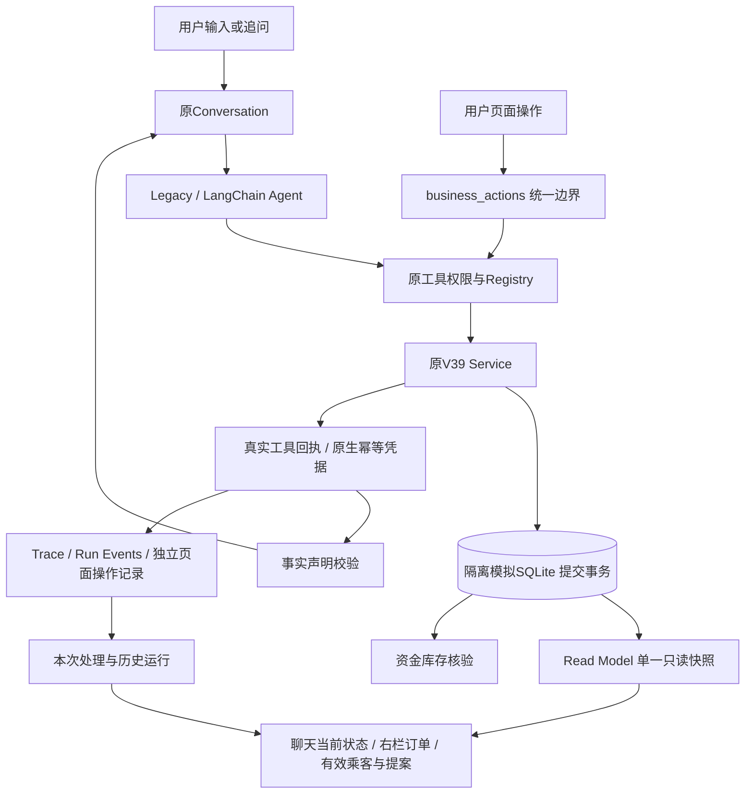
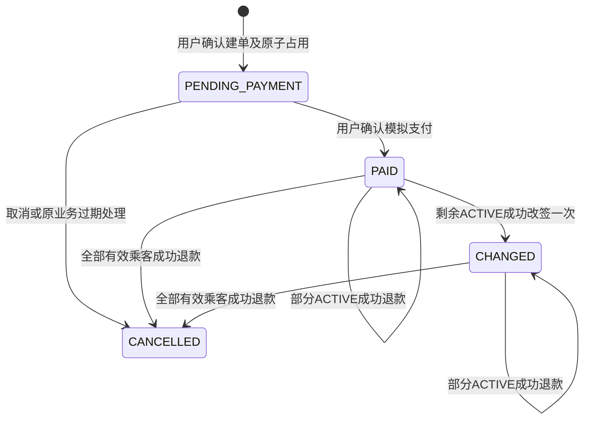

# Ticket Agent 业务状态统一与全流程闭环整改实施报告

审计日期：2026-11-04（Asia/Shanghai）；执行者：Codex，开发及自测，不是独立审查。

总体：IMPLEMENTED；OFFLINE_VERIFIED、DATABASE_VERIFIED、BROWSER_VERIFIED；LIVE_API_VERIFIED=受控DeepSeek范围通过（保留一次截断失败）；INDEPENDENTLY_REVIEWED=NOT_RUN；ACCEPTED=PENDING_USER；不宣称COMPLETE。

## 现场与保护

分支 `feat/ticket-agent-v36-stabilization`，HEAD `4340b6640025be95e8300a3d625a32cfb431e35d`，暂存区空。开工有大量旧修改与未跟踪成果，均保留；本报告只归属开工快照之后的20个生产/新增测试文件。开工6803项实际SHA及原1892/4056/5538清单在 `artifacts/runtime/v394-implementation-business-state-20261104-220744/before.json`，初始源码副本在 `opening/`。无Commit/Push/Merge/Tag、无Bridge/Harness、无真实铁路/支付/Embedding请求。

冻结 `data/v39/simulation-v391.sqlite` 只计算文件Hash，未连接、删除、覆盖或迁移。旧业务库、GTFS、阶段八数据库、2100 Fixture、正式103及B快照保留。原103仍BLOCKED，不冒充重新计分。

两个原API账本有外部追加，前缀SHA完整；用户回复“来自我”，保留追加。百炼+9667字节、DeepSeek+18547字节；与本轮隔离13次请求分开统计。详见 `external-ledger-append.json`、`external-ledger-confirmation.json`。原4056/5538的两项历史账本差异与本次外部追加分别记录，不能称原清单全部相同。

## 根因及修复证据

| 根因 | 原链路证据 | 本轮修复 |
|---|---|---|
| 订单与右栏各读一套状态 | opening/web/user_layout.py只读tickets.db，铁路Bridge另读Service.order | business_state+read_model提供同一已提交快照，旧订单来源仍独立标识 |
| 行程/推荐只认旧selected_train | opening/web/user_layout.py、原铁路卡片缺选择接线 | 真实railway_query_trips结果与用户选车驱动摘要，空推荐隐藏 |
| 退款/改签选项与报价断链 | opening/web/railway_simulation.py只认全局v39_quote，控件跨订单残留 | 读取当前订单ACTIVE明细及匹配有效报价，人数/状态/次数/权限禁用原因明确 |
| 页面支付没有同轮LLM工具证据 | opening/target/v39/business_claim_guard.py按当轮执行事件判断 | 匹配原生幂等回执、owned订单与SQL账本，投影真实PAID；绝不将本次失败当成功 |
| 确认改写旧Agent状态 | opening/web/runtime.py确认后改最后运行并清所有pending | 每次页面操作独立operation、真实call_id、before/after、关联原proposal/run，原Trace不改 |
| 历史渲染触发写事务 | 原Service.order调用_expire/BEGIN IMMEDIATE | Read Model使用mode=ro、query_only及单BEGIN一致读，渲染不释放库存 |
| 运行阶段遗漏铁路写提案 | opening/web/run_view.py | 由实际CONFIRMATION_REQUIRED、确认回执及执行事件计算，待确认不等于完成 |
| 模型回答截断被看成交易失败 | 本轮Live最后查单1024输出上限触发length，实际库已CHANGED | 原失败完整保留，单独展示已提交状态；新只读2048核验通过，未重放交易 |
| 原用量只有非阻断统计 | opening/target/request_accounting.py | 显式验收批次硬预算V2；日常非批次原语义保留 |

## 真实业务数据流



公共Agent.chat十字段、Trace工具五字段、旧八工具及铁路十一工具Schema、SYSTEM_PROMPT、DIMENSIONS不变。页面真实执行不伪造LLM tool_call；原Agent待确认记录仍是当时状态，另追加页面确认结果。持久业务状态是权威，原回复保留历史含义，当前状态使用明确独立投影。

## 订单状态（复用原D9/P01，不重设计）



业务失败保留原状态及FAILED尝试；技术异常由原事务回滚。FAILED退款新提案重试、每乘客最多一次成功退款、每单一次改签、当前价格快照和P01整数分half-up均未改。锁座显示真实建单hold_id与有效期，不伪造独立锁座成功。

## 修改文件及原因

| 文件 | 修改原因 |
|---|---|
| `target/request_accounting.py` | 两个真实模型HTTP入口接入可选批次预算；保留非批次用量统计 |
| `target/v39/business_claim_guard.py` | 用匹配订单及已提交凭据支持真实状态声明，失败操作不冒充成功 |
| `target/v39/planner.py` | 离线确定性演示支持按本人订单ID查询，供完整链路验证 |
| `web/conversation.py` | 已提交状态投影、失败/截断提示、运行聚焦及原消息历史保留 |
| `web/interaction.py` | 页面与Agent操作分开、等待确认/未完成分类、已执行工具和历史核验 |
| `web/railway_cards.py` | 真实查询卡片选择事件驱动当前行程 |
| `web/railway_simulation.py` | 修复ACTIVE选择器、有效改签报价、禁用原因及确认后刷新 |
| `web/run_view.py` | 根据真实铁路提案和页面确认事件生成阶段状态 |
| `web/runtime.py` | 铁路提案确认委托统一页面业务边界，不改写原Agent运行 |
| `web/session_store.py` | 保存状态引用、选中车次及回执，刷新历史只读恢复 |
| `web/user_copy.py` | 预算停止和回答截断的明确用户说明 |
| `web/user_layout.py` | 右栏复用共享数据，保留旧演示业务入口 |
| `web/v39_bridge.py` | 原UI接线共享快照及明确的交易确认卡 |
| `target/acceptance_budget.py` | 新增持久化共享验收预算、原子预留、未知用量保护及只读受控重试边界 |
| `target/v39/read_model.py` | 新增归属隔离、单一只读事务的业务状态快照 |
| `web/business_actions.py` | 统一页面Registry调用、用户确认、幂等回执、前后态和独立真实事件 |
| `web/business_panels.py` | 有数据才显示摘要/推荐/订单；报价、建单及有效乘客操作接线 |
| `web/business_state.py` | 聊天、右栏、选车和历史共用快照，处理dict/list结果与失败运行关联 |
| `tests/v39/test_business_state.py` | 15项真实SQL、归属、回执、权限、失败和UI投影检查 |
| `tests/v39/test_acceptance_budget_v2.py` | 7项跨Provider/跨进程预算及受控重试测试 |

完整SHA：`artifacts/runtime/v394-implementation-business-state-20261104-220744/changed-files.json`。实际开工→结束差异：`artifacts/runtime/v394-implementation-business-state-20261104-220744/task-only.diff`；Git diff还包含之前未提交工作，不全部算本轮。没有修改旧测试、断言、skip/xfail、交易SQL或政策文件。

## 实际测试

| 范围 | PASS | FAIL | SKIP | 证据 |
|---|---:|---:|---:|---|
| 开工V39隔离基线 | 315 | 0 | 0 | baseline-v39/results.json |
| 最终V39含新增22项 | 337 | 0 | 0 | suite-post-live/results.json、pytest.log、junit.xml |
| 原完整回归（不含V39） | 1441 | 11 | 1 | old-regression-post-live/results/ |
| 原回归额外子测试 | 199 | 0 | 0 | 同上is_subtest单列，不重算主用例 |
| 四规格Edge完整流程及截断场景 | 104 | 0 | 0 | browser-error-proof-02/results.json |

合计主用例1778 passed / 11 failed / 1 skipped，另199子测试。新测试与开工315逐项兼容；旧11失败和唯一Skip ID未变，不能称旧项目全绿。

复现命令（必须使用新的输出目录名，不覆盖已有目录）：

```powershell
.venv-v35\Scripts\python.exe -B scripts/run_v39_tests.py --out artifacts/runtime/v394-implementation-business-state-20261104-220744/suite-NEW
.venv-v35\Scripts\python.exe -B artifacts/runtime/v394-implementation-business-state-20261104-220744/run_regression.py old-regression-NEW
.venv-v35\Scripts\python.exe -B artifacts/runtime/v394-implementation-business-state-20261104-220744/start_browser_error_proof_02.py
node artifacts/runtime/v394-implementation-business-state-20261104-220744/browser-post-live.js browser-NEW 8721 server-error-proof-02
```

最后两个浏览器命令需先复制启动脚本并将证据目录/端口改为新的独立值；已用目录会fail-closed，当前测试服务已停止。原始实际命令存在各results.json、server.json与execution.json中。不得直接重用旧数据库重放交易。

旧失败ID：

- `tests/test_deepseek_direct_send.py::DeepSeekDirectSendTests::test_configured_online_default_is_deepseek_and_render_never_calls_agent`
- `tests/test_deepseek_direct_send.py::DeepSeekDirectSendTests::test_direct_send_permission_is_session_and_provider_specific`
- `tests/test_deepseek_direct_send.py::DeepSeekDirectSendTests::test_qwen_still_requires_its_original_checkbox`
- `tests/test_followups_continuous.py::ContinuousFollowupsTests::test_qwen_ten_clicks_survive_timeout_and_saved_replay`
- `tests/test_followups_mvp.py::FollowupRuntimeTests::test_qwen_ui_consent_automatically_includes_followups_offline`
- `tests/test_qwen_langsmith_ui.py::QwenNavigationTests::test_empty_qwen_run_has_a_clear_reason_and_disabled_export`
- `tests/test_qwen_langsmith_ui.py::QwenNavigationTests::test_explicit_history_selection_is_preserved_and_model_is_explained`
- `tests/test_qwen_langsmith_ui.py::QwenNavigationTests::test_live_fee_consent_does_not_follow_a_different_provider`
- `tests/test_qwen_langsmith_ui.py::QwenNavigationTests::test_qwen_panel_rejects_another_provider_record_without_export`
- `tests/test_qwen_langsmith_ui.py::QwenNavigationTests::test_qwen_stays_active_after_opening_integration_center`
- `tests/test_unlimited_live_ui.py::LivePageTests::test_bailian_user`

旧Skip ID：

- `tests/test_p2_scenarios.py::test_no_approved_p2_scenarios`

所有早期失败批次保留：新测试fixture/冻结时钟排序假设、浏览器冷启动/热加载Worker租约、真实选车ID绑定问题、表单blur、ReactAria选择时序及故障注入分类。修复后新批次验证，不覆盖原件。真实Live1024截断FAIL也保留，不能用后续PASS抹除。

## 数据库、Live、浏览器和预算

详见同目录 `Ticket-Agent-Business-State-Database-Report.md`、`Ticket-Agent-Business-State-Browser-Report.md`、`Ticket-Agent-Business-State-Budget-Live-Report.md`。全部证据根 `artifacts/runtime/v394-implementation-business-state-20261104-220744/`。

受控DeepSeek13HTTP，真实Prompt+Completion累计94435Token；费用NULL/UNKNOWN。13次均使用独立用量目录和同一持久批次。新只读查单2请求6214Token，完整回答与DB一致，金融业务表指纹不变。Qwen仅离线SDK与共享预算路径验证，本轮没有Qwen真实请求，不能宣称Qwen Live闭环验收。

## Skills应用

已实际读取eval-audit、write-code-eval、frontend-design。审计采纳：数据库/原回执优先、原正式103身份不等成绩、199子测试独立列、异常后保留证据。确定性规则采纳：真SQL金额/库存/归属/幂等/权限/跨进程额度，而非只看文案。前端采纳：保留蓝白及深色主题，有数据才展示、禁用原因、金额/乘客/确认内容突出。未采用LLM Judge、新依赖、重做UI、政策变化、恢复冻结数据库或额外追问生成API，均超出本次目标或无必要。没有虚构Skill工具能力。

## 风险、未完成及验收边界

1. 原11失败/1Skip保留，正式103计分、Bridge与冻结simulation-v391来源阻塞未解决。
2. 原生产默认输出设置未擅改；复杂回答仍可能截断。本轮修复其业务状态展示，只有受控只读测试用2048，不能宣称所有模型回答永不截断。
3. 浏览器完整交易用确定性离线模型，真实DeepSeek在Conversation+Registry+SQL独立验收；不能把两者组合称为真实Live浏览器全流程通过。
4. Console/网络外部字体图标拦截16项，PageError0；用户网络下字体未做真实联网验证。
5. 单Worker与Secret租约原部署限制保留；没有为避免热加载阻塞而放宽安全策略。
6. 当前实现及自测不是独立审查，也不是用户接受。先人工转交独立只读包审查，再由用户验收；不自动提交推送。

已更新PROJECT_STATUS，保留历史记录。Git最终状态、SHA保护结论见 `final-verification.json`、`git-final-status.txt`、`protection-final.json`；本轮测试服务停止回执以 `server-stops-final-03.json` 为准，前两次停止工具错误记录保留。

交付收尾时间：2026-11-05 00:03以后（Asia/Shanghai）；仍为11月4日开工同一任务/同一API批次。测试执行时间以results.json的UTC原始值为准。
