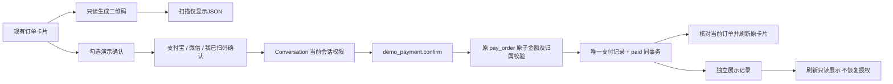

# Ticket Agent V3.7 — 阶段二：支付二维码与演示支付闭环报告

- 完成时间：2026-11-01T03:27:16+08:00；范围仅阶段二；用户任务附件已完整读取。
- 分支 `feat/ticket-agent-v36-stabilization`；HEAD `139cdbe2fca8c7249847f245cffef1ed0545dd36`；仍未提交/推送/合并。
- 验收结论：方案B完成。40项新增测试通过；完整回归1138 passed / 11 failed / 1 skipped，199 subtests passed；原11失败和1 skip保持，0新增失败。四规格浏览器108/108通过。项目整体仍有11项历史失败。

## 1. 现场基线与保护

接手时已有阶段1/1.2源码修改和未跟踪状态/报告/测试/user_copy及两个项目Skill；未清理、覆盖或重置。现场HEAD符合预期。阶段1/1.1/1.2报告、最新截图/verification、环境、支付源码和测试已检查。初始快照before.json保存2274工作区文件、1892保护文件和3708历史产物哈希。

Python 3.12.14、Streamlit1.65.0、Pillow12.3.0、pytest9.1.1；qrcode起初缺失，已仅在.venv-v35安装qrcode8.2（--isolated --no-deps，无其他升级）。Playwright1.64.1和Edge156.0.4314.50沿用既有安装，无新浏览器/浏览器依赖下载。

## 2. 原有支付架构


真实实现：create_order用OD+uuid生成10位随机十六进制订单号；amount=库存price×人数，round到2位，单位为元，存SQLite REAL。原orders表10列，状态pending/paid/cancelled/refunded/expired。_owned_order以order_id+CURRENT_USER_PHONE校验归属；各Conversation使用独立tickets.db。pay_order在BEGIN IMMEDIATE事务中拒绝非pending，paid重复返回duplicate_pay=true。原支付方式只随单次响应返回，未落库；原卡片来自历史工具结果。刷新通过session-replay恢复只读记录，不重建Agent或恢复旧授权。

## 3. 新支付架构与方案选择

采用方案B。现有Streamlit没有经过认证的扫码通知通道；本阶段不新增网络回调或外部服务，不把JSON扫码当作收款通知。二维码仅供识别订单，回到应用后由用户确认。



三个UI入口统一经过Conversation.confirm_demo_payment → demo_payment.confirm → mock_core.pay_order；没有按钮直接修改字典/数据库状态。原自然语言/Agent工具路径仍调用同一个pay_order；不新增公开工具或修改八工具Schema、Agent十字段/工具五字段。

## 4. 二维码机制、实际内容和扫码行为

`render_qr(order_id, amount, amount_yuan) -> bytes`使用qrcode+Pillow返回PNG；st.image(width=180)；从当前会话订单查询取得实际金额，两份金额均为元，必须相等、有限、正数且至多2位小数。二维码只含订单识别字段，不含手机号、乘客、Key、凭证、URL或token。不同订单编码不同。生成失败仅显示安全警告，仍可使用原支付入口，订单状态不变。

以下为本次浏览器实际订单编码样例（像素读取，不依赖PNG文本元数据）：

```json
{
  "order_id": "ODccf609d098",
  "amount": 73,
  "amount_yuan": "73.00",
  "currency": "CNY",
  "amount_unit": "yuan",
  "demo": true
}
```

扫码不会访问Streamlit、支付宝、微信或商户接口，不会回调和扣款。应用醒目显示“演示二维码，扫码不会真实扣款。”和扫码后回应用确认说明。浏览器未接真实手机扫码器；验收将实际浏览器收到的PNG像素解码，与DOM订单号/金额逐一比对。离线读取器复用qrcode的几何/BCH/RS分块表，独立读取像素、解掩码、反交织和解析字节，不读取PNG元数据；不具备拍照透视/旋转或纠错能力，不宣称通用扫码器验收。

## 5. 确认、状态、幂等和权限

- 支付前必须勾选本订单的演示确认；三个按钮均按此启用，选定订单号、金额和方式再次送服务端校验。扫码确认使用选择的支付宝/微信方式；两原按钮保留。
- 授权key绑定session_id、订单号和金额；会话/Provider切换或金额变化不复用其他订单授权。服务端拒绝read_only、非用户空间、Live仅查询工具集、已有Agent待确认状态、无当前DB、未明确布尔确认、非法方式或其他用户订单。
- 金额在原pay_order同一事务内与订单记录比较；随后仅pending→paid。cancelled/refunded/expired不可支付；paid重复确认返回幂等结果，不插入第二条支付记录、不更改首次支付方式。
- demo_payments以order_id为主键，记录方式/金额/paid_at，与paid状态同事务；并发确认和插入失败回滚均有测试。原orders表不改列、不重算价格、不改退票/改签规则。
- 已支付显示状态、方式、金额与订单号，隐藏二维码和支付按钮；历史支付缺失方式显示“未记录”。非pending不展示可用入口。生成、重绘、刷新、模型设置/Provider切换均不自动支付。
- 支付展示记录demo-payment-receipts.json仅保存本次明确支付后的非敏感字段，独立于公共Trace/Agent结果。刷新恢复仍只读，读取该受会话ID/金额约束的展示记录，不读写DB、不重新授权；损坏/跨会话记录不作为支付依据。
- 此项目仍使用固定模拟身份和会话隔离，不新增真实账户认证或支付安全认证；演示成功不计为真实购票/扣款，也不写入正式Agent评分。

## 6. 修改文件、原因和阶段边界

| 文件 | 修改原因 |
|---|---|
| `requirements-v35-lock.txt` | 只增加qrcode==8.2一行，其余锁定版本保持。 |
| `requirements.txt` | 加入唯一固定依赖qrcode==8.2。 |
| `target/demo_payment.py` | 方案B统一业务适配器，必须明确确认；限定支付方式、数据库作用域和服务端预期金额。 |
| `target/mock_core.py` | 保留pay_order旧调用；在同一事务核验预期金额、写唯一demo_payments并更新paid；query_order补充已记录支付方式。 |
| `target/payment_qr.py` | qrcode/Pillow生成PNG；校验元单位、有限正金额及冗余amount_yuan，不访问订单或支付接口。 |
| `tests/test_payment_qr.py` | 新增40个离线专项；不修改任何旧测试、正式断言或skip。 |
| `web/conversation.py` | 复用原show_business/order_card，显示已核对的最新订单；原支付宝/微信动作移入订单支付区域，避免重复入口。 |
| `web/payment.py` | 在原订单卡片附近显示二维码、来源说明和三种入口；同一勾选授权；只读刷新展示及损坏记录防护。 |
| `web/presentation.py` | 在原订单卡片显示支付方式，缺失历史方式显示未记录；继续HTML转义和演示边界。 |
| `web/runtime.py` | 绑定当前Conversation目录/权限，调用统一支付服务；成功后写独立展示记录，不伪造Agent运行。 |
| `PROJECT_STATUS.md` | 更新当前阶段、功能/测试/风险/索引和阶段记录；保留旧成绩和历史记录。 |
| 本报告 | 记录架构、命令、原始结果、截图、差异与限制。 |

新增审计/验收辅助脚本和隔离副本仅位于本阶段artifacts目录；不参与产品运行。阶段1既有app/demo/developer_workspace/scroll_bridge及user_copy等修改保持，未重构Grid/Flex、Provider优先级、Live费用授权或退改签，不进入阶段三。原有导航/session_state名不改；新增payment_控件key，原两支付追问动作移到订单卡片。40项AppTest/业务专项及完整回归验证现有行为兼容性。

## 7. 实际测试命令和结果

使用现有regression_center.prepare和冻结P0复测包的隔离机制：校验15份冻结证据/缓存，复制当前源码到独立snapshot，清除真实凭据、禁止本地Secrets、关闭追踪/Embedding网络，用socket守卫只允许loopback；pytest临时目录独立。未在原正式数据目录运行测试。

```powershell
.\.venv-v35\Scripts\python.exe -m pip --isolated install --disable-pip-version-check --no-deps --report artifacts/runtime/v37-phase2-payment-20261101/qrcode-install.json qrcode==8.2
.\.venv-v35\Scripts\python.exe -B -m artifacts.runtime.v37-phase2-payment-20261101.run_checks targeted-r1
.\.venv-v35\Scripts\python.exe -B -m artifacts.runtime.v37-phase2-payment-20261101.run_checks full-r1
.\.venv-v35\Scripts\python.exe -B -m artifacts.runtime.v37-phase2-payment-20261101.run_checks full-r2
.\.venv-v35\Scripts\python.exe -B -m artifacts.runtime.v37-phase2-payment-20261101.run_checks full-r3
.\.venv-v35\Scripts\python.exe -B -m artifacts.runtime.v37-phase2-payment-20261101.run_checks full-r4
```

full-r4在其snapshot目录实际执行：

```powershell
.\.venv-v35\Scripts\python.exe -m pytest tests -q --tb=short --junitxml=<本阶段full-r4/junit.xml>
```

| 批次 | Passed | Failed | Skipped | 子测试通过 | 说明 |
|---|---:|---:|---:|---:|---|
| 阶段1.2历史基线 | 1098 | 11 | 1 | 199 | 不覆盖原报告 |
| targeted-r1 | 29 | 0 | 0 | 0 | 初始专项，后来补充刷新/损坏记录等测试 |
| full-r1 | 1131 | 11 | 1 | 199 | 中间33项新增，尚未加入刷新展示记录测试 |
| full-r2 | 1133 | 11 | 1 | 199 | 中间35项新增 |
| full-r3 | 1136 | 11 | 1 | 199 | 中间38项新增；后续补Live只读门禁 |
| full-r4（最终） | **1138** | **11** | **1** | **199** | 新增40项全通过、0新增失败、0旧测试移除 |

最终新增测试覆盖：PNG/PIL、实际订单号/金额/demo标识和元单位、不同订单、异常金额；pending/paid/支付方式落库、幂等/并发唯一记录、取消/过期/越权/金额变化拒绝、事务回滚、显式确认、三入口、扫码方式、刷新只读/不自动支付、Provider切换不支付、二维码失败、跨会话与损坏展示记录。采用方案B，无伪造token/过期token测试，也无新增skip/xfail。

## 8. 原11失败和Skip逐项比较

以下ID在阶段1.2与最终full-r4完全一致；均保留失败，不在本阶段修复、删除或修改断言：

- `tests/test_deepseek_direct_send.py::DeepSeekDirectSendTests::test_configured_online_default_is_deepseek_and_render_never_calls_agent`
- `tests/test_deepseek_direct_send.py::DeepSeekDirectSendTests::test_direct_send_permission_is_session_and_provider_specific`
- `tests/test_deepseek_direct_send.py::DeepSeekDirectSendTests::test_qwen_still_requires_its_original_checkbox`
- `tests/test_followups_continuous.py::ContinuousFollowupsTests::test_qwen_ten_clicks_survive_timeout_and_saved_replay`
- `tests/test_followups_mvp.py::FollowupRuntimeTests::test_qwen_ui_consent_automatically_includes_followups_offline`
- `tests/test_qwen_langsmith_ui.py::QwenNavigationTests::test_empty_qwen_run_has_a_clear_reason_and_disabled_export`
- `tests/test_qwen_langsmith_ui.py::QwenNavigationTests::test_explicit_history_selection_is_preserved_and_model_is_explained`
- `tests/test_qwen_langsmith_ui.py::QwenNavigationTests::test_live_fee_consent_does_not_follow_a_different_provider`
- `tests/test_qwen_langsmith_ui.py::QwenNavigationTests::test_qwen_panel_rejects_another_provider_record_without_export`
- `tests/test_qwen_langsmith_ui.py::QwenNavigationTests::test_qwen_stays_active_after_opening_integration_center`
- `tests/test_unlimited_live_ui.py::LivePageTests::test_bailian_user`

唯一skip保持：`tests/test_p2_scenarios.py::test_no_approved_p2_scenarios`。regression-comparison.json通过JUnit规范化ID比对：新增失败0、解决旧失败0、移除测试0；新增40项均位于tests/test_payment_qr.py。完整pytest仍退出1，与保留11失败一致，不能宣称全仓全绿。

## 9. 真实浏览器验收

```powershell
.\.venv-v35\Scripts\python.exe -B -m artifacts.runtime.v37-phase2-payment-20261101.start_browser_app
node artifacts/runtime/v37-phase2-payment-20261101/browser_acceptance.js
```

隔离Streamlit地址127.0.0.1:8515；使用本机Edge真实浏览器（headless）+既有Playwright，不是AppTest截图。每规格5个实际新订单：支付宝、微信、扫码确认各一单；取消一单；待支付刷新一单，共20单。每次都从UI发送下单并确认，读取实际卡片和二维码。

| 规格 | 浅色 | 深色 | 内容 |
|---|---:|---:|---|
| 1600×1100 | 27/27 | 27/27 | 创建/金额/像素二维码/确认门禁/三支付入口/已支付隐藏入口/支付后刷新/取消/未支付刷新 |
| 390×844 | 27/27 | 27/27 | 同上；使用可见侧栏/主题/订单控件真实点击 |

合计108/108，PageError 0；原始Console资源错误48、失败请求48，均为离线规则拦截fonts.gstatic.com的travel_explore SVG图标，实际外部放行0。保留原始记录，不将资源错误隐藏或计成0；离线小图标显示受限，支付操作未阻塞。UI重复支付验收为支付后入口消失，后端并发/重复确认另由真实SQLite专项证明只写一条记录。浏览器后续只读SQLite回查20单，12 paid各1条记录、4 cancelled各0条、4 pending各0条；方式/金额均匹配。

前序验收脚本尝试也保留：r1解码器假定原始像素尺寸，遇Streamlit缩放PNG；r2定位到视觉隐藏checkbox input被label拦截；r3取消指令触发原有直接执行分支而多等一个确认按钮；r4定位到隐藏radio input；r5发现移动端展开按钮自身就是button，旧后代选择器不匹配。最终修正为点击可见文案/实际DOM按钮，并适配缩放图像；未用force点击或注入订单/支付状态来制造成功。见browser-attempt-*原始记录与最终browser-verification.json。

## 10. 截图、运行与JSON证据

共同目录：`artifacts/runtime/v37-phase2-payment-20261101/`。

- before.json / originals/：接手文件/保护/历史哈希与本阶段增量前原件；phase2-only.diff为相对接手工作区的六文件变更，不混入阶段1旧diff。
- qrcode-install.json：仅新增qrcode8.2的安装回执。
- full-r4/source-manifest.json、junit.xml、pytest.log、summary.json：最终源码、实际命令、起止时间和完整结果；各前序目录保留。
- regression-comparison.json：40新增与原11失败/skip逐ID比较；browser/source-manifest*、snapshot-overlays.json：浏览器所用源码与最终三文件覆盖记录。
- browser-verification.json / browser-db-readback.json：108项实际操作、20订单及只读DB回查；每单*-qr.png是实际浏览器媒体PNG，并有像素解码记录。
- *-alipay-pending.png、*-qr-explanation.png、*-alipay-paid.png、*-wechat-paid.png、*-scan-paid.png、*-paid-reload.png、*-cancelled.png：四规格真实截图，含手机待支付与成功页；screenshots.json保存文件SHA256。
- browser/app.log、server.json：隔离启动与进程信息；verification.json：最终保护/Git/源码与报告指纹。
- 本次8515测试服务已关闭，server-stop.json记录核对后的父子进程与停止结果；初次沙箱停止失败及状态更正也保留，未将未执行的停止记为最终成功。

## 11. 保护文件与Git最终状态

- 1892原保护文件0差异；3708接手历史产物0差异；2274接手工作区文件中仅六个授权源码/依赖及状态文件发生本阶段变更。阶段1源码其他修改、原阶段0/1/1.1/1.2/Skills报告与截图均保留。
- 103正式用例、web/datasets、B快照、docs/evidence、原SYSTEM_PROMPT/八工具Schema/七维度、原测试断言和P2不改；未执行真实模型/Embedding/LangSmith/12306/支付请求。仅安装缺失qrcode时访问包分发源，无其他依赖升级或浏览器安装。
- 分支 `feat/ticket-agent-v36-stabilization`，HEAD `139cdbe2fca8c7249847f245cffef1ed0545dd36`；暂存区为空。git diff --check退出0，既有LF/CRLF提示不作行尾修复。原6个tracked阶段1文件修改仍在；本阶段6个tracked文件中2个与旧修改重叠，故最终tracked modified为10个，不代表10个全是本阶段修改。
- 新增本阶段4个产品/测试文件、本文及独立验收产物；PROJECT_STATUS.md增量维护。已有Skill/状态/报告/test_phase1/user_copy等未跟踪文件保留。完整git status与哈希见verification.json。未Commit/Push/Merge、reset/restore/clean/stash。

## 12. 未解决问题与停止

离线规则拦截外部图标资源，保留Console/请求错误与截图缺图；未为消除错误联网或修改无关图标代码。原11项失败仍待后续明确产品契约；本阶段不处理默认Provider或Live授权差异。二维码不是收款码、没有扫描通知；无法据点击确认验证真实扫码动作。未验证手机原生扫描软件、真实支付或公网部署；没有相关真实服务请求。历史已支付订单缺方式不补造。支付后展示记录保存失败会明确提示保留会话核对，不自动重试支付；SQLite仍为演示业务存储，不作真实支付账务。

阶段二交付标准已完成，可由用户验收；已更新PROJECT_STATUS.md并停止。只有用户确认下一阶段任务后才开始阶段三退票/改签，当前未开发阶段三。
