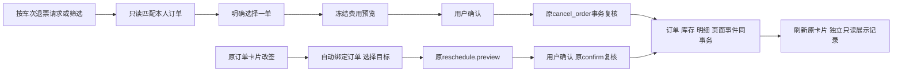

# Ticket Agent V3.7 — 阶段三订单选择式退票与改签交付报告

时间：2026-11-01T11:46:01+08:00（Asia/Shanghai）。仅阶段三，交付后停止。
**结论：阶段三业务闭环完成。新增59项全部通过；完整1197 passed / 11 failed / 1 skipped，199 subtests passed。原11失败/1 skip保持，0新增失败、0旧测试移除。Edge四规格业务96/96通过。项目整体仍有11项历史失败。**

## 1. 基线、范围与现场保护

现场分支feat/ticket-agent-v36-stabilization，HEAD `139cdbe2fca8c7249847f245cffef1ed0545dd36`，暂存区为空。接手2279文件已有阶段1/2未提交修改及Skills；与阶段二最终源码哈希一致。原1892保护文件、3708历史产物核验通过，另保护阶段二验收报告/截图/日志等，总历史清单4056份。未切分支、重置、恢复、清理或覆盖旧报告。
已检查状态、阶段1/1.2/2报告与verification、原支付40测试、退改源码、政策、正式103用例和原始JUnit。所有运行使用既有冻结P0包/prepare隔离副本。无新依赖、无联网安装。

## 2. eval-audit：实施前审计发现

已完整读取项目原版`.agents/skills/eval-audit/SKILL.md`，使用本地源码/报告与Trace资料，不访问远端MCP或LangSmith。以下是实施前审计，不把Skill建议当作已验证事实；原始记录在skill-audit.json，交付回复前已先向用户输出发现。

| 领域 / 状态 | 实际发现与证据 | 采纳或不采纳 |
|---|---|---|
| error_analysis / Problem exists | 已有真实状态/库存和越权断言；缺退款边界、并发/回滚、按车次多候选检查。 `tests/test_core.py::CoreTests::test_order_idempotency_refund_and_inventory`, `tests/test_core.py::CoreTests::test_authorization_and_passenger_match` | 补SQL状态/金额/库存/记录数量检查，而非只断言回复。 |
| evaluator_design / Problem exists | 已有48小时、价格变化和库存断言；未比对库存快照/完整订单快照，缺并发/中途故障回滚检查。 `tests/test_reschedule.py`, `target/reschedule.py::_calculate/confirm` | 保存快照并在事务内重新计算；用触发器失败验证完整回滚。 |
| pipeline_hygiene / Problem exists | 退款未持久记录；UI手填订单号；凭证状态未建模，P01/P07不能靠改文案落实。 `target/mock_core.py::cancel_order`, `web/conversation.py::user_page` | 新增退款明细、订单选择、打印凭证记录保守拒绝；不新增凭证办理流程。 |
| human_review / Problem exists | 现有支付已将页面结果与Agent Trace分离；退改页面也需独立事件和刷新记录，不能补造Agent工具调用。 `web/payment.py`, `web/runtime.py`, `web/session_store.py` | 事务内page_operations和独立只读展示快照，检查Agent历史/公共Trace未变。 |
| judge_validation / Cannot determine | 本阶段不是LLM Judge校准，无新的人工语义标签，不能推导Judge质量或真实模型修复。  | 不调用LLM、MCP或新增Judge；不修改Recall/MRR/INDETERMINATE和正式评分。 |
| labeled_data / OK | 103正式基线和既有JUnit可作为保护/回归参照，不扩写或改断言；新增隔离确定性场景独立计数。  | 不采纳泛化100/50样本收集、二元化评分或新标注界面建议；与当前业务修复无关。 |

已有test_core真实检查库存回补、越权与重复退票；已有test_reschedule检查48小时、库存、价格变化、已改签拒退，不能说旧测试都只看文案。缺口是完整状态/快照/并发/故障回滚/页面闭环覆盖；旧业务单测通过不等于手填订单号的旧页面完成了用户操作。现有证据不足以认定旧测试是假通过或11失败已恢复。

## 3. write-code-eval：确定性检查规格与实际使用

完整读取原版`.agents/skills/write-code-eval/SKILL.md`；按“失败模式→输入→客观规则→通过/失败/边界样例→真实Trace/DB检查”编写pytest/AppTest及浏览器只读回查，使用原测试框架的assert结果/失败原因。Skill本身没有自动运行器、数据库安全保证或浏览器工具，本次未虚构这些能力。

| 规则 | 输入 | 预期结果 | 失败条件 | 测试位置 |
|---|---|---|---|---|
| 订单归属 | FOREIGN订单/同车次混合用户 | 只返回本人候选，FOREIGN不可取消，订单库存不变 | 出现他人ID/手机号或状态改变 | test_owned_filters_and_no_implicit_cancellation / test_unauthorized_and_nonexistent_orders_rejected |
| 退票手续费边界 | 固定发车2026-12-10 12:00，订单100元；提前49/48/47/24/23小时 | 5/10/10/10/20元手续费；退款95/90/90/90/80元 | 金额/费率/持久化时间或状态不符 | test_fixed_time_fee_boundaries_and_persisted_money |
| 重复退票 | 相同订单连续或两线程同时取消 | 恰好一条refund，库存只加一次；其余返回error | 第二条明细或再次释放 | test_pending_zero_fee_and_single_inventory_release / test_concurrent_refunds_only_one_record_and_one_release |
| 改签次数 | 同一preview重复confirm，成功后再次改签 | 只有一条reschedule；第二次拒绝，库存不再变化 | 次数超过1或再次修改库存 | test_success_updates_stock_order_once_and_blocks_refund / test_concurrent_confirmation_one_success |
| 库存更新与回滚 | preview后库存变化、确认时SQL触发器失败 | preview只读、旧库存+1/目标-1、失败全部回滚 | 部分状态改变/接受已失效库存快照 | test_preview_readonly_and_difference / test_stale_confirmation_revalidated / test_reschedule_transaction_failure_rolls_back_all |
| 差价计算 | 旧100；新120/80/100 | +20/-20/0；UI应补/应退记录/无差价；不新增支付退款 | 差价不符或调用支付退款 | test_ui_difference_matches_fixed_db_values_without_execution / test_preview_readonly_and_difference |
| P01/P02/P07/P12 | 发车后、已改签、已打印凭证、pending | 拒退/拒退/保守拒退/费率0且退款0 | 绕过政策、错误确认按钮、产生退款记录 | test_departed_paid_order_rejected / test_printed_voucher_rejected_by_business_and_quote / test_card_auto_binds_id_and_preview_has_no_writes |
| UI与DB/Trace一致 | 浏览器选择一单并确认退票或改签 | SQLite订单/库存/明细/页面状态相符；page_operations.source=page；Trace哈希不变 | 只文案成功、DB无变化或伪造Agent调用 | test_page_action_does_not_invoke_agent_or_forge_trace_and_replays_readonly / browser-verification.json |

采纳：确定性输入、独立预期、SQL状态/库存/金额/记录数量、正反例和边界、异常注入回滚、UI与DB一致性。未采纳：LLM Judge、人工语义标签采样、二元化正式评分、新标注平台/新依赖和远端Trace拉取；均非本阶段必要条件且超出授权。未改Recall/MRR、INDETERMINATE或A/B/Mock/Live归属。两个Skill原版文件哈希保持；Skill使用是读取并执行其方法，不是调用未提供的API。

## 4. 真实退改架构与12项核查

| 问题 | 当前真实实现及变化 |
|---|---|
| 取消入口 | 原cancel_order(order_id,reason)保留；匹配和页面确认最终仍调用它。 |
| 订单匹配 | 新cancel_order_by_train只读返回本人车次/日期候选，席别/乘客可筛选，永不自动退票。 |
| 用户身份 | config.CURRENT_USER_PHONE，固定模拟身份；不接受UI手机号授权。未新增真实登录系统。 |
| 订单库 | 每Conversation.root/tickets.db，使用现有CALL_LOCK/database_scope；测试及浏览器均为新隔离副本。 |
| 状态 | pending/paid/cancelled/refunded/expired，退票已支付→refunded，未支付→cancelled。 |
| 已改签 | reschedules以order_id为主键，存在记录表示已改签一次。 |
| preview/confirm | 原reschedule.preview只读；confirm BEGIN IMMEDIATE内重算并比较完整订单/目标库存快照。 |
| 旧库存 | 原_release在同一确认事务内释放原席位人数。 |
| 目标库存 | 条件UPDATE扣减，人数不足拒绝，失败全事务回滚。 |
| 差价 | Decimal新单价×人数−原订单实付额；原orders.amount保留支付金额，新票面金额/difference入reschedules明细，不发起补款/退款。 |
| 刷新 | 原只读恢复保留；另读page-order-state.json展示最新退改结果，不恢复旧授权、不重写Trace。 |
| 审计 | 原reschedules明细保留，新增时间/快照；refunds记录金额/费率/退款/时间；页面page_operations.source=page。 |



页面业务与模型分层：这两条页面路径不创建Agent、不调用模型、不构造工具Trace；事件写page_operations。自然语言中明确指定G/D/C车次的退票执行请求转入只读候选选择，避免沿用最近订单造成错退；咨询/否定语句不被此路由接管。未提供ISO日期时要求补充，不猜“明天”。原order_id聊天工具路径保持。

## 5. 按车次匹配、多候选和确认

SQL同时约束当前用户、车次和日期；额外席别/乘客精确筛选，返回摘要脱敏姓名、不返回手机号。库存有班次不等于有订单；无匹配明确“你没有该车次的可退订单。”。单候选与多候选均须明确选择、预览再确认，绝不按车次批量取消。摘要显示车次/日期/路线/席别/金额/状态/已改签/费用依据；费用只在可退时显示。预览值和订单指纹保存在会话，确认金额/状态有变化则要求重新预览。

## 6. P01/P02/P03/P07/P12与金额

| 条件 | 保留的规则 |
|---|---|
| 退票 >48小时 | 5% |
| 退票恰好48小时至恰好24小时 | 10%；与原实现一致 |
| 退票 <24小时且尚未发车 | 20% |
| 已支付，发车时刻或之后 | 拒绝退票 |
| pending | P12费率0、退款0，取消并释放一次库存；过期仍按原回收逻辑拒绝操作 |
| 已改签 | P02禁止退票，不显示确认按钮、不计算可退金额、不调用取消服务；只可改签一次 |
| 已打印凭证记录 | 检测reimbursement_vouchers(order_id,printed_at)，P01/P07保守拒绝在线退票 |
| 改签时间 | 保留原>=48小时归类及发车后2小时/当日其他车次约束；原6项改签测试不改 |

费用用Decimal按订单金额计算，分位ROUND_HALF_EVEN，与旧round的舍入风格一致；退款=原金额−手续费。明细保留原订单号、原金额、费率、费用、退款和业务时间；事务失败不留半笔明细。所有日期边界测试固定config.now，非依赖真实测试时钟。

政策差异：P01文字为已取凭证不退，P07要求先交回，旧模型没有凭证状态；本阶段未新增打印/交回办理流程，只对有打印记录保守拒绝，不把“交回”作为UI自报即可放行。政策文件原字节保留。data/policies.md头部“改签等未建模”是旧概述，与已有reschedule代码不同，本阶段标注差异而不改政策原件。

## 7. 改签卡片、差价与事务

复用原order_card，增加“改签”；原订单号/车次/日期/席别/原支付金额自动只读带入。删除旧手填订单号表单，原更多工具位置仅说明从卡片发起，不新增完整我的订单面板。未支付无改签按钮；机票进入说明后即提示不支持，不提供目标表单或执行入口。

目标日期/车次/席别来自同路线的现有模拟库存。preview不改订单、不占位、不释放库存、不写成功记录；正差价显示应补记录、负差价显示应退记录、零价显示无差价。确认必须点击“确认改签”，并在事务内重新核对归属、paid/高铁、一次限制、完整订单快照、目标日期/席别/价格/库存快照。库存虽仍够用但变化也要求重预览；目标扣减/原释放/订单更新/改签记录/页面事件任一步异常全部回滚。

原订单amount仍是原支付金额；卡片另列“新票面金额”和差价记录，未将新票价伪装成已补款。成功后隐藏再次改签及退款确认，显示用户要求的P02禁退提示。

## 8. 修改文件与边界

| 文件 | 原因 |
|---|---|
| target/order_refund.py（新） | 统一报价、只读匹配、改签/凭证检查与页面事件写入。 |
| target/mock_core.py | 保留原cancel_order，复用共享quote，事务内退款明细；新增匹配辅助函数及订单状态附加信息。 |
| target/reschedule.py | 原preview/confirm补完整快照、时间及页面事件；原库存事务和政策不另写一套。 |
| web/order_actions.py（新） | 本会话权限、按车次请求路由、候选/费用确认、卡片改签、独立刷新记录。 |
| web/conversation.py | 在原卡片接入动作，替换旧手填ID入口；行李计算、导航/布局和费用授权逻辑保留。 |
| web/presentation.py | 原卡片显示退票明细、新票面金额和差价记录。 |
| 三个新测试文件 | 按风险分为匹配/退款、改签事务、UI/权限/Trace分层，原测试全保留。 |
| PROJECT_STATUS.md / 本报告 | 当前阶段、实测、风险和证据索引增量维护。 |

未改target/tools.py八Schema、target/agent.py SYSTEM_PROMPT、七维度、政策文件、正式103用例/B快照、P2、Provider优先级、Live费用授权或支付/二维码实现；阶段二40测试与支付源码保持。新增私有expected/source参数兼容原工具调用；新辅助函数不加入工具清单。未开发阶段四或改行李计算/整体布局。

## 9. 实际测试与命令

复用阶段二run_checks模式和regression_center.prepare：15份冻结证据/缓存校验，独立snapshot/临时目录/数据库，移除凭据、禁止本地Secrets和外部socket，关闭追踪与Embedding网络。只运行tests范围。

```powershell
.\.venv-v35\Scripts\python.exe -B -m artifacts.runtime.v37-phase3-refund-reschedule-20261101.run_checks targeted-r1
.\.venv-v35\Scripts\python.exe -B -m artifacts.runtime.v37-phase3-refund-reschedule-20261101.run_checks targeted-r2
.\.venv-v35\Scripts\python.exe -B -m artifacts.runtime.v37-phase3-refund-reschedule-20261101.run_checks full-r1
.\.venv-v35\Scripts\python.exe -B -m artifacts.runtime.v37-phase3-refund-reschedule-20261101.run_checks full-r2
.\.venv-v35\Scripts\python.exe -B -m artifacts.runtime.v37-phase3-refund-reschedule-20261101.run_checks full-r3
```

最终在full-r3/snapshot/ticket-agent实际执行python -m pytest tests -q --tb=short --junitxml=<full-r3/junit.xml>，退出1，与保留11失败一致。实际起止时间、绝对命令和隔离目录见各summary.json。

| 批次 | Passed | Failed | Skipped | 子测试通过 | 说明 |
|---|---:|---:|---:|---:|---|
| 阶段二基线 | 1138 | 11 | 1 | 199 | 原报告不覆盖 |
| targeted-r1 | 1189 | 12 | 1 | 摘要未列 | 辅助脚本参数索引误写，实际收集全tests；保留原日志，不作为专项通过 |
| targeted-r2 | 97 | 1 | 0 | 0 | 98项：原改签6、支付40、新增52；旧错误提示关键词不兼容 |
| full-r1 | 1190 | 11 | 1 | 199 | 修复业务提示关键词，未改旧断言 |
| full-r2 | 1194 | 11 | 1 | 199 | 补明确车次聊天路由4项 |
| full-r3最终 | **1197** | **11** | **1** | **199** | 再补正负零差价UI、P02不调用服务检查；59新增全部通过 |

新增分布：test_refund_by_train.py 27、test_reschedule_order_selection.py 17、test_phase3_refund_ui.py 15。完整新增ID见regression-comparison.json；无新增skip/xfail，阶段二40项全通过。

## 10. 原失败与Skip逐ID核对

- `tests/test_deepseek_direct_send.py::DeepSeekDirectSendTests::test_configured_online_default_is_deepseek_and_render_never_calls_agent`
- `tests/test_deepseek_direct_send.py::DeepSeekDirectSendTests::test_direct_send_permission_is_session_and_provider_specific`
- `tests/test_deepseek_direct_send.py::DeepSeekDirectSendTests::test_qwen_still_requires_its_original_checkbox`
- `tests/test_followups_continuous.py::ContinuousFollowupsTests::test_qwen_ten_clicks_survive_timeout_and_saved_replay`
- `tests/test_followups_mvp.py::FollowupRuntimeTests::test_qwen_ui_consent_automatically_includes_followups_offline`
- `tests/test_qwen_langsmith_ui.py::QwenNavigationTests::test_empty_qwen_run_has_a_clear_reason_and_disabled_export`
- `tests/test_qwen_langsmith_ui.py::QwenNavigationTests::test_explicit_history_selection_is_preserved_and_model_is_explained`
- `tests/test_qwen_langsmith_ui.py::QwenNavigationTests::test_live_fee_consent_does_not_follow_a_different_provider`
- `tests/test_qwen_langsmith_ui.py::QwenNavigationTests::test_qwen_panel_rejects_another_provider_record_without_export`
- `tests/test_qwen_langsmith_ui.py::QwenNavigationTests::test_qwen_stays_active_after_opening_integration_center`
- `tests/test_unlimited_live_ui.py::LivePageTests::test_bailian_user`

Skip：`tests/test_p2_scenarios.py::test_no_approved_p2_scenarios`。与阶段二JUnit规范化ID集合完全相同；新增失败0、旧失败解决0、旧用例移除0。不能称为全仓全绿。

## 11. 四规格浏览器与DB/Trace证据

```powershell
.\.venv-v35\Scripts\python.exe -B -m artifacts.runtime.v37-phase3-refund-reschedule-20261101.start_browser_app
node artifacts/runtime/v37-phase3-refund-reschedule-20261101/browser_acceptance.js
```

隔离127.0.0.1:8516，真实Edge 156.0.4314.50 headless +既有Playwright1.64.1。每规格从UI创建/支付3单，按车次日期筛选2候选，选择一单预览/退票；从第三单卡片自动带入，实际选择不同日期、车次和席别，预览/确认，再验证P02禁退及刷新只读状态。共12个UI订单。
归属UI验证为候选全属于本会话实际创建的本人订单，手机号不显示；跨用户攻击单独在隔离SQL单测加入其他用户同车次订单验证。未在浏览器注入他人订单或伪造状态。

| 规格 | 浅色 | 深色 |
|---|---:|---:|
| 1600×1100 | 24/24 | 24/24 |
| 390×844 | 24/24 | 24/24 |

业务96/96、PageError0、新业务Console错误0。原始Console资源错误12、失败请求12，全部为离线拦截同一fonts.gstatic.com travel_explore图标。阶段二原48项日志未改；本次次数由页面流程决定，类别相同，不按48上限过滤或伪装0。浏览器实际外部放行0，图标缺图限制保留。
每规格SQL回查：退票前后库存仅释放选中人数、另一候选仍paid；改签preview前后完整状态相同，confirm旧库存+1/新库存−1、仅一条改签记录，未增加支付/退款；page_operations两条source=page，公共Trace哈希不变。刷新使用新展示记录，保留只读权限。

前序脚本问题有原始记录：r1将分段日期控件误当input；r2读回脚本GBK/UTF-8导致中文库存键碰撞误报，改为ASCII JSON；r3移动端下拉控件贴近独立滚动区边缘，改为可见控件上的真实滚轮操作后选择，并实际切换日期。均未改DOM/注入SQLite成功状态，未修改产品布局。

## 12. 证据、保护与Git

共同根artifacts/runtime/v37-phase3-refund-reschedule-20261101/：before.json/originals/git-diff-before保存接手状态；skill-audit.json和code-eval-spec.json记录两个Skill；full-r3源码清单/JUnit/pytest.log/summary、regression-comparison逐ID比较；browser-verification记录96项；四份*-refund-db.json和*-reschedule-db.json为只读回查；screenshots.json有截图SHA256；phase3-only.diff仅本阶段四源码相对接手增量；verification.json为最终核验。所有前序尝试保留。

截图包括四规格*-multiple-candidates、*-refund-fee-confirm、*-refunded、*-card-change-entry、*-auto-bound-order、*-difference-preview、*-rescheduled、*-p02-no-refund等PNG，来自真实浏览器，不是AppTest或静态示意。未实际测试实体手机原生App、真实出票/退款/补款或公网部署。

本轮8516隔离测试服务已关闭，停止前核对记录中的启动进程、子进程和命令行；证据为browser/server-stop.json。

1892保护文件、3708原历史产物及扩展4056历史文件均0差异；103正式目录仍103，B manifest七文件匹配；原测试/阶段二40项源码和报告/截图保留。支付三模块、两个Skill、Prompt、Schema、DIMENSIONS及政策原字节未改。所有数据库写入仅本轮测试/浏览器隔离副本。
Git分支feat/ticket-agent-v36-stabilization，HEAD `139cdbe2fca8c7249847f245cffef1ed0545dd36`；暂存区空；git diff --check退出0。已有10个tracked修改保留，本阶段四现有源码中三个已在原diff内、reschedule新增为modified，最终11个tracked修改。本阶段另新增2业务/UI模块、3测试、本文及状态增量；原未跟踪文件全部保留。未Commit/Push/Merge、reset/clean/stash/restore。完整状态见verification.json。

## 13. 风险、阶段四建议与停止

原11失败仍待单独任务；固定模拟身份不等于真实认证。凭证交回未建模，P01/P07采用保守拒绝；历史改签记录缺新增快照字段不会被伪造或回写。差价只作本地记录，amount仍代表原支付额。展示快照损坏/保存失败不恢复写权限，不自动重试业务。离线外部图标仍可能缺图。真实模型/Embedding/LangSmith/12306/支付/退款/补差价请求均0，本阶段未安装任何依赖。

建议阶段四仅在用户确认后设计独立功能面板及统一订单状态来源；不得把本阶段的限定订单选择扩大为完整我的订单面板或独立费率计算器。本阶段完成后停止，等待用户验收。
