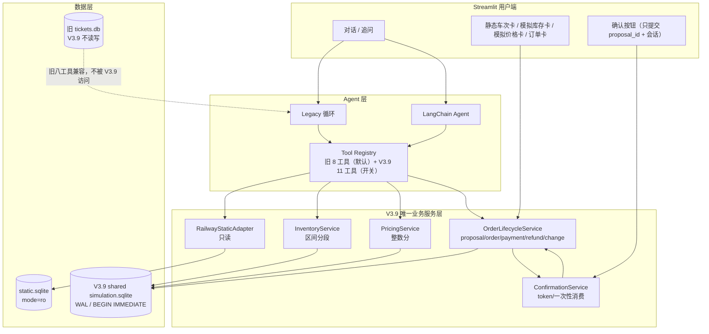
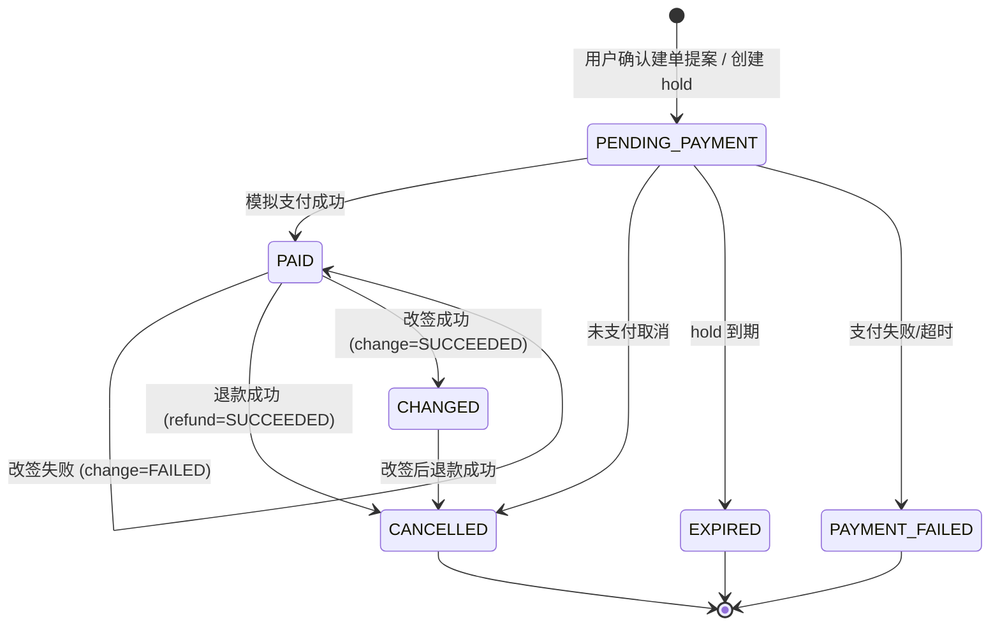
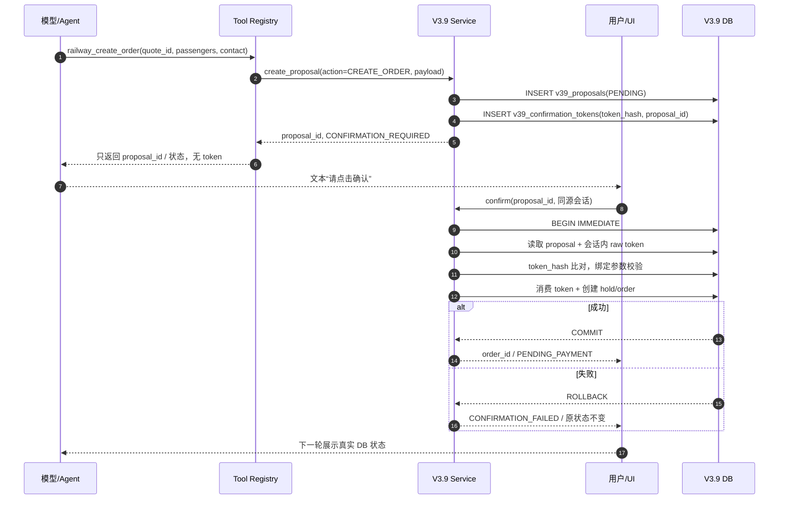

# Ticket Agent V3.9 架构设计 V1.1（Codex 审查稿）

- **文档状态**：`ARCHITECTURE_V1_1_READY_FOR_CODEX_REVIEW` 候选
- **不等于**：`CODEX_REVIEW_PASSED`、用户已批准实施、业务代码已实现
- **日期**：2026-11-02（Asia/Shanghai）
- **替代关系**：本文件是 V1.0 的独立 V1.1 修订；**不覆盖** `Ticket-Agent-V3.9-Architecture-Design.md`
- **基线 HEAD**：`4340b6640025be95e8300a3d625a32cfb431e35d`
- **分支**：`feat/ticket-agent-v36-stabilization`
- **本轮范围**：只读基线复核 + 架构设计修订 + 审查包生成；**未修改业务源码、测试、配置、数据库**；未创建 V3.9 数据库；未迁移。

> 本设计中的 D1–D8 是**默认设计基准**，用于让 Codex 有明确对象可审查；不代表用户已经批准正式实施。Bridge 仍为 `BLOCKED_NOT_INSTALLED`，本轮只生成人工转交包，未派发 Codex 任务。

---

## 0. 修订摘要（V1.0 → V1.1）

| 编号 | V1.0 问题 | V1.1 处理 |
|---|---|---|
| P0-1 | 部分高风险工具要求 `confirmation_token`，模型可能看到/传递 token，与“模型不能确认”矛盾 | **所有工具 Schema 删除 confirmation_token**；高风险工具只创建 proposal；token 只存在于服务端可信会话，UI 按 proposal_id 确认；消费与状态转换同事务 |
| P0-2 | 价格只写概念，未明确多人/固定费/舍入 | 改为整数分公式：按人次计算单人价、固定费每单一次、half-up 舍入；提供算例与快照字段 |
| P0-3 | 库存状态/释放矩阵不完整 | 增加 `held/sold/available` 每状态转换表、条件更新、重复释放防护、异常回滚 |
| P1-1 | 改签未绑定目标报价 | 必须传 `target_quote_id`，目标报价含目标车次/日期/席别/区间；目标 hold 与旧 sold 原子交换；失败保留原订单/库存 |
| P1-2 | 数据库按 conversation 隔离，无法测竞争 | 改为**应用共享 V3.9 DB**，用 `scenario_id/session_id/owner_phone` 隔离；库存共享竞争，订单按 owner 隔离；测试用临时 DB |
| P1-3 | 订单/退款状态混用 | 拆分 `order_status/payment_status/refund_status/change_status`；退款失败不释放 sold、不改订单有效状态 |
| D1–D8 | 部分未定/与需求冲突 | 固定为独立 DB、区间库存、三模拟席别、900/600/300、11 工具、服务端 token、确定性 seed、暂不统一旧历史 |

---

## 1. 现场与保护基线

### 1.1 Git 现场

| 项 | 实际值 |
|---|---|
| 仓库 | `D:\codexproject\ticket-agent` |
| 分支 | `feat/ticket-agent-v36-stabilization` |
| HEAD | `4340b6640025be95e8300a3d625a32cfb431e35d` |
| 暂存区 | 空 |
| 工作区 | 保留 V3.7/V3.8 未提交源码、视觉修改、阶段八原型和报告；本设计不覆盖 |
| 本轮文件 | 仅新增 V1.1 架构文档/机器设计/审查包；追加 PROJECT_STATUS；不写业务源码 |

基线证据：`artifacts/runtime/v39-architecture-v1.1-20261102/baseline.json`。

### 1.2 保护资产

| 资产 | 状态 |
|---|---|
| 2100 Fixture `data/fixtures/train-v1.json` | SHA-256 `feaec244...b29217`；只读 |
| 原始 GTFS ZIP `output_gtfs.zip` | SHA-256 `3877dbc0...a12030`；只读 |
| 阶段八 SQLite `static.sqlite` | SHA-256 `e32f0cd4...35c69`；只读 |
| 正式 103 条 | 数量 103；状态 `BLOCKED_WAITING_FOR_ORIGINAL_B_EXECUTOR`；不执行/不改 |
| B 方 7 份快照 | `web/datasets/b_v32_20261020/`；只读 |
| 1892 保护清单 | 引用 `artifacts/runtime/v37-phase1-20261101/verification.json`，`protected_files=1892` |
| 4056 历史引用 | 保留；本架构步骤未重新逐项哈希，明确不冒充复核 |
| 原八工具 / Baseline / Prompt / DIMENSIONS | 本设计不改；实施时默认关闭新功能 |

### 1.3 Bridge 状态

- 3080 不可达、Bridge 未安装；
- H1 重定向、H2 响应体超时、H3 项目/写入隔离、M1 completed≠停止，均未整改；
- 本轮不派发可写任务、不声称 Codex 已审查；只生成人工转交包；
- 架构审查应在 Bridge 整改与独立反测后，或由用户以只读方式转交 Codex。

---

## 2. 目标、非目标与术语

### 2.1 目标

1. 现有用户端通过自然语言查询静态车次/经停/服务日；
2. 查询模拟余票、模拟价格；
3. 完成模拟报价、锁座、订单、支付、取消、退款、改签、历史；
4. 静态/库存/价格/交易四层明确；
5. 桌面/手机、浅/深四规格不破坏原 UI；
6. 旧八工具、Baseline、Prompt、DIMENSIONS、正式 103/B 保持兼容；
7. 全离线、确定性、可回放、可审计。

### 2.2 非目标

- 不接 12306/95306/RailGo/真实支付/乘客/发票；
- 不把静态时刻解释为真实余票/票价；
- 不写 GTFS，不修复 187 异常班次，不补 shape/坐标/别名；
- 不修改正式 103/B/历史失败；
- 不在未授权时调用真实模型；本轮 0 请求。

### 2.3 术语

| 术语 | 含义 |
|---|---|
| 静态数据 | GTFS 时刻、站点、经停、服务日、版本/SHA；只读 |
| 模拟库存 | V3.9 场景下按区间/席别的容量、held、sold |
| 模拟价格 | 可追溯规则计算的 `SIMULATED_FARE`，非真实票价 |
| 报价 | `v39_quotes` 快照，有有效期 |
| 提案 | `v39_proposals` 高风险意图，无交易副作用；等待 UI 确认 |
| 确认令牌 | 服务端会话内一次性 secret，不进入模型可见输入/输出 |
| 订单聚合 | `v39_orders` + items + snapshots + payment/refund/change 记录 |

---

## 3. 系统总体架构图



**不可逆边界**：

- `GTFS` 只读；`Sim` 只写 V3.9 表；`Old` 不被 V3.9 代码打开；
- 模型/Agent 只能调用 Registry 暴露的只读或提案工具，不能直接写 DB；
- UI 确认按钮走独立服务端方法，不经过模型工具。

---

## 4. 静态数据 Adapter

### 4.1 模块与复用

```text
target/v39/railway_static.py      # 只读 Adapter/DTO
target/v39/railway_identity.py    # DB SHA/metadata/固定版本
prototypes/railway_static/        # 复用，不修改
```

Adapter 只依赖标准库与原型 `Dataset`；不导入 `web.app`，不写 GTFS，不发网络。

### 4.2 身份验证

1. 固定 `V39_RAILWAY_DB_PATH`；
2. `sqlite3.connect(..., uri="file:...?mode=ro")`；
3. 核对 `source_metadata.source_sha256=3877...`、`schema_version=1`；
4. 进程启动时计算文件 SHA，必须为 `e32f0cd4...`；缓存结果；
5. 不匹配 → `STATIC_DATA_IDENTITY_MISMATCH`，不降级到 Mock/Fixture；
6. 所有结果附 `dataset_version`、`release`、`source_sha256`、覆盖期。

### 4.3 六类查询与 DTO

| 方法 | 输入 | 关键状态 |
|---|---|---|
| `search_stations` | `name`, `limit`, `cursor` | `FOUND/NO_MATCH/STATION_AMBIGUOUS` |
| `station` | `stop_id` | `FOUND/NO_MATCH` |
| `query_trips` | `service_date`, optional `origin_stop_id`, `destination_stop_id`, `train_no` | `FOUND/NO_MATCH/OUT_OF_COVERAGE/STATION_ID_REQUIRED` |
| `trip_stops` | `trip_id`, `service_date` | `FOUND/NO_MATCH/TRIP_QUARANTINED` |
| `direct` | `origin_stop_id`, `destination_stop_id`, `service_date` | `FOUND/NO_MATCH/TRIP_QUARANTINED/STATION_AMBIGUOUS` |
| `dataset_info` | — | `FOUND` |

要求：

- 站名歧义返回候选，不自动选；唯一名称也返回明确 `stop_id`；
- 日期是始发服务日；保留 `arrival_time/departure_time` 原始字符串、`arrival_seconds/departure_seconds`、`arrival_at/departure_at`；跨 24 小时不模 24；
- 187 个隔离班次在车次/经停/直达全部不可见，返回 `TRIP_QUARANTINED`；
- 结果最多 50 条/页，确定性排序；
- 所有静态结果：

```json
{
  "data_source": "CHINESE_RAILWAY_GTFS",
  "data_type": "STATIC_SCHEDULE",
  "real_time": false,
  "availability_available": false,
  "fare_available": false,
  "booking_available": false
}
```

静态存在车次 ≠ 有票；库存/价格/交易只能来自 V3.9 服务。

### 4.4 数据质量

保留 26 个未核验坐标、3,558 个缺失 shape、23 组同名站、别名表空等限制；结果只标记，不补全、不推断。

---

## 5. 数据库共享范围（P1-2）

### 5.1 应用共享 DB

**D1：V3.9 使用一个应用共享的独立 SQLite，不按 conversation 分库。**

```text
data/v39/simulation.sqlite     # 默认应用共享（可配置）
tests 临时目录/simulation.sqlite  # 测试专用，不碰共享库
data/tickets.db                # 旧八工具；V3.9 不打开
static.sqlite                  # GTFS；只读
```

- 所有用户在同一 `scenario_id` 下竞争同一区间库存；
- `session_id`、`owner_phone` 只用于订单/提案/令牌归属，不作为库存分片键；
- `scenario_id` 是库存/价格/订单的隔离维度；不同场景不共享库存；
- 订单查询按 `owner_phone = 当前用户`（可看本人跨会话历史）；高风险操作/提案/令牌同时绑定当前 `session_id`；不同用户不能读/操作他人订单、报价、提案、令牌；
- 测试用临时 DB，不污染共享库；并发测试在同一临时 DB 上跑。

### 5.2 测试隔离

- `V39_SIMULATION_DB_PATH` 指向临时目录；
- 每次并发/回滚测试新建/复制种子 DB；
- 测试结束关闭连接、保留临时目录证据；
- 不在 `data/v39` 上运行破坏性测试。

---

## 6. 数据库 Schema（完整设计）

> 这是设计 DDL，不是本轮执行；实施时放入 `migrations/v39_001_init.sql`。所有表在 V3.9 独立 DB，外键启用，WAL。

### 6.1 DDL

```sql
PRAGMA foreign_keys = ON;
PRAGMA journal_mode = WAL;

CREATE TABLE v39_schema_version (
  version INTEGER PRIMARY KEY,
  applied_at TEXT NOT NULL,
  checksum TEXT NOT NULL
);

CREATE TABLE v39_scenarios (
  scenario_id TEXT PRIMARY KEY,
  name TEXT NOT NULL,
  seed INTEGER NOT NULL,
  dataset_version TEXT NOT NULL,
  status TEXT NOT NULL CHECK (status IN ('ACTIVE','ARCHIVED')),
  created_at TEXT NOT NULL,
  config_json TEXT NOT NULL
);

CREATE TABLE v39_price_rules (
  rule_id TEXT NOT NULL,
  version INTEGER NOT NULL,
  scenario_id TEXT NOT NULL,
  dataset_version TEXT NOT NULL,
  trip_id TEXT,
  seat_class TEXT NOT NULL CHECK (seat_class IN ('SECOND','FIRST','BUSINESS')),
  base_fen_per_segment INTEGER NOT NULL CHECK (base_fen_per_segment >= 0),
  seat_multiplier_bp INTEGER NOT NULL CHECK (seat_multiplier_bp > 0),
  fixed_fee_fen INTEGER NOT NULL DEFAULT 0 CHECK (fixed_fee_fen >= 0),
  valid_from TEXT NOT NULL,
  valid_until TEXT,
  status TEXT NOT NULL CHECK (status IN ('ACTIVE','INACTIVE')),
  PRIMARY KEY (rule_id, version),
  FOREIGN KEY (scenario_id) REFERENCES v39_scenarios(scenario_id)
);
CREATE UNIQUE INDEX ux_price_rule_scope
  ON v39_price_rules(scenario_id, COALESCE(trip_id,''), seat_class, valid_from);

CREATE TABLE v39_inventory_segments (
  scenario_id TEXT NOT NULL,
  dataset_version TEXT NOT NULL,
  trip_id TEXT NOT NULL,
  service_date TEXT NOT NULL,
  seat_class TEXT NOT NULL CHECK (seat_class IN ('SECOND','FIRST','BUSINESS')),
  segment_index INTEGER NOT NULL CHECK (segment_index >= 0),
  from_stop_id TEXT NOT NULL,
  from_sequence INTEGER NOT NULL CHECK (from_sequence >= 0),
  to_stop_id TEXT NOT NULL,
  to_sequence INTEGER NOT NULL CHECK (to_sequence >= 0),
  capacity INTEGER NOT NULL CHECK (capacity >= 0),
  held INTEGER NOT NULL DEFAULT 0 CHECK (held >= 0),
  sold INTEGER NOT NULL DEFAULT 0 CHECK (sold >= 0),
  version INTEGER NOT NULL DEFAULT 0,
  updated_at TEXT NOT NULL,
  PRIMARY KEY (scenario_id, dataset_version, trip_id, service_date, seat_class, segment_index),
  FOREIGN KEY (scenario_id) REFERENCES v39_scenarios(scenario_id),
  CHECK (from_sequence < to_sequence),
  CHECK (held + sold <= capacity)
);
CREATE INDEX ix_inventory_lookup
  ON v39_inventory_segments(scenario_id, trip_id, service_date, seat_class);

CREATE TABLE v39_quotes (
  quote_id TEXT PRIMARY KEY,
  scenario_id TEXT NOT NULL,
  dataset_version TEXT NOT NULL,
  trip_id TEXT NOT NULL,
  service_date TEXT NOT NULL,
  origin_stop_id TEXT NOT NULL,
  destination_stop_id TEXT NOT NULL,
  origin_sequence INTEGER NOT NULL CHECK (origin_sequence >= 0),
  destination_sequence INTEGER NOT NULL CHECK (destination_sequence >= 0),
  seat_class TEXT NOT NULL CHECK (seat_class IN ('SECOND','FIRST','BUSINESS')),
  passenger_count INTEGER NOT NULL CHECK (passenger_count BETWEEN 1 AND 6),
  rule_id TEXT NOT NULL,
  rule_version INTEGER NOT NULL,
  segment_count INTEGER NOT NULL CHECK (segment_count > 0),
  single_base_fen INTEGER NOT NULL CHECK (single_base_fen >= 0),
  single_seat_fen INTEGER NOT NULL CHECK (single_seat_fen >= 0),
  base_total_fen INTEGER NOT NULL CHECK (base_total_fen >= 0),
  seat_total_fen INTEGER NOT NULL CHECK (seat_total_fen >= 0),
  fixed_fee_fen INTEGER NOT NULL DEFAULT 0 CHECK (fixed_fee_fen >= 0),
  total_fen INTEGER NOT NULL CHECK (total_fen >= 0),
  currency TEXT NOT NULL DEFAULT 'CNY',
  quote_hash TEXT NOT NULL,
  status TEXT NOT NULL CHECK (status IN ('ACTIVE','EXPIRED','CONSUMED')),
  expires_at TEXT NOT NULL,
  created_at TEXT NOT NULL,
  FOREIGN KEY (scenario_id) REFERENCES v39_scenarios(scenario_id),
  FOREIGN KEY (rule_id, rule_version) REFERENCES v39_price_rules(rule_id, version),
  CHECK (origin_sequence < destination_sequence)
);
CREATE INDEX ix_quotes_expiry ON v39_quotes(status, expires_at);

CREATE TABLE v39_holds (
  hold_id TEXT PRIMARY KEY,
  quote_id TEXT NOT NULL,
  order_id TEXT,
  scenario_id TEXT NOT NULL,
  trip_id TEXT NOT NULL,
  service_date TEXT NOT NULL,
  seat_class TEXT NOT NULL CHECK (seat_class IN ('SECOND','FIRST','BUSINESS')),
  quantity INTEGER NOT NULL CHECK (quantity BETWEEN 1 AND 6),
  status TEXT NOT NULL CHECK (status IN ('ACTIVE','RELEASED','CONSUMED','EXPIRED')),
  expires_at TEXT NOT NULL,
  created_at TEXT NOT NULL,
  released_at TEXT,
  version INTEGER NOT NULL DEFAULT 0,
  FOREIGN KEY (quote_id) REFERENCES v39_quotes(quote_id),
  FOREIGN KEY (scenario_id) REFERENCES v39_scenarios(scenario_id)
);
CREATE INDEX ix_holds_expiry ON v39_holds(status, expires_at);

CREATE TABLE v39_hold_segments (
  hold_id TEXT NOT NULL,
  segment_index INTEGER NOT NULL CHECK (segment_index >= 0),
  quantity INTEGER NOT NULL CHECK (quantity BETWEEN 1 AND 6),
  PRIMARY KEY (hold_id, segment_index),
  FOREIGN KEY (hold_id) REFERENCES v39_holds(hold_id) ON DELETE CASCADE
);

CREATE TABLE v39_proposals (
  proposal_id TEXT PRIMARY KEY,
  session_id TEXT NOT NULL,
  owner_phone TEXT NOT NULL,
  action TEXT NOT NULL CHECK (action IN ('CREATE_ORDER','PAY','CANCEL','REFUND','CHANGE')),
  aggregate_id TEXT,
  quote_id TEXT,
  order_id TEXT,
  scenario_id TEXT NOT NULL,
  request_hash TEXT NOT NULL,
  payload_json TEXT NOT NULL,
  state TEXT NOT NULL CHECK (state IN ('PENDING','CONFIRMED','CANCELLED','EXPIRED')),
  expires_at TEXT NOT NULL,
  created_at TEXT NOT NULL,
  consumed_at TEXT,
  FOREIGN KEY (scenario_id) REFERENCES v39_scenarios(scenario_id),
  FOREIGN KEY (quote_id) REFERENCES v39_quotes(quote_id)
);
CREATE UNIQUE INDEX ux_proposal_pending
  ON v39_proposals(session_id, action, COALESCE(aggregate_id,''), state)
  WHERE state='PENDING';
CREATE INDEX ix_proposals_expiry ON v39_proposals(state, expires_at);

CREATE TABLE v39_orders (
  order_id TEXT PRIMARY KEY,
  proposal_id TEXT NOT NULL,
  session_id TEXT NOT NULL,
  owner_phone TEXT NOT NULL,
  scenario_id TEXT NOT NULL,
  dataset_version TEXT NOT NULL,
  quote_id TEXT NOT NULL,
  hold_id TEXT NOT NULL,
  trip_id TEXT NOT NULL,
  service_date TEXT NOT NULL,
  origin_stop_id TEXT NOT NULL,
  destination_stop_id TEXT NOT NULL,
  origin_sequence INTEGER NOT NULL,
  destination_sequence INTEGER NOT NULL,
  seat_class TEXT NOT NULL CHECK (seat_class IN ('SECOND','FIRST','BUSINESS')),
  passenger_count INTEGER NOT NULL CHECK (passenger_count BETWEEN 1 AND 6),
  total_fen INTEGER NOT NULL CHECK (total_fen >= 0),
  currency TEXT NOT NULL DEFAULT 'CNY',
  order_status TEXT NOT NULL CHECK (order_status IN
    ('PENDING_PAYMENT','PAID','CANCELLED','EXPIRED','PAYMENT_FAILED','CHANGED')),
  payment_status TEXT NOT NULL CHECK (payment_status IN
    ('UNPAID','PENDING','SUCCEEDED','FAILED','TIMEOUT')),
  refund_status TEXT NOT NULL CHECK (refund_status IN
    ('NONE','REQUESTED','SUCCEEDED','FAILED')),
  change_status TEXT NOT NULL CHECK (change_status IN
    ('NONE','REQUESTED','SUCCEEDED','FAILED')),
  idempotency_key TEXT NOT NULL,
  created_at TEXT NOT NULL,
  updated_at TEXT NOT NULL,
  expires_at TEXT NOT NULL,
  version INTEGER NOT NULL DEFAULT 0,
  FOREIGN KEY (proposal_id) REFERENCES v39_proposals(proposal_id),
  FOREIGN KEY (scenario_id) REFERENCES v39_scenarios(scenario_id),
  FOREIGN KEY (quote_id) REFERENCES v39_quotes(quote_id),
  FOREIGN KEY (hold_id) REFERENCES v39_holds(hold_id),
  UNIQUE (session_id, idempotency_key),
  UNIQUE (quote_id),
  UNIQUE (hold_id),
  CHECK (origin_sequence < destination_sequence)
);
CREATE INDEX ix_orders_owner ON v39_orders(owner_phone, created_at DESC);
CREATE INDEX ix_orders_state ON v39_orders(order_status, expires_at);

CREATE TABLE v39_order_items (
  item_id TEXT PRIMARY KEY,
  order_id TEXT NOT NULL,
  passenger_name TEXT NOT NULL,
  seat_class TEXT NOT NULL CHECK (seat_class IN ('SECOND','FIRST','BUSINESS')),
  fare_fen INTEGER NOT NULL CHECK (fare_fen >= 0),
  item_status TEXT NOT NULL CHECK (item_status IN ('ACTIVE','CANCELLED','REFUNDED','CHANGED')),
  created_at TEXT NOT NULL,
  FOREIGN KEY (order_id) REFERENCES v39_orders(order_id) ON DELETE CASCADE
);
CREATE INDEX ix_order_items_order ON v39_order_items(order_id);

CREATE TABLE v39_order_snapshots (
  order_id TEXT NOT NULL,
  snapshot_version INTEGER NOT NULL,
  static_snapshot_json TEXT NOT NULL,
  price_snapshot_json TEXT NOT NULL,
  quote_hash TEXT NOT NULL,
  created_at TEXT NOT NULL,
  PRIMARY KEY (order_id, snapshot_version),
  FOREIGN KEY (order_id) REFERENCES v39_orders(order_id) ON DELETE CASCADE
);

CREATE TABLE v39_payment_attempts (
  payment_id TEXT PRIMARY KEY,
  order_id TEXT NOT NULL,
  amount_fen INTEGER NOT NULL CHECK (amount_fen >= 0),
  status TEXT NOT NULL CHECK (status IN ('PENDING','SUCCEEDED','FAILED','TIMEOUT')),
  failure_code TEXT,
  provider TEXT NOT NULL DEFAULT 'SIMULATED' CHECK (provider='SIMULATED'),
  idempotency_key TEXT NOT NULL,
  created_at TEXT NOT NULL,
  finished_at TEXT,
  FOREIGN KEY (order_id) REFERENCES v39_orders(order_id),
  UNIQUE (order_id, idempotency_key)
);
CREATE INDEX ix_payments_order ON v39_payment_attempts(order_id, created_at);

CREATE TABLE v39_refund_attempts (
  refund_id TEXT PRIMARY KEY,
  order_id TEXT NOT NULL,
  amount_fen INTEGER NOT NULL CHECK (amount_fen >= 0),
  status TEXT NOT NULL CHECK (status IN ('PENDING','SUCCEEDED','FAILED')),
  reason TEXT,
  failure_code TEXT,
  idempotency_key TEXT NOT NULL,
  created_at TEXT NOT NULL,
  finished_at TEXT,
  FOREIGN KEY (order_id) REFERENCES v39_orders(order_id),
  UNIQUE (order_id, idempotency_key)
);
CREATE INDEX ix_refunds_order ON v39_refund_attempts(order_id, created_at);

CREATE TABLE v39_change_requests (
  change_id TEXT PRIMARY KEY,
  order_id TEXT NOT NULL,
  old_trip_id TEXT NOT NULL,
  old_quote_id TEXT NOT NULL,
  target_quote_id TEXT NOT NULL,
  target_trip_id TEXT NOT NULL,
  difference_fen INTEGER NOT NULL,
  status TEXT NOT NULL CHECK (status IN ('PENDING','CONFIRMED','REJECTED','FAILED')),
  idempotency_key TEXT NOT NULL,
  created_at TEXT NOT NULL,
  finished_at TEXT,
  FOREIGN KEY (order_id) REFERENCES v39_orders(order_id),
  FOREIGN KEY (old_quote_id) REFERENCES v39_quotes(quote_id),
  FOREIGN KEY (target_quote_id) REFERENCES v39_quotes(quote_id),
  UNIQUE (order_id, idempotency_key)
);
CREATE INDEX ix_changes_order ON v39_change_requests(order_id, created_at);

CREATE TABLE v39_confirmation_tokens (
  token_hash TEXT PRIMARY KEY,
  proposal_id TEXT NOT NULL,
  session_id TEXT NOT NULL,
  owner_phone TEXT NOT NULL,
  action TEXT NOT NULL,
  aggregate_id TEXT,
  quote_id TEXT,
  amount_fen INTEGER,
  args_hash TEXT NOT NULL,
  expires_at TEXT NOT NULL,
  used_at TEXT,
  created_at TEXT NOT NULL,
  FOREIGN KEY (proposal_id) REFERENCES v39_proposals(proposal_id),
  UNIQUE (proposal_id)
);

CREATE TABLE v39_idempotency (
  scope TEXT NOT NULL,
  key TEXT NOT NULL,
  request_hash TEXT NOT NULL,
  response_json TEXT NOT NULL,
  created_at TEXT NOT NULL,
  PRIMARY KEY (scope, key)
);

CREATE TABLE v39_inventory_events (
  event_id TEXT PRIMARY KEY,
  scenario_id TEXT NOT NULL,
  trip_id TEXT NOT NULL,
  service_date TEXT NOT NULL,
  seat_class TEXT NOT NULL,
  segment_index INTEGER NOT NULL,
  delta_held INTEGER NOT NULL,
  delta_sold INTEGER NOT NULL,
  hold_id TEXT,
  order_id TEXT,
  reason TEXT NOT NULL,
  created_at TEXT NOT NULL
);
CREATE INDEX ix_inventory_events_scope
  ON v39_inventory_events(scenario_id, trip_id, service_date, seat_class);

CREATE TABLE v39_audit_events (
  event_id TEXT PRIMARY KEY,
  aggregate_type TEXT NOT NULL,
  aggregate_id TEXT NOT NULL,
  event_type TEXT NOT NULL,
  from_state TEXT,
  to_state TEXT,
  detail_json TEXT NOT NULL,
  request_id TEXT,
  created_at TEXT NOT NULL
);
CREATE INDEX ix_audit_aggregate ON v39_audit_events(aggregate_type, aggregate_id, created_at);
```

### 6.2 约束/索引/事务补充

- 外键开启；所有写事务 `BEGIN IMMEDIATE`；
- `v39_orders` 的 `(session_id,idempotency_key)` 唯一；
- `v39_proposals` 的 pending 唯一索引防止同一会话同 action/aggregate 重复提案；
- `v39_inventory_segments` 的 CHECK 防止 held/sold 负值和超容量；
- `v39_order_items` 金额合计必须由服务校验等于订单 `total_fen`；
- `v39_order_snapshots` 每次改签/改价写新版本，不覆盖旧快照；
- 所有金额 INTEGER 分；时间 ISO-8601 Asia/Shanghai；不使用浮点。

---

## 7. 区间库存状态机（P0-3）

### 7.1 变量

对每个库存段：

```text
capacity = 模拟容量
held     = 已锁定但未支付/未消费
sold     = 已支付/已占用
available = capacity - held - sold   # 派生，不存库
```

区间 `i→j` 覆盖 `seg_i...seg_{j-1}`；`available_od = min(available[seg] for seg in covered)`。

### 7.1.1 D7 确定性容量（每个相邻区间）

| 场景 | 二等座 SECOND | 一等座 FIRST | 商务座 BUSINESS |
|---|---:|---:|---:|
| default | 20 | 8 | 3 |
| tight | 3 | 2 | 1 |
| sufficient | 100 | 50 | 20 |
| sold_out | 0 | 0 | 0 |
| payment_fail | 20 | 8 | 3 |

初始化时所有段 `held=0`, `sold=0`；容量固定，不随机波动。`seed=20261102` 仅用于可复现 ID/测试夹具，不改变容量表。价格固定见第 8 节。该表是**人为演示参数**，不是真实铁路库存。

### 7.2 状态转换对库存的影响

| 操作 | held 变化 | sold 变化 | 订单状态 | 支付/退款/改签状态 | 说明 |
|---|---:|---:|---|---|---|
| 创建 hold（确认建单） | `+q` 每个覆盖段 | 0 | `PENDING_PAYMENT` | `UNPAID/NONE/NONE` | 条件更新全部段，失败回滚 |
| 支付成功 | `-q` | `+q` | `PAID` | `SUCCEEDED/NONE/NONE` | 同事务，防重复 |
| 支付失败 | `-q` | 0 | `PAYMENT_FAILED` | `FAILED/NONE/NONE` | 失败即释放 |
| 支付超时 | `-q` | 0 | `EXPIRED` | `TIMEOUT/NONE/NONE` | 与超时/过期一致 |
| 未支付取消 | `-q` | 0 | `CANCELLED` | `UNPAID/NONE/NONE` | 只释放 held |
| 已支付退款申请 | 0 | 0 | `PAID` | `SUCCEEDED/REQUESTED/NONE` | 订单仍有效 |
| 退款成功 | 0 | `-q` | `CANCELLED` | `SUCCEEDED/SUCCEEDED/NONE` | 释放 sold |
| 退款失败 | 0 | 0 | `PAID` | `SUCCEEDED/FAILED/NONE` | 订单仍有效，可重试 |
| 改签成功 | 旧 `-q`（旧 hold/sold 处理），新 `+q`/`-q` | 旧 `-q`，新 `+q` | `CHANGED` | `SUCCEEDED/.../SUCCEEDED` | 原子交换，见第 9 节 |
| 改签失败 | 目标 hold `-q` | 0 | `PAID` | `.../FAILED` | 原订单/库存不变 |
| hold 过期 | `-q` | 0 | `EXPIRED` | `UNPAID/NONE/NONE` | 条件回收，仅一次 |
| 重复请求 | 0 | 0 | 原状态 | 原状态 | 幂等表返回原响应 |

### 7.3 不变量

1. 每段 `held>=0`、`sold>=0`、`held+sold<=capacity`；
2. `available` 不存库，避免缓存不一致；
3. 每次 `held/sold` 变化必须写 `v39_inventory_events`，事件 delta 与行变化同事务；
4. 同一 hold 只能从 `ACTIVE` 消费/释放一次；
5. 同一订单只能成功支付一次；重复支付返回原结果；
6. 同一订单退款成功一次；退款失败可重试，但每次新 attempt；
7. 任何异常回滚全部库存/状态/事件。

### 7.4 原子扣减

```sql
UPDATE v39_inventory_segments
SET held = held + :q, version = version + 1, updated_at = :now
WHERE scenario_id=:s AND dataset_version=:v AND trip_id=:t
  AND service_date=:d AND seat_class=:c
  AND segment_index IN (:segments)
  AND capacity - held - sold >= :q;
```

`rowcount` 必须等于 `len(segments)`；否则 rollback 返回 `INVENTORY_INSUFFICIENT`。  
`BEGIN IMMEDIATE` + 条件更新双保险；禁止先读再无条件写。

### 7.5 过期回收

- hold TTL 900 秒；quote 600；confirmation 300；
- 无后台进程时惰性回收：在读写入口 `UPDATE v39_holds SET status='EXPIRED' WHERE status='ACTIVE' AND expires_at<=now`，并条件释放对应段；
- `UPDATE` 带 `status='ACTIVE'`，重复执行不会二次释放；
- 订单同步 `EXPIRED`；写 audit/inventory event。

### 7.6 并发与崩溃

- 20 线程同一段购买：最多 capacity 成功；
- 支付/取消/退款并发：状态 CAS（`WHERE status=... AND version=...`）；
- 异常/进程崩溃：SQLite 事务回滚；重启后过期回收；
- 不得使用应用内存锁替代 DB 事务；`CALL_LOCK` 只能辅助。

---

## 8. 模拟价格（P0-2）

### 8.1 规则默认值（D7）

| 参数 | 值 |
|---|---:|
| 每相邻区间基础价 | 1000 分 |
| 二等座系数 | 10000（1.0） |
| 一等座系数 | 15000（1.5） |
| 商务座系数 | 30000（3.0） |
| 固定费用 | 0 分/订单 |
| 人数 | 1–6 |
| 舍入 | 每乘客 half-up 到分 |

### 8.2 计算顺序（整数）

```text
segment_count = destination_sequence - origin_sequence
single_base_fen = 1000 * segment_count
single_seat_fen = floor((single_base_fen * seat_multiplier_bp + 5000) / 10000)
base_total_fen = single_base_fen * passenger_count
seat_total_fen = single_seat_fen * passenger_count
order_total_fen = seat_total_fen + fixed_fee_fen
```

`single_base_fen` 是单人基础价，`single_seat_fen` 是单人席别价；固定费每订单一次；总价按人次数乘。  
全程整数，不经过 float；`+5000` 是 half-up；负数差价使用对称的 away-from-zero 规则并在测试固定。

### 8.3 默认算例

2 个区间、二等座、3 人：

```text
single_base = 1000*2 = 2000
single_seat = floor((2000*10000+5000)/10000)=2000
base_total = 2000*3=6000
seat_total = 2000*3=6000
fixed = 0
total = 6000
```

一等座 2 区间 3 人：single 3000，total 9000。  
商务座 2 区间 3 人：single 6000，total 18000。

### 8.4 报价快照

`v39_quotes` 固定保存：

`segment_count/single_base_fen/single_seat_fen/base_total_fen/seat_total_fen/fixed_fee_fen/total_fen/rule_id/rule_version/passenger_count/quote_hash/expires_at`。

`v39_order_snapshots.price_snapshot_json` 再冻结一次，后续改规则不影响历史订单。

### 8.5 报价过期/改签差价

- 过期报价 `QUOTE_EXPIRED`，不自动重算；用户重新报价；
- 改签差价 `difference = target_quote.total_fen - current_paid_total_fen`；
- 差价 >0：补款确认；<0：模拟退款；=0：直接换；
- 新旧总价均用整数分，不使用旧订单 `amount` 浮点。

---

## 9. 改签设计（P1-1）

### 9.1 绑定目标报价

`railway_change_order` 必须传：

```text
order_id, target_quote_id,
target_trip_id, target_service_date,
target_origin_stop_id, target_destination_stop_id, target_seat_class
```

服务端校验 target_quote 属于当前会话、ACTIVE、未消费、目标字段完全一致、场景相同、静态 trip/日期有效、`passenger_count == order.passenger_count`；模型不能只传车次号。

### 9.2 新旧关系

- 保留原 `order_id`；`v39_order_snapshots` 写新版本，旧快照不可变；
- `v39_change_requests` 记录 old_trip/old_quote/target_quote/difference/status；
- 原订单不删除、不换 ID；UI 显示改签历史；
- 禁止创建第二套 V3.9 订单聚合。

### 9.3 原子交换流程

```text
BEGIN IMMEDIATE
  verify order=PAID, no active change, target quote ACTIVE
  check target inventory all segments
  UPDATE target segments held += q (conditional)
  create target hold
  handle difference:
    >0: simulated supplement payment (must succeed)
    <0: simulated refund of difference (must succeed)
  UPDATE old segments sold -= q (conditional old sold>=q)
  UPDATE target hold CONSUMED; target segments held-=q, sold+=q
  UPDATE target quote CONSUMED
  update order trip/date/seat/quote/total, order_status=CHANGED, change_status=SUCCEEDED
  insert snapshot new version, change record, audit/events
COMMIT
any step fail -> ROLLBACK; old order/sold/hold unchanged; target hold released
```

### 9.4 失败与并发

- 目标库存不足/报价过期/补款失败/退款失败 → `CHANGE_FAILED`，原订单 `PAID`，原库存不变；
- 同一订单只允许一个 `REQUESTED` 改签（部分唯一索引）；
- 改签与退款/支付并发：锁订单行 + CAS，失败方回滚；
- 改签成功后原订单状态 `CHANGED`，退款按改签后票面/政策处理。

---

## 10. 订单/支付/退款状态（P1-3）

### 10.1 状态拆分

| 维度 | 字段 | 值 |
|---|---|---|
| 订单 | `order_status` | `PENDING_PAYMENT`,`PAID`,`CANCELLED`,`EXPIRED`,`PAYMENT_FAILED`,`CHANGED` |
| 支付 | `payment_status` | `UNPAID`,`PENDING`,`SUCCEEDED`,`FAILED`,`TIMEOUT` |
| 退款 | `refund_status` | `NONE`,`REQUESTED`,`SUCCEEDED`,`FAILED` |
| 改签 | `change_status` | `NONE`,`REQUESTED`,`SUCCEEDED`,`FAILED` |

### 10.2 支付

- 成功：`payment_status=SUCCEEDED`，`order_status=PAID`，held→sold；
- 失败：`payment_status=FAILED`，`order_status=PAYMENT_FAILED`，held释放；
- 超时：`payment_status=TIMEOUT`，`order_status=EXPIRED`，held释放；
- 重复：幂等返回原 attempt，不重复扣减；
- 支付失败订单不再接受支付；重新买需新报价/订单。
- `payment_fail` 场景的支付 attempt 确定性返回 `FAILED`；default/sufficient/tight/sold_out 的成功路径成功。失败不是异常，仍写 attempt/audit 并释放 held。

### 10.3 退款

- 申请：`refund_status=REQUESTED`，订单仍 `PAID`，sold不变；
- 成功：`refund_status=SUCCEEDED`，`order_status=CANCELLED`，sold释放；
- 失败：`refund_status=FAILED`，`order_status=PAID`，sold不变；可新建 attempt 重试；
- 退款金额默认为订单 `total_fen` 全额模拟退款；若场景配置手续费规则，必须由可追溯规则计算并写入 attempt，不能用 LLM 估价或浮点；本阶段不接真实退款渠道；
- 重复退款：幂等返回原结果，不重复释放/退款；
- 不允许退款失败把订单标 `CANCELLED`。

### 10.4 取消

- 未支付：`CANCELLED`、payment UNPAID，释放 held；
- 已支付：进入退款流程（REFUND_REQUESTED/SUCCEEDED/FAILED），不是直接 `CANCELLED`；
- 退款失败时订单仍 `PAID`。

### 10.5 退款失败后的库存/最终状态

- 库存：不释放 sold；
- 订单：`PAID` 仍有效；
- 退款：`FAILED`，可重试；
- 最终：只有退款 `SUCCEEDED` 才 `CANCELLED` 并释放 sold；
- 记录 `v39_refund_attempts` 每次结果。

---

## 11. 支付、退款、改签事务流程图

```mermaid
sequenceDiagram
    autonumber
    participant U as 用户/UI
    participant S as OrderLifecycleService
    participant I as InventoryService
    participant P as PricingService
    participant D as V3.9 DB

    U->>S: confirm(proposal_id) + 同源会话
    S->>D: BEGIN IMMEDIATE
    S->>D: 校验 proposal/token/归属/状态
    alt 模拟支付
        S->>I: 条件消费 held (held-=q, sold+=q)
        S->>D: order=PAID, payment=SUCCEEDED
        alt 支付失败/超时
            S->>I: 释放 held (held-=q)
            S->>D: order=PAYMENT_FAILED/EXPIRED
        end
    else 退款
        S->>D: refund=REQUESTED (sold 不变)
        alt 退款成功
            S->>I: sold-=q (条件 sold>=q)
            S->>D: order=CANCELLED, refund=SUCCEEDED
        else 退款失败
            S->>D: order=PAID, refund=FAILED (sold 不变)
        end
    else 改签
        S->>I: 目标段 held+=q (条件)
        S->>P: 目标 quote 已存在且有效
        alt 差价>0
            S->>D: 模拟补款成功
        else 差价<0
            S->>D: 模拟退差成功
        end
        S->>I: 旧段 sold-=q; 目标 hold->sold
        S->>D: order=CHANGED, change=SUCCEEDED, 新 snapshot
        alt 任一步失败
            S->>D: ROLLBACK; 目标 hold 释放, 原订单/原库存不变
        end
    end
    S->>D: 写 audit/inventory_events + COMMIT
    D-->>S: 成功后返回
    S-->>U: 从 DB 读取的真实状态
```

## 12. 完整订单生命周期图



说明：`PAID + refund=REQUESTED/FAILED` 和 `PAID + change=REQUESTED/FAILED` 是**同一订单状态下的独立子状态**，避免把退款失败误判为订单失效。

---

## 13. 服务端确认与 Agent 权限（P0-1）

### 12.1 原则

1. 模型只能创建**提案**，不能执行高风险交易；
2. 模型永远看不到、生成不了、传不了确认令牌；
3. 令牌只存在于服务端可信会话存储，按 `proposal_id` 关联；
4. UI 只提交 `proposal_id` + 同源会话，服务端从会话取 token；
5. 令牌绑定 `session_id/owner_phone/action/aggregate_id/quote_id/amount_fen/args_hash/expires_at`；
6. 一次性消费；过期/重复/跨会话/参数不一致全部拒绝；
7. token 消费与状态转换同一事务；失败回滚，token 不消费；
8. 不以模型回复“成功”作为交易成功；UI/服务查询 DB 状态。

### 12.2 提案流程



### 12.3 工具 Schema 禁止项

以下字段**不得**出现在任何模型可见 Schema/Prompt/对话记录：

```text
confirmation_token
raw_token
token_secret
session_secret
```

11 个工具均无 token 参数；高风险工具只返回 `proposal_id` + `CONFIRMATION_REQUIRED`。

### 12.4 确认令牌表

见 `v39_confirmation_tokens`：`token_hash` 主键、`proposal_id`、`session_id`、`owner_phone`、`action`、`aggregate_id`、`quote_id`、`amount_fen`、`args_hash`、`expires_at`、`used_at`。

生成本身由服务端在**提案创建时**完成；raw token 写入服务端会话存储（内存/受保护 session store），DB 只存哈希。UI 确认时从同一会话读取 raw token，不接受浏览器/模型传入的 token。

### 12.5 原子消费

```sql
UPDATE v39_confirmation_tokens
SET used_at=:now
WHERE token_hash=:hash
  AND used_at IS NULL
  AND expires_at > :now
  AND session_id=:session
  AND action=:action
  AND args_hash=:args_hash;
```

`rowcount != 1` → `CONFIRMATION_INVALID/USED/EXPIRED`，不执行交易。  
同一事务内完成 token 消费 + 订单/库存/支付状态更新；异常全回滚。

### 12.6 权限矩阵

| 能力 | Agent/模型 | UI 用户 | 服务端 | token |
|---|---|---|---|---|
| 静态查询 | ✓ | ✓ | ✓ | 无 |
| 库存查询 | ✓ | ✓ | ✓ | 无 |
| 报价创建 | ✓ | ✓ | ✓ | 无 |
| 建单提案 | ✓（只提案） | ✓ | 执行 | 确认时服务端 |
| 支付提案 | ✓（只提案） | ✓ | 执行 | 服务端 |
| 取消/退款/改签提案 | ✓（只提案） | ✓ | 执行 | 服务端 |
| 直接修改订单/库存 | ✗ | ✗ | 仅服务方法 | — |
| 读取 token | ✗ | ✗ | 仅会话存储 | — |
| 确认他人订单 | ✗ | ✗ | ✗ | 拒绝 |

---

## 14. 11 个工具完整 Schema

完整 JSON Schema 见 `tool-schemas.json`；以下是审查摘要。所有工具：

```json
{"additionalProperties": false}
```

且不含 `confirmation_token`。

| # | 工具 | 必填参数 | 可选 | 返回/副作用 |
|---|---|---|---|---|
| 1 | `railway_search_stations` | `name` | `limit`,`cursor` | 候选；只读 |
| 2 | `railway_query_trips` | `service_date` | `origin_stop_id`,`destination_stop_id`,`train_no`,`limit` | 静态车次；只读 |
| 3 | `railway_trip_stops` | `trip_id`,`service_date` | — | 经停；只读 |
| 4 | `railway_check_inventory` | `trip_id`,`service_date`,`origin_stop_id`,`destination_stop_id`,`seat_class`,`quantity` | — | 模拟余票；只读 |
| 5 | `railway_quote_fare` | 同上 + `passenger_count` | — | 创建 quote；无订单/库存 |
| 6 | `railway_create_order` | `quote_id`,`passengers`,`contact` | — | **只创建 proposal**；无订单/库存 |
| 7 | `railway_get_order` | — | `order_id` | 当前用户订单/历史；只读 |
| 8 | `railway_pay_order` | `order_id`,`expected_total_fen` | `pay_type` | **只创建支付 proposal** |
| 9 | `railway_cancel_order` | `order_id` | `reason` | **只创建取消 proposal** |
| 10 | `railway_refund_order` | `order_id` | `reason` | **只创建退款 proposal** |
| 11 | `railway_change_order` | `order_id`,`target_quote_id`,`target_trip_id`,`target_service_date`,`target_origin_stop_id`,`target_destination_stop_id`,`target_seat_class` | — | **只创建改签 proposal** |

说明：

- `railway_create_order` 的 `passengers` 是 1–6 个姓名；`contact` 是演示联系方式；
- `railway_pay_order` 的 `expected_total_fen` 防止价格变化；
- `railway_get_order` 不传 `order_id` 时只返回当前用户列表，不能跨用户；
- 高风险工具成功返回 `proposal_id`, `status=CONFIRMATION_REQUIRED`, `expires_at`；不返回交易结果；
- 确认后由 UI 调用服务方法，模型通过 `railway_get_order` 重新读取。

---

## 15. 双引擎 Registry 与 Prompt

### 14.1 Registry

```text
base_tools = 原八工具（始终）
v39_tools  = 11 个 railway_*（仅 RAILWAY_SIMULATION_ENABLED=1）
definitions(profile) = base + (v39 if enabled/profile)
```

- Legacy 循环和 LangChain 的 `adapt_tool` 都调用同一 `resolve_definition(name)`；
- 参数校验、权限、提案、服务全部共用；
- 旧 `Baseline` 仍只看到八工具；V3.9 Profile 独立；
- 关闭开关时，行为与原系统一致，旧 103/Baseline 不受影响。

### 14.2 Prompt

- 旧 `SYSTEM_PROMPT` 常量不改；
- 启用 V3.9 时仅在运行时追加 `V3.9_APPENDIX`（工具列表 + 静态/模拟标识 + 不可自确认）；
- 附录中不出现 token 字段、不出现“模型可确认”；
- 该附录属于**公开 Prompt 契约变更**，实施前需用户/Codex 批准；
- 未获批准前 Prompt 保持原样。

---

## 16. 用户端 UI

### 15.1 展示层

新增 `web/v39_cards.py`：

- 静态车次卡：车次、起终、到发、服务日、经停、`dataset_version/source_sha`、`STATIC_SCHEDULE`；
- 模拟库存卡：`SIMULATED INVENTORY`，有票/不足/售罄/未配置；
- 模拟价格卡：`SIMULATED FARE`，单人基础、席别系数、人数、固定费、总价、规则版本、过期；
- 订单卡：订单号、车次、区间、席别、人数、总价、`order_status/payment_status/refund_status/change_status`、期限、可执行操作；
- 历史：订单/支付/退款/改签分栏。

### 15.2 交互

1. 用户自然语言 → Agent 查询/报价；
2. 需要建单/支付/取消/退款/改签 → Agent 创建 proposal；
3. UI 显示确认卡（金额、操作、期限）；
4. 用户点击确认 → 服务端 token 消费 + 事务；
5. UI 从 DB 读取真实状态，不采用模型自述；
6. 站名歧义返回候选；缺日期追问；
7. 报价过期提示重新报价；库存不足/售罄不显示购买；
8. 支付/退款失败展示可重试状态，不伪装成功；
9. 关闭 feature flag 时旧 UI 完全不变。

### 15.3 布局

保留 `user_chat_scroll`、`user_compose`、`user_rail`、五阶段、三工作空间和关键 key；新卡片不新增平行聊天；桌面 1600×1100、手机 390×844、浅/深四规格；输入框、右栏、滚动、弹窗、横向溢出纳入验收。

---

## 17. Feature Flag 与配置

```text
RAILWAY_SIMULATION_ENABLED=0        # 默认关闭
V39_RAILWAY_DB_PATH=<阶段八 static.sqlite>
V39_SIMULATION_DB_PATH=<共享 simulation.sqlite>
V39_SCENARIO=default
V39_HOLD_TTL_SECONDS=900
V39_QUOTE_TTL_SECONDS=600
V39_CONFIRM_TTL_SECONDS=300
V39_MAX_PAGE_SIZE=50
```

- 关闭：旧八工具/旧 UI/旧 Prompt；不打开 V3.9 DB；
- 开启但 DB/GTFS 不可用：明确错误，不降级 Fixture/Mock；
- 不读 Key/Cookie/.env；无网络。

---

## 18. 迁移与回滚

### 17.1 新库

1. 创建 `data/v39/simulation.sqlite`（仅新文件）；
2. 开启 WAL/FK；
3. 单事务执行 `migrations/v39_001_init.sql`；
4. 写 `v39_schema_version` + checksum；
5. 初始化 D7 场景/价格规则；
6. 失败：关闭连接，保留半成品隔离，不碰旧库。

### 17.2 旧库兼容

- `data/tickets.db` 不 ALTER、不迁移、不写；
- 旧八工具继续使用旧库；
- V3.9 不读取旧订单；D8：本阶段不统一新旧历史；
- 若未来统一，另做只读导入/视图项目，不在本阶段。

### 17.3 回滚

- 关闭 `RAILWAY_SIMULATION_ENABLED` → 回旧 UI/旧工具；
- 备份后归档/删除 V3.9 DB → 无 V3.9 状态；
- 代码回滚仅新增 `target/v39`、`web/v39_cards.py`、迁移与开关接线；
- GTFS/阶段八 DB 不参与回滚，哈希不变；
- 回滚演练：新库迁移失败、支付失败、改签失败、进程中断各一次。

---

## 19. 错误码规范

| 错误码 | 场景 |
|---|---|
| `STATIC_DATA_UNAVAILABLE` | 路径不存在/不可读 |
| `STATIC_DATA_IDENTITY_MISMATCH` | SHA/版本不符 |
| `OUT_OF_COVERAGE` | 日期不在覆盖期 |
| `NO_MATCH` | 条件无结果（非售罄） |
| `STATION_AMBIGUOUS` | 同名多站 |
| `STATION_ID_REQUIRED` | 未提供明确 stop_id |
| `TRIP_QUARANTINED` | 187 隔离班次 |
| `TRIP_NOT_OPERATING` | 服务日不开行 |
| `INVENTORY_NOT_CONFIGURED` | 无场景/席别库存 |
| `INVENTORY_INSUFFICIENT` | 余量小于请求 |
| `INVENTORY_SOLD_OUT` | 余量 0 |
| `PRICE_NOT_CONFIGURED` | 无价格规则 |
| `QUOTE_EXPIRED` | 报价过期 |
| `QUOTE_CONSUMED` | 报价已用 |
| `PROPOSAL_NOT_FOUND` | 提案不存在/不属于会话 |
| `PROPOSAL_EXPIRED` | 提案过期 |
| `CONFIRMATION_REQUIRED` | 高风险操作需 UI 确认 |
| `CONFIRMATION_INVALID` | token 不匹配/跨会话/参数变化 |
| `CONFIRMATION_USED` | token 已消费 |
| `CONFIRMATION_EXPIRED` | token 过期 |
| `ORDER_NOT_FOUND` | 订单不存在 |
| `ORDER_FORBIDDEN` | 非本人/非本会话 |
| `INVALID_STATE` | 当前状态不允许 |
| `PAYMENT_FAILED` | 模拟支付失败 |
| `PAYMENT_TIMEOUT` | 支付超时 |
| `REFUND_FAILED` | 模拟退款失败 |
| `REFUND_NOT_ALLOWED` | 政策/状态不允许 |
| `CHANGE_NOT_ALLOWED` | 不满足改签条件 |
| `CHANGE_FAILED` | 目标库存/差价/事务失败 |
| `IDEMPOTENT_REPLAY` | 幂等返回原结果 |
| `DB_BUSY` | SQLite busy 超时 |
| `INTERNAL_ERROR` | 未分类；不得泄露内部细节 |

所有错误返回 `code/message/retryable`；敏感错误不返回 SQL/路径/stack。

---

## 20. 日志与审计

- `v39_audit_events`：提案、确认、订单、支付、退款、改签、库存回收；含 `request_id/proposal_id/order_id/from/to`；
- `v39_inventory_events`：每段 delta，支持对账；
- 不记录 raw token、Key、Cookie、乘客证件；
- 日志脱敏；模型对话只展示业务状态，不展示 token；
- Trace/run_events 与 V3.9 审计通过 request_id 关联，不伪造 Agent 调用；
- 审计只追加，不修改历史。

---

## 21. 测试设计矩阵

完整矩阵见 `test-matrix.json`；覆盖：

### 20.1 静态

六类查询、187 隔离三路径、站名歧义、唯一站、服务日边界、跨日 47:53、无 shape、未核验坐标、版本/SHA、只读、业务表不写。

### 20.2 库存

正常、区间不串占、20 并发、容量 0/小、不足、hold 过期、支付失败、取消、退款、改签、场景隔离、重置保留历史、重复请求、异常回滚。

### 20.3 价格

单人/多人（1/3/6）、三席别、规则缺失、过期、版本变化、固定费、舍入、改签差价、无 float。

### 20.4 订单/支付/退款/改签

完整购买、重复下单/支付、失败/超时、取消、退款成功/失败/重试、改签成功/失败回滚、差价补退、状态拆分、并发。

### 20.5 Agent

Legacy/LangChain 工具参数一致、权限、提案、无 token 可见、模型不能自确认、多轮追问、历史回放、错误。

### 20.6 浏览器

Edge + Playwright，1600×1100 / 390×844 浅/深，独立记录 Passed/Failed/Console/PageError/NetworkFailed/截图/版本。

### 20.7 保护

正式 103 不执行/不改；历史 1441/11/1/199 逐 ID；Fixture/GTFS/DB/B/1892 哈希前后；新测试独立计数。

---

## 22. 验收标准映射

| # | 验收 | 设计 |
|---|---|---|
| 1 | 静态接入 | Adapter + cards |
| 2 | Agent 查询 | 5 只读工具 |
| 3 | 模拟库存 | segments |
| 4 | 区间余票 | min segments |
| 5 | 价格可追溯 | rule/quote snapshot |
| 6 | 建单 | quote + proposal + token |
| 7 | 锁座 | hold/TTL |
| 8 | 支付成功/失败 | attempt + state |
| 9 | 失败释放 | same tx |
| 10 | 取消 | unpaid/paid branches |
| 11 | 退款 | attempt/status |
| 12 | 改签 | target quote + hold swap |
| 13 | 改签回滚 | atomic rollback |
| 14 | 并发不超卖 | BEGIN IMMEDIATE + conditional |
| 15 | 双引擎 | registry/dispatch |
| 16 | 旧八工具 | base unchanged |
| 17 | 权限 | proposal/token/owner |
| 18 | 四规格 | browser |
| 19 | 历史基线 | no change |
| 20 | 103 原状态 | BLOCKED |
| 21 | GTFS/阶段八 | hashes |
| 22 | Codex 复测 | after review |
| 23 | 证据/回滚 | package/migrations |

---

## 23. D1–D8 决策记录

| 决策 | 采用方案 | 依据/影响 |
|---|---|---|
| D1 | 独立 V3.9 SQLite（应用共享），旧 `tickets.db` 不改 | 旧库 10 列 INSERT 与旧工具不破坏；V3.9 事务独立；可回滚 |
| D2 | 区间分段库存 | 乘客只占起终区间，`available=min(segments)`；满足区间余票验收 |
| D3 | 仅模拟 SECOND/FIRST/BUSINESS | GTFS 无席别配置；不得冒充真实席别 |
| D4 | hold 900s、quote 600s、confirmation 300s | 沿用旧锁座期限；报价/确认独立过期 |
| D5 | 11 个 `railway_*` 工具 | 旧八工具不变；新 Profile 默认关闭 |
| D6 | 服务端一次性 token + UI 确认 | 模型不可见/不可传 token；原子消费 |
| D7 | 确定性容量与价格（见第 8 节） | 默认 20/8/3 等；1000 分/区间；系数 10000/15000/30000；固定费 0；整数分 |
| D8 | 本阶段不统一新旧订单历史 | 旧库只读兼容；新 V3.9 订单独立；避免高风险迁移 |

这些是**架构默认基准**，不是用户批准的正式实施参数；D7 数值是人为演示参数，不代表真实铁路库存/票价。

## 24. 风险清单

| 风险 | 影响 | 缓解 |
|---|---|---|
| Bridge H1/H2/H3/M1 未整改 | 不能自动派发 Codex | 人工转交；不绕过 |
| 正式 103/B 执行器 BLOCKED | 不能宣称正式通过 | 保持原状，新测试独立 |
| 区间容量非真实座位语义 | 误导 | 全程 `SIMULATED`，规则文档化 |
| GTFS 权利未清 | 不可公开分发 | LOCAL_DEMO_ONLY |
| 无真实席别 | 不能推断 | 仅模拟三席别 |
| 跨日 47:53 | 时间错乱 | 保留 seconds/日期，不模 24 |
| 共享 DB 并发 | busy/超卖 | WAL、busy_timeout、条件更新、并发测试 |
| 旧库隔离 | 历史不统一 | D8 明确不统一；只读兼容 |
| Token 泄漏 | 越权交易 | 不进入模型/Schema/日志；hash 存储 |
| 测试库污染 | 影响共享数据 | 临时 DB，不碰共享 |
| **既有证据缺失** | 相对 V1.0 baseline，`docs/collaboration/` 和 `Ticket-Agent-V3.9-Dual-Agent-Environment-and-Bridge-Audit.md` 在当前工作区不存在；不是本架构步骤删除，未擅自伪造恢复 | 需用户从备份恢复；本包只记录缺失，不冒充已复核 |

---

## 25. 本轮交付与停止

- 本文件：`docs/reviews/Ticket-Agent-V3.9-Architecture-Design-v1.1.md`
- 机器包：`artifacts/runtime/v39-architecture-v1.1-20261102/`
- 不修改业务源码/测试/配置/数据库；未创建 V3.9 DB；未迁移；未调用真实服务。
- Bridge 不在本轮修复；不派发可写任务。
- 完成标准：本文件 + architecture.json + schema.sql + tool-schemas.json + permissions.json + test-matrix.json + risk-list.json + review package + SHA256。
- 状态：`ARCHITECTURE_V1_1_READY_FOR_CODEX_REVIEW`（**不是** `CODEX_REVIEW_PASSED`）。
