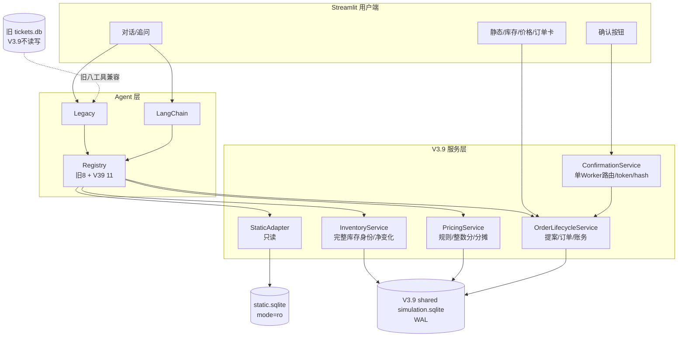
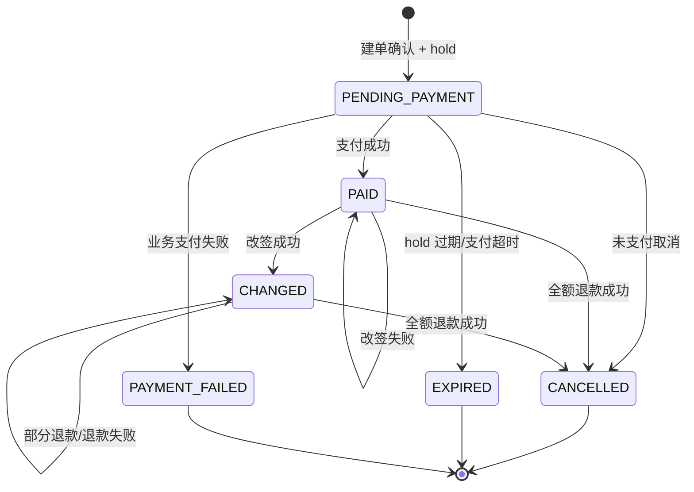
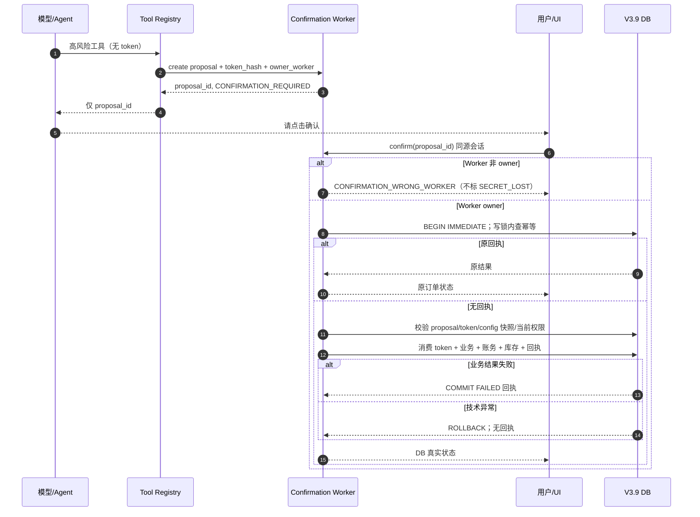

# Ticket Agent V3.9 架构设计 V1.2.1（第三轮 Codex 审查稿）

- **状态**：`ARCHITECTURE_V1_2_1_READY_FOR_CODEX_REVIEW` 候选
- **不表示**：`CODEX_REVIEW_PASSED`、V3.9 已实现、正式 103 通过
- **日期**：2026-11-03（Asia/Shanghai）
- **基线 HEAD**：`4340b6640025be95e8300a3d625a32cfb431e35d`
- **关系**：完整独立 V1.2.1；不覆盖 V1.0/V1.1/V1.2 原件。
- **本轮范围**：仅架构/SQL/Schema/权限/测试/审查材料。未修改业务源码、测试、配置、数据库；未创建 V3.9 DB；未执行 DDL/迁移。

> D1–D8 仍是默认设计基准；D9 政策待用户批准。本文不编造用户授权。

---

## 1. F01–F13 整改结论

| 编号 | 整改 |
|---|---|
| F01 并发确认/幂等 | 事务外快速查询 + `BEGIN IMMEDIATE` 内**重新查询**回执；同键同参返回原回执；同键异参拒绝；token/业务/资金/库存/回执同一事务；两个进程同时确认只产生一套结果 |
| F02 库存完整身份 | 所有库存集合 key 均为 `scenario_id+dataset_version+trip_id+service_date+seat_class+segment_index`；hold/change segment 持久化完整身份；禁止只比 segment_index |
| F03 RETAINED 归属 | 新 hold 覆盖完整目标区间（RETAINED+NEW）；RETAINED 行记录 `source_hold_id/source_order_id`，不增减 held/sold；NEW 才预留；旧 hold 关闭后保留区间仍有归属 |
| F04 退款账本 | `v39_transactions.refund_id` 唯一关联退款请求；refund_items/allocations/transaction 同订单校验；同一 item 只能成功退一次；累计退款上限；方向/类型/金额 CHECK；失败不释放库存 |
| F05 部分退款契约 | 工具增加 `scope=FULL/ITEMS` + `item_ids`；proposal payload/UI 选择/服务端命令；3 人→退 1→查询→改签/拒绝→退 2 全链路 |
| F06 多 Worker Secret | 初版只支持**单确认 Worker + 可靠路由**；Worker B 无 secret 返回 `CONFIRMATION_WRONG_WORKER`，不标记 SECRET_LOST；仅权威 owner 重启/销毁才 SECRET_LOST；未实现共享安全存储前不支持任意多 Worker |
| F07 业务失败 vs 技术异常 | 业务结果失败提交失败状态/记录/幂等回执（消费 token）；业务拒绝（权限/报价/库存不足）不消费 token、不写成功回执；技术异常全回滚、token 不消费、无回执 |
| F08 SQLite 初始化 | 路径核验/禁旧库/独立新库/WAL 事务外/每连接 foreign_keys=ON 并验证/再 BEGIN/DDL+版本/提交；失败无半套结构 |
| F09 价格确定性 | 时间基准、半开区间、trip 专属优先、同优先级歧义拒绝、重叠拒绝、版本冻结、历史快照；无法唯一确定返回 `PRICE_RULE_AMBIGUOUS` |
| F10 测试矩阵 | 56 项逐项可复现；修正 T012/T013/T022/T023/T027/T030/T017/T009/T011，新增 14 类 |
| F11 Bridge 证据 | 记录历史 SHA `e5b984...`/`bca032...`；原件缺失、无备份、未恢复、未核验；不生成替代原件；Bridge BLOCKED |
| F12 确认前重校验 | 重新校验用户/session/execution mode/flag/write_policy/EffectiveConfig/Baseline/Provider 白名单/proposal 配置哈希/修订号；变化即拒绝旧 proposal |
| F13 proposal 唯一 | `v39_orders.UNIQUE(proposal_id)`；服务层 + 数据库双约束；直接插入重复 proposal_id 也必须失败 |

---

## 2. 基线与保护

- 分支/HEAD 同任务书；工作区 V3.7/V3.8 未提交成果保留。
- 2100 Fixture、GTFS ZIP、阶段八 DB、103、B 7 份、1892、4056、5538 引用/哈希保留。
- 正式 103 仍 `BLOCKED_WAITING_FOR_ORIGINAL_B_EXECUTOR`。
- 两处 4056 已知差异保留，不回滚，不算本轮新增。
- 未创建 `data/v39`；`schema.sql` 未执行。

### F11 历史证据

历史 verification 记录的预期 SHA：

```text
Bridge 审计: e5b98464218d4c072dc460de335deaf1e0d8f9603df4ac1873a545a7ee2d52c1
协作协议:   bca032ba92b1888e91dc253013298ae082667cad8999394de3e6a4cced589337
```

当前文件缺失；无可信备份；**未恢复、未重新核验**。新 `Ticket-Agent-V3.9-Bridge-Evidence-Gap-20261102.md` 只记录缺口，不是历史原件。Bridge 仍 BLOCKED，3080 不可达。

---

## 3. 系统总体架构图



---

## 4. 数据库共享、R1 归属与 F02 完整身份

### 4.1 共享域

- 独立应用共享 `data/v39/simulation.sqlite`；不按 conversation 分库。
- `scenario_id` 隔离库存/价格；`session_id/owner_phone` 隔离订单/报价/提案/令牌。
- 多用户在同一 scenario/segment 竞争库存；不能读他人订单/报价。
- 报价创建时服务端写入 `session_id/owner_phone`；工具不接收这些字段。
- 建单/改签/确认重新校验 `quote.owner_phone/session_id`。

### 4.2 完整库存身份

**所有**库存集合、hold、change segment、事件、比较与唯一键必须使用：

```text
(scenario_id, dataset_version, trip_id, service_date, seat_class, segment_index)
```

禁止只用 `segment_index` 或 `trip_id+segment_index`。`v39_hold_segments`、`v39_change_segments` 均持久化完整身份。

---

## 5. 完整 Schema（设计 DDL）

> 完整 DDL 与同包 `schema.sql` 逐字一致；本步骤未执行。21 表、19 索引。

```sql
PRAGMA foreign_keys = ON;
PRAGMA journal_mode = WAL;

CREATE TABLE v39_schema_version (
  version INTEGER PRIMARY KEY,
  applied_at TEXT NOT NULL,
  checksum TEXT NOT NULL
);

CREATE TABLE v39_scenarios (
  scenario_id TEXT PRIMARY KEY,
  name TEXT NOT NULL,
  seed INTEGER NOT NULL,
  dataset_version TEXT NOT NULL,
  status TEXT NOT NULL CHECK (status IN ('ACTIVE','ARCHIVED')),
  config_json TEXT NOT NULL,
  created_at TEXT NOT NULL
);

CREATE TABLE v39_price_rules (
  rule_id TEXT NOT NULL,
  version INTEGER NOT NULL,
  scenario_id TEXT NOT NULL,
  dataset_version TEXT NOT NULL,
  trip_id TEXT,
  seat_class TEXT NOT NULL CHECK (seat_class IN ('SECOND','FIRST','BUSINESS')),
  base_fen_per_segment INTEGER NOT NULL CHECK (base_fen_per_segment > 0),
  seat_multiplier_bp INTEGER NOT NULL CHECK (seat_multiplier_bp > 0),
  fixed_fee_fen INTEGER NOT NULL DEFAULT 0 CHECK (fixed_fee_fen >= 0),
  priority INTEGER NOT NULL DEFAULT 0,
  valid_from TEXT NOT NULL,
  valid_until TEXT,
  status TEXT NOT NULL CHECK (status IN ('ACTIVE','INACTIVE')),
  PRIMARY KEY (rule_id, version),
  FOREIGN KEY (scenario_id) REFERENCES v39_scenarios(scenario_id)
);
CREATE UNIQUE INDEX ux_price_rule_scope
  ON v39_price_rules(scenario_id, COALESCE(trip_id,''), seat_class, valid_from);

CREATE TABLE v39_inventory_segments (
  scenario_id TEXT NOT NULL,
  dataset_version TEXT NOT NULL,
  trip_id TEXT NOT NULL,
  service_date TEXT NOT NULL,
  seat_class TEXT NOT NULL CHECK (seat_class IN ('SECOND','FIRST','BUSINESS')),
  segment_index INTEGER NOT NULL CHECK (segment_index >= 0),
  from_stop_id TEXT NOT NULL,
  from_sequence INTEGER NOT NULL CHECK (from_sequence >= 1),
  from_position INTEGER NOT NULL CHECK (from_position >= 0),
  to_stop_id TEXT NOT NULL,
  to_sequence INTEGER NOT NULL CHECK (to_sequence >= 1),
  to_position INTEGER NOT NULL CHECK (to_position >= 0),
  capacity INTEGER NOT NULL CHECK (capacity >= 0),
  held INTEGER NOT NULL DEFAULT 0 CHECK (held >= 0),
  sold INTEGER NOT NULL DEFAULT 0 CHECK (sold >= 0),
  version INTEGER NOT NULL DEFAULT 0,
  updated_at TEXT NOT NULL,
  PRIMARY KEY (scenario_id, dataset_version, trip_id, service_date, seat_class, segment_index),
  FOREIGN KEY (scenario_id) REFERENCES v39_scenarios(scenario_id),
  CHECK (from_position < to_position),
  CHECK (from_position + 1 = to_position),
  CHECK (held + sold <= capacity)
);
CREATE INDEX ix_inventory_lookup
  ON v39_inventory_segments(scenario_id, trip_id, service_date, seat_class);

CREATE TABLE v39_quotes (
  quote_id TEXT PRIMARY KEY,
  session_id TEXT NOT NULL,
  owner_phone TEXT NOT NULL,
  scenario_id TEXT NOT NULL,
  dataset_version TEXT NOT NULL,
  trip_id TEXT NOT NULL,
  service_date TEXT NOT NULL,
  origin_stop_id TEXT NOT NULL,
  destination_stop_id TEXT NOT NULL,
  origin_sequence INTEGER NOT NULL CHECK (origin_sequence >= 1),
  destination_sequence INTEGER NOT NULL CHECK (destination_sequence >= 1),
  origin_position INTEGER NOT NULL CHECK (origin_position >= 0),
  destination_position INTEGER NOT NULL CHECK (destination_position >= 0),
  seat_class TEXT NOT NULL CHECK (seat_class IN ('SECOND','FIRST','BUSINESS')),
  passenger_count INTEGER NOT NULL CHECK (passenger_count BETWEEN 1 AND 6),
  rule_id TEXT NOT NULL,
  rule_version INTEGER NOT NULL,
  base_fen_per_segment INTEGER NOT NULL CHECK (base_fen_per_segment > 0),
  seat_multiplier_bp INTEGER NOT NULL CHECK (seat_multiplier_bp > 0),
  fixed_fee_fen INTEGER NOT NULL DEFAULT 0 CHECK (fixed_fee_fen >= 0),
  segment_count INTEGER NOT NULL CHECK (segment_count > 0),
  single_base_fen INTEGER NOT NULL CHECK (single_base_fen >= 0),
  single_seat_fen INTEGER NOT NULL CHECK (single_seat_fen >= 0),
  base_total_fen INTEGER NOT NULL CHECK (base_total_fen >= 0),
  seat_total_fen INTEGER NOT NULL CHECK (seat_total_fen >= 0),
  total_fen INTEGER NOT NULL CHECK (total_fen >= 0),
  currency TEXT NOT NULL DEFAULT 'CNY',
  quote_hash TEXT NOT NULL,
  status TEXT NOT NULL CHECK (status IN ('ACTIVE','EXPIRED','CONSUMED')),
  expires_at TEXT NOT NULL,
  created_at TEXT NOT NULL,
  FOREIGN KEY (scenario_id) REFERENCES v39_scenarios(scenario_id),
  FOREIGN KEY (rule_id, rule_version) REFERENCES v39_price_rules(rule_id, version),
  CHECK (origin_position < destination_position),
  CHECK (segment_count = destination_position - origin_position)
);
CREATE INDEX ix_quotes_owner ON v39_quotes(owner_phone, session_id, status, expires_at);
CREATE INDEX ix_quotes_trip ON v39_quotes(scenario_id, trip_id, service_date);

CREATE TABLE v39_holds (
  hold_id TEXT PRIMARY KEY,
  quote_id TEXT NOT NULL,
  order_id TEXT,
  change_id TEXT,
  session_id TEXT NOT NULL,
  owner_phone TEXT NOT NULL,
  scenario_id TEXT NOT NULL,
  trip_id TEXT NOT NULL,
  service_date TEXT NOT NULL,
  seat_class TEXT NOT NULL CHECK (seat_class IN ('SECOND','FIRST','BUSINESS')),
  quantity INTEGER NOT NULL CHECK (quantity BETWEEN 1 AND 6),
  status TEXT NOT NULL CHECK (status IN ('ACTIVE','CONSUMED','RELEASED','EXPIRED','CHANGED')),
  expires_at TEXT NOT NULL,
  created_at TEXT NOT NULL,
  released_at TEXT,
  version INTEGER NOT NULL DEFAULT 0,
  FOREIGN KEY (quote_id) REFERENCES v39_quotes(quote_id),
  FOREIGN KEY (scenario_id) REFERENCES v39_scenarios(scenario_id)
);
CREATE INDEX ix_holds_expiry ON v39_holds(status, expires_at);
CREATE INDEX ix_holds_owner ON v39_holds(owner_phone, status);

CREATE TABLE v39_hold_segments (
  hold_id TEXT NOT NULL,
  scenario_id TEXT NOT NULL,
  dataset_version TEXT NOT NULL,
  trip_id TEXT NOT NULL,
  service_date TEXT NOT NULL,
  seat_class TEXT NOT NULL CHECK (seat_class IN ('SECOND','FIRST','BUSINESS')),
  segment_index INTEGER NOT NULL CHECK (segment_index >= 0),
  quantity INTEGER NOT NULL CHECK (quantity BETWEEN 1 AND 6),
  inventory_role TEXT NOT NULL CHECK (inventory_role IN ('NEW','RETAINED')),
  source_hold_id TEXT,
  source_order_id TEXT,
  PRIMARY KEY (hold_id, scenario_id, dataset_version, trip_id, service_date, seat_class, segment_index),
  FOREIGN KEY (hold_id) REFERENCES v39_holds(hold_id) ON DELETE CASCADE,
  CHECK (inventory_role <> 'RETAINED' OR (source_hold_id IS NOT NULL AND source_order_id IS NOT NULL))
);

CREATE TABLE v39_proposals (
  proposal_id TEXT PRIMARY KEY,
  session_id TEXT NOT NULL,
  owner_phone TEXT NOT NULL,
  action TEXT NOT NULL CHECK (action IN ('CREATE_ORDER','PAY','CANCEL','REFUND','CHANGE')),
  aggregate_id TEXT,
  quote_id TEXT,
  order_id TEXT,
  scenario_id TEXT NOT NULL,
  execution_mode TEXT NOT NULL,
  config_hash TEXT NOT NULL,
  write_policy_hash TEXT NOT NULL,
  feature_flag TEXT NOT NULL,
  baseline_id TEXT NOT NULL,
  provider TEXT NOT NULL,
  tool_whitelist_hash TEXT NOT NULL,
  config_revision INTEGER NOT NULL,
  confirmation_owner_worker TEXT,
  idempotency_key TEXT NOT NULL,
  request_hash TEXT NOT NULL,
  payload_json TEXT NOT NULL,
  state TEXT NOT NULL CHECK (state IN ('PENDING','CONFIRMED','CANCELLED','EXPIRED','SECRET_LOST')),
  expires_at TEXT NOT NULL,
  created_at TEXT NOT NULL,
  consumed_at TEXT,
  FOREIGN KEY (scenario_id) REFERENCES v39_scenarios(scenario_id),
  FOREIGN KEY (quote_id) REFERENCES v39_quotes(quote_id),
  UNIQUE (session_id, action, idempotency_key)
);
CREATE UNIQUE INDEX ux_proposal_pending
  ON v39_proposals(session_id, action, COALESCE(aggregate_id,''), state)
  WHERE state='PENDING';
CREATE INDEX ix_proposals_expiry ON v39_proposals(state, expires_at);

CREATE TABLE v39_orders (
  order_id TEXT PRIMARY KEY,
  proposal_id TEXT NOT NULL,
  session_id TEXT NOT NULL,
  owner_phone TEXT NOT NULL,
  scenario_id TEXT NOT NULL,
  dataset_version TEXT NOT NULL,
  quote_id TEXT NOT NULL,
  hold_id TEXT NOT NULL,
  trip_id TEXT NOT NULL,
  service_date TEXT NOT NULL,
  origin_stop_id TEXT NOT NULL,
  destination_stop_id TEXT NOT NULL,
  origin_sequence INTEGER NOT NULL CHECK (origin_sequence >= 1),
  destination_sequence INTEGER NOT NULL CHECK (destination_sequence >= 1),
  origin_position INTEGER NOT NULL,
  destination_position INTEGER NOT NULL,
  seat_class TEXT NOT NULL CHECK (seat_class IN ('SECOND','FIRST','BUSINESS')),
  passenger_count INTEGER NOT NULL CHECK (passenger_count BETWEEN 1 AND 6),
  total_fen INTEGER NOT NULL CHECK (total_fen >= 0),
  paid_total_fen INTEGER NOT NULL DEFAULT 0 CHECK (paid_total_fen >= 0),
  refunded_total_fen INTEGER NOT NULL DEFAULT 0 CHECK (refunded_total_fen >= 0),
  fee_total_fen INTEGER NOT NULL DEFAULT 0 CHECK (fee_total_fen >= 0),
  net_paid_fen INTEGER NOT NULL DEFAULT 0 CHECK (net_paid_fen >= 0),
  currency TEXT NOT NULL DEFAULT 'CNY',
  order_status TEXT NOT NULL CHECK (order_status IN
    ('PENDING_PAYMENT','PAID','CHANGED','CANCELLED','EXPIRED','PAYMENT_FAILED')),
  payment_status TEXT NOT NULL CHECK (payment_status IN
    ('UNPAID','PENDING','SUCCEEDED','FAILED','TIMEOUT')),
  refund_status TEXT NOT NULL CHECK (refund_status IN
    ('NONE','REQUESTED','SUCCEEDED','FAILED')),
  change_status TEXT NOT NULL CHECK (change_status IN
    ('NONE','REQUESTED','SUCCEEDED','FAILED')),
  change_count INTEGER NOT NULL DEFAULT 0 CHECK (change_count BETWEEN 0 AND 1),
  policy_profile TEXT NOT NULL DEFAULT 'P02_STRICT' CHECK (policy_profile IN ('P02_STRICT','CHANGED_REFUND_P01')),
  idempotency_key TEXT NOT NULL,
  created_at TEXT NOT NULL,
  updated_at TEXT NOT NULL,
  expires_at TEXT NOT NULL,
  version INTEGER NOT NULL DEFAULT 0,
  FOREIGN KEY (proposal_id) REFERENCES v39_proposals(proposal_id),
  FOREIGN KEY (scenario_id) REFERENCES v39_scenarios(scenario_id),
  FOREIGN KEY (quote_id) REFERENCES v39_quotes(quote_id),
  FOREIGN KEY (hold_id) REFERENCES v39_holds(hold_id),
  UNIQUE (session_id, idempotency_key),
  UNIQUE (proposal_id),
  UNIQUE (quote_id),
  UNIQUE (hold_id),
  CHECK (origin_position < destination_position)
);
CREATE INDEX ix_orders_owner ON v39_orders(owner_phone, created_at DESC);
CREATE INDEX ix_orders_state ON v39_orders(order_status, expires_at);

CREATE TABLE v39_order_items (
  item_id TEXT PRIMARY KEY,
  order_id TEXT NOT NULL,
  passenger_index INTEGER NOT NULL CHECK (passenger_index BETWEEN 0 AND 5),
  passenger_name TEXT NOT NULL,
  seat_class TEXT NOT NULL CHECK (seat_class IN ('SECOND','FIRST','BUSINESS')),
  base_fen INTEGER NOT NULL CHECK (base_fen >= 0),
  seat_fen INTEGER NOT NULL CHECK (seat_fen >= 0),
  fixed_fee_share_fen INTEGER NOT NULL CHECK (fixed_fee_share_fen >= 0),
  fare_fen INTEGER NOT NULL CHECK (fare_fen >= 0),
  item_status TEXT NOT NULL CHECK (item_status IN ('ACTIVE','CANCELLED','REFUNDED','CHANGED')),
  created_at TEXT NOT NULL,
  FOREIGN KEY (order_id) REFERENCES v39_orders(order_id) ON DELETE CASCADE,
  UNIQUE (order_id, passenger_index),
  CHECK (fare_fen = seat_fen + fixed_fee_share_fen)
);
CREATE INDEX ix_order_items_order ON v39_order_items(order_id);

CREATE TABLE v39_order_snapshots (
  order_id TEXT NOT NULL,
  snapshot_version INTEGER NOT NULL,
  static_snapshot_json TEXT NOT NULL,
  price_snapshot_json TEXT NOT NULL,
  quote_hash TEXT NOT NULL,
  created_at TEXT NOT NULL,
  PRIMARY KEY (order_id, snapshot_version),
  FOREIGN KEY (order_id) REFERENCES v39_orders(order_id) ON DELETE CASCADE
);

CREATE TABLE v39_transactions (
  transaction_id TEXT PRIMARY KEY,
  order_id TEXT NOT NULL,
  change_id TEXT,
  refund_id TEXT,
  transaction_type TEXT NOT NULL CHECK (transaction_type IN
    ('PAYMENT','CHANGE_SUPPLEMENT','CHANGE_REFUND','REFUND')),
  direction TEXT NOT NULL CHECK (direction IN ('DEBIT','CREDIT')),
  amount_fen INTEGER NOT NULL CHECK (amount_fen > 0),
  status TEXT NOT NULL CHECK (status IN ('PENDING','SUCCEEDED','FAILED','TIMEOUT')),
  failure_code TEXT,
  provider TEXT NOT NULL DEFAULT 'SIMULATED' CHECK (provider='SIMULATED'),
  idempotency_key TEXT NOT NULL,
  request_hash TEXT NOT NULL,
  created_at TEXT NOT NULL,
  finished_at TEXT,
  FOREIGN KEY (order_id) REFERENCES v39_orders(order_id),
  FOREIGN KEY (change_id) REFERENCES v39_change_requests(change_id),
  FOREIGN KEY (refund_id) REFERENCES v39_refund_requests(refund_id),
  UNIQUE (order_id, transaction_type, idempotency_key),
  CHECK ((transaction_type IN ('PAYMENT','CHANGE_SUPPLEMENT') AND direction='DEBIT') OR (transaction_type IN ('CHANGE_REFUND','REFUND') AND direction='CREDIT')),
  CHECK (refund_id IS NULL OR transaction_type='REFUND'),
  CHECK (change_id IS NULL OR transaction_type IN ('CHANGE_SUPPLEMENT','CHANGE_REFUND'))
);
CREATE INDEX ix_transactions_order ON v39_transactions(order_id, created_at);
CREATE INDEX ix_transactions_change ON v39_transactions(change_id, created_at);
CREATE UNIQUE INDEX ux_transactions_refund_success
  ON v39_transactions(refund_id) WHERE refund_id IS NOT NULL AND status='SUCCEEDED';

CREATE TABLE v39_transaction_allocations (
  allocation_id TEXT PRIMARY KEY,
  transaction_id TEXT NOT NULL,
  order_item_id TEXT,
  change_id TEXT,
  amount_fen INTEGER NOT NULL CHECK (amount_fen >= 0),
  FOREIGN KEY (transaction_id) REFERENCES v39_transactions(transaction_id) ON DELETE CASCADE,
  FOREIGN KEY (order_item_id) REFERENCES v39_order_items(item_id),
  FOREIGN KEY (change_id) REFERENCES v39_change_requests(change_id)
);
CREATE INDEX ix_alloc_transaction ON v39_transaction_allocations(transaction_id);

CREATE TABLE v39_refund_requests (
  refund_id TEXT PRIMARY KEY,
  order_id TEXT NOT NULL,
  scope TEXT NOT NULL CHECK (scope IN ('FULL','ITEMS')),
  requested_fen INTEGER NOT NULL CHECK (requested_fen >= 0),
  refundable_fen INTEGER NOT NULL CHECK (refundable_fen >= 0),
  fee_fen INTEGER NOT NULL DEFAULT 0 CHECK (fee_fen >= 0),
  net_fen INTEGER NOT NULL CHECK (net_fen >= 0),
  status TEXT NOT NULL CHECK (status IN ('PENDING','SUCCEEDED','FAILED')),
  prior_order_status TEXT NOT NULL,
  prior_total_fen INTEGER NOT NULL CHECK (prior_total_fen >= 0),
  reason TEXT,
  failure_code TEXT,
  idempotency_key TEXT NOT NULL,
  created_at TEXT NOT NULL,
  finished_at TEXT,
  FOREIGN KEY (order_id) REFERENCES v39_orders(order_id),
  UNIQUE (order_id, idempotency_key),
  CHECK (requested_fen = fee_fen + net_fen)
);
CREATE INDEX ix_refund_requests_order ON v39_refund_requests(order_id, created_at);

CREATE TABLE v39_refund_items (
  refund_id TEXT NOT NULL,
  order_item_id TEXT NOT NULL,
  amount_fen INTEGER NOT NULL CHECK (amount_fen >= 0),
  fee_fen INTEGER NOT NULL DEFAULT 0 CHECK (fee_fen >= 0),
  net_fen INTEGER NOT NULL CHECK (net_fen >= 0),
  PRIMARY KEY (refund_id, order_item_id),
  UNIQUE (order_item_id),
  FOREIGN KEY (refund_id) REFERENCES v39_refund_requests(refund_id) ON DELETE CASCADE,
  FOREIGN KEY (order_item_id) REFERENCES v39_order_items(item_id),
  CHECK (amount_fen = fee_fen + net_fen)
);

CREATE TABLE v39_change_requests (
  change_id TEXT PRIMARY KEY,
  order_id TEXT NOT NULL,
  old_hold_id TEXT NOT NULL,
  new_hold_id TEXT,
  old_quote_id TEXT NOT NULL,
  target_quote_id TEXT NOT NULL,
  target_trip_id TEXT NOT NULL,
  target_service_date TEXT NOT NULL,
  target_origin_stop_id TEXT NOT NULL,
  target_destination_stop_id TEXT NOT NULL,
  target_origin_position INTEGER NOT NULL,
  target_destination_position INTEGER NOT NULL,
  target_seat_class TEXT NOT NULL CHECK (target_seat_class IN ('SECOND','FIRST','BUSINESS')),
  difference_fen INTEGER NOT NULL,
  status TEXT NOT NULL CHECK (status IN ('PENDING','CONFIRMED','REJECTED','FAILED')),
  prior_order_status TEXT NOT NULL,
  prior_total_fen INTEGER NOT NULL CHECK (prior_total_fen >= 0),
  failure_code TEXT,
  idempotency_key TEXT NOT NULL,
  created_at TEXT NOT NULL,
  finished_at TEXT,
  FOREIGN KEY (order_id) REFERENCES v39_orders(order_id),
  FOREIGN KEY (old_hold_id) REFERENCES v39_holds(hold_id),
  FOREIGN KEY (new_hold_id) REFERENCES v39_holds(hold_id),
  FOREIGN KEY (old_quote_id) REFERENCES v39_quotes(quote_id),
  FOREIGN KEY (target_quote_id) REFERENCES v39_quotes(quote_id),
  UNIQUE (order_id, idempotency_key)
);
CREATE INDEX ix_changes_order ON v39_change_requests(order_id, created_at);

CREATE TABLE v39_change_segments (
  change_id TEXT NOT NULL,
  scenario_id TEXT NOT NULL,
  dataset_version TEXT NOT NULL,
  trip_id TEXT NOT NULL,
  service_date TEXT NOT NULL,
  seat_class TEXT NOT NULL CHECK (seat_class IN ('SECOND','FIRST','BUSINESS')),
  segment_index INTEGER NOT NULL CHECK (segment_index >= 0),
  role TEXT NOT NULL CHECK (role IN ('RETAINED','NEW','RELEASED')),
  quantity INTEGER NOT NULL CHECK (quantity BETWEEN 1 AND 6),
  source_hold_id TEXT,
  source_order_id TEXT,
  PRIMARY KEY (change_id, scenario_id, dataset_version, trip_id, service_date, seat_class, segment_index),
  FOREIGN KEY (change_id) REFERENCES v39_change_requests(change_id) ON DELETE CASCADE,
  CHECK (role <> 'RETAINED' OR (source_hold_id IS NOT NULL AND source_order_id IS NOT NULL))
);

CREATE TABLE v39_confirmation_tokens (
  token_hash TEXT PRIMARY KEY,
  proposal_id TEXT NOT NULL,
  owner_worker_id TEXT NOT NULL,
  secret_version INTEGER NOT NULL DEFAULT 1,
  session_id TEXT NOT NULL,
  owner_phone TEXT NOT NULL,
  action TEXT NOT NULL,
  aggregate_id TEXT,
  quote_id TEXT,
  amount_fen INTEGER,
  args_hash TEXT NOT NULL,
  expires_at TEXT NOT NULL,
  used_at TEXT,
  invalidated_at TEXT,
  invalid_reason TEXT,
  created_at TEXT NOT NULL,
  FOREIGN KEY (proposal_id) REFERENCES v39_proposals(proposal_id),
  UNIQUE (proposal_id)
);

CREATE TABLE v39_idempotency (
  scope TEXT NOT NULL,
  key TEXT NOT NULL,
  request_hash TEXT NOT NULL,
  response_json TEXT NOT NULL,
  status TEXT NOT NULL CHECK (status IN ('SUCCEEDED','FAILED')),
  created_at TEXT NOT NULL,
  expires_at TEXT NOT NULL,
  PRIMARY KEY (scope, key)
);

CREATE TABLE v39_inventory_events (
  event_id TEXT PRIMARY KEY,
  scenario_id TEXT NOT NULL,
  dataset_version TEXT NOT NULL,
  trip_id TEXT NOT NULL,
  service_date TEXT NOT NULL,
  seat_class TEXT NOT NULL,
  segment_index INTEGER NOT NULL,
  delta_held INTEGER NOT NULL,
  delta_sold INTEGER NOT NULL,
  hold_id TEXT,
  order_id TEXT,
  change_id TEXT,
  reason TEXT NOT NULL,
  created_at TEXT NOT NULL
);
CREATE INDEX ix_inventory_events_scope
  ON v39_inventory_events(scenario_id, trip_id, service_date, seat_class);

CREATE TABLE v39_audit_events (
  event_id TEXT PRIMARY KEY,
  aggregate_type TEXT NOT NULL,
  aggregate_id TEXT NOT NULL,
  event_type TEXT NOT NULL,
  from_state TEXT,
  to_state TEXT,
  detail_json TEXT NOT NULL,
  request_id TEXT,
  created_at TEXT NOT NULL
);
CREATE INDEX ix_audit_aggregate ON v39_audit_events(aggregate_type, aggregate_id, created_at);
```

---

## 6. F02/F03/F10 库存与改签

### 6.1 站序映射（F10/T023/R9）

```text
raw_stop_sequence = GTFS 原值（可能非连续）
sequence_index    = 阶段八标准化 1-based（实测 11588 班次全部从 1 开始）
position          = 按 sequence_index 升序的 dense_rank - 1（0-based）
segment_index     = position(prev stop)
covered_segments  = [position(origin), position(destination)-1]
```

- 首段 0；末段 n-2；全程 0..n-2；跨日时刻不变；
- 187 隔离班次在 mapping 前整体拒绝；
- 禁止用 `raw_sequence-1`；证据 `sequence-mapping.json`。

### 6.2 库存状态

`available = capacity - held - sold`（派生）。每个库存变化写 `v39_inventory_events`（含 dataset_version/完整 key）。

| 操作 | held | sold |
|---|---:|---:|
| hold NEW | +q | 0 |
| 支付成功 | -q | +q |
| 支付失败/超时 | -q | 0 |
| 取消未支付 | -q | 0 |
| 全额退款 | 0 | -q |
| 部分退款 | 0 | -q_item |
| hold 过期 | -q | 0 |
| 改签 RETAINED | 0 | 0 |
| 改签 NEW | +q→-q→+q | 0→+q |
| 改签 RELEASED | 0 | -q（仅成功后） |

不变量：`held>=0`、`sold>=0`、`held+sold<=capacity`；事件 delta 与行更新同事务。

### 6.3 RETAINED 归属（F03）

- 新 hold 必须覆盖**完整目标区间**：RETAINED + NEW 都写 `v39_hold_segments`；
- RETAINED：`inventory_role=RETAINED`，`source_hold_id/source_order_id` 指向旧 hold/订单；不增加 held/sold；
- NEW：`inventory_role=NEW`，条件 `held+=q`；成功后 `held-=q,sold+=q`；
- RELEASED：仅在成功后 `sold-=q`；
- 旧 hold 成功时 `CHANGED`，新 hold `CONSUMED`；
- 失败：新 hold `RELEASED`，RETAINED 无变化，旧订单/旧 hold/旧 sold 原样。

三种情况：

| 情况 | 新 hold | 库存 |
|---|---|---|
| 全部 RETAINED | 全 RETAINED | 0 增量，仅转移归属 |
| 部分 RETAINED | RETAINED + NEW | NEW held；成功后 sold |
| 全部 NEW | 全 NEW | NEW held；成功后 sold；旧 RELEASED 释放 |

### 6.4 重叠净变化（F10/R10）

`O`=旧覆盖，`T`=目标覆盖（完整身份集合）：

```text
RETAINED = O ∩ T
RELEASED = O - T
NEW      = T - O
```

顺序：校验 → 预留 NEW（条件 held）→ 差价交易 → 释放 RELEASED → NEW 转 sold → 更新订单/持旧归属/快照 → 提交。失败不先释放旧库存。

---

## 7. F04/F05 交易、退款与部分退款

### 7.1 交易账本

`v39_transactions` 类型/方向：

| type | direction |
|---|---|
| PAYMENT | DEBIT |
| CHANGE_SUPPLEMENT | DEBIT |
| CHANGE_REFUND | CREDIT |
| REFUND | CREDIT |

必填 `transaction_id/order_id/change_id/refund_id/amount_fen/type/direction/status/idempotency_key/created_at/finished_at`。  
`REFUND` 必须有 `refund_id` 且唯一关联一个退款请求；`change_id` 只用于改签补/退。  
`sum(transaction_allocations.amount_fen)=transaction.amount_fen`；allocations 与 refund_items 必须同订单。

账务：

```text
paid_total = sum(DEBIT SUCCEEDED)
refunded_total = sum(CREDIT SUCCEEDED)
fee_total = sum(refund fee)
net_paid = paid_total - refunded_total
current_face = sum(active item.fare_fen)
稳定态: net_paid = current_face + fee_total
```

### 7.2 支付/补款/退差/退款事务流程

```mermaid
sequenceDiagram
    autonumber
    participant U as 用户/UI
    participant S as OrderLifecycleService
    participant I as InventoryService
    participant D as V3.9 DB
    U->>S: confirm(proposal_id) + 同源会话
    S->>D: BEGIN IMMEDIATE
    S->>D: 写锁内复用幂等回执
    alt 首次支付
        S->>I: NEW/整单 held-=q, sold+=q
        S->>D: transaction(PAYMENT,DEBIT)
        S->>D: order=PAID
    else 改签补款/退差
        S->>I: NEW 段 held；成功后 sold；RELEASED 段 sold-=
        S->>D: CHANGE_SUPPLEMENT/CHANGE_REFUND
        S->>D: order=CHANGED
    else 退款
        S->>D: refund_request(prior_status/prior_total)
        alt 成功
            S->>I: 释放对应 item 的 sold
            S->>D: transaction(REFUND,CREDIT)+refund_items
            S->>D: full=CANCELLED; partial=prior
        else 业务失败
            S->>D: commit refund=FAILED; sold 不变; prior 恢复
        end
    end
    S->>D: audit + inventory_events + idempotency + COMMIT
    S-->>U: DB 真实状态
```

### 7.3 F04 退款约束

- `v39_refund_requests` 保存 `scope FULL|ITEMS`、`refundable_fen/fee_fen/net_fen`、`prior_order_status/prior_total_fen`；
- `v39_refund_items` 每 item 一行，`UNIQUE(order_item_id)` 防不同幂等键重复退同一乘客；
- 同一订单累计 `refunded_total + fee_total <= paid_total`；同一 item 只能 `ACTIVE→REFUNDED` 一次；
- 退款请求、REFUND 交易、allocations、items 同一事务；失败不改订单有效状态、不释放 sold；
- 退款失败恢复 `prior_order_status`（PAID 或 CHANGED），不是一律 PAID；
- 部分退款后订单总额 = active item fare 之和；active 为 0 才 `CANCELLED`。

### 7.3 F05 部分退款契约

工具 `railway_refund_order`：

```json
{"order_id":"...","scope":"FULL|ITEMS","item_ids":["..."],"reason":"optional"}
```

- `ITEMS` 必须提供 `item_ids`；仅 `reason` 不构成授权；
- 服务端验证 item 属于该 order/owner，状态 ACTIVE，未退过；
- proposal payload 固定 `order_id/scope/item_ids/refundable_fen/prior_order_status/prior_total_fen/expected_fee`；
- UI 显示乘客明细/金额/手续费/确认；确认入口再次校验；
- 3 人 → 退 1 → 查询（active 2/refunded 1/remaining hold）→ 改签（按 D9 或拒绝）→ 退剩余 2（若政策允许）全链路；
- 已退款 item 不可再次退款；累计退款上限。

---

## 8. F04/F07 状态机与失败语义

### 8.1 订单生命周期图



### 8.2 F07 三类结果

| 类别 | 例子 | 事务 | token | 幂等回执 | 库存/状态 |
|---|---|---|---|---|---|
| 业务结果失败 | 模拟支付失败、模拟退款失败 | 提交失败状态/失败交易/审计 | **消费**（已执行确认） | 写入 FAILED 回执 | 支付失败释放 held；退款失败不释放 sold；订单恢复 prior |
| 业务拒绝 | 权限撤销、报价过期、库存不足、政策拒退 | 不进入业务写 | **不消费** | 不写成功回执 | 不变；重新提案 |
| 技术异常 | SQL/账本/审计写失败、提交前崩溃 | 全 ROLLBACK | 不消费 | 不写回执 | 全部不变，可重试同键 |

- 业务失败不能和统一 ROLLBACK 混同；业务失败提交后返回 `PAYMENT_FAILED/REFUND_FAILED`；
- 技术异常不得留下半套订单/库存/账本；
- 提交成功响应丢失：同键查回执返回原结果；
- 改签库存不足：业务拒绝，旧订单/旧 sold 不变；
- 支付失败：同事务恰好释放一次 held。

---

## 9. F01/F12/F13 确认、权限与唯一性

### 9.1 F01 并发确认流程

```text
1. auth: 用户/session/owner
2. 事务外幂等快速查询
3. BEGIN IMMEDIATE
4. 写锁内再次查询幂等回执
   - 同键同参 -> 返回原回执
   - 同键异参 -> IDEMPOTENCY_CONFLICT
5. 无回执 -> 重新校验 proposal/token/状态/权限/配置
6. 同一事务：消费 token + 订单/库存/资金/审计 + 幂等回执
7. COMMIT -> 返回结果
```

两个进程同时确认同 proposal：SQLite 写锁串行；第一个提交，第二个在锁内看到回执并返回同一结果；只一笔订单/一套库存/一套资金。

### 9.2 确认与权限流程图



### 9.3 F12 确认前重新校验

`v39_proposals` 保存创建时配置快照：

```text
execution_mode, config_hash, write_policy_hash, feature_flag,
baseline_id, provider, tool_whitelist_hash, config_revision,
confirmation_owner_worker
```

确认时逐项与当前上下文比较；任一变化 → `PROPOSAL_CONFIG_STALE`，不执行，用户重新提案。校验适用于 Legacy/LangChain/UI 服务入口；仅隐藏按钮无效。

### 9.3 F13 唯一性

- `v39_orders.UNIQUE(proposal_id)`；
- 服务层检查 proposal 未生成订单；
- 直接插入重复 proposal_id 的订单由数据库拒绝；
- 一份建单 proposal 最多一个订单；其它 proposal 不复用。

---

## 10. F06 多 Worker Secret 与 F08 SQLite

### 10.1 F06 部署边界

**V1.2.1 仅支持单确认 Worker + 可靠路由（或 sticky session）。**

- raw token 在确认 Worker 内存；DB 只存 hash/owner_worker_id；
- Worker B 没有 raw token：返回 `CONFIRMATION_WRONG_WORKER`，**不**改 proposal 状态，不标记 SECRET_LOST；路由到 owner；
- 只有 owner Worker 重启/销毁/权威确认 secret 丢失，才将 PENDING proposal 置 `SECRET_LOST`；不自动恢复、不自动执行；
- 两个 Worker 同时确认：owner 写锁/幂等保证一套结果；非 owner 拒绝；
- 未实现安全共享 secret store 前，不宣称任意多 Worker 支持；若未来共享，需加密、读取授权、轮换/失效设计并独立审查。

### 10.2 F08 SQLite 初始化

迁移连接：

```text
resolve path -> reject old tickets.db / static.sqlite / protected paths
-> create new independent V3.9 file
-> connect
-> PRAGMA journal_mode=WAL (outside transaction)
-> PRAGMA foreign_keys=ON
-> verify foreign_keys==1
-> BEGIN
-> execute DDL + schema_version
-> COMMIT
```

普通连接：connect → WAL（首次/已设置）→ foreign_keys=ON → 验证=1 → BEGIN IMMEDIATE（写）或只读查询。  
迁移失败：ROLLBACK/关闭，保留隔离半成品，不覆盖旧库；不得创建半套已提交结构。  
所有连接在事务外设置 PRAGMA；禁止在事务内切换 WAL/foreign_keys。

---

## 11. F09 价格规则确定性

- 时间基准：报价创建时 `V39_CLOCK`/Asia-Shanghai `now`（测试固定）；`valid_from <= now < valid_until` 半开区间。
- 选择顺序：`trip_id` 专属优先于 `trip_id IS NULL` 通用；同优先级按 `valid_from` 新者不自动覆盖——若多条同时匹配，返回 `PRICE_RULE_AMBIGUOUS`。
- 迁移/种子阶段拒绝重叠规则；运行时重叠视为配置错误，不任意选。
- 规则版本冻结；quote 保存 rule_id/version/全部输入/quote_hash；历史订单快照不受后续规则影响。
- 价格公式：读取规则 `base_fen_per_segment/seat_multiplier_bp/fixed_fee_fen`；不硬编码 1000；整数分 half-up；固定费按乘客整数分摊（q,r），余数给前 r 个 item；`sum(item.fare)=total`。

---

## 12. 11 工具、权限与 R7 接线

### 12.1 工具

完整 Schema 见 `tool-schemas.json`。高风险工具只创建 proposal，无 token 参数。

| 工具 | 权限/归属 |
|---|---|
| search/query/stops/inventory | 只读 |
| quote | 服务端 session/owner |
| create_order | quote owner + proposal |
| get_order | owner |
| pay/cancel/refund | order owner + proposal |
| change | order + target quote owner + proposal |

`railway_refund_order` 支持 `scope=FULL|ITEMS` + `item_ids`；禁止仅用 reason 授权。

### 12.2 R7 接线矩阵

| 层 | V3.9 接线 |
|---|---|
| Registry | 旧八 + V39 11 独立 catalog；`resolve_definitions(profile)` |
| Legacy | 从 registry 取；dispatch 同服务 |
| LangChain | adapt_tool 从 registry；tool_names 仅 profile |
| Provider | 旧白名单不变；V39 Provider 单独批准 |
| EffectiveConfig | V39 profile/context + V39_WRITES；Baseline 不含 |
| Write Authorization | V39 高风险 proposal/token/归属；不绕过 |
| Feature Flag | 默认 0；需 context；全局开不提升 Baseline |
| Baseline | 强制旧八/旧 Prompt |
| UI | 新卡片/确认；服务端 token |
| Trace | proposal/order/transaction/inventory 旁证；旧字段不变 |
| 旧库/mock_core | 旧八不变；V3.9 不写旧库 |

无 V3.9 上下文 → 拒绝新工具；F12 在确认时再次校验。

---

## 13. R8 证据与 R12 测试

- Bridge 历史 SHA 已记录，原件缺失、未恢复、未核验；Bridge BLOCKED。
- 测试矩阵 `test-matrix.json`：**56 项**，每项含 ID、目的、固定初始数据、用户、输入、顺序、预期响应、DB、库存、幂等、故障注入、回滚断言。
- 重点修正：T012/T013 成功/失败拆分；T022 真正半分；T023 排序 position；T027 手续费；T030 held/delta；T017 固定 seed；T009 恰好过期边界；T011 业务失败提交 vs 技术回滚。
- 新增 14 类：多进程同 proposal、跨车次/日期/席别改签、重复/并发/超额退款、Worker A/B、SQLite PRAGMA、权限撤销、flag 关闭、Baseline 切换、写入点故障注入、事件守恒。
- 不把矩阵增加写成测试通过。

---

## 14. 政策 D9 与 D1–D8

D1–D8 保持默认基准。D9：

- **A `P02_STRICT`（兼容推荐）**：CHANGED 后退款拒绝；保留一次改签；P01 阶梯。  
- **B `CHANGED_REFUND_P01`（需用户批准）**：允许改签后按 P01 退款；仍一次改签；部分退款后是否可改签/再退需明确。  
- 费用：P01 >48h 5%、24–48h 10%、<24h 20%，整数 half-up；退款失败不释放 sold。

**D9 PENDING_USER_APPROVAL**；一次改签、部分退款后改签/再退、手续费规则均列为待确认。

---

## 15. 风险与交付

| 风险 | 状态 |
|---|---|
| Bridge H1/H2/H3/M1 | BLOCKED；未派发 |
| Codex V1.2 报告 | 任务书给出 BLOCKED；原始文件不在工作区 |
| R8 历史证据 | 缺失；有历史 SHA；无备份；不冒充 |
| D9 政策 | 待用户 |
| 正式 103/B | BLOCKED |
| DDL/测试 | 未执行 |
| 多 Worker | 仅单确认 Worker；共享 secret 未实现 |
| Mermaid | 4 源图；未 CLI 渲染 |

交付：`docs/reviews/Ticket-Agent-V3.9-Architecture-Design-v1.2.1.md`；`artifacts/runtime/v39-architecture-v1.2.1-20261103-010456/`。

**状态：`ARCHITECTURE_V1_2_1_READY_FOR_CODEX_REVIEW`**；等待 Codex 第三轮独立审查，不进入业务实现。


