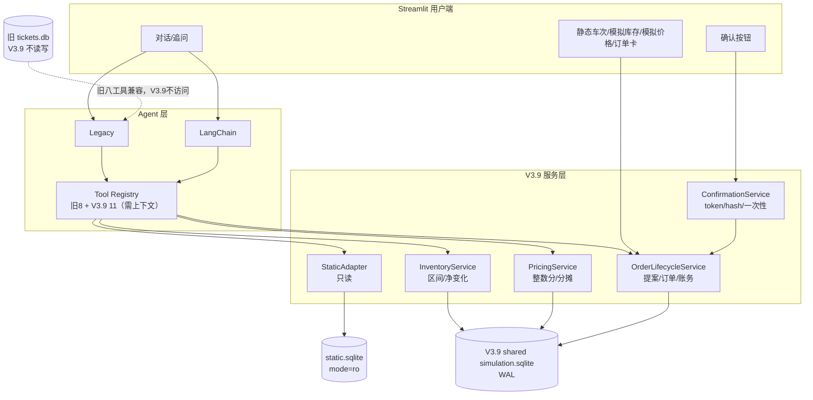
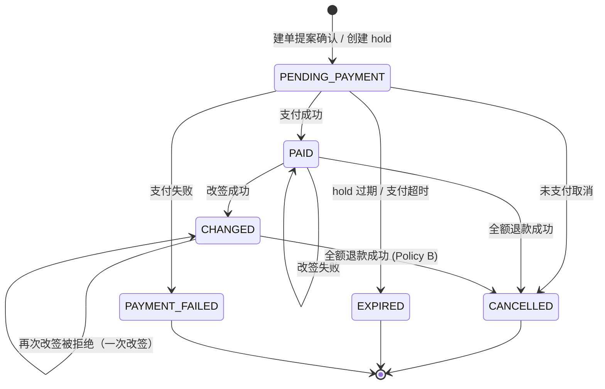
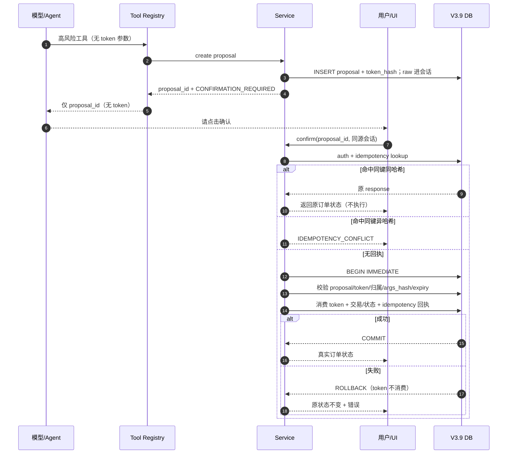

# Ticket Agent V3.9 架构设计 V1.2（第二轮 Codex 审查稿）

- **状态**：`ARCHITECTURE_V1_2_READY_FOR_CODEX_REVIEW` 候选
- **不表示**：`CODEX_REVIEW_PASSED`、V3.9 已实现、正式 103 已通过
- **日期**：2026-11-02（Asia/Shanghai）
- **基线 HEAD**：`4340b6640025be95e8300a3d625a32cfb431e35d`
- **关系**：完整独立 V1.2 设计；不覆盖 V1.0/V1.1 原文
- **本轮范围**：只修订架构/SQL/权限/测试/审查材料；**未修改业务源码、测试、配置、数据库；未创建 V3.9 DB；未执行迁移。**

> D1–D8 仍是默认设计基准，不是用户已批准实施。R4 新增政策选项必须由用户决定；本文件不编造授权。

---

## 1. R1–R12 处理结果

| 编号 | 审查问题 | V1.2 处理 |
|---|---|---|
| R1 | 报价归属/跨用户 | `v39_quotes` 增加 `session_id/owner_phone`；创建时从服务端上下文取，不接受模型字段；建单、改签、确认重新验证 quote owner/session；新增 A 报价→B 建单/改签/确认攻击测试 |
| R2 | 改签聚合一致性 | 新增改签原子更新字段清单；旧 hold=`CHANGED`、新 hold=`CONSUMED`；旧 sold 仅在 `RELEASED` 段释放，保留段不重复扣；目标新段先 held 后 sold；失败回滚；新增 `v39_change_segments` |
| R3 | 账务模型 | 用统一 `v39_transactions` + `v39_transaction_allocations` 取代“每单仅一次支付/退款”；支持 PAYMENT/CHANGE_SUPPLEMENT/CHANGE_REFUND/REFUND；订单累计已收/已退/净收；部分退款按 item 分摊 |
| R4 | CHANGED 退款/失败恢复 | 四维状态拆分；退款请求保存 `prior_order_status/prior_total_fen`；失败恢复原状态；P01/P02/一次改签列为政策选项，需用户决定；新增 CHANGED 退款失败测试 |
| R5 | 确认与幂等顺序 | 固定 auth→幂等回执→参数哈希→proposal/token→同事务消费+业务+回执；同键异参拒绝；响应丢失返回原回执；token 重放与合法幂等重放区分 |
| R6 | secret 丢失/重启 | raw token 只在服务端会话内存；hash 持久化；重启后 raw 丢失，PENDING proposal 惰性置 `SECRET_LOST/EXPIRED`；不自动恢复；用户重新提案；TTL 在操作中校验 |
| R7 | 双引擎/权限 | 给出 Registry/Legacy/LangChain/Provider/EffectiveConfig/WriteAuthorization/FeatureFlag/Baseline/UI/Trace 十层接线矩阵；无 V3.9 上下文拒绝；Baseline 强制旧八工具 |
| R8 | Bridge 证据缺失 | 实际核对两份文件不存在，无可信备份/原始 SHA；不重写冒充；新增独立“证据缺口说明”文件；Bridge 仍 BLOCKED |
| R9 | 站序映射 | 明确 raw `stop_sequence`、规范 `sequence_index`（1-based）、`position`（0-based）、`segment_index`；公式覆盖首段/末段/全程/中间/跨日/隔离；实际 DB 11588 班次 min=1 |
| R10 | 重叠区间改签 | 计算 `RETAINED/NEW/RELEASED` 三集合；仅 NEW 段需要新容量，保留段复用旧 sold；先预留 NEW，后释放 RELEASED，失败不先释放旧库存 |
| R11 | 价格/乘客明细 | 价格读取实际 `base_fen_per_segment/seat_multiplier_bp/fixed_fee_fen`；固定费按乘客整数分摊，余数给前 N 项；`sum(item.fare_fen)=order.total_fen`；非零固定费/舍入测试 |
| R12 | 测试矩阵不足 | 新矩阵每项含 Test ID、目的、初始数据、用户、请求、顺序、预期响应、DB、库存、幂等、故障注入、回滚；覆盖 22 类指定场景 |

---

## 2. 基线与保护

| 项 | 实际 |
|---|---|
| 分支 | `feat/ticket-agent-v36-stabilization` |
| HEAD | `4340b6640025be95e8300a3d625a32cfb431e35d` |
| 暂存区 | 空 |
| 2100 Fixture | `feaec244...`；只读 |
| GTFS ZIP | `3877dbc0...`；只读 |
| 阶段八 SQLite | `e32f0cd4...`；只读 |
| 正式 103 | 103；`BLOCKED_WAITING_FOR_ORIGINAL_B_EXECUTOR`；不执行/不改 |
| B 7 份 | `web/datasets/b_v32_20261020/`；只读 |
| 1892/4056/5538 | 原清单引用/记录保留；本设计未重写 |
| 旧八工具/Prompt/Dimensions/Baseline | 保留；默认关闭新功能 |
| V1.0/V1.1 文档 | 保留，不覆盖 |

### R8 已确认的证据缺口

当前工作区不存在：

- `docs/collaboration/`
- `docs/reviews/Ticket-Agent-V3.9-Dual-Agent-Environment-and-Bridge-Audit.md`

`git` 无这些未跟踪文件的提交历史，`artifacts` 未找到可信原件/哈希。**不根据记忆重写冒充历史原件。** 新文件 `docs/reviews/Ticket-Agent-V3.9-Bridge-Evidence-Gap-20261102.md` 仅记录缺口与新建时间，不是历史原件。Bridge 仍 `BLOCKED_NOT_INSTALLED`（3080 不可达）。

---

## 3. 系统总体架构图



---

## 4. 静态 Adapter 与 R9 站序映射

### 4.1 身份与查询

- GTFS `static.sqlite` 只读，SHA `e32f...`，`source_sha256=3877...`；
- 六类查询：站名搜索、stop_id 站点、服务日车次、trip 经停、起终直达、数据信息；
- 全部结果 `real_time=false, availability_available=false, fare_available=false, booking_available=false`；
- 日期为**始发服务日**；保留原始到发字符串、`arrival_seconds/departure_seconds`、`arrival_at/departure_at`；47:53 不模 24；
- 187 个隔离班次整班次不可见，返回 `TRIP_QUARANTINED`；
- 同名站返回候选，不自动选。

### 4.2 三种站序概念（R9）

| 概念 | 来源 | 值域 | 用途 |
|---|---|---|---|
| `raw_stop_sequence` | GTFS `stop_times.stop_sequence` 原字符串/整数 | 原值，可能非连续 | 只作原始证据 |
| `sequence_index` | 阶段八标准化列（`CAST(stop_sequence AS INTEGER)`） | 实测全部 11588 班次从 **1** 开始，最大 49 | 班次内顺序标识 |
| `position` | 对有效经停按 `sequence_index` 升序的 **0-based** 序号 | `0..n-1` | 区间计算 |
| `segment_index` | 相邻站区间的 **0-based** 序号 | `0..n-2` | 库存键 |

**映射公式**：

```text
position(stop) = dense_rank() over (
  partition by trip_id, service_date
  order by CAST(raw_stop_sequence AS INTEGER)
) - 1
segment_index(prev, next) = position(prev)
covered_segments(o, d) = [position(o), position(d) - 1]
```

- 首站→第二站：`position=0→1`，`segment_index=0`；
- 最后一段：`position=n-2→n-1`，`segment_index=n-2`；
- 全程：`0..n-2`；
- 中间区间：`position(o)..position(d)-1`；
- 跨日：时刻用原始秒/实际 datetime，index 映射不变；
- 隔离 187 班次：在 Adapter 前整体拒绝，不进入 mapping/inventory；
- **禁止假定 raw 序号从零连续**；如果有缺口/重复，以排序后的 dense position 为准；重复 raw `stop_sequence` 属于数据异常，返回 `STATIC_SEQUENCE_AMBIGUOUS`，不猜。

实测：`SELECT MIN(sequence_index)=1`，11588 个有效 trip 的 `MIN(sequence_index)` 全部为 1；最大 49；`MIN<>1` 为 0。证据：`sequence-mapping.json`。

### 4.3 DTO 字段

`trip.stops[]` 至少包含：`stop_id, stop_name, raw_stop_sequence, sequence_index, position, arrival_time, departure_time, arrival_seconds, departure_seconds, arrival_at, departure_at, shape_status`。

---

## 5. 数据库共享域与 R1 报价归属

### 5.1 应用共享 DB

**D1**：一个应用共享 `data/v39/simulation.sqlite`；不按 conversation 分库。

- `scenario_id` 隔离库存/价格；
- `session_id` 绑定提案/令牌/高风险操作；
- `owner_phone` 绑定订单/报价归属；
- 不同用户可以在同一 scenario/segment 竞争库存（真实并发），但不能读取他人订单/报价；
- 测试用临时 DB；不碰共享库。

### 5.2 报价归属（R1）

`v39_quotes` 必须有：

```text
quote_id, session_id, owner_phone, scenario_id, dataset_version,
trip_id, service_date, origin/destination stop/sequence/position, seat_class,
passenger_count, rule_id/version, base/multiplier/fixed, totals,
quote_hash, status, expires_at, created_at
```

创建：

1. 服务端从当前会话上下文取 `session_id/owner_phone`，**工具参数没有 owner/session**；
2. 模型只能传 trip/日期/区间/席别/人数；
3. 写入 quote。

使用报价：

- 建单/改签目标报价/确认必须 `quote.owner_phone == current.owner AND quote.session_id == current.session_id`；
- 跨用户引用返回 `QUOTE_FORBIDDEN`，不泄露报价内容；
- 不能只靠 UI 隐藏；
- 建单/改签/确认在事务中**重新验证** quote 状态、归属、有效期、hash。

攻击测试：A 创建 quote，B 用 quote_id 建单/改签/确认 → 全部拒绝；A 的 quote 状态、B 无订单、库存无变化。

---

## 6. 完整 Schema（设计 DDL）

> 以下 DDL 与同包 `schema.sql` 一致；本步骤未执行。所有表在 V3.9 独立 DB；旧 `data/tickets.db` 不访问。

```sql
PRAGMA foreign_keys = ON;
PRAGMA journal_mode = WAL;

CREATE TABLE v39_schema_version (
  version INTEGER PRIMARY KEY,
  applied_at TEXT NOT NULL,
  checksum TEXT NOT NULL
);

CREATE TABLE v39_scenarios (
  scenario_id TEXT PRIMARY KEY,
  name TEXT NOT NULL,
  seed INTEGER NOT NULL,
  dataset_version TEXT NOT NULL,
  status TEXT NOT NULL CHECK (status IN ('ACTIVE','ARCHIVED')),
  config_json TEXT NOT NULL,
  created_at TEXT NOT NULL
);

CREATE TABLE v39_price_rules (
  rule_id TEXT NOT NULL,
  version INTEGER NOT NULL,
  scenario_id TEXT NOT NULL,
  dataset_version TEXT NOT NULL,
  trip_id TEXT,
  seat_class TEXT NOT NULL CHECK (seat_class IN ('SECOND','FIRST','BUSINESS')),
  base_fen_per_segment INTEGER NOT NULL CHECK (base_fen_per_segment > 0),
  seat_multiplier_bp INTEGER NOT NULL CHECK (seat_multiplier_bp > 0),
  fixed_fee_fen INTEGER NOT NULL DEFAULT 0 CHECK (fixed_fee_fen >= 0),
  valid_from TEXT NOT NULL,
  valid_until TEXT,
  status TEXT NOT NULL CHECK (status IN ('ACTIVE','INACTIVE')),
  PRIMARY KEY (rule_id, version),
  FOREIGN KEY (scenario_id) REFERENCES v39_scenarios(scenario_id)
);
CREATE UNIQUE INDEX ux_price_rule_scope
  ON v39_price_rules(scenario_id, COALESCE(trip_id,''), seat_class, valid_from);

CREATE TABLE v39_inventory_segments (
  scenario_id TEXT NOT NULL,
  dataset_version TEXT NOT NULL,
  trip_id TEXT NOT NULL,
  service_date TEXT NOT NULL,
  seat_class TEXT NOT NULL CHECK (seat_class IN ('SECOND','FIRST','BUSINESS')),
  segment_index INTEGER NOT NULL CHECK (segment_index >= 0),
  from_stop_id TEXT NOT NULL,
  from_sequence INTEGER NOT NULL CHECK (from_sequence >= 1),
  from_position INTEGER NOT NULL CHECK (from_position >= 0),
  to_stop_id TEXT NOT NULL,
  to_sequence INTEGER NOT NULL CHECK (to_sequence >= 1),
  to_position INTEGER NOT NULL CHECK (to_position >= 0),
  capacity INTEGER NOT NULL CHECK (capacity >= 0),
  held INTEGER NOT NULL DEFAULT 0 CHECK (held >= 0),
  sold INTEGER NOT NULL DEFAULT 0 CHECK (sold >= 0),
  version INTEGER NOT NULL DEFAULT 0,
  updated_at TEXT NOT NULL,
  PRIMARY KEY (scenario_id, dataset_version, trip_id, service_date, seat_class, segment_index),
  FOREIGN KEY (scenario_id) REFERENCES v39_scenarios(scenario_id),
  CHECK (from_position < to_position),
  CHECK (from_position + 1 = to_position),
  CHECK (held + sold <= capacity)
);
CREATE INDEX ix_inventory_lookup
  ON v39_inventory_segments(scenario_id, trip_id, service_date, seat_class);

CREATE TABLE v39_quotes (
  quote_id TEXT PRIMARY KEY,
  session_id TEXT NOT NULL,
  owner_phone TEXT NOT NULL,
  scenario_id TEXT NOT NULL,
  dataset_version TEXT NOT NULL,
  trip_id TEXT NOT NULL,
  service_date TEXT NOT NULL,
  origin_stop_id TEXT NOT NULL,
  destination_stop_id TEXT NOT NULL,
  origin_sequence INTEGER NOT NULL CHECK (origin_sequence >= 1),
  destination_sequence INTEGER NOT NULL CHECK (destination_sequence >= 1),
  origin_position INTEGER NOT NULL CHECK (origin_position >= 0),
  destination_position INTEGER NOT NULL CHECK (destination_position >= 0),
  seat_class TEXT NOT NULL CHECK (seat_class IN ('SECOND','FIRST','BUSINESS')),
  passenger_count INTEGER NOT NULL CHECK (passenger_count BETWEEN 1 AND 6),
  rule_id TEXT NOT NULL,
  rule_version INTEGER NOT NULL,
  base_fen_per_segment INTEGER NOT NULL CHECK (base_fen_per_segment > 0),
  seat_multiplier_bp INTEGER NOT NULL CHECK (seat_multiplier_bp > 0),
  fixed_fee_fen INTEGER NOT NULL DEFAULT 0 CHECK (fixed_fee_fen >= 0),
  segment_count INTEGER NOT NULL CHECK (segment_count > 0),
  single_base_fen INTEGER NOT NULL CHECK (single_base_fen >= 0),
  single_seat_fen INTEGER NOT NULL CHECK (single_seat_fen >= 0),
  base_total_fen INTEGER NOT NULL CHECK (base_total_fen >= 0),
  seat_total_fen INTEGER NOT NULL CHECK (seat_total_fen >= 0),
  total_fen INTEGER NOT NULL CHECK (total_fen >= 0),
  currency TEXT NOT NULL DEFAULT 'CNY',
  quote_hash TEXT NOT NULL,
  status TEXT NOT NULL CHECK (status IN ('ACTIVE','EXPIRED','CONSUMED')),
  expires_at TEXT NOT NULL,
  created_at TEXT NOT NULL,
  FOREIGN KEY (scenario_id) REFERENCES v39_scenarios(scenario_id),
  FOREIGN KEY (rule_id, rule_version) REFERENCES v39_price_rules(rule_id, version),
  CHECK (origin_position < destination_position),
  CHECK (segment_count = destination_position - origin_position)
);
CREATE INDEX ix_quotes_owner ON v39_quotes(owner_phone, session_id, status, expires_at);
CREATE INDEX ix_quotes_trip ON v39_quotes(scenario_id, trip_id, service_date);

CREATE TABLE v39_holds (
  hold_id TEXT PRIMARY KEY,
  quote_id TEXT NOT NULL,
  order_id TEXT,
  change_id TEXT,
  session_id TEXT NOT NULL,
  owner_phone TEXT NOT NULL,
  scenario_id TEXT NOT NULL,
  trip_id TEXT NOT NULL,
  service_date TEXT NOT NULL,
  seat_class TEXT NOT NULL CHECK (seat_class IN ('SECOND','FIRST','BUSINESS')),
  quantity INTEGER NOT NULL CHECK (quantity BETWEEN 1 AND 6),
  status TEXT NOT NULL CHECK (status IN ('ACTIVE','CONSUMED','RELEASED','EXPIRED','CHANGED')),
  expires_at TEXT NOT NULL,
  created_at TEXT NOT NULL,
  released_at TEXT,
  version INTEGER NOT NULL DEFAULT 0,
  FOREIGN KEY (quote_id) REFERENCES v39_quotes(quote_id),
  FOREIGN KEY (scenario_id) REFERENCES v39_scenarios(scenario_id)
);
CREATE INDEX ix_holds_expiry ON v39_holds(status, expires_at);
CREATE INDEX ix_holds_owner ON v39_holds(owner_phone, status);

CREATE TABLE v39_hold_segments (
  hold_id TEXT NOT NULL,
  segment_index INTEGER NOT NULL CHECK (segment_index >= 0),
  quantity INTEGER NOT NULL CHECK (quantity BETWEEN 1 AND 6),
  inventory_role TEXT NOT NULL CHECK (inventory_role IN ('NEW','RETAINED')),
  PRIMARY KEY (hold_id, segment_index),
  FOREIGN KEY (hold_id) REFERENCES v39_holds(hold_id) ON DELETE CASCADE
);

CREATE TABLE v39_proposals (
  proposal_id TEXT PRIMARY KEY,
  session_id TEXT NOT NULL,
  owner_phone TEXT NOT NULL,
  action TEXT NOT NULL CHECK (action IN ('CREATE_ORDER','PAY','CANCEL','REFUND','CHANGE')),
  aggregate_id TEXT,
  quote_id TEXT,
  order_id TEXT,
  scenario_id TEXT NOT NULL,
  idempotency_key TEXT NOT NULL,
  request_hash TEXT NOT NULL,
  payload_json TEXT NOT NULL,
  state TEXT NOT NULL CHECK (state IN ('PENDING','CONFIRMED','CANCELLED','EXPIRED','SECRET_LOST')),
  expires_at TEXT NOT NULL,
  created_at TEXT NOT NULL,
  consumed_at TEXT,
  FOREIGN KEY (scenario_id) REFERENCES v39_scenarios(scenario_id),
  FOREIGN KEY (quote_id) REFERENCES v39_quotes(quote_id),
  UNIQUE (session_id, action, idempotency_key)
);
CREATE UNIQUE INDEX ux_proposal_pending
  ON v39_proposals(session_id, action, COALESCE(aggregate_id,''), state)
  WHERE state='PENDING';
CREATE INDEX ix_proposals_expiry ON v39_proposals(state, expires_at);

CREATE TABLE v39_orders (
  order_id TEXT PRIMARY KEY,
  proposal_id TEXT NOT NULL,
  session_id TEXT NOT NULL,
  owner_phone TEXT NOT NULL,
  scenario_id TEXT NOT NULL,
  dataset_version TEXT NOT NULL,
  quote_id TEXT NOT NULL,
  hold_id TEXT NOT NULL,
  trip_id TEXT NOT NULL,
  service_date TEXT NOT NULL,
  origin_stop_id TEXT NOT NULL,
  destination_stop_id TEXT NOT NULL,
  origin_sequence INTEGER NOT NULL CHECK (origin_sequence >= 1),
  destination_sequence INTEGER NOT NULL CHECK (destination_sequence >= 1),
  origin_position INTEGER NOT NULL,
  destination_position INTEGER NOT NULL,
  seat_class TEXT NOT NULL CHECK (seat_class IN ('SECOND','FIRST','BUSINESS')),
  passenger_count INTEGER NOT NULL CHECK (passenger_count BETWEEN 1 AND 6),
  total_fen INTEGER NOT NULL CHECK (total_fen >= 0),
  paid_total_fen INTEGER NOT NULL DEFAULT 0 CHECK (paid_total_fen >= 0),
  refunded_total_fen INTEGER NOT NULL DEFAULT 0 CHECK (refunded_total_fen >= 0),
  fee_total_fen INTEGER NOT NULL DEFAULT 0 CHECK (fee_total_fen >= 0),
  net_paid_fen INTEGER NOT NULL DEFAULT 0 CHECK (net_paid_fen >= 0),
  currency TEXT NOT NULL DEFAULT 'CNY',
  order_status TEXT NOT NULL CHECK (order_status IN
    ('PENDING_PAYMENT','PAID','CHANGED','CANCELLED','EXPIRED','PAYMENT_FAILED')),
  payment_status TEXT NOT NULL CHECK (payment_status IN
    ('UNPAID','PENDING','SUCCEEDED','FAILED','TIMEOUT')),
  refund_status TEXT NOT NULL CHECK (refund_status IN
    ('NONE','REQUESTED','SUCCEEDED','FAILED')),
  change_status TEXT NOT NULL CHECK (change_status IN
    ('NONE','REQUESTED','SUCCEEDED','FAILED')),
  change_count INTEGER NOT NULL DEFAULT 0 CHECK (change_count BETWEEN 0 AND 1),
  policy_profile TEXT NOT NULL DEFAULT 'P02_STRICT',
  idempotency_key TEXT NOT NULL,
  created_at TEXT NOT NULL,
  updated_at TEXT NOT NULL,
  expires_at TEXT NOT NULL,
  version INTEGER NOT NULL DEFAULT 0,
  FOREIGN KEY (proposal_id) REFERENCES v39_proposals(proposal_id),
  FOREIGN KEY (scenario_id) REFERENCES v39_scenarios(scenario_id),
  FOREIGN KEY (quote_id) REFERENCES v39_quotes(quote_id),
  FOREIGN KEY (hold_id) REFERENCES v39_holds(hold_id),
  UNIQUE (session_id, idempotency_key),
  UNIQUE (quote_id),
  UNIQUE (hold_id),
  CHECK (origin_position < destination_position)
);
CREATE INDEX ix_orders_owner ON v39_orders(owner_phone, created_at DESC);
CREATE INDEX ix_orders_state ON v39_orders(order_status, expires_at);

CREATE TABLE v39_order_items (
  item_id TEXT PRIMARY KEY,
  order_id TEXT NOT NULL,
  passenger_index INTEGER NOT NULL CHECK (passenger_index BETWEEN 0 AND 5),
  passenger_name TEXT NOT NULL,
  seat_class TEXT NOT NULL CHECK (seat_class IN ('SECOND','FIRST','BUSINESS')),
  base_fen INTEGER NOT NULL CHECK (base_fen >= 0),
  seat_fen INTEGER NOT NULL CHECK (seat_fen >= 0),
  fixed_fee_share_fen INTEGER NOT NULL CHECK (fixed_fee_share_fen >= 0),
  fare_fen INTEGER NOT NULL CHECK (fare_fen >= 0),
  item_status TEXT NOT NULL CHECK (item_status IN ('ACTIVE','CANCELLED','REFUNDED','CHANGED')),
  created_at TEXT NOT NULL,
  FOREIGN KEY (order_id) REFERENCES v39_orders(order_id) ON DELETE CASCADE,
  UNIQUE (order_id, passenger_index),
  CHECK (fare_fen = seat_fen + fixed_fee_share_fen)
);
CREATE INDEX ix_order_items_order ON v39_order_items(order_id);

CREATE TABLE v39_order_snapshots (
  order_id TEXT NOT NULL,
  snapshot_version INTEGER NOT NULL,
  static_snapshot_json TEXT NOT NULL,
  price_snapshot_json TEXT NOT NULL,
  quote_hash TEXT NOT NULL,
  created_at TEXT NOT NULL,
  PRIMARY KEY (order_id, snapshot_version),
  FOREIGN KEY (order_id) REFERENCES v39_orders(order_id) ON DELETE CASCADE
);

CREATE TABLE v39_transactions (
  transaction_id TEXT PRIMARY KEY,
  order_id TEXT NOT NULL,
  change_id TEXT,
  transaction_type TEXT NOT NULL CHECK (transaction_type IN
    ('PAYMENT','CHANGE_SUPPLEMENT','CHANGE_REFUND','REFUND')),
  direction TEXT NOT NULL CHECK (direction IN ('DEBIT','CREDIT')),
  amount_fen INTEGER NOT NULL CHECK (amount_fen > 0),
  status TEXT NOT NULL CHECK (status IN ('PENDING','SUCCEEDED','FAILED','TIMEOUT')),
  failure_code TEXT,
  provider TEXT NOT NULL DEFAULT 'SIMULATED' CHECK (provider='SIMULATED'),
  idempotency_key TEXT NOT NULL,
  request_hash TEXT NOT NULL,
  created_at TEXT NOT NULL,
  finished_at TEXT,
  FOREIGN KEY (order_id) REFERENCES v39_orders(order_id),
  FOREIGN KEY (change_id) REFERENCES v39_change_requests(change_id),
  UNIQUE (order_id, transaction_type, idempotency_key)
);
CREATE INDEX ix_transactions_order ON v39_transactions(order_id, created_at);
CREATE INDEX ix_transactions_change ON v39_transactions(change_id, created_at);

CREATE TABLE v39_transaction_allocations (
  allocation_id TEXT PRIMARY KEY,
  transaction_id TEXT NOT NULL,
  order_item_id TEXT,
  change_id TEXT,
  amount_fen INTEGER NOT NULL CHECK (amount_fen >= 0),
  FOREIGN KEY (transaction_id) REFERENCES v39_transactions(transaction_id) ON DELETE CASCADE,
  FOREIGN KEY (order_item_id) REFERENCES v39_order_items(item_id),
  FOREIGN KEY (change_id) REFERENCES v39_change_requests(change_id)
);
CREATE INDEX ix_alloc_transaction ON v39_transaction_allocations(transaction_id);

CREATE TABLE v39_refund_requests (
  refund_id TEXT PRIMARY KEY,
  order_id TEXT NOT NULL,
  scope TEXT NOT NULL CHECK (scope IN ('FULL','ITEMS')),
  requested_fen INTEGER NOT NULL CHECK (requested_fen >= 0),
  status TEXT NOT NULL CHECK (status IN ('PENDING','SUCCEEDED','FAILED')),
  prior_order_status TEXT NOT NULL,
  prior_total_fen INTEGER NOT NULL CHECK (prior_total_fen >= 0),
  reason TEXT,
  failure_code TEXT,
  idempotency_key TEXT NOT NULL,
  created_at TEXT NOT NULL,
  finished_at TEXT,
  FOREIGN KEY (order_id) REFERENCES v39_orders(order_id),
  UNIQUE (order_id, idempotency_key)
);
CREATE INDEX ix_refund_requests_order ON v39_refund_requests(order_id, created_at);

CREATE TABLE v39_refund_items (
  refund_id TEXT NOT NULL,
  order_item_id TEXT NOT NULL,
  amount_fen INTEGER NOT NULL CHECK (amount_fen >= 0),
  fee_fen INTEGER NOT NULL DEFAULT 0 CHECK (fee_fen >= 0),
  net_fen INTEGER NOT NULL CHECK (net_fen >= 0),
  PRIMARY KEY (refund_id, order_item_id),
  FOREIGN KEY (refund_id) REFERENCES v39_refund_requests(refund_id) ON DELETE CASCADE,
  FOREIGN KEY (order_item_id) REFERENCES v39_order_items(item_id),
  CHECK (amount_fen = fee_fen + net_fen)
);

CREATE TABLE v39_change_requests (
  change_id TEXT PRIMARY KEY,
  order_id TEXT NOT NULL,
  old_hold_id TEXT NOT NULL,
  new_hold_id TEXT,
  old_quote_id TEXT NOT NULL,
  target_quote_id TEXT NOT NULL,
  target_trip_id TEXT NOT NULL,
  target_service_date TEXT NOT NULL,
  target_origin_stop_id TEXT NOT NULL,
  target_destination_stop_id TEXT NOT NULL,
  target_origin_position INTEGER NOT NULL,
  target_destination_position INTEGER NOT NULL,
  target_seat_class TEXT NOT NULL CHECK (target_seat_class IN ('SECOND','FIRST','BUSINESS')),
  difference_fen INTEGER NOT NULL,
  status TEXT NOT NULL CHECK (status IN ('PENDING','CONFIRMED','REJECTED','FAILED')),
  prior_order_status TEXT NOT NULL,
  prior_total_fen INTEGER NOT NULL CHECK (prior_total_fen >= 0),
  failure_code TEXT,
  idempotency_key TEXT NOT NULL,
  created_at TEXT NOT NULL,
  finished_at TEXT,
  FOREIGN KEY (order_id) REFERENCES v39_orders(order_id),
  FOREIGN KEY (old_hold_id) REFERENCES v39_holds(hold_id),
  FOREIGN KEY (new_hold_id) REFERENCES v39_holds(hold_id),
  FOREIGN KEY (old_quote_id) REFERENCES v39_quotes(quote_id),
  FOREIGN KEY (target_quote_id) REFERENCES v39_quotes(quote_id),
  UNIQUE (order_id, idempotency_key)
);
CREATE INDEX ix_changes_order ON v39_change_requests(order_id, created_at);

CREATE TABLE v39_change_segments (
  change_id TEXT NOT NULL,
  segment_index INTEGER NOT NULL,
  role TEXT NOT NULL CHECK (role IN ('RETAINED','NEW','RELEASED')),
  quantity INTEGER NOT NULL CHECK (quantity BETWEEN 1 AND 6),
  PRIMARY KEY (change_id, segment_index),
  FOREIGN KEY (change_id) REFERENCES v39_change_requests(change_id) ON DELETE CASCADE
);

CREATE TABLE v39_confirmation_tokens (
  token_hash TEXT PRIMARY KEY,
  proposal_id TEXT NOT NULL,
  session_id TEXT NOT NULL,
  owner_phone TEXT NOT NULL,
  action TEXT NOT NULL,
  aggregate_id TEXT,
  quote_id TEXT,
  amount_fen INTEGER,
  args_hash TEXT NOT NULL,
  expires_at TEXT NOT NULL,
  used_at TEXT,
  invalidated_at TEXT,
  invalid_reason TEXT,
  created_at TEXT NOT NULL,
  FOREIGN KEY (proposal_id) REFERENCES v39_proposals(proposal_id),
  UNIQUE (proposal_id)
);

CREATE TABLE v39_idempotency (
  scope TEXT NOT NULL,
  key TEXT NOT NULL,
  request_hash TEXT NOT NULL,
  response_json TEXT NOT NULL,
  status TEXT NOT NULL CHECK (status IN ('SUCCEEDED','FAILED')),
  created_at TEXT NOT NULL,
  expires_at TEXT NOT NULL,
  PRIMARY KEY (scope, key)
);

CREATE TABLE v39_inventory_events (
  event_id TEXT PRIMARY KEY,
  scenario_id TEXT NOT NULL,
  trip_id TEXT NOT NULL,
  service_date TEXT NOT NULL,
  seat_class TEXT NOT NULL,
  segment_index INTEGER NOT NULL,
  delta_held INTEGER NOT NULL,
  delta_sold INTEGER NOT NULL,
  hold_id TEXT,
  order_id TEXT,
  change_id TEXT,
  reason TEXT NOT NULL,
  created_at TEXT NOT NULL
);
CREATE INDEX ix_inventory_events_scope
  ON v39_inventory_events(scenario_id, trip_id, service_date, seat_class);

CREATE TABLE v39_audit_events (
  event_id TEXT PRIMARY KEY,
  aggregate_type TEXT NOT NULL,
  aggregate_id TEXT NOT NULL,
  event_type TEXT NOT NULL,
  from_state TEXT,
  to_state TEXT,
  detail_json TEXT NOT NULL,
  request_id TEXT,
  created_at TEXT NOT NULL
);
CREATE INDEX ix_audit_aggregate ON v39_audit_events(aggregate_type, aggregate_id, created_at);
```

关键变化：

- `v39_quotes` owner/session（R1）；
- `v39_orders` 全部改签字段、`change_count`、累计已收/已退/净收（R2/R3）；
- `v39_hold_segments.inventory_role`（NEW/RETAINED）；
- `v39_transactions` + `v39_transaction_allocations`（R3）；
- `v39_refund_requests` + `v39_refund_items`（R3/R4）；
- `v39_change_requests` old/new holds、target quote、prior status（R2）；
- `v39_change_segments` RETAINED/NEW/RELEASED（R10）；
- `v39_confirmation_tokens` 只存 hash，无 raw 列（R6）；
- `v39_idempotency` 保存 request hash/response/expiry（R5）。

---

## 7. 库存、支付、退款、改签账务

### 7.1 库存变量与转换

```text
available = capacity - held - sold  # 派生
```

| 操作 | held | sold | 订单状态 | 说明 |
|---|---:|---:|---|---|
| hold 创建 | +q（NEW 段） | 0 | PENDING_PAYMENT | 条件更新全部覆盖段 |
| 支付成功 | -q | +q | PAID | 同事务 |
| 支付失败/超时 | -q | 0 | PAYMENT_FAILED/EXPIRED | 释放 held |
| 未支付取消 | -q | 0 | CANCELLED | 释放 held |
| 退款成功（full） | 0 | -q | CANCELLED | 释放 sold |
| 退款成功（partial） | 0 | -q_partial | 保持 PAID/CHANGED | item 级 |
| 退款失败 | 0 | 0 | 恢复 prior | 可重试 |
| 改签 | NEW 段 +q→-q→+q；RELEASED 段 -q；RETAINED 段 0 | NEW +q；RELEASED -q；RETAINED 0 | CHANGED | 见 R10 |
| hold 过期 | -q | 0 | EXPIRED | 条件回收一次 |

不变量：`held>=0`、`sold>=0`、`held+sold<=capacity`；每次变化写 `v39_inventory_events`；事件 delta 与行变化同事务。

### 7.2 R3 交易账本

`v39_transactions`：

| 字段 | 说明 |
|---|---|
| `transaction_id` | 唯一交易 ID |
| `order_id` | 订单 |
| `change_id` | 改签补/退适用，否则 NULL |
| `transaction_type` | `PAYMENT/CHANGE_SUPPLEMENT/CHANGE_REFUND/REFUND` |
| `direction` | `DEBIT`（客户付）/`CREDIT`（客户收） |
| `amount_fen` | 正整数分 |
| `status` | `PENDING/SUCCEEDED/FAILED/TIMEOUT` |
| `idempotency_key` | 唯一幂等 |
| `request_hash` | 参数哈希 |
| `created_at/finished_at` | 时间 |

`v39_transaction_allocations`：每笔交易按 order item 分摊，`sum(alloc.amount_fen)==transaction.amount_fen`（服务端断言）；部分退款必须有 allocation。

账务口径：

```text
paid_total_fen     = sum(amount_fen where direction=DEBIT and status=SUCCEEDED)
refunded_total_fen = sum(amount_fen where direction=CREDIT and status=SUCCEEDED)
net_paid_fen       = paid_total_fen - refunded_total_fen
current_face_fen   = sum(active order_item.fare_fen)
```

稳定态（PAID/CHANGED）要求 `net_paid_fen == current_face_fen + fee_total_fen`。无手续费时退化为 `net_paid_fen == current_face_fen`；全额退款后 `current_face_fen=0`，`net_paid_fen=fee_total_fen`（保留的 P01 手续费）；部分退款后 active item 面值与费用同步重算。订单表保存累计快照，账本为最终审计源。

改签：

- 新票价 > 旧：`CHANGE_SUPPLEMENT` DEBIT；
- 新票价 < 旧：`CHANGE_REFUND` CREDIT；
- 相等：不写金额交易，写 change 记录；
- 首次支付为 `PAYMENT`；
- 退款为 `REFUND`；部分退款用 allocations/refund_items；
- 不再有“每单只能一次成功支付/退款”的约束；只保留幂等唯一键和状态约束。

### 7.3 支付/补款/退差/退款事务流程

```mermaid
sequenceDiagram
    autonumber
    participant U as 用户/UI
    participant S as OrderLifecycleService
    participant I as InventoryService
    participant D as V3.9 DB
    U->>S: confirm(proposal_id) + 同源会话
    S->>D: BEGIN IMMEDIATE
    S->>D: auth + idempotency + proposal/token
    alt 首次支付
        S->>I: held -= q; sold += q
        S->>D: transaction(PAYMENT,DEBIT,SUCCEEDED)
        S->>D: order=PAID; payment=SUCCEEDED
    else 改签补款
        S->>I: NEW 段 held+=q; 成功后 held-=q,sold+=q
        S->>D: transaction(CHANGE_SUPPLEMENT,DEBIT)
        S->>D: order=CHANGED; change=SUCCEEDED
    else 改签退差
        S->>I: RELEASED 段 sold-=q; RETAINED 不动
        S->>D: transaction(CHANGE_REFUND,CREDIT)
        S->>D: order=CHANGED; change=SUCCEEDED
    else 退款
        S->>D: refund_request(prior_status/prior_total)
        alt 成功
            S->>I: 释放对应 item 的 sold
            S->>D: transaction(REFUND,CREDIT) + refund_items
            S->>D: full -> CANCELLED; partial -> prior status
        else 失败
            S->>D: order/refund 恢复 prior；sold 不变
        end
    end
    S->>D: audit + inventory_events + idempotency response + COMMIT
    D-->>S: 提交
    S-->>U: 从 DB 读取的真实状态
```

### 7.4 累计/部分退款

`v39_refund_requests`：

- `scope=FULL|ITEMS`；`prior_order_status`/`prior_total_fen`；`refund_items` 明细；
- 全额退款成功：订单 `CANCELLED`，全部 active item `REFUNDED`，sold 释放全部 q；
- 部分退款：只退 selected items；这些 item `REFUNDED`，订单 `total_fen` 重算；若仍有 active items，订单保持 `PAID` 或 `CHANGED`；sold 只释放对应区间数量（按 item 的覆盖段）；
- 退款失败：不改变 item/订单/库存；`refund_status=FAILED`，prior 状态恢复；
- 手续费：P01 按票价阶梯；整数分 half-up；fee 与 net 记入 `refund_items`；P02/政策选项见第 9 节。

---

## 8. R2/R10 改签原子更新

### 8.1 字段清单

改签成功必须在**同一事务**更新：

```text
trip_id, service_date,
origin_stop_id, destination_stop_id,
origin_sequence, destination_sequence,
origin_position, destination_position,
seat_class, quote_id, hold_id, total_fen,
order_items passenger names/seat/fare/fixed_fee_share,
order_snapshots new version,
paid_total_fen, refunded_total_fen, fee_total_fen, net_paid_fen,
change_count += 1, order_status=CHANGED, change_status=SUCCEEDED
```

旧字段保存在 `v39_change_requests`、`v39_order_snapshots`、`v39_change_segments`；不允许订单引用新 quote 但保留旧 hold。

### 8.2 Hold 最终状态

| 对象 | 最终状态 |
|---|---|
| 旧 hold（已支付时 CONSUMED） | `CHANGED`；保留历史，不再 active |
| 新 hold（目标 NEW 段） | `CONSUMED` |
| 新 hold 的 RETAINED 段 | 不创建 hold 记录；旧 sold 继续代表新票 |
| 失败目标 hold | `RELEASED` |
| 失败旧 hold | 保持 `CONSUMED`；旧 sold 不变 |

### 8.3 R10 区间净变化

旧覆盖 `O`，目标覆盖 `T`：

```text
RETAINED = O ∩ T       # 旧 sold q 继续占用，不重复扣
RELEASED = O - T       # 成功时 sold -= q
NEW      = T - O       # 先 held += q，成功时 held -= q, sold += q
```

顺序：

1. 验证 target quote/owner/状态/有效期；验证旧订单 `PAID/CHANGED`（按一次改签政策）；
2. 计算 RETAINED/RELEASED/NEW，写 `change_segments`；
3. **只对 NEW 段**条件 `held += q`；容量不足 → 失败，旧库存不动；
4. 处理差价：>0 补款交易成功；<0 退差交易成功；失败回滚；
5. 对 RELEASED 段条件 `sold -= q`；RETAINED 段不动；
6. NEW 段 `held -= q, sold += q`；
7. 更新订单全部字段/items/snapshot；旧 hold `CHANGED`，新 hold `CONSUMED`；
8. 写 change/transactions/audit/inventory events，提交。

示例容量 1：原 A→C 占 A-B、B-C；改 B→C：RETAINED=B-C，RELEASED=A-B，NEW=∅；无需新容量，成功。原 A→B 改 B→C：RELEASED=A-B，NEW=B-C，需 B-C 空闲；失败先不释放 A-B。

失败：目标 hold RELEASED；订单/items/snapshot/旧 sold/旧 hold 不变；`change_status=FAILED`，`prior_order_status` 保留；可重试（若政策允许）。

---

## 9. R4 状态机与政策

### 9.1 四维状态

| 维度 | 值 |
|---|---|
| order_status | `PENDING_PAYMENT/PAID/CHANGED/CANCELLED/EXPIRED/PAYMENT_FAILED` |
| payment_status | `UNPAID/PENDING/SUCCEEDED/FAILED/TIMEOUT` |
| refund_status | `NONE/REQUESTED/SUCCEEDED/FAILED` |
| change_status | `NONE/REQUESTED/SUCCEEDED/FAILED` |

### 9.2 状态迁移矩阵

| 当前订单 | 操作 | 成功 | 失败/拒绝 | 库存 |
|---|---|---|---|---|
| PENDING_PAYMENT | 支付 | PAID | PAYMENT_FAILED/EXPIRED | held→sold 或释放 |
| PENDING_PAYMENT | 取消 | CANCELLED | INVALID_STATE | 释放 held |
| PENDING_PAYMENT | 改签/退款 | 拒绝 | CHANGE/REFUND_NOT_ALLOWED | 无变化 |
| PAID | 退款 | CANCELLED（full）/PAID（partial） | PAID, refund=FAILED | full 释放 sold；partial 释放对应 item |
| PAID | 改签 | CHANGED | PAID, change=FAILED | 见 R10 |
| CHANGED | 退款（Policy B） | CHANGED（partial）或 CANCELLED（full） | **CHANGED**, refund=FAILED | 只释放对应 sold |
| CHANGED | 退款（Policy A/P02） | 拒绝 | CHANGED, REFUND_NOT_ALLOWED | 无变化 |
| CHANGED | 再次改签 | 拒绝（一次改签） | CHANGED | 无变化 |
| CANCELLED | 任何写 | 拒绝 | INVALID_STATE | 无变化 |
| EXPIRED | 任何写 | 拒绝 | INVALID_STATE | 无变化 |
| PAYMENT_FAILED | 任何写 | 拒绝；重新报价/新建 | INVALID_STATE | 无变化 |

退款失败必须恢复到 `prior_order_status`（`PAID` 或 `CHANGED`），不能一律 `PAID`；`prior_order_status`/`prior_total_fen` 存在 `v39_refund_requests`。

### 9.3 完整订单生命周期图



> `PAID`/`CHANGED` 上的退款/改签子状态由 `refund_status/change_status` 表达；上图只画订单主状态，不把“退款中”误画成独立订单状态。

### 9.4 P01/P02/一次改签政策选项

现有政策（`data/policies.md`）：

- **P01**：>48h 5%，24–48h 10%，<24h 20%；已取凭证/已改签不退；
- **P02**：每张票仅可改签一次，改签后不退；
- 现有 `target/order_refund.py` 对 changed 直接返回 P02；`target/reschedule.py` 只允许一次 paid 改签。

**选项 A：严格兼容 P02（默认兼容基线）**

- CHANGED 后退款一律 `REFUND_NOT_ALLOWED`；
- 一次改签；
- 优点：不改变旧政策，不引入未授权规则；缺点：R3/R4 的“改签后退款”只能作为拒绝分支，V3.9 功能较弱。

**选项 B：允许改签后按 P01 退款（推荐产品增强，需用户批准）**

- CHANGED 后可按 P01 对当前票价退全款/部分；仍只允许一次改签；
- 退款失败恢复 `CHANGED`，不释放 sold；
- 优点：完整生命周期、支持差价后退款；缺点：改变 P02，需明确告知用户/更新政策文本；
- 必须用户批准，不能默认打开。

**选项 C：允许改签后仅全额退款且不可再改**

- B 的保守子集；减少部分退款复杂度；
- 优点：政策更简单；缺点：仍改 P02，且不支持部分退款。

**推荐**：**A 作为兼容默认（不改变旧政策）；若产品要求改签后退款，采用 B 并由用户确认政策变更**。V1.2 Schema 同时支持 A/B：`policy_profile=P02_STRICT|CHANGED_REFUND_P01`；默认严格，B 需显式授权。

P01 手续费计算：`fee_fen = half_up(refundable_fen * rate_bp / 10000)`；rate 5%/10%/20%；`net_fen=amount-fee`；整数分；不看 LLM。

---

## 10. R5 幂等/确认顺序与 R6 secret 丢失

### 10.1 R5 固定顺序

```text
1. auth: 同源会话 + owner_phone + session_id
2. idempotency lookup: (scope='confirm', key)
3. found?
   - request_hash 相同 -> 返回原 response，不重新执行
   - request_hash 不同 -> IDEMPOTENCY_CONFLICT
4. not found:
   - 校验 proposal 存在/归属/未过期/state=PENDING
   - 校验 token 存在、未用、未失效、args_hash/amount/action 一致
5. BEGIN IMMEDIATE
   - 再次检查 token 条件 + proposal 状态
   - 消费 token（used_at）
   - 执行订单/库存/账务转换
   - 写 idempotency response
   - COMMIT
```

- 幂等键：服务端生成 `confirm:<session_id>:<proposal_id>:<action>`；不采用模型/客户端任意字符串；UI 重试用同一 proposal_id。
- 作用域：`confirm`；同一键不同 `request_hash` 拒绝；不跨用户/会话。
- 回执保存 30 天（`V39_IDEMPOTENCY_RETENTION_DAYS=30`），至少覆盖订单生命周期；审计日志永久。
- 业务已提交但 HTTP 响应丢失：重试命中回执，返回原 `order_id/state`；不重复扣/退。
- Token 重放：若首次已提交，合法同键重放走回执；不同键再用已消费 token → `CONFIRMATION_USED`；未提交 token 消费后业务失败 → 回滚 token（未消费），可重试。
- `v39_idempotency` 存 `request_hash/response_json/status/expires_at`。

### 10.2 权限/确认流程图



### 10.3 R6 secret 丢失

- raw token 只在服务端会话存储（内存/受保护 session store）；DB 只存 `token_hash`；
- **服务重启后 raw 丢失**：不能让 PENDING proposal 自动恢复；访问确认时返回 `CONFIRMATION_SECRET_LOST`，同一事务将 proposal 置 `SECRET_LOST`/`EXPIRED`；不自动重建 token；
- 旧 token hash 保留审计；`invalidated_at/invalid_reason` 记录；
- 用户重新发起 proposal；旧 pending unique 索引在置过期后可再建；
- 过期在**实际确认/操作**时再次校验 `expires_at`，不依赖后台回收；
- 跨会话恢复：只能查询自有订单；不能恢复 token/确认状态；需重新提案；
- 订单本身不因 secret 丢失而失效；PENDING_PAYMENT 可按 hold 过期规则处理。

`v39_proposals.state` 包含 `SECRET_LOST`；`v39_confirmation_tokens` 只存 hash，无 raw 字段。

---

## 11. R7 双引擎与权限接线矩阵

### 11.1 现有代码事实

| 文件 | 现有关键点 |
|---|---|
| `target/tools.py` | `TOOLS` 静态八工具、`TOOL_NAMES`、`validate` 只认旧集合、`dispatch` 唯一执行入口 |
| `target/agent.py` | `definitions=tools.TOOLS`，按 `EffectiveConfig.tool_whitelist` 过滤；Legacy 调 `tools.dispatch` |
| `target/langchain_agent.py` | `tool_names` 默认旧集合；`adapt_tool` 从 `tools.TOOLS` 取；不认识的名称被拒绝；`READ_ONLY_TOOLS` 仅旧两工具 |
| `target/execution_config.py` | `EffectiveConfig.tool_whitelist` 来自 `dev_overrides.TOOLS`；`tool_denial` 检查白名单/写策略/确认 |
| `target/deepseek_runtime.py` | `READ_ONLY` 旧两工具白名单 |
| `target/write_authorization.py` | `WRITE_TOOLS` 旧写工具集合；确认/归属/隐私预检 |
| `web/runtime.py` / `web/conversation.py` | 会话、页面确认、工具展示/Trace |
| `target/mock_core.py` | 旧八工具业务；V3.9 不写旧库 |

### 11.2 目标接线矩阵

| 层 | V3.9 接线 | 禁止 |
|---|---|---|
| Registry | 保留 `BASE_TOOLS`（旧八）+ `V39_TOOLS`（十一）；`resolve_definitions(profile)` | 不修改 `TOOLS` 常量、不把 V39 加进全局旧集合 |
| Legacy | `agent.py` 从 `resolve_definitions` 取；`dispatch` 只接受当前 profile 允许的名称 | 无 V3.9 上下文的 Legacy 不得获得新工具 |
| LangChain | `adapt_tool` 从 registry 取；`tool_names` 校验 base+V39（仅 profile）；`READ_ONLY_TOOLS` 不变 | 不复制业务服务；不绕过 `adapt_tool` |
| Provider | `allowed_tools` 仍旧八；V3.9 真实模型白名单需单独 profile 批准 | 全局开关开启也不能扩大正式 Provider 白名单 |
| EffectiveConfig | 新增 `railway_profile`/`v39_context`；`tool_whitelist = base` 或 `base+V39` | 不把 V39 放进 Baseline 的 `tool_whitelist` |
| Write Authorization | 新增 `V39_WRITES`；高风险工具必须 proposal/token；归属/隐私前置 | 不把 V39 写工具直接加进旧 `WRITE_TOOLS` 绕过旧确认 |
| Feature Flag | `RAILWAY_SIMULATION_ENABLED=0` 默认；必须同时有 V3.9 上下文（DB path/scenario/session） | 全局开启 ≠ Baseline 获得新工具 |
| Baseline | `execution_mode=baseline` 强制 `BASE_TOOLS`、旧 Prompt、旧 DIMENSIONS | 即使 flag 开，Baseline 仍八工具 |
| UI | 新卡片/确认按钮；UI 只显示当前 profile 允许工具 | 不用 UI 隐藏替代服务端归属 |
| Trace | 新 run/tool event 带 `v39_action/proposal/order/transaction` 旁证；旧字段不变 | 不伪造 Agent 页面调用；不把提案当执行 |

### 11.3 上下文缺失拒绝

```text
resolve_v39_context():
  session_id + owner_phone + scenario_id + db_path + feature_flag
  any missing -> V39_CONTEXT_REQUIRED
```

- 即使 `RAILWAY_SIMULATION_ENABLED=1`，无上下文仍拒绝新工具；
- Baseline 的 `effective_config` 不生成 V39 profile；
- Legacy/LangChain 均调用同一 `V39Policy`/service，权限一致。

本轮仅设计；**未修改上述生产文件**。

---

## 12. 11 个工具与权限（R1/R7）

完整 Schema 见 `tool-schemas.json`；全部无 `confirmation_token`。

| 工具 | 作用 | 风险 | 归属校验 |
|---|---|---|---|
| `railway_search_stations` | 站名/候选 | 只读 | 无 |
| `railway_query_trips` | 静态车次 | 只读 | 无 |
| `railway_trip_stops` | 经停 | 只读 | 无 |
| `railway_check_inventory` | 模拟余票 | 只读 | 无 |
| `railway_quote_fare` | 创建报价 | 低（写 quote） | 服务端 session/owner |
| `railway_create_order` | 建单提案 | 高 | quote owner/session + token |
| `railway_get_order` | 本人订单/历史 | 只读 | owner |
| `railway_pay_order` | 支付提案 | 高 | order owner + token |
| `railway_cancel_order` | 取消提案 | 高 | order owner + token |
| `railway_refund_order` | 退款提案 | 高 | order owner + token |
| `railway_change_order` | 改签提案 | 高 | order + target quote owner + token |

高风险工具只返回 `proposal_id/status=CONFIRMATION_REQUIRED`，不执行订单/库存/账务；token 不在 Schema/参数/Prompt/对话/Trace。

权限矩阵见 `permissions.json`；模型不能确认，UI/服务端确认。

---

## 13. R11 价格与乘客明细

价格必须读取选中规则字段，**不硬编码 1000**：

```text
base_fen_per_segment = rule.base_fen_per_segment
seat_multiplier_bp   = rule.seat_multiplier_bp
fixed_fee_fen        = rule.fixed_fee_fen
segment_count        = destination_position - origin_position
single_base_fen      = base_fen_per_segment * segment_count
single_seat_fen      = half_up(single_base_fen * seat_multiplier_bp / 10000)
base_total_fen       = single_base_fen * passenger_count
seat_total_fen       = single_seat_fen * passenger_count
fee_q, fee_r         = divmod(fixed_fee_fen, passenger_count)
item_fixed_share[i]  = fee_q + (1 if i < fee_r else 0)
item_fare[i]         = single_seat_fen + item_fixed_share[i]
order_total_fen      = sum(item_fare) = seat_total_fen + fixed_fee_fen
```

- 固定费每单一次，按乘客整数分摊；余数给前 `r` 个乘客（按 `passenger_index` 升序）；不四舍五入到元；
- 报价保存 rule/base/multiplier/fixed/single/totals/quote_hash；
- 订单 items 每人的 `fare_fen` 合计严格等于订单 `total_fen`；
- 部分退款按 item 的 `fare_fen` 或明确政策比例；手续费另列 `fee_fen`，`amount=net+fee`；
- 非零固定费、不同规则版本、舍入边界纳入测试；
- 全程整数分，无 float。

D7 默认值（仅 seed）：1000 分/区间，系数 10000/15000/30000，固定费 0；规则可以覆盖，不能硬编码。

---

## 14. UI、迁移、错误与审计（摘要）

- UI：静态/模拟库存/模拟价格/订单四类卡；明确 `SIMULATED`；确认按钮；保留旧布局/key；四规格；
- Migration：新 DB，单事务 DDL，`v39_schema_version`；失败隔离；旧库不 ALTER；
- Rollback：关闭 flag、备份/归档新 DB；旧库/GTFS 不动；
- 错误码：`QUOTE_FORBIDDEN`、`QUOTE_EXPIRED`、`CONFIRMATION_SECRET_LOST`、`IDEMPOTENCY_CONFLICT`、`TRANSACTION_FAILED`、`CHANGE_OVERLAP_CONFLICT`、`STATIC_SEQUENCE_AMBIGUOUS`、`POLICY_NOT_CONFIGURED` 等；
- 审计：`v39_audit_events`、`v39_inventory_events`、transactions/allocations；不记录 raw token/key/证件；
- 配置：`RAILWAY_SIMULATION_ENABLED=0`，DB paths，TTL，policy profile，idempotency retention。

---

## 15. R12 测试矩阵

完整逐项矩阵见 `test-matrix.json`；每项包含：

`test_id, purpose, setup, users, request, sequence, expected_response, expected_db, inventory_delta, idempotency_assertion, fault_injection, rollback_assertion`。

覆盖：

1 跨用户报价；2 跨用户订单；3 提交成功响应丢失；4 同键异参；5 token 重放；6 secret 丢失；7 pending 过期；8 支付/hold 过期竞争；9 改签成功后退款；10 退款失败保持 CHANGED；11 改签补款；12 改签退差；13 累计收退款对账；14 flag 开但 Baseline 隔离；15 多进程并发；16 库存事件守恒；17 重叠区间改签；18 非零固定费；19 一基站序映射；20 187 隔离；21 47:53 跨日；22 多用户共享 DB。

矩阵是设计，不是执行结果；不得把“增加测试标题”写成测试通过。

---

## 16. D1–D9 决策记录

| 决策 | V1.2 |
|---|---|
| D1 | 独立应用共享 V3.9 SQLite；旧 tickets.db 不改 |
| D2 | 区间分段库存 |
| D3 | 仅模拟 SECOND/FIRST/BUSINESS |
| D4 | hold 900 / quote 600 / confirmation 300 |
| D5 | 11 个 railway_*；旧八不变；默认关闭 |
| D6 | 服务端 token+UI；模型只提案 |
| D7 | seed 20261102；容量 20/8/3 等；1000 分/区间；系数 10000/15000/30000；固定费 0（规则可覆盖） |
| D8 | 本阶段不统一旧历史 |
| D9 | 政策 Profile 待用户确认：A=`P02_STRICT`（兼容默认，CHANGED 退款拒绝）；B=`CHANGED_REFUND_P01`（允许改签后按 P01 退款） |

**新增政策决策 D9（需用户确认）**：

- 推荐 **A 兼容 P02** 作为默认；若需要改签后退款，采用 **B** 并更新政策文本；
- 一次改签限制保留（需确认）；
- P01 手续费阶梯保留。
- D9 未确认前不得把任意选项写成用户批准。

---

## 17. 风险与未解决项

1. **R8 历史证据缺失**：两份文件当前不存在，无备份/SHA；已新建缺口说明，不冒充原件。
2. **Bridge BLOCKED**：3080 不可达；不能派发 Codex 可写任务。
3. **正式 103/B BLOCKED**：不能宣称正式通过。
4. **D9 政策未定**：CHANGED 退款与一次改签需用户选择。
5. **DDL 未执行**：schema 是设计；未创建数据库。
6. **Mermaid 未 CLI 渲染**：4 个源图已提供；当前环境无渲染器，需 Codex/工具复核。
7. **R1 归属测试未执行**：设计矩阵，不是通过。
8. **R7 接线未实施**：只给设计，不改生产代码。

---

## 18. 交付与状态

- 文档：`docs/reviews/Ticket-Agent-V3.9-Architecture-Design-v1.2.md`
- 包：`artifacts/runtime/v39-architecture-v1.2-20261102-235454/`
- 保留 V1.0/V1.1 原文和 Codex 审查发现。
- **状态**：`ARCHITECTURE_V1_2_READY_FOR_CODEX_REVIEW`（候选；不等于通过）。
- 停止：不进入业务编码、不建 DB、不迁移、不 Commit/Push/Merge。
