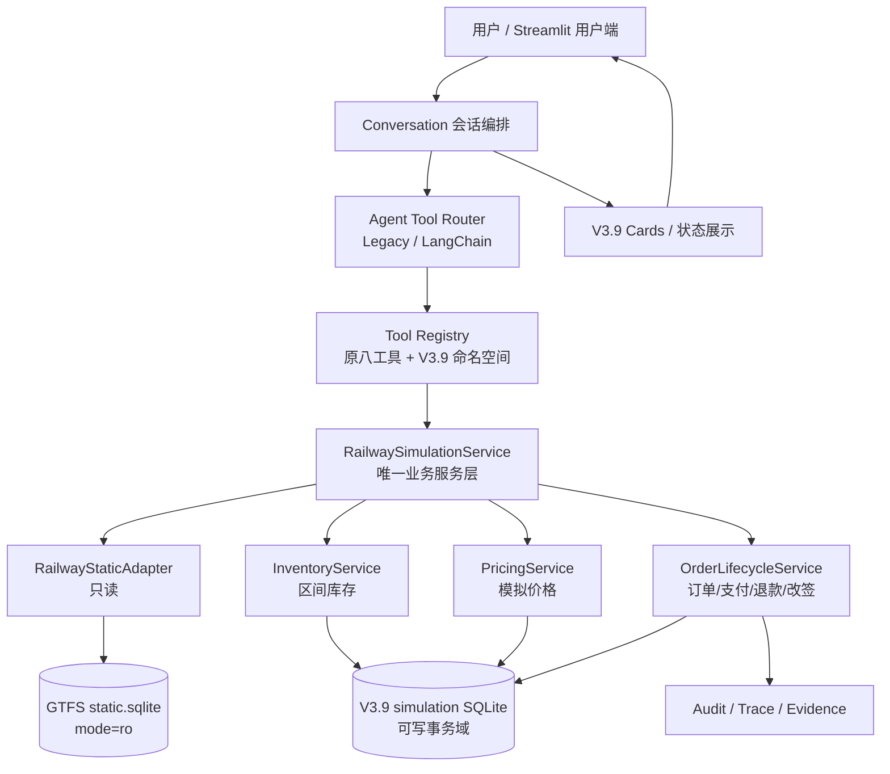
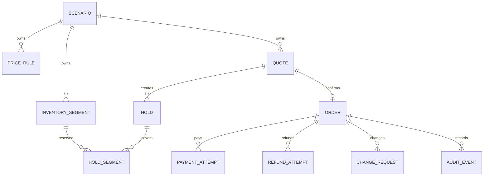
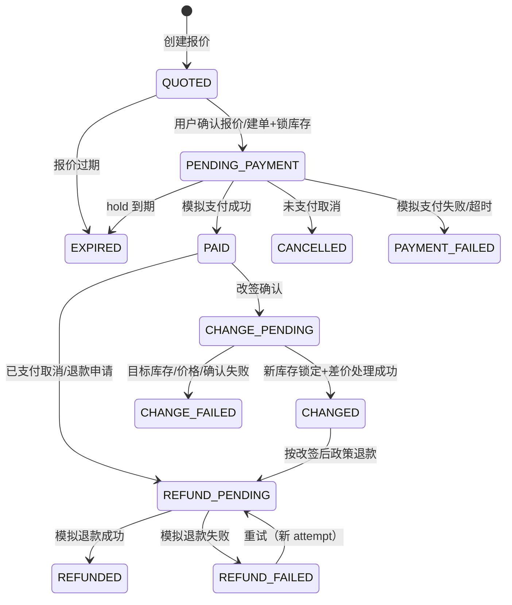

# Ticket Agent V3.9 架构设计（审查稿）

- **文档状态**：`PENDING_USER_CONFIRMATION` + `CODEX_REVIEW_NOT_DISPATCHED`
- **日期**：2026-11-02（Asia/Shanghai）
- **基线 HEAD**：`4340b6640025be95e8300a3d625a32cfb431e35d`
- **分支**：`feat/ticket-agent-v36-stabilization`
- **本轮范围**：只读基线冻结 + 架构设计；**未修改任何 Ticket Agent 业务代码、测试、数据库、配置或正式证据**。
- **安全前置**：Bridge 3080 不可达，H1/H2/H3/M1 未整改；未派发 Codex 可写任务，未启动业务实现。

> 本设计中的“必须”表示通过 Codex 架构审查和用户确认后的实施约束；“建议/待定”表示需用户决策的开放问题。不得把本文件当作实现完成或正式验收。

---

## 1. 现场基线

### 1.1 实际 Git 与工作区

| 项 | 值 |
|---|---|
| 仓库 | `D:\codexproject\ticket-agent` |
| 分支 | `feat/ticket-agent-v36-stabilization` |
| HEAD | `4340b6640025be95e8300a3d625a32cfb431e35d` |
| 暂存区 | 空 |
| 工作区 | 保留 V3.7/V3.8 未提交源码、视觉修改、阶段八原型和报告；本设计不覆盖 |
| 本设计改动 | 仅新增架构报告/证据 JSON；没有业务源码修改 |

开工证据：`artifacts/runtime/v39-architecture-20261102/before.json`、`hashes.json`。

### 1.2 冻结资产

| 资产 | SHA-256 / 状态 |
|---|---|
| 2100 Fixture `data/fixtures/train-v1.json` | `feaec244decbe9ed25f42b5fa7767bb4fb65d76e5313d8b1a52db14826b29217` |
| 原始 GTFS ZIP `output_gtfs.zip` | `3877dbc0ebc0392afef4b111dd9ba837c97eb4aa45788542919be53d52a12030` |
| 阶段八 SQLite `static.sqlite` | `e32f0cd41b45532ea7aedf4c72a6ffc24f6eaa23c042ee8f35cb02aa50735c69` |
| 正式用例目录 | 103 条，状态仍为 `BLOCKED_WAITING_FOR_ORIGINAL_B_EXECUTOR` |
| B 快照 | 7 份文件，manifest 存在；本设计未改写 |
| 阶段八报告 | `COMPLETE_WITH_RESTRICTIONS`，`LOCAL_DEMO_ONLY`，`RIGHTS_REVIEW_PENDING` |
| 1892 保护清单 | 引用 `artifacts/runtime/v37-phase1-20261101/verification.json`，`protected_files=1892` |
| 4056 历史清单 | 只作历史引用；本架构步骤未重新逐项哈希，不冒充已复核 |
| 历史 1441 passed / 11 failed / 1 skipped / 199 subtests | 基线数字保留；本轮未重跑，不把设计当 PASS |

### 1.3 阶段八固定数据约束

- Release `gtfs-20261101-063437`，Commit `adb0852237d7d4a529c9ee4daa9d7d5ebb1b6ab8`；
- 原始站点 3,169、原始班次 11,775、原始经停 109,729；
- 188 条时间异常、187 个整班次隔离、11,588 个有效班次、107,669 有效经停；
- 26 个未独立核验坐标、3,558 个缺失 shape_id、别名表空；
- 原始 GTFS 只读；阶段八 SQLite 只读；不重新导入、不修复 187 班次、不补别名/坐标/shape。

### 1.4 Bridge 安全状态

- `127.0.0.1:3080` 不可达，未见 Bridge 安装/监听；
- H1 重定向、H2 响应体超时、H3 项目/写入隔离、M1 completed≠停止，均未整改/未独立复核；
- 因此：**不通过 Bridge 派发可写任务，不调用 Codex 审查会话，不创建/发送 Harness 任务**；
- 架构设计只能作为静态审查包提交，由用户在 Bridge 整改后自行交给 Codex。

---

## 2. 目标与非目标

### 2.1 目标

1. 用户在现有 Streamlit 用户端通过自然语言查询静态车次、经停站、运行日期；
2. 查询**模拟**余票和**模拟**价格；
3. 完成模拟报价、锁座、订单、支付、取消、退款、改签、历史查询；
4. 静态数据、模拟库存、模拟价格、模拟交易四层明确分开；
5. 桌面/手机、浅色/深色四规格不破坏原 UI；
6. 原八工具、旧 Prompt、DIMENSIONS、Baseline、正式 103 和 B 快照保持兼容；
7. 所有业务可离线、确定、可回放、可审计。

### 2.2 非目标

- 不接 12306、95306、RailGo 或任何实时铁路接口；
- 不接真实支付、乘客、发票、短信、邮件系统；
- 不把静态时刻解释为真实余票/真实票价；
- 不把模拟库存写回 GTFS；
- 不自动修复 187 个异常班次、不补全缺失 shape/坐标/别名；
- 不修改正式 103 的 expect、B 快照或历史失败；
- 不在本阶段进入真实模型收费调用；真实模型调用需用户单独授权。

---

## 3. 总体架构



### 3.1 分层边界

| 层 | 职责 | 禁止 |
|---|---|---|
| 静态 Adapter | 只读查询、身份校验、日期/经停/隔离语义 | 写 GTFS、补数据、推断余票/票价 |
| 模拟服务层 | 场景、库存、报价、订单、支付、退款、改签 | 依赖 Streamlit、依赖模型输出做一致性判断 |
| Tool Registry | Schema、权限、参数校验、确认令牌、双引擎注册 | 在 Legacy/LangChain 各写一套业务 |
| UI | 展示、确认按钮、错误提示 | 直接写数据库、绕过服务确认 |
| SQLite | V3.9 事务域 | 与 GTFS 同库、写旧业务库 |

### 3.2 关键不变量

1. GTFS 只读连接，业务写连接永不指向 `static.sqlite`；
2. 所有静态结果带 `real_time=false`、`availability_available=false`、`fare_available=false`、`booking_available=false`；
3. 所有模拟结果带 `SIMULATED_INVENTORY` / `SIMULATED_FARE` / `SIMULATED_TRANSACTION`；
4. 任何订单必须引用有效报价快照、场景、数据集版本、trip/服务日/区间；
5. 库存扣减、订单状态、支付、退款、改签在**同一 SQLite 事务**内提交或回滚；
6. 模型不能自己生成/确认高风险令牌；
7. 关闭 `RAILWAY_SIMULATION_ENABLED` 时原八工具行为字节级不变。

---

## 4. 静态数据接入

### 4.1 复用方式

复用 `prototypes/railway_static/` 的 `Dataset`、`schema`、`calendar`、`quality`，**不修改原型文件**。新增：

```text
target/v39/railway_static.py          # 只读 Adapter / DTO / 状态映射
target/v39/railway_identity.py        # DB SHA、metadata、固定版本校验
target/v39/tool_registry.py           # 新工具定义与权限
target/v39/simulation/                # 场景、库存、价格、订单领域
target/v39/store.py                   # V3.9 SQLite 连接/迁移
web/v39_cards.py                      # 铁路/模拟卡片
tests/v39/                            # 新测试，独立于正式103
```

`prototypes/railway_static` 仅作为只读实现依赖，导入路径固定；不将其复制成第二套查询逻辑。

### 4.2 数据集身份

启动/首次查询时：

1. 解析固定 `V39_RAILWAY_DB_PATH`；
2. 以 `mode=ro` 打开；
3. 读取 `source_metadata`，核对 `source_sha256=3877...`、`schema_version=1`；
4. 计算/核对数据库文件 SHA `e32f...`（进程级缓存，不每请求重算 893MB）；
5. 不一致返回 `STATIC_DATA_IDENTITY_MISMATCH`，不降级到旧 Fixture/Mock；
6. 记录数据版本、Release、Commit、覆盖期到结果。

### 4.3 六类查询契约

| 能力 | 输入 | 输出状态 |
|---|---|---|
| 站名搜索 | `name`, `limit`, `cursor` | `FOUND / NO_MATCH / STATION_AMBIGUOUS` |
| 指定站 | `stop_id` | `FOUND / NO_MATCH` |
| 服务日车次 | `service_date`, `origin_stop_id?`, `destination_stop_id?`, `train_no?` | `FOUND / NO_MATCH / OUT_OF_COVERAGE / STATION_REQUIRED` |
| 全程经停 | `trip_id`, `service_date` | `FOUND / NO_MATCH / QUARANTINED` |
| 直达 | `origin_stop_id`, `destination_stop_id`, `service_date` | `FOUND / NO_MATCH / QUARANTINED / AMBIGUOUS_STATION` |
| 数据信息 | — | `FOUND`（版本、覆盖、质量、限制） |

要求：

- 站名歧义返回候选，不自动猜；唯一名称也返回明确 `stop_id`；
- `service_date` 为**始发服务日**；保留原始到发字符串、`arrival_seconds/departure_seconds`、实际 `arrival_at/departure_at`；不模 24；
- 187 个隔离班次在车次、经停、直达全部不可见；返回 `QUARANTINED` 原因；
- 结果最多 50 条/页，确定性排序，含 `dataset_version`、`source_sha256`、`data_source`；
- 静态结果中 `availability`/`fare`/`booking` 一律不可用，不得用“有车”推断“有票”。

### 4.4 静态 DTO 示例

```json
{
  "status": "FOUND",
  "data_source": "CHINESE_RAILWAY_GTFS",
  "data_type": "STATIC_SCHEDULE",
  "dataset_version": "gtfs-20261101-063437",
  "source_sha256": "3877...",
  "real_time": false,
  "availability_available": false,
  "fare_available": false,
  "booking_available": false,
  "trip": {
    "trip_id": "...",
    "train_no": "G1",
    "service_date": "2026-11-03",
    "stops": [
      {"stop_id": "...", "stop_sequence": 0, "arrival_time": "07:00:00",
       "departure_time": "07:00:00", "arrival_at": "2026-11-03T07:00:00+08:00"}
    ]
  }
}
```

---

## 5. 数据库与事务域

### 5.1 核心决策 D1（待用户批准）

**推荐：V3.9 使用独立可写 SQLite 文件，不迁移/覆盖 `data/tickets.db`，也不把模拟数据写回 GTFS。**

```text
data/tickets.db                     # 旧八工具历史库；旧工具继续使用，V3.9 只读/不写
.../<conversation-root>/v39/simulation.sqlite   # V3.9 UI 会话事务域
data/v39/demo.sqlite                # CLI/测试默认演示库
static.sqlite                       # 阶段八 GTFS，只读
```

理由：

- 旧 `orders` 是固定 10 列 `INSERT INTO orders VALUES (...)`，新增列会破坏旧工具；
- 旧 `inventory/locks` 以 `train_no/date/seat_type` 为主键，无法表达区间分段；
- 旧八工具与 V3.9 订单混用会造成跨工具越权/错误释放库存；
- 新库可做独立事务、备份、回滚，旧库 SHA 不变；
- V3.9 内部只有一个 `v39_orders` 聚合和唯一订单服务，不产生“第二套 V3.9 订单逻辑”。

**这是重大架构决策**：若用户要求 V3.9 与旧订单同表/同库 sidecar，需要改用 D1-B（旧表加 sidecar），并重新审查旧工具隔离。

### 5.2 ER 图



### 5.3 表设计

所有金额用 **整数分**；时间用带时区 ISO-8601（Asia/Shanghai）；所有表含 `created_at`，可变表含 `updated_at`、`version`。

#### `v39_schema_version`

`version INTEGER PRIMARY KEY, applied_at TEXT NOT NULL, checksum TEXT NOT NULL`

#### `v39_scenarios`

| 字段 | 说明 |
|---|---|
| `scenario_id TEXT PK` | 新演示实例 ID |
| `name TEXT` | default/tight/sufficient/sold_out/payment_fail |
| `seed INTEGER` | 确定性库存/价格种子 |
| `dataset_version TEXT` | 绑定静态版本 |
| `status TEXT` | ACTIVE/ARCHIVED |
| `created_at TEXT` | 创建时间 |
| `config_json TEXT` | 容量/价格/失败模式配置 |

**场景重置**：创建新 `scenario_id` 并归档旧场景；不删除旧订单/支付/锁/hold 历史。

#### `v39_inventory_segments`

| 字段 | 说明 |
|---|---|
| `scenario_id TEXT` | FK |
| `dataset_version TEXT` | 固定版本 |
| `trip_id TEXT` | 静态 trip_id |
| `service_date TEXT` | 始发服务日 |
| `seat_class TEXT` | `SECOND/FIRST/BUSINESS`（模拟席别） |
| `segment_index INTEGER` | 0..n-2 |
| `from_stop_id/from_sequence` | 区间起点 |
| `to_stop_id/to_sequence` | 区间终点 |
| `capacity INTEGER` | 模拟容量 |
| `held INTEGER` | 当前 hold |
| `sold INTEGER` | 已支付/已确认占用 |
| `version INTEGER` | 乐观锁 |

唯一键：`(scenario_id, dataset_version, trip_id, service_date, seat_class, segment_index)`；  
CHECK：`capacity >= 0 AND held >= 0 AND sold >= 0 AND held+sold <= capacity`。

索引：`(scenario_id, trip_id, service_date, seat_class)`、`(service_date, trip_id)`。

#### `v39_price_rules`

| 字段 | 说明 |
|---|---|
| `rule_id TEXT` | 规则 ID |
| `version INTEGER` | 规则版本 |
| `scenario_id TEXT` | 场景 |
| `dataset_version TEXT` | 数据版本 |
| `trip_id TEXT NULL` | 为空表示路线级 |
| `seat_class TEXT` | 模拟席别 |
| `base_fen_per_segment INTEGER` | 每区间基础价 |
| `seat_multiplier_bp INTEGER` | 10000=1.0 |
| `fixed_fee_fen INTEGER` | 明确配置的固定费 |
| `valid_from/valid_until TEXT` | 有效期 |
| `status TEXT` | ACTIVE/INACTIVE |

唯一键：`(rule_id, version)`；`(scenario_id, trip_id, seat_class, valid_from)`。

#### `v39_quotes`

| 字段 | 说明 |
|---|---|
| `quote_id TEXT PK` | 报价 ID |
| `scenario_id/dataset_version` | 来源 |
| `trip_id/service_date` | 静态身份 |
| `origin_stop_id/destination_stop_id` | 区间 |
| `origin_sequence/destination_sequence` | 区间序号 |
| `seat_class` | 席别 |
| `passenger_count` | 人数 |
| `rule_id/rule_version` | 价格规则 |
| `base_fen/seat_fen/fee_fen/total_fen` | 透明组成 |
| `currency TEXT` | CNY |
| `quote_hash TEXT` | 输入+规则快照 |
| `status TEXT` | ACTIVE/EXPIRED/CONSUMED |
| `expires_at TEXT` | 报价过期 |
| `created_at TEXT` | |

唯一键 `quote_id`；索引 `(scenario_id, status, expires_at)`。

#### `v39_holds`

`hold_id PK`, `quote_id`, `order_id NULL`, `scenario_id`, `trip_id`, `service_date`, `seat_class`, `quantity`, `status` (`ACTIVE/RELEASED/CONSUMED/EXPIRED`), `expires_at`, `created_at`, `released_at`, `version`。

唯一键 `hold_id`；索引 `(status, expires_at)`、`(order_id)`。

#### `v39_hold_segments`

`hold_id`, `segment_index`, `quantity`，主键 `(hold_id, segment_index)`，FK hold；CHECK 非负。

#### `v39_orders`

| 字段 | 说明 |
|---|---|
| `order_id TEXT PK` | `V39-...` |
| `session_id TEXT` | 会话 |
| `owner_phone TEXT` | 归属 |
| `scenario_id/dataset_version` | 场景/版本 |
| `quote_id/hold_id` | 报价/锁定 |
| `trip_id/service_date` | 静态身份 |
| `origin_stop_id/destination_stop_id` | 区间 |
| `origin_sequence/destination_sequence` | 序号 |
| `seat_class` | 模拟席别 |
| `passengers_json` | 乘客姓名（演示） |
| `total_fen/currency` | 金额 |
| `state TEXT` | 状态机 |
| `idempotency_key TEXT` | 幂等 |
| `expires_at TEXT` | 锁/支付期限 |
| `created_at/updated_at` | |
| `version INTEGER` | 乐观锁 |

唯一键 `order_id`、`(session_id, idempotency_key)`；索引 `(owner_phone, created_at)`、`(state, expires_at)`。

#### `v39_order_items`

`item_id TEXT PK`, `order_id TEXT`, `passenger_name TEXT`, `seat_class TEXT`, `fare_fen INTEGER`, `item_status TEXT`, `created_at TEXT`。  
唯一键 `item_id`；索引 `(order_id)`。每个订单至少一个 item；金额合计必须等于 `orders.total_fen`（服务端校验）。

#### `v39_order_snapshots`

`order_id PK`, `static_snapshot_json`（车次/站名/到发/版本/SHA）, `price_snapshot_json`, `quote_hash`, `created_at`。  
目的：后改价/换版本不改历史订单展示。

#### `v39_payment_attempts`

`payment_id PK`, `order_id`, `amount_fen`, `status` (`PENDING/SUCCEEDED/FAILED/TIMEOUT`), `failure_code`, `provider='SIMULATED'`, `idempotency_key`, `created_at`, `finished_at`。  
唯一键 `(order_id, idempotency_key)`；成功时同事务把订单置 `PAID`。

#### `v39_refund_attempts`

`refund_id PK`, `order_id`, `amount_fen`, `status` (`PENDING/SUCCEEDED/FAILED`), `reason`, `failure_code`, `idempotency_key`, `created_at`, `finished_at`。  
唯一键 `(order_id, idempotency_key)`；失败不得把订单置 `REFUNDED`。

#### `v39_change_requests`

`change_id PK`, `order_id`, `old_trip_id/old_quote_id`, `new_trip_id/new_quote_id`, `difference_fen`, `status` (`PENDING/CONFIRMED/REJECTED/FAILED`), `idempotency_key`, `created_at`, `finished_at`。

#### `v39_confirmation_tokens`

`token_hash PK`, `session_id`, `action`, `aggregate_id`, `quote_id`, `scenario_id`, `args_hash`, `expires_at`, `used_at`, `created_at`。  
只存哈希；token 只在服务端响应/UI session 中出现，不写日志、不发给模型。

#### `v39_idempotency`

`scope TEXT`, `key TEXT`, `request_hash TEXT`, `response_json TEXT`, `created_at`，主键 `(scope,key)`。

#### `v39_inventory_events`

`inventory_event_id TEXT PK`, `scenario_id`, `trip_id`, `service_date`, `seat_class`, `segment_index`, `delta_held`, `delta_sold`, `hold_id`, `order_id`, `reason`, `created_at`。  
只追加；用于对账/回放，不由业务直接改总数；库存段是唯一余额来源。

#### `v39_audit_events`

`event_id PK`, `aggregate_type`, `aggregate_id`, `event_type`, `from_state`, `to_state`, `detail_json`, `created_at`, `request_id`。  
只追加，不覆盖历史。

### 5.4 事务边界

每个高风险操作：

```text
BEGIN IMMEDIATE
  → 校验会话/归属/场景/静态身份/报价/令牌/幂等
  → 条件更新库存分段
  → 更新 hold / order / payment / refund / change
  → 写 audit + idempotency response
COMMIT
异常 → ROLLBACK（不改任何业务行）
```

- `busy_timeout=5000`；WAL 模式；写事务不跨 GTFS 查询；
- 不在事务内调用模型、网络、UI；
- 写操作失败不回退已提交的只读查询；
- 过期 hold 回收在同一写事务内，以 `expires_at` 条件更新，避免并发双释放。

---

## 6. 区间库存模型

### 6.1 分段不变量

对每个 `(scenario, dataset_version, trip, service_date, seat_class)`：

```text
segments = [seg_0, seg_1, ..., seg_{n-2}]   # 相邻站之间
for each seg: 0 <= held + sold <= capacity
```

购买 `origin_sequence=i` 到 `destination_sequence=j` 的 `q` 张票，占用 `seg_i ... seg_{j-1}` 全部区间。

### 6.2 原子扣减

```sql
UPDATE v39_inventory_segments
SET held = held + :q, version = version + 1, updated_at = :now
WHERE scenario_id=:s AND dataset_version=:v AND trip_id=:t
  AND service_date=:d AND seat_class=:c
  AND segment_index IN (:segments)
  AND capacity - held - sold >= :q;
```

检查受影响行数必须等于区间数；否则 `ROLLBACK` 并返回 `INVENTORY_INSUFFICIENT`。  
`BEGIN IMMEDIATE` 串行化写者，条件更新是第二道防线；不能只读后写。

### 6.3 余票语义

对 OD 的可用量：

```text
available = min(capacity - held - sold for each segment in [i, j))
```

状态：

| 状态 | 条件 |
|---|---|
| `SIMULATED_AVAILABLE` | `available >= requested` |
| `SIMULATED_INSUFFICIENT` | `0 < available < requested` |
| `SIMULATED_SOLD_OUT` | `available == 0` |
| `INVENTORY_NOT_CONFIGURED` | 无该 trip/date/class/场景库存 |
| `INVENTORY_UNKNOWN` | 库存表/场景不可用（不猜） |
| `TRIP_NOT_OPERATING` | 静态无该服务日/被隔离/版本不符 |

静态车次存在但无模拟库存 → 不能显示“有票”。

### 6.4 场景初始化

- 默认场景：固定 seed，容量/价格规则写入；同一输入可复现；
- `tight`：小容量；`sufficient`：大容量；`sold_out`：容量 0；`payment_fail`：支付失败结果；
- 场景数据隔离：所有键含 `scenario_id`；
- 重置 = 新建 `scenario_id`；旧订单/支付/退款/hold 保留；
- 不对 GTFS 写入任何库存。

### 6.5 席别

GTFS 不提供真实席别配置。V3.9 仅定义模拟席别：

```text
SECOND（二等座）、FIRST（一等座）、BUSINESS（商务座）
```

只有场景配置了某 trip/class 才能查询；否则 `INVENTORY_NOT_CONFIGURED`。不得声称全国列车真实拥有这些席别。

---

## 7. 模拟价格引擎

### 7.1 规则与计算

规则按 `(scenario, dataset_version, trip/route, seat_class, validity)` 配置：

```text
segment_base = sum(base_fen_per_segment for traversed segments)
seat_amount  = round_half_up(segment_base * seat_multiplier_bp / 10000)
total_fen    = seat_amount + fixed_fee_fen
```

所有金额整数分；展示时转元但保留计算明细。  
**无匹配规则 → `PRICE_NOT_CONFIGURED`，拒绝报价/建单；不得默认价格、不得让 LLM 估价。**

### 7.2 报价快照

`v39_quotes` 保存：

- 基础模拟价格、席别系数、固定费用、总价；
- `rule_id/version`、`quote_hash`、`expires_at`（默认 600 秒）；
- 静态身份（trip/service_date/起终/版本/SHA）；
- 场景/人数。

订单创建必须引用未过期、未消费、hash 一致的报价；过期返回 `QUOTE_EXPIRED`，不自动重算。

### 7.3 改签差价

```text
difference_fen = new_quote.total_fen - old_order.total_fen
```

- 差价 > 0：需补款确认；
- 差价 < 0：模拟退款差额；
- 差价 = 0：确认后直接换票；
- 改签前后价格快照都保存，不从旧订单 `amount` 反推。

---

## 8. 订单状态机



| 状态 | 含义 | 可执行动作 |
|---|---|---|
| `QUOTED` | 只有报价，无订单/库存 | 建单、过期 |
| `PENDING_PAYMENT` | 已建单并锁库存 | 支付、取消、过期 |
| `PAID` | 模拟支付成功 | 退款、改签、查询 |
| `CANCELLED` | 未支付取消/已释放 | 查询 |
| `EXPIRED` | hold 到期回收 | 查询/重新报价 |
| `PAYMENT_FAILED` | 支付失败已释放 | 重新报价 |
| `REFUND_PENDING` | 退款处理中 | 成功/失败 |
| `REFUNDED` | 退款成功 | 查询 |
| `REFUND_FAILED` | 退款失败，订单仍已支付 | 重试退款 |
| `CHANGE_PENDING` | 改签目标已预留、待确认差价 | 确认/回滚 |
| `CHANGED` | 改签完成，保留原单历史 | 退款/查询 |
| `CHANGE_FAILED` | 改签失败，原订单保持 | 查询/重试 |

### 8.1 状态转换规则

- 状态只能沿表迁移；非法迁移返回 `INVALID_STATE`，不改数据；
- 支付失败：`PENDING_PAYMENT → PAYMENT_FAILED` **同事务释放 hold/分段库存**；不允许留下锁定；
- 取消未支付：`PENDING_PAYMENT → CANCELLED` 释放；
- 取消已支付：`PAID → REFUND_PENDING → REFUNDED`；失败保持 `REFUND_FAILED`；
- 改签：先检查目标库存/价格并预留新 hold；确认后原子释放旧 hold、占用新 hold、更新订单静态快照；失败回滚，旧订单/旧 hold 不变；
- 改签每单可多次？设计允许历史多次，但每次必须满足政策；若不满足返回 `CHANGE_NOT_ALLOWED`；
- 重复操作以幂等键返回原结果，不重复扣/退。

### 8.2 用户确认

高风险操作（建单、支付、取消、退款、改签）由**服务端确认令牌**控制：

1. 服务生成提案（quote/order/refund/change）；
2. UI 显示确认按钮；
3. 用户点击后，服务端生成一次性 token（绑定 session、action、aggregate、quote、scenario、args_hash）；
4. UI 将 token 交给服务，**不把 token 暴露给模型**；
5. 服务校验 token 一次性、未过期、参数哈希一致，再执行；
6. 模型若调用高风险工具但无有效 token，返回 `CONFIRMATION_REQUIRED`，不执行。

---

## 9. 事务、幂等与并发

### 9.1 幂等

| 操作 | 幂等键 |
|---|---|
| 建单 | `(session_id, quote_id, passengers_hash)` |
| 支付 | `(order_id, payment_attempt_key)` |
| 退款 | `(order_id, refund_attempt_key)` |
| 改签 | `(order_id, target_quote_id, change_key)` |
| 取消 | `(order_id, cancel_key)` |

`v39_idempotency` 保存 request hash 与原响应；重复请求返回同一响应，不重复执行。

### 9.2 并发验证

- 同一 segment 20 个并发购买：最多 capacity 成功；
- 重复支付：只写一条成功支付/一次状态迁移；
- 重复取消/退款：不重复释放/退款；
- 改签并发：旧/新 hold 只交换一次；
- 锁过期与支付竞争：只有一个事务获得有效状态；
- 进程异常：SQLite 回滚，重启后 hold 过期可回收，订单/库存守恒。

### 9.3 过期回收

- hold TTL 900 秒（沿用旧锁座期限）；
- quote TTL 600 秒；
- confirmation TTL 300 秒；
- 无后台进程时，在读写入口惰性回收过期 hold；回收本身使用条件更新，避免重复释放；
- 回收不删除订单/支付历史，只改状态与库存。

---

## 10. Tool 注册与权限

### 10.1 原八工具保护

- `query_tickets`、`monitor_seat`、`lock_seat`、`create_order`、`pay_order`、`cancel_order`、`query_order`、`search_policy` **名称、Schema、行为、默认开启状态不变**；
- `TOOLS`/`TOOL_NAMES` 仍是旧集合；V3.9 工具放独立 `V39_TOOLS`/registry；
- 关闭开关时，Legacy/LangChain 看到旧集合，提示词/维度/Baseline 不变；
- 不修改正式 103、B 快照、`SYSTEM_PROMPT` 常量、`DIMENSIONS`。

### 10.2 V3.9 工具（建议 11 个）

| 工具 | 能力 | 风险 | 令牌 |
|---|---|---|---|
| `railway_search_stations` | 站名搜索 | 只读 | 无 |
| `railway_query_trips` | 服务日/起终/车次查询 | 只读 | 无 |
| `railway_trip_stops` | 全程经停 | 只读 | 无 |
| `railway_check_inventory` | 区间模拟余票 | 只读 | 无 |
| `railway_quote_fare` | 创建模拟报价 | 低（写 quote） | 无 |
| `railway_create_order` | 报价确认后建单/锁库存 | 高 | **需要** |
| `railway_get_order` | 订单/支付/退款/改签历史 | 只读 | 无（归属校验） |
| `railway_pay_order` | 模拟支付 | 高 | **需要** |
| `railway_cancel_order` | 取消/退款入口 | 高 | **需要** |
| `railway_refund_order` | 模拟退款 | 高 | **需要** |
| `railway_change_order` | 改签 | 高 | **需要** |

“确认订单”由服务端 UI/服务方法完成，不作为模型可自主调用的写工具；工具返回 `confirmation_required` 时，模型只能提示用户点击。

### 10.3 权限矩阵

| 角色/入口 | 查询 | 报价 | 建单 | 确认 | 支付 | 取消 | 退款 | 改签 |
|---|---|---|---|---|---|---|---|---|
| 普通用户 UI | ✓ | ✓ | 需确认 | 用户点击 | 需确认 | 需确认 | 需确认 | 需确认 |
| Legacy Agent | ✓ | ✓ | 仅 token | ✗ | 仅 token | 仅 token | 仅 token | 仅 token |
| LangChain Agent | ✓ | ✓ | 仅 token | ✗ | 仅 token | 仅 token | 仅 token | 仅 token |
| 开发者/测试 | ✓ | ✓ | 隔离测试 | 服务端 | 隔离测试 | 隔离测试 | 隔离测试 | 隔离测试 |
| 模型自述“已确认” | ✗ | ✗ | ✗ | ✗ | ✗ | ✗ | ✗ | ✗ |

### 10.4 工具参数契约（审查用摘要）

| 工具 | 必填参数 | 关键可选参数 | 输出重点 |
|---|---|---|---|
| `railway_search_stations` | `name` | `limit`, `cursor` | 候选 stop_id/站名/状态 |
| `railway_query_trips` | `service_date` | `origin_stop_id`, `destination_stop_id`, `train_no`, `limit` | static trip 列表/版本 |
| `railway_trip_stops` | `trip_id`, `service_date` | — | 全经停/原始时刻/隔离 |
| `railway_check_inventory` | `trip_id`, `service_date`, `origin_stop_id`, `destination_stop_id`, `seat_class`, `quantity` | — | `SIMULATED_*` 状态/可用量 |
| `railway_quote_fare` | 同上 + `passenger_count` | — | quote_id/明细/过期 |
| `railway_create_order` | `quote_id`, `passengers`, `contact`, `confirmation_token` | — | order_id/state/hold |
| `railway_get_order` | `order_id`（或当前用户） | — | order/payment/refund/change |
| `railway_pay_order` | `order_id`, `confirmation_token`, `expected_total_fen` | `pay_type` | attempt/state |
| `railway_cancel_order` | `order_id`, `confirmation_token` | `reason` | cancel/refund 分支 |
| `railway_refund_order` | `order_id`, `confirmation_token` | `reason` | refund attempt/state |
| `railway_change_order` | `order_id`, `target_trip_id`, `target_service_date`, `target_origin_stop_id`, `target_destination_stop_id`, `target_seat_class`, `confirmation_token` | `passenger_count` | change/差价/回滚 |

所有工具输出统一包含 `status`、`message`、`data`、`simulation=true`、`data_version`；高风险工具在无 token 时只返回 `CONFIRMATION_REQUIRED`，不写库。

### 10.5 双引擎注册

```text
ToolRegistry.definitions(profile)
  → base 8 tools (always)
  → + V39_TOOLS (only RAILWAY_SIMULATION_ENABLED=1)
Legacy loop → tools.available_definitions(profile)
LangChain adapt_tool → registry.resolve(name)
dispatch → validate → permission → service
```

- 两引擎共用同一 schema、参数校验、权限、服务；
- 不在 `target/agent.py` 或 `target/langchain_agent.py` 复制库存/订单逻辑；
- 旧 `Baseline Profile` 仍指向八工具；V3.9 用独立 Profile，不覆盖 Baseline；
- Prompt：旧常量不改；V3.9 仅在启用时组装 `old_prompt + V3.9_APPENDIX`，且需用户批准（重大契约变更）。

---

## 11. UI 整合

### 11.1 展示

新增 `web/v39_cards.py`：

- **静态车次卡**：车次、起终站、到发、服务日、经停、版本/SHA、`STATIC_SCHEDULE`；
- **模拟库存卡**：`SIMULATED INVENTORY`，有票/不足/售罄/未配置；
- **模拟价格卡**：`SIMULATED FARE`，基础价、席别系数、费用、总价、规则版本、过期时间；
- **订单卡**：订单号、车次、起终、席别、金额、状态、锁/支付期限、可执行操作；
- **历史**：订单、支付、退款、改签分段展示。

### 11.2 布局

- 保留现有 `user_chat_scroll`、`user_compose`、`user_rail`、五阶段、三工作空间和关键 key；
- 新卡片只替换/扩展现有车次区域，不新增平行聊天；
- 桌面 1600×1100、手机 390×844、浅/深色四规格；
- 输入框、右栏、滚动、确认弹窗、横向溢出纳入验收；
- 关闭 feature flag 时 UI 与 V3.8 一致。

### 11.3 交互

- 站名歧义：返回候选卡片，要求选择 stop_id；
- 缺日期：追问，不默认“明天”；
- 报价过期：提示重新报价，不复用旧价；
- 库存不足/售罄：不显示“可购买”；
- 支付/退款失败：显示状态与可重试操作，不伪装成功；
- 所有模拟能力带明确标识，不写“12306 实时”。

---

## 12. 配置与开关

```text
RAILWAY_SIMULATION_ENABLED=0        # 默认关闭
V39_RAILWAY_DB_PATH=<阶段八 static.sqlite>
V39_SIMULATION_DB_PATH=<会话/演示 sqlite>
V39_SCENARIO=default
V39_HOLD_TTL_SECONDS=900
V39_QUOTE_TTL_SECONDS=600
V39_CONFIRM_TTL_SECONDS=300
V39_MAX_PAGE_SIZE=50
```

- 开关关闭：旧八工具/旧 UI/旧 Prompt 完全不变；
- 开关开启但数据集/数据库不可用：返回 `STATIC_DATA_UNAVAILABLE`/`SIMULATION_DB_UNAVAILABLE`，不静默回退到 Fixture/Mock；
- 不新增外部服务、不读 Key/Cookie/.env；无网络。

---

## 13. 迁移与回滚

### 13.1 新库迁移

1. 创建 `v39/simulation.sqlite`（不存在时）；
2. `PRAGMA journal_mode=WAL; PRAGMA foreign_keys=ON`；
3. 在单事务执行 `migrations/v39_001_init.sql`；
4. 写 `v39_schema_version`，计算 checksum；
5. 初始化默认场景/价格规则（确定性 seed）；
6. 失败：关闭连接，保留/隔离半成品，不覆盖旧库；可删除新建的 V3.9 文件后重试。

### 13.2 旧库兼容

- `data/tickets.db` 不做 ALTER、不迁移、不写；
- 旧八工具继续使用旧库；
- V3.9 订单历史在新库，旧订单不被改写；
- 若未来要统一历史，另做只读导入项目，不在本次范围。

### 13.3 回滚

- 关闭 `RAILWAY_SIMULATION_ENABLED` → 回旧 UI/旧工具；
- 删除/归档新 V3.9 DB（先备份）→ 回到无 V3.9 状态；
- 代码回滚仅涉及新增 `target/v39`、`web/v39_cards.py`、迁移和开关接线；不改旧表；
- 原始 GTFS/阶段八 DB 不参与回滚，哈希不变。

---

## 14. 测试体系

### 14.1 静态

六类查询、187 隔离班次（车次/经停/直达三路径）、站名歧义、服务日/跨日 47:53、缺失 shape、未核验坐标、版本/覆盖、只读连接、无业务表写入。

### 14.2 库存

正常购买、区间不串占、20 并发、库存不足、售罄、hold 过期、支付失败释放、场景隔离、不超卖、重置保留历史。

### 14.3 价格

基础、席别、规则缺失、过期、版本变化、差价、无默认价、LLM 不估价。

### 14.4 订单

完整购买、重复下单、重复支付、支付失败/超时、取消、退款成功/失败/重复、改签成功/失败回滚、幂等、异常回滚、锁过期。

### 14.5 Agent

Legacy/LangChain 工具调用、参数一致、权限、令牌、多轮追问、历史回放、错误、模型不能自确认；关闭开关旧八工具回归。

### 14.6 浏览器

Edge + Playwright，1600×1100 / 390×844 × 浅/深，独立记录 Passed/Failed/Console/PageError/Network Failed/截图/版本；不得隐藏错误。

### 14.7 历史保护

- 正式 103：不执行、不修改、不自造 PASS，保持 BLOCKED；
- 旧 1441/11/1/199：逐 ID 比较；
- 新增 V3.9 测试独立计数，不混入正式成绩；
- 2100 Fixture、B 7 快照、1892 清单、历史报告/账本哈希前后核对。

---

## 15. 里程碑

| 里程碑 | 内容 | 门禁 |
|---|---|---|
| A 架构 | 本文档 + DB/工具/状态机/事务设计 | **Codex 审查 + 用户确认 D1–D6** |
| B 静态 Adapter | 只读接口、身份校验、六类查询、测试 | 默认关闭，不注册 Agent |
| C 模拟业务 | 场景/分段库存/价格/迁移 | 事务/并发测试通过 |
| D Agent 工具 | Registry、双引擎、权限/令牌 | Schema/Prompt 兼容批准 |
| E 生命周期 | 建单/支付/取消/退款/改签/UI | E2E + 失败回滚 |
| F 验收 | 浏览器/回归/证据/报告 | 43 项四规格 + 旧基线一致 |

用户已把 9.1–9.6 合并为完整阶段；获得 A 批准后连续实施 B–E，不需要逐里程碑重新授权，但 D1–D6 的设计变更必须再次确认。

---

## 16. 验收标准映射

| # | 验收项 | 设计对应 |
|---|---|---|
| 1 | 静态数据接入用户端 | Adapter + v39 cards |
| 2 | Agent 对话查询 | 5 个只读工具 |
| 3 | 模拟库存查询 | segment inventory |
| 4 | 区间余票 | min over segments |
| 5 | 价格可追溯 | rule/quote snapshot |
| 6 | 创建模拟订单 | quote + token + hold |
| 7 | 锁座 | hold/segments + TTL |
| 8 | 支付成功/失败 | payment attempts + state |
| 9 | 失败释放 | same tx release |
| 10 | 取消 | cancel/refund branches |
| 11 | 退款 | attempt + state |
| 12 | 改签 | change request + hold swap |
| 13 | 改签回滚 | swap transaction rollback |
| 14 | 并发不超卖 | BEGIN IMMEDIATE + conditional UPDATE |
| 15 | 双引擎 | shared registry/dispatch |
| 16 | 原八工具兼容 | base registry unchanged, flag off |
| 17 | 权限 | token + ownership + matrix |
| 18 | 四规格 UI | browser suite |
| 19 | 历史基线 | no changes, ID compare |
| 20 | 103 原状态 | no execution/scoring |
| 21 | GTFS/阶段八哈希 | SHA freeze |
| 22 | Codex 独立复测 | after Bridge remediation |
| 23 | 证据/回滚 | migrations/backups/report |

---

## 17. 待用户确认的重大决策

| ID | 决策 | 推荐 | 影响 |
|---|---|---|---|
| D1 | V3.9 订单存储：独立 V3.9 SQLite vs 旧库 sidecar | **独立 V3.9 DB**（旧库只读不动） | 旧库零风险；若要求同表需重新设计 |
| D2 | 库存粒度：区间分段容量 vs 整班次池 | **区间分段容量**（满足验收 4） | 更复杂但满足“不串占” |
| D3 | 席别：仅模拟 SECOND/FIRST/BUSINESS | **仅模拟，规则配置** | 不冒充真实席别 |
| D4 | TTL：hold 900 / quote 600 / confirm 300 | **采用** | 与旧锁座一致，报价/确认独立 |
| D5 | 工具命名/数量：11 个 `railway_*` | **采用** | 旧八工具不变；Prompt 需附录 |
| D6 | 高风险确认：服务端 token + UI 点击 | **采用** | 模型不能自确认 |
| D7 | 场景预设/容量/价格 seed | 需用户确认具体演示数值 | 影响演示结果 |
| D8 | 是否允许 V3.9 与旧订单统一历史视图 | 本阶段不做 | 降低旧库风险 |

**在 D1–D6 获用户明确确认、Codex 架构审查通过前，不开始里程碑 B–F，不修改业务源码。**

---

## 18. 剩余风险

1. **Bridge 未准入**：无法自动派发 Codex 审查；H1/H2/H3/M1 未整改前不得绕过。
2. **正式 103/B 执行器仍 BLOCKED**：V3.9 新测试不能冒充正式成绩。
3. **区间容量是模拟语义**：不代表真实座位复用/超售规则；必须在 UI 标 `SIMULATED`。
4. **GTFS 权利/完整性**：LOCAL_DEMO_ONLY、RIGHTS_REVIEW_PENDING，不公开分发。
5. **静态数据无席别/价格**：模拟席别/价格必须可追溯，不得暗示真实。
6. **跨日时刻**：47:53 等必须保留秒/日期，不模 24。
7. **1892/4056 保护**：本架构步骤只引用既有证据，未重新逐项哈希；实施阶段必须重跑。
8. **新库与旧库分裂**：D1 选择独立库会带来历史订单不统一；需用户接受或用只读视图补。
9. **动态 UI**：新卡片不得破坏 390/844 已验证的侧栏/输入框修复。
10. **SQLite 写并发**：`BEGIN IMMEDIATE` 串行化，需在真实并发测试中验证超时/回滚。

---

## 19. 本轮交付与停止条件

已交付：

- 现场/基线：`artifacts/runtime/v39-architecture-20261102/before.json`、`hashes.json`；
- 架构设计：本文件；
- 安全结论：Bridge BLOCKED，未派发写任务；
- **没有修改 Ticket Agent 业务代码、测试、配置、数据库或历史证据。**

停止条件：

- 不进入里程碑 B；
- 不启动库存/订单/UI 开发；
- 不创建/修改 V3.9 数据库；
- 不调用真实模型/铁路/支付；
- 等待用户确认 D1–D6 及 Codex 独立架构审查；
- Bridge 整改并通过 H1/H2/H3/M1 反测后，才可派发 Codex 审查或后续实现。
