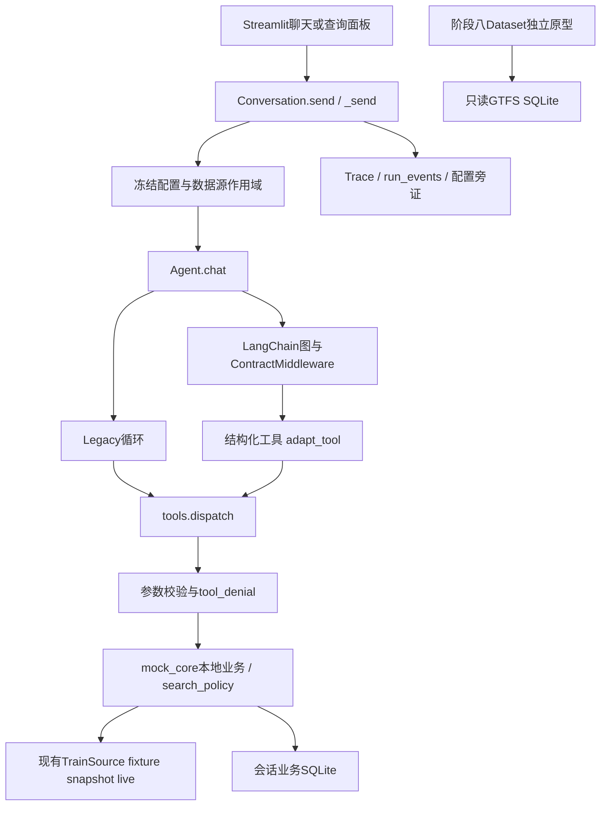
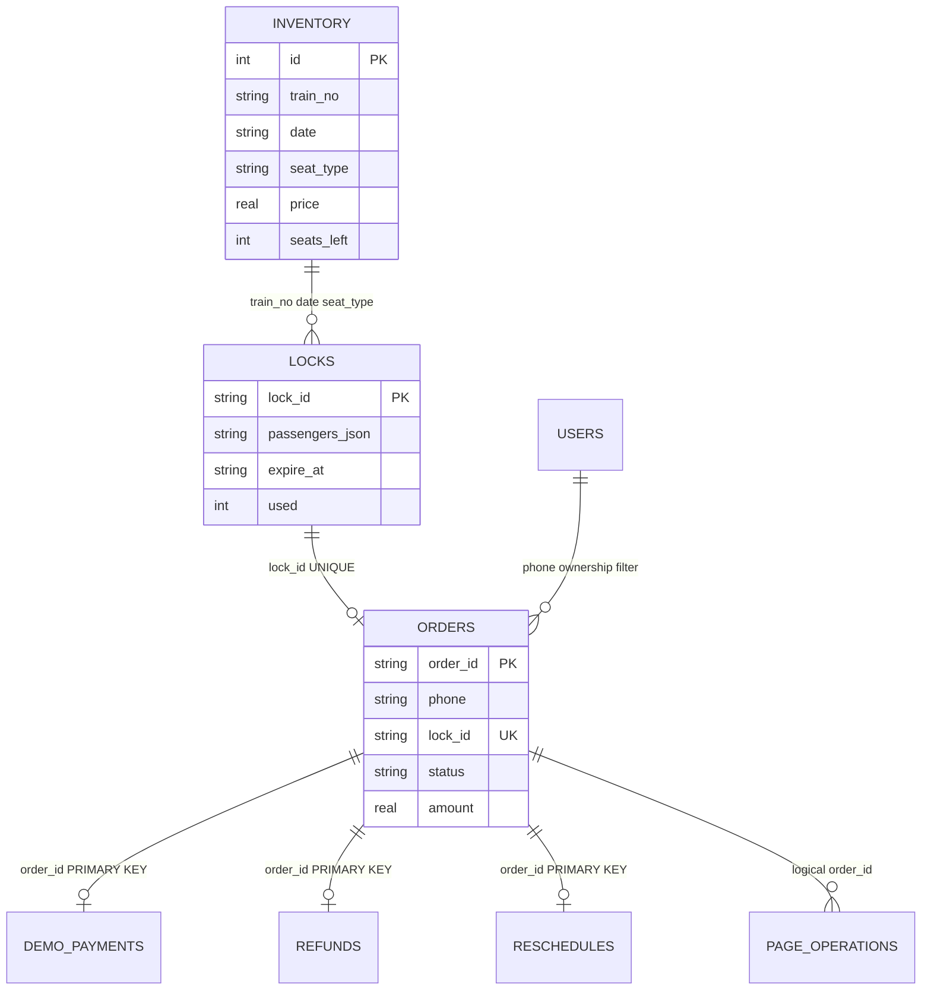
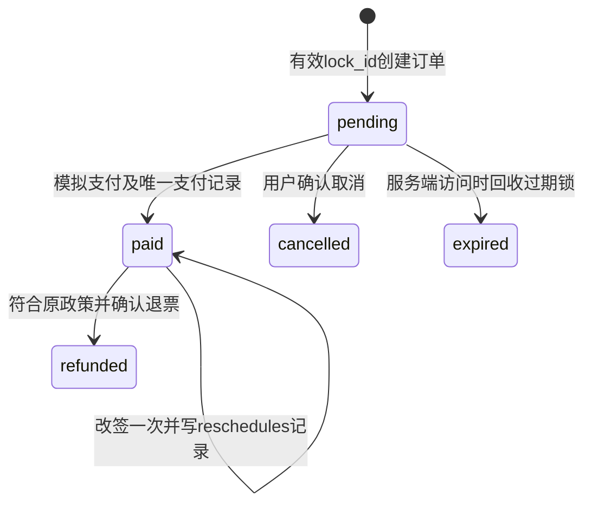

# Ticket Agent V3.9 阶段9.0：现有架构与兼容性审计

2026-11-02，Asia/Shanghai。**阶段9.0只读架构审计完成；9.1尚未开始。** 附件总方案确定目标和分阶段验收，不代表V3.9产品已经实现。本轮仅核对源码、历史证据和SQLite只读结构，新增报告并在PROJECT_STATUS末尾追加记录，没有修改生产代码或配置。

## 1. 实际基线及审计范围

仓库`D:\codexproject\ticket-agent`；分支`feat/ticket-agent-v36-stabilization`，HEAD `4340b6640025be95e8300a3d625a32cfb431e35d`。工作区已有阶段七服务、视觉升级、阶段八原型及相关未提交文档，开工完整状态/哈希见`artifacts/runtime/v39-phase90-audit-20261102-212244/before.json`（下称本轮证据目录）。暂存区为空；不切换、不清理、不提交。

直接审查25份核心源码，读取项目状态、接口契约、阶段2/3/4/6/7/8报告及关键verification；AST提取接口位置，不导入web.app、config或生产业务模块。只读读取`data/tickets.db`和阶段八`static.sqlite`的sqlite_master及行数，不读取乘客个人资料，不调用可能写库的业务查询。既有测试文件仅审查代码/用例索引，未执行测试。

| 对象 | 现场事实 | 验证边界 |
|---|---|---|
| 生产界面 | 仍为3.7及已有未提交视觉升级 | 本轮没有浏览器验收或发布 |
| 阶段八 | COMPLETE_WITH_RESTRICTIONS，固定原型/DB在现有目录 | 历史51/0/0/0和CLI6/6保留，不冒称本轮重测 |
| 阶段七独立服务 | Adapter工程完成、Live Source BLOCKED | 不启动服务，不复用其公网调用作为V3.9铁路数据路径 |
| 历史全量回归 | 1441 passed / 11 failed / 1 skipped，199子测试通过 | 本轮NOT_RUN；11失败和唯一skip不变 |
| 正式103 | 配套B执行器仍BLOCKED | 未运行、未改判据或重计分 |
| 独立数据 | 11775原始trip，187隔离，11588有效；109729原始停站、107669有效 | 原DB视图/原始表结构与计数对应，原件/阶段八文件哈希保留 |
| 默认历史业务库 | 本机data/tickets.db有inventory504、locks2、orders2、users2 | 是历史默认库，不是新会话库；不能据此判定2100条固定Fixture缺失或把两者相互覆盖 |

根目录默认库与UI会话数据库是不同作用域：`web/runtime.py:118`将DB_PATH指向`Conversation.root/tickets.db`；`config.py:11`才是默认`data/tickets.db`。本轮没有枚举或操作所有会话订单，故不能证明全部历史会话业务状态正常。

## 2. 当前实际调用链

图中阶段八没有接入Agent的箭头，这是当前事实。旧HTTP Mock还可由配置选择，但Web会话强制本地路径；本轮没有运行HTTP或模型请求。

依据：`target/agent.py:172/218`、`target/langchain_agent.py:147/317`、`target/tools.py:179/218`、`target/mock_core.py:106`、`web/runtime.py:261/312`、`prototypes/railway_static/query.py:7`。

### 八个现有公开工具

query_tickets、monitor_seat、lock_seat、create_order、pay_order、cancel_order、query_order、search_policy。**改签不是第九个Agent公开工具**，当前由页面调用独立服务`target/reschedule.py`；不能把页面改签完成说成Agent已经自主调用改签工具。

`query_tickets`输入城市名/date，可选seat_type/kind，包含机票枚举；V3.9的stop_id/trip_id/始发服务日无法无损套进旧Schema。LangChain构造器明确拒绝原八工具集合之外的名称（`target/langchain_agent.py:342`）；validate、dev_overrides、Baseline Profile也绑定旧集合。原`SYSTEM_PROMPT`、`TOOLS`、`DIMENSIONS`和Agent.chat十字段/工具五字段须保护。

## 3. 阶段八可复用接口及差距

| 实际接口 | 当前语义 | 后续适配需要处理 |
|---|---|---|
| Dataset.info() | 版本/SHA、coverage、rights、实际quality统计 | 可缓存同一固定版本的重质量统计，不能每次模型查询无限返回全量元数据 |
| stations(name) | 子串候选和selection_required | 限量/分页，保持同名ID，显式用户选择 |
| station(stop_id) | 原始站点及坐标来源标记 | 不把SOURCE_TABLE_MATCHED等同独立坐标核验 |
| trains(service_date) | 某始发服务日全部有效trip | 总方案表中的“始发站、终到站查询”并非此方法现有参数；应组合direct或另做明确过滤 |
| trip(trip_id, service_date) | 指定内部ID完整经停 | 按公开车次号选择须在同版本、同服务日精确解析，不猜G1203别名 |
| direct(from_id,to_id,service_date) | 起终ID按序、有效日、整班次隔离 | 与“首末站恰好相同”的始发终到查询是两个概念，不能混用 |

数据库使用`mode=ro`，原型入口只核对metadata中的source SHA/schema_version；**并非每次打开都重算893MB派生DB文件哈希**。建议9.1启动准入时以阶段八source-manifest/派生DB SHA核验，随后固定只读路径与进程生命周期，不伪称只读等于内容从未被篡改。

所有日期均为始发服务日。必须保留arrival_at/departure_at及超过24小时偏移，不能转为旧UI的单个HH:MM或无时区datetime后继续业务判断。GTFS没有席别配置、余票或票价，也不能凭车次前缀给所有列车保证商务/一等/二等真实配置。

## 4. 当前数据库关系和事务

以下为源码中的**逻辑关系**，并非声称存在物理FOREIGN KEY约束。默认历史库当前只有前四表，支付/退改/页面表由服务按需创建，不能因默认库缺表判断功能不存在。

实际DDL来源：`data/seed.py:68`；后加表：`target/mock_core.py:254/289`、`target/reschedule.py:53`、`target/order_refund.py:81`。阶段八是另一独立只读数据库，source_trips/source_stop_times/source_calendar_dates及隔离视图不属于此订单事务域。

### 事务行为

- `mock_core._conn()`使用BEGIN IMMEDIATE，先执行过期锁座回收，再执行业务并提交；异常时rollback。同库库存、锁、订单、支付/退款记录可以原子更新。
- **查询也可能写库**：旧query_tickets/query_order进入_conn，可能建库或回收过期锁座。展示层`order_read_model.orders()`才使用只读连接，只计算effective_status而不回写。
- 返回`{error:...}`不等于抛异常。它可能在过期回收后正常退出上下文并提交维护变更；不能笼统承诺所有失败都零数据库变化。后续必须分别断言目标操作和过期维护。
- `reschedule.confirm()`另开同一业务库事务，重算proposal、条件扣目标库存、释放旧库存、更新原订单车次、写唯一改签记录；异常rollback。不能把旧`_release()`原样用于新inventory模型，否则会释放到错误池。
- 进程CALL_LOCK是辅助串行化，不能替代SQLite跨进程事务或持久化幂等。现有唯一键和BEGIN IMMEDIATE可复用，但新库存event/hold/quote必须与订单写入同一事务域，不能在GTFS库写状态。

## 5. 订单状态机与新旧映射

| V3.9概念 | 当前持久状态/记录 | 兼容性结论 |
|---|---|---|
| 库存锁定 | locks.used=0，inventory立即扣数量 | 无独立订单状态；默认15分钟，不是方案建议10分钟 |
| 待支付 | orders.status=pending，locks.used=1 | 已扣库存；不能再次在建单时重复扣减 |
| 支付成功 | paid + demo_payments唯一order_id | 再付返回duplicate_pay，不重复写；银行卡属于旧工具枚举，页面仅支付宝/微信 |
| 取消 | cancelled + refunds记录；locks.used=2 | pending取消退款金额0，释放库存 |
| 过期 | expired；locks.used=2 | 服务端按访问懒回收，没有后台清理进程 |
| 已退款 | refunded + refunds.detail | 原收费政策/归属检查复用；示例退款，不涉及真实资金 |
| 已改签 | status仍paid，reschedules存在，展示“已改签” | 没有新建rescheduled枚举；每单一次；P02禁退保留 |
| 支付失败 | 无独立payment_failed状态 | 故障可能留下pending/锁，待到期回收；方案要求“失败立即释放”尚未实现，须定义可重试失败与终止失败，不能擅自改旧规则 |
| 退款失败 | 异常rollback；校验失败不执行退款 | 没有真实支付网关/异步退款补偿，不能称已实现外部退款失败闭环 |

配置中锁座TTL为900秒（`config.py:39`）；模型操作提案确认TTL为600秒（`target/langchain_agent.py:26`），两者是不同的时钟对象，不能因为都涉及倒计时而混改。

支付取当前订单金额并核对expected_amount。建单金额在create_order时重新读取inventory.price乘人数，锁座返回unit_price但尚无持久quote冻结机制。改签保留orders.amount和原支付金额，只在reschedules.detail记录new_amount/difference，不执行差价结算，不应把旧amount直接解释为新票面金额。

## 6. 确认、授权、幂等和Trace

现有多层边界可复用，但不能把任何一层当成全链路确认：

1. 页面普通写请求使用pending_operation消息确认，绑定配置/data_source hash；LangChain特定路径使用interrupt绑定精确tool/args/call_id并校验提案与期限。
2. `write_authorization.denial()`做用户意图、乘客/订单引用、成功lock证据和归属限制。模型自写“用户已确认”不是服务端授权。
3. `execution_config.tool_denial()`检查冻结白名单/写策略；developer_custom还要求确认作用域。它在CURRENT为空时兼容受信旧离线执行器，不可把此兼容入口当新产品的默认授权策略。
4. `tools.dispatch()`做参数、权限、实际执行与结果事件。Legacy也调用此入口，但没有统一等同于LangChain interrupt的事务提案机制；V3.9需按引擎分别验收。
5. 页面支付/退款/改签有自己的服务端确认入口，不能为了统一UI而绕过assert_page_allowed、proposal绑定或订单归属。

现有幂等：create_order按lock_id唯一、pay_order对paid幂等、退款/改签有唯一记录/状态拒绝；Conversation.receipts按request_id缓存本会话完成结果。**lock_seat本身每次创建新lock，没有持久化操作幂等键；request_id缓存也不等于崩溃后跨进程幂等**。新hold/quote/order操作须有持久幂等范围、参数指纹及原响应，沿用订单系统而非重建第二套订单。

Trace/run_events、完整执行旁证和page_operations继续分开：页面交易不能伪造为Agent调用，提议/拦截/执行/工具成功/业务成功不得合并。`finish_reason=stop`不代表交易成功；未知Token不能记为已知0。新数据/库存/报价摘要建议写独立旁证，不擅增公共十/五字段。

## 7. V3.9兼容性门槛与建议方案（均未实施）

### P0：身份与事务模型

旧inventory/locks/orders按train_no/date/seat_type关联，没有dataset_version、trip_id、起终stop_id、scenario_id等。不可把G1车次号直接替换成GTFS内部ID，亦不可往旧固定inventory灌入全国数据。

建议在新的V3.9会话/实验业务数据库中沿用原订单体系及状态，显式迁移增加同库sidecar：simulation_scenarios、simulation_inventory、inventory_holds、simulation_quotes、simulation_inventory_events、idempotency_records及订单静态身份/价格快照关联表。**这不是第二套订单库**，orders/payments/refunds/reschedules仍是同一事务域中的主记录；具体迁移DDL及双路径服务适配须在9.2/9.4审查，当前没有实施或授权迁移现有库。

推荐先采用整班次席位池：一次区间购票占用该班次一个模拟名额，避免未建模分段复用而超卖；这是保守模拟设计建议，并非已确认规则。报价/订单仍必须保存起终ID/序号；若改为逐区间容量，应先另定库存不变量与并发断言。

场景切换仅选择新的scenario_id，不重置旧行或旧订单；订单支付、过期、退款必须返回订单原场景。新库存total/held/sold非负和守恒、版本竞争、事件记录与订单状态须同事务完成。

### P0：工具注册与Baseline隔离

建议设计独立、默认关闭的V3.9能力注册/配置Profile和只读Adapter，不修改全局原TOOLS/旧Prompt/七维度。单独配置版本、schema哈希、数据集身份写入旁证，Baseline仍旧八工具/2100 Fixture/原时钟；关闭新功能即回旧路径，不自动降级Mock冒充静态成功。

但当前Agent构造器、adapt_tool、validate、权限及Override注册均绑定旧TOOLS，**无法只新增一个Adapter文件就让六个新工具在Agent运行**。需要提交显式注册扩展/分发兼容性设计，覆盖双引擎、permissions、Trace、Mock Provider行为和回归隔离，获得用户确认后才改相关生产接线。未经此门槛，9.1最多实施独立只读Adapter及验证，不得宣称Agent接入完成；可把Agent正式注册留9.3。

### P0：静态源与模拟业务边界

现有SourceChoice只有fixture/snapshot/live，assert_demo_acquisition拒绝非Fixture锁座/建单/改签。不能简单把GTFS标成snapshot再移除guard来开交易。应在V3.9显式业务模式中将“只读列车事实”和“模拟可写业务”分别鉴权：订单提交重新核对有效trip、明确stop_id、服务日、隔离、模拟库存及有效价格快照，始终不写GTFS。

### P1：价格、时间、权限

- 无已配置模拟价目规则就PRICE_NOT_CONFIGURED。新增版本规则和Decimal/整数分快照；不得用坐标估官方票价或拿旧seed基价当全国价格。历史REAL金额及政策口径不擅改。
- 新时间使用Asia/Shanghai实际区间到发时间，避免服务日与中途站日期混用。退款/改签现有代码依赖`date+' '+inventory.depart`且无时区，不能直接喂47:53或aware datetime。
- 只读原型可查询187隔离以外所有国铁类型，并未提供真实席别配置；三席别仅为模拟规则，需明确哪些演示trip可配置，不能假称真实列车座席。
- 新写能力应同时校验会话/用户/提案/报价版本/场景/来源SHA/库存键，服务端一次性确认；持久化hold归属，不能仅凭模型返回lock_id或一个全局confirmed布尔。

### P1：UI和输出差距

现有ticket_cards只显示前20条，期望train_no/from_city/to_city/depart/arrive/price/seats_left。`_duration()`用HH:MM并模1440，无法表示多日旅程；查票面板只有8个城市和高铁/机票，不是全国站点选择。应做新的静态时刻、模拟库存、模拟票价分栏/字段映射，保留现有布局/关键key。

实时来源选择当前位于开发者页（`web/developer_workspace.py:74`），用户会话可继承所选来源；并非用户页独立显示一个Live selector。V3.9需从运行模式阻止进入铁路Live路径，同时保留历史代码和只读历史证据；仅隐藏按钮不足以保证不联网。模型Live Provider与铁路Live数据是两条权限轴，不混淆取消费用授权或擅自改变模型逻辑。本轮一律不调用真实模型。

## 8. 后续复用/新增文件候选

这些是规划清单，**不是本轮修改清单或下一阶段自动授权**。

| 范围 | 建议复用 | 可能新增/限定修改与门槛 |
|---|---|---|
| 9.1 | prototypes/railway_static Dataset，原DB只读 | 独立只读Adapter/配置准入/分页，独立V3.9测试；保持原型字节不变，先不注册旧八工具 |
| 9.2 | 同库事务、原订单主记录 | 新scenario/inventory/quote/hold/event侧表、迁移与事务接口；先批准库存粒度/TTL/失败规则 |
| 9.3 | Agent双引擎、dispatch、冻结配置、run_events | 独立工具registry/Profile接线；须先批准Schema/权限/Prompt兼容方案，保留旧路径 |
| 9.4 | mock_core支付/取消、order_refund费率、reschedule政策、order_read_model | 提取可接同一事务连接的业务适配、记录身份和报价快照，不复制第二套订单系统 |
| 9.5 | conversation、user_features、user_layout、presentation、payment/order_actions | 新静态/库存/报价卡片及按来源渲染，四规格浏览器；不破坏三工作空间和测试控制台 |
| 9.6 | 原regression_center隔离产物和保护哈希 | 新V3.9独立套件/逐ID旧失败对比；正式103仍按原执行器门槛，不自造判据 |

建议新代码命名域例如`target/v39/`和`tests/v39/`，最终位置待9.1任务确认，当前未创建。原GTFS/Fixture/阶段八DB只读；新可写库应为独立V3.9会话文件，同一文件内复用订单表/服务，不将新记录写入既有用户历史库。

## 9. 9.0验收与下一步

已交付：架构现状、实际工具链图、逻辑ER图、订单状态机、新旧状态映射、复用/新增候选和风险门槛。source-index.json保留25源码哈希/函数行；database-schema.json保存两个实际库的只读DDL/计数和前后SHA；test-index-not-executed.json明确只审查未执行。常规搜索中出现的不存在路径已改用rg文件清单定位，未据猜测接口编写方案。

本轮没有产品功能改动，无测试执行、无浏览器验收、无真实模型/铁路/其他网络请求。原历史成绩全部保留，NOT_RUN不计作PASS。最终保护/Git证据见verification.json。

**是否适合现架构：适合增量实现，但不能直接套用旧数据键/旧工具Schema。是否可开始9.1：只读Adapter范围具备准备条件；Agent注册接入仍受上述兼容性方案确认门槛约束。** 建议用户先确认9.1仅包含固定DB准入、六类只读封装、结果限量/分页、原型与基线保护及独立离线测试；不包含库存、交易、UI或旧TOOLS/Prompt变更。

本轮停止等待确认，不启动9.1、不自行选定库存或价格规则、不提交推送。
