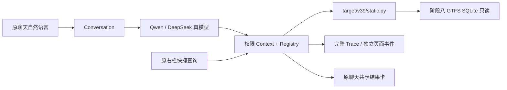

# Ticket Agent V3.9.3 实施报告

日期：2026-11-04（Asia/Shanghai）。执行者：Codex，开发自测，不是独立审查。证据根目录：`artifacts/runtime/v391-d9-lifecycle-v393-20261104-001639/`。

## 1. 裁定与原版 UI 保留

**IMPLEMENTED / TESTED（限定下述实际范围）**；**LIVE_API_VERIFIED=PARTIAL**；**INDEPENDENTLY_REVIEWED=NOT_RUN**；**ACCEPTED=PENDING_USER_ACCEPTANCE**。`PRODUCT_DB_PROTECTION=BLOCKED` 为继承的旧库来源问题，原库停止写入；正式103计分和 Bridge 仍 BLOCKED。不得称 COMPLETE。

原 `web/app.py → web.conversation.user_page` 不变；左导航、原聊天、右栏、四快捷入口、模型设置、历史会话、用户/开发者/测试空间、多行输入、原控件 key 和会话变量保留；未用独立铁路页替换入口。界面原3.7标签未伪装成正式发布版本。

## 2. 开工现场与授权

- 分支 `feat/ticket-agent-v36-stabilization`；HEAD `4340b6640025be95e8300a3d625a32cfb431e35d`；暂存空。18个已有跟踪修改与全部未跟踪成果已保留；开工完整状态和6724文件SHA见 `before.json`。
- V3.9.2源码快照及旧报告先读后核对。发现已知冻结DB差异，未连接/修复该库。
- 用户确认百炼账本既有11031字节追加为本轮起点：314598字节 / `cecbf4f6a810419a7deaf16d18f0c46dcbea044e99459b6d6875cc55339d869e`，旧303567字节前缀完整。
- 用户另批准仅两个铁路查询可选 `cursor`。工具数仍8+11，旧8、Agent.chat十字段、Trace五字段、Baseline不扩展。Schema结构对比见 `audit-pre-docs.json`。
- 真模型测试已获本任务授权，使用现有配置和独立测试账本；没有新增Key、修改系统环境、铁路API、支付API、Embedding调用或LangSmith上传。

## 3. 修改文件及原因

以下是本轮增量，不等于相对HEAD的全部历史未提交差异。

| 文件 | 修改原因 |
|---|---|
| `web/v39_bridge.py` | 修复 Context 与 EffectiveConfig 白名单不一致；按原权限派生铁路工具；仅自定义会话增加动态铁路说明与最近快捷查询条件。 |
| `target/langchain_agent.py` | 模型上下文投影、可恢复的只读失败分支、班次总数纠正审计；旧写权限和确认逻辑保留。 |
| `target/reply_consistency.py` | 最近成功查询命名空间决定校验事实来源，避免用旧 Fixture 比较后续 GTFS 结果；旧工具单独查询逻辑保留。 |
| `target/v39/static.py` | 真实查询总数/当前页/limit/has_more/query_parameters/source 元数据，保留原 data 与 next_cursor。 |
| `target/v39/registry.py` | 错误类型与异常栈写入 run_events，不修改交易服务或 Schema 校验边界。 |
| `target/v39/tool-schemas.json` | 经用户单独批准，仅 railway_search_stations 和 railway_query_trips 增加可选数字 cursor；其他9个铁路工具和旧8工具语义不变。 |
| `target/v39/model_result.py` | 新增：仅模型 ToolMessage 复制投影，完整工具原件留在 Trace；不改事务工具结果。 |
| `target/v39/counts.py` | 新增：针对明确总班次数的有限文本纠正；原文、纠正值和来源 call_id 留存。不是通用语义真实性保证。 |
| `web/railway_queries.py` | 新增：原右栏的车站/车次/经停查询、真实候选选择与下一页；统一 Registry；共享聊天结构化展示，页面操作单独审计。 |
| `web/conversation.py` | 复用查询结果卡；快捷结果显示在原聊天区；无实际检索时不重复显示政策尚未检索提示。 |
| `web/user_layout.css` | 仅原聊天区域的16px正文、1.7行高、消息间隔、标题和用户消息宽度；提高限定选择器优先级以避免旧14px规则覆盖。 |
| `tests/v39/test_v393_bridge.py` | 新增3项：19工具共存、旧政策工具真实分发入口、撤销查询权限不被恢复；首批先复现失败。 |
| `tests/v39/test_v393_model_context.py` | 新增3项：投影不污染原 Trace、非查询工具不投影、真实GTFS分页完整性。 |
| `tests/v39/test_v393_counts.py` | 新增3项：38/41纠正、失败和旧查询不授权纠正、仅两个可选cursor Schema。 |
| `tests/v39/test_v393_authority.py` | 新增1项：最近GTFS与旧Fixture权威来源双向选择。 |

另增本轮评审文档、运行证据、独立审查任务书；`PROJECT_STATUS.md`只新增当前索引与历史更新记录。`opening-to-current.patch`区分本轮与既有修改，最终HEAD完整diff另存。

## 4. 工具调用失败的实际原因与修复

1. **白名单矛盾**：V3.9.2有效配置含旧8+新11，Context只含新11，Registry过滤/拒绝旧工具；新增反向测试首批实际3失败，修复后通过。不是Provider HTTP故障。
2. **读取失败被当成整个Agent异常**：`ORDER_FORBIDDEN`等预期读错误仍为失败工具结果，允许模型根据真实错误解释；未把失败改成成功，不开放写确认。
3. **长上下文与通用UI错误**：旧报告未给出Qwen UI通用错误的确定根因。本轮精简模型端静态行投影、要求简短解释，完整原件不删；两模型均在原UI完成真实静态查询，证实当前测试路径可用。不能仅凭成功复跑就断言历史错误的唯一根因已定位，也不声称所有长对话都不会耗尽轮数。
4. **旧Fixture错误作为后续GTFS权威**：连续补日期时模型曾先调用旧工具；修复校验来源选择并增加动态说明，v2双模型仅用同一铁路Registry继续查询。首批失败/误述原件保留。
5. **数量不一致**：Adapter提供真实total/returned元数据；模型说明与UI共享事实；有限总数纠正保留原文和修正事件。不删除模型回答，不将窄规则称为完整事实校验。

## 5. 静态数据架构和来源



三类来源继续分离：真实模型理解/工具选择；GTFS真实静态站/车次/时刻；本地模拟库存/价格/交易。静态查询不会显示真实有票、真实锁座、真实支付成功。

- GTFS原ZIP：`artifacts/runtime/railway-dataset-preparation-20261102-gtfs/output_gtfs.zip`；SHA256 `3877dbc0ebc0392afef4b111dd9ba837c97eb4aa45788542919be53d52a12030`。
- 数据库：`artifacts/runtime/railway-static-phase8-20261102-184912/static.sqlite`；SHA256 `e32f0cd41b45532ea7aedf4c72a6ffc24f6eaa23c042ee8f35cb02aa50735c69`。
- 实查3169站、11588有效班次、107669有效经停、187个异常班次/188条隔离原因；别名0。`static-read-only-probe.json`保留原始查询与规模。
- 2026-11-06 北京南VNP→上海虹桥AOH：40条；20+20分页无丢失/重复。2026-11-04查询为39条，不能混用日期硬编码40。历史许可/来源独立性限制仍保留，不代表已独立认证官方实时真实性。

## 6. 快捷入口、自然语言与结构化结果

原右栏新增折叠查询：查车次/查车站/查经停。候选从静态库取出，明确选真实ID；日期与分页都走同一Registry。结果进入原聊天区，标记“快捷查询·本地工具直接结果，未调用模型”，不伪造Agent Trace。

聊天复用车次/站/经停结果卡，显示来源、版本、总数、当前页和下一页状态。旧报价/确认/订单/退款改签展示保留，未重写业务状态机。页面查询留独立page_event；只读库异常进run_events保留类型/栈。

连续缺日期→补日期通过v2真模型验证；同会话最近成功快捷路线可用于之后的自然语言沿用。没有新增规则解析器冒充模型自主调用。

**范围限制**：快捷结果目前只存当前会话内存，不持久化到旧聊天回放；快捷与模型结果并非统一时间轴。上午时间筛选、所有站名歧义的端到端真模型流程、查询跨50条时模型主动翻页未完整验收；Schema和Adapter分页已测试。不能把这些写成已完成验收。

## 7. 聊天可读性

沿用原主题色/布局；正文16px、行高1.7，标题21/19px，消息内边距14×16、间距16，用户消息最大88%靠右。无检索的普通聊天不反复展示“尚未检索”。结果表与模型解释分层，输入区仍在原位置，手机右栏可折叠。

`ui-sealed/results.json`四规格均验证浏览器计算字号16px。表格在窄屏内部可横向滚动，页面本身无横向溢出。未增加依赖或改Grid/Flex结构。前后截图及局限见浏览器报告。

## 8. 离线、双引擎及交易回归

| 批次 | PASS | FAIL | SKIP | 证据 |
|---|---:|---:|---:|---|
| 新V3.9全套（含V3.9.1/2/3） | 174 | 0 | 0 | `sealed-suite/results.json`, `pytest.log`, `junit.xml` |
| 旧完整回归（独立冻结副本） | 1441 | 11 | 1 | `regression-sealed/results/` |
| 旧回归子测试，单列 | 199 | 0 | 0 | 同上 `is_subtest` |
| 原启动器复查 | 1 | 0 | 0 | `launcher-recheck/`，另2子测试 |
| Edge四规格断言 | 52 | 0 | 0 | `ui-sealed/results.json` |

旧报告“1640通过”=1441主测试+199子测试；本轮改为分列。新10测试不混入正式103。T057–T076及20份真实SQLite探针保留在 `sealed-suite/db-probes/`，D9/P01、交易失败、并发、资金库存、双引擎/权限由现有全套验证；本轮未修改policy/lifecycle/accounting/service/store/数据库DDL。

中间 `old-regression-final` 曾1440/12/1，启动器40秒健康探测超时。原断言单独复跑1通过/2子测试；最终完整回归恢复1441/11/1。**原因未定位**，保留失败日志，不武断归为环境问题。最后仅CSS选择器优先级变更，用四规格浏览器重新验收；非CSS生产逻辑与最终回归冻结副本相同。

## 9. 实际命令与隔离

```powershell
.\.venv-v35\Scripts\python.exe -B scripts/run_v39_tests.py --out artifacts/runtime/v391-d9-lifecycle-v393-20261104-001639/sealed-suite
.\.venv-v35\Scripts\python.exe -B artifacts/runtime/v391-d9-lifecycle-v393-20261104-001639/run_old_regression.py regression-sealed
node artifacts/runtime/v391-d9-lifecycle-v393-20261104-001639/browser_sealed.js
.\.venv-v35\Scripts\python.exe -B artifacts/runtime/v391-d9-lifecycle-v393-20261104-001639/live_probe.py bailian
.\.venv-v35\Scripts\python.exe -B artifacts/runtime/v391-d9-lifecycle-v393-20261104-001639/live_probe.py deepseek
.\.venv-v35\Scripts\python.exe -B artifacts/runtime/v391-d9-lifecycle-v393-20261104-001639/live_probe_v2.py bailian
.\.venv-v35\Scripts\python.exe -B artifacts/runtime/v391-d9-lifecycle-v393-20261104-001639/live_probe_v2.py deepseek
```

上述为已执行命令，输出目录不可重复覆盖；复现时使用新的任务目录和批次名。离线runner清空凭据并拦截外部socket；旧回归使用冻结P0数据、当前源码覆盖、独立temp/DB/Trace。UI服务器分离新库；Live用独立usage目录、实际配置和授权会话，不连接原产品DB。Live有单进程请求上限，禁止自动重试和费用伪记零。启动/浏览器脚本、完整命令和PID见各 `server.json`；自建服务已停止。

## 10. Qwen / DeepSeek 真实API

| 批次 | HTTP请求 | Prompt Token | Completion Token | 实际金额 |
|---|---:|---:|---:|---|
| live-bailian | 16 | 150859 | 1981 | 未知 |
| live-deepseek | 17 | 142012 | 1925 | 未知 |
| live-v2-bailian | 4 | 23558 | 673 | 未知 |
| live-v2-deepseek | 4 | 22203 | 561 | 未知 |
| live-ui | 4 | 19446 | 230 | 未知 |
| live-ui-deepseek | 4 | 18465 | 335 | 未知 |

合计49请求；Prompt376543、Completion5705；Qwen24请求，DeepSeek25请求。每次均有started/finished及独立request_id；成本/剩余额度**未知**，不是0；含正常额外追问请求，未混入主回合Token。

已验证：两Provider正常聊天/自主铁路工具查询/工具返回/40条真实结果；连续补日期v2；G531经停、无站/无车次与预期读错误路径有原始轨迹。两Provider各在原版UI成功查询40条，不能仅以HTTP200判成功。

**仍PARTIAL**：首批出现过来源/形状解释不准确和旧工具混用；修复后v2复验通过对应范围，但任意长回答所有时刻/派生时长/所有措辞未完整语义验收。只读错误回复仍可能直述错误码或措辞不够友好。双Key配置的UI模型切换自动化未成功（option未展开），保留失败尝试；DeepSeek UI使用单Provider测试配置，不冒充双Key切换通过。生产Provider选择及费用授权逻辑本轮未改。

## 11. 浏览器验收

Edge本机真实浏览器，1600×1100/390×844，各浅色/深色：52/52，16截图。PageError0；Console error8、requestfailed8、网络阻断8，均记录为受限环境阻断fonts.gstatic.com的图标资源；不能报告Console全零。

浏览器覆盖原导航/四快捷入口、真实候选、20条分页、下一页两卡保留、Agent共享卡、输入框、页面横向溢出、字号。未在本轮原UI重新走完整三人退款改签浏览器生命周期；服务层真实SQLite回归已执行。数据库不可用、长文本、多行输入全部交互组合和实体手机未完整浏览器复验。详情见 Browser-Report。

## 12. 数据库与保护

1892/4056/5538三组相对**本轮开工点**新增差异0、缺失0；历史4056既存差异不抹除、不冒充与最早版本完全相同。原103/expect/B、2100 Fixture、GTFS、阶段八DB、旧tickets.db、历史审查/失败批次均保护。开工八个现存源码增量和新增文件见上表，不计入历史成绩。

冻结 `data/v39/simulation-v391.sqlite` 462848字节 / `9ebf39ecd8fd4caa277d6fa993ef0bbbeeb99355ab997d23a37678d0c44af939` 及其WAL/SHM不变；未连接该库。`simulation.sqlite`不变。该历史来源冲突仍BLOCKED，不能用本轮查询测试消除。

7个本轮查询测试库报价/提案/订单/交易均0、foreign_key_check空；这证明查询未创建交易，不等于无写入（配置初始化和查询审计允许存在）。真实交易资金库存由独立合成场景SQLite测试验证，不能把GTFS查询说成真实票务交易。

## 13. 契约、权限与历史

SYSTEM_PROMPT/TOOLS/DIMENSIONS AST与开工一致，Baseline未扩大，两个cursor之外工具Schema语义一致。Agent.chat/Trace公有字段由现有契约测试验证。动态V3.9自定义后缀不修改正式SYSTEM_PROMPT或Baseline；权限由原工具授权派生，不靠Feature Flag授予写操作。D9 APPROVED及P01规则未改，模型仍不能提供/消费确认令牌。

## 14. Skills 使用

- frontend-design：采纳原版布局内的文字节奏、卡片层级、浅/深主题适配；未采纳大重构/新框架/新字体网络依赖。
- eval-audit：发现HTTP成功≠工具成功≠业务成功，白名单测试缺口、总数统计与Fixture权威混用、UI真模型与直连测试混淆。保留原始失败和完整Trace，离线/真模型/浏览器分开。不引入未校准LLM Judge，也不将小样本当成稳定成功率。
- write-code-eval：对已复现失败写10个确定性检查，输入/预期/失败条件见测试源。真实GTFS分页核对同源完整集合、权限撤销负例、38/41错误计数样本和原始消息不变性。自然语言整体质量不虚构客观全通过。

## 15. Git差异与风险

HEAD和分支不变，暂存空，无提交/推送/合并/标签。`git diff --check`退出0（旧文件LF→CRLF提示非内容错误）。相对HEAD仍有大量历史未提交成果，不清理。最后清单/完整diff及本轮开工差异见 `git-final.json` / `git-head.patch` / `opening-to-current.patch`。

待解决：产品DB来源冲突、正式103原始B执行器、Bridge历史证据/准入、旧11失败、启动健康探测偶发超时、双Key模型切换浏览器验证、模型任意长叙述真实性、快捷结果持久化/时间轴、完整原UI交易浏览器路径。不能将检出风险包装为已修复。

## 16. 独立审查材料

历史封装额外核验：V3.9.2目录113项清单中112项匹配，`verification.json`不匹配；旧ZIP本身SHA仍为`94be53b3afa45dfdb6f0510e1bae315aeea9970021d8f117d4c9d084eb032823`，ZIP内回执匹配清单，目录回执仅`zip_sha256`/`sha_manifest_sha256`两个封装字段不同，其他值一致。见`prior-seal-investigation.json`与`prior-seal-comparison.json`。未修改旧ZIP/回执/清单，不能把这一项计作原清单通过；交独立审查确认历史封装过程。这不属于1892/4056/5538组的新差异。

新独立源码与证据ZIP、逐文件SHA、保留原始API回复和错误日志、任务书供用户人工转交；见 `review-package.json` / `review-source-manifest.json` / `independent-review-task.md`。打包不是独立审查，Harness请求0、费用0，Bridge未启用。原审查包不覆盖。

## 17. 下一步与停止

本轮授权内的修复、快捷入口、UI和测试已实施并形成可审查结果；其余限定/阻塞如上，未宣称所有验收条件满足。建议先人工独立审查本包，核对冻结产品DB来源；之后单独安排双Key切换、长对话事实一致性与完整原UI交易验收。等待用户验收；不自动进入后续阶段，不提交推送。
