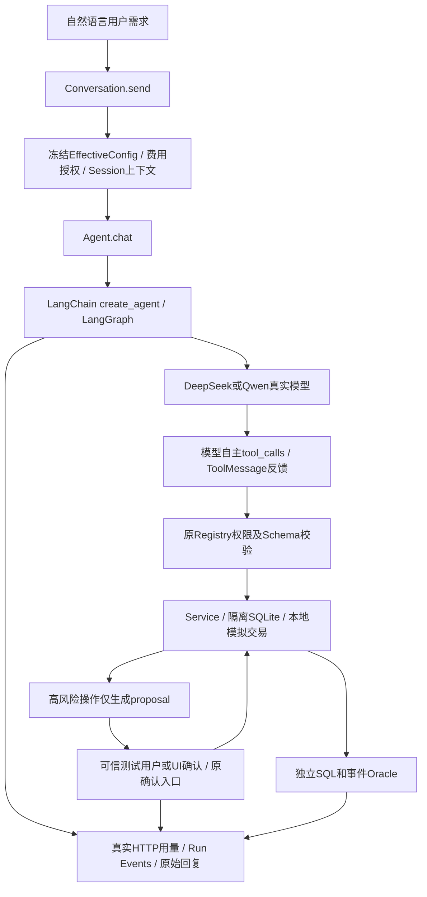

# Ticket Agent V3.11 架构审计与实施计划

日期：2026-11-10（Asia/Shanghai）。**阶段：审计及计划已交付；业务实施、测试、真实API请求尚未开始。整体PARTIAL。**

依据：用户V3.11任务书。按第十七节，完成审计/计划后，等待用户确认真实API预算和隔离写流程测试范围，再实施。本文是开发前架构审计，不是V3.11独立验收报告。

## 1. 现场与保护

- 仓库：`D:\codexproject\ticket-agent`。
- 分支：`feat/ticket-agent-v36-stabilization`。
- HEAD：`2bba4caa379b111aadcefd0369e79cf6259e33e7`，没有后续提交。
- 暂存区空；开工5个跟踪修改、293个未跟踪文件。已有修改为PROJECT_STATUS.md、target/acceptance_budget.py、target/scenario_generator.py、tests/v39/test_acceptance_budget_v2.py、web/scenario_generator.py；全部保留。
- 本阶段只新增本文及开工元数据；不改业务/测试/配置、不更新旧报告、不运行测试、不访问真实服务、不连接产品数据库、不提交推送。
- 开工旁证：`artifacts/runtime/v310-v311-audit-20261110-e48e85c2/opening.json`，SHA256 `307925cd7a587ec3b1a6021be868a5d6be2c857676c6cfee55982c8ce3b0446a`。含413项源码/配置SHA、Git状态及原保护差异。不会输出Key。
- 原5587项逐文件只读重算：5586一致、1项已知变化。原清单保留，不能宣布零差异。

| 例外项 | SHA256 |
|---|---|
| tests/v39/test_acceptance_budget_v2.py 原值 | 4697eb838497f2ead1f3d304710a060acd03af5f651c8d69fd2e9832bebaa6cc |
| 当前值/拟新基线 | c09730dc2fe33cc7226e7c934508fa1f8b1e4ae4bc54f22fb2a2f1712b14b37f |

原因：原Token硬上限拒绝测试改为/3的统计/预警及超过旧上限仍准入断言；不是103正式用例。保留现状不代表补造此前批准，例外纳入新保护基线的决定待用户确认。

## 2. 审计范围与方法

读取PROJECT_STATUS及11月9/10日报告/JSON/XML/Trace索引；检查Agent与LangChain执行循环、两Provider的HTTP记账、工具Schema/Registry、Service/Lifecycle、只读Read Model、SQL/存储/政策、V310Adapter、候选仓库与页面、配置/权限/确认、会话恢复、RAG及故障注入。对target/v39目录文件进行完整文本读取/语法盘点；关键调用链按方法审阅。不是所有业务分支已动态验证。

使用eval-audit：重点检查实际失败、Oracle独立性、审批来源、分母和证据身份；没有引入LLM Judge，也没有联网读取Skill参考链接。write-code-eval用于后续确定性Oracle设计；本阶段尚未编写执行器或测试。

## 3. 架构是否支持真正Agent执行

**支持，现有产品执行链可以复用；目前AI测试入口未接入真正Live Agent执行模式。无需重写Agent或11工具。**

关键证据：

- `target/agent.py:46`：Live只通过langchain，不伪装Legacy模型；`chat:107`绑定Trace/EffectiveConfig。
- `target/langchain_agent.py:356`：原Provider SDK、StructuredTool、create_agent、InMemorySaver；`chat:430`为实际graph.invoke、模型多轮和恢复入口。
- `web/runtime.py:334`：装配V39上下文，Live时不注入RailwayDemoProvider，调用原Agent；`send:149`及`confirm_railway_proposal:544`可复用。
- `target/v39/registry.py`：两个引擎共用11工具；Schema、session/config/白名单/Feature Flag校验；写工具只propose。
- `web/business_actions.py:78`、`target/v39/service.py:235`：可信确认、归属、Worker/epoch、幂等及事务提交。
- `target/scenario_v310.py:178`：当前执行固定Conversation(live=False)、离线环境、socket/DNS阻断；tool步骤由invoke直接分发，chat步骤也只是Mock。它的passed只能算确定性集成。
- `web/scenario_generator.py`：仅有Legacy Mock/V3.10确定性执行按钮，并明确Live Agent未启用。

模型不得持有确认token，不给模型增加confirm工具。模型生成提案→可信用户批准→原Service提交→下一轮把真实回执送回原对话。确认事件记录为人类/测试用户操作，不能冒充模型工具执行。

## 4. 可复用与必须新增

| 范围 | 复用 | 需要新增或扩展 |
|---|---|---|
| Agent与模型 | Agent、LangGraph、SDK、安全HTTP客户端 | LiveAgent测试执行模式；按自然语言目标驱动，不执行DSL工具步骤冒充自主规划 |
| 模拟业务 | 原11工具/Registry/Service/D9-P01 | 全新隔离运行工厂及场景生命周期，不复制业务Service |
| 确认 | 原UI/Conversation确认、Worker租约与秘密 | 将候选审核和业务确认分开，绑定candidate revision、proposal、order、金额及批准范围 |
| Oracle | 原只读Read Model、历史confirmation_proof/invariants | 测试侧独立只读SQL/事件断言；不能仅调用同一生产计算函数自证 |
| 追踪 | run_events、config-events、HTTP dispatch、UsageLog | run/request/tool_call/proposal/order/transaction映射、原始模型回复与最终展示分栏 |
| 数据仓库 | 原候选CREATE/修订/审核/runs | 分开记录生成、质量、审核、Agent执行、工具、业务断言及恢复结果 |
| 故障 | FaultRun、服务支付/退款/改签失败开关 | 8类故障的注入点、恢复策略、正常对照与失败证据 |
| UI | 原测试控制台及候选页 | Live Agent受控入口、等待确认/执行详情/业务快照/Trace/历史；模块级布局 |
| 回归 | 原regression_center及有效R4执行脚本 | 固定环境重现、当前源码叠加、ID级对照、显式保护例外，不改旧失败断言 |

拟新增职责模块：`target/scenario_live_agent.py`（运行编排）、`target/scenario_business_oracle.py`（独立断言）、`target/scenario_faults.py`（测试专用注入）、`tests/test_ai_scenario_v311_*.py`及独立证据脚本。名称为实施建议，文件尚不存在/未实现。不修改公共Agent.chat十字段、旧八工具、11铁路工具Schema、DIMENSIONS或正式103。

## 5. 真实业务规则与状态机

权威来源：`target/v39/service.py:275/302`、`lifecycle.py:113/150`、`policy.py`及`policy_profile.json`。

- CREATE_ORDER确认后同一事务创建订单、乘客价格快照及hold，PENDING_PAYMENT；确认前没有订单/hold。
- PAY成功生成PAYMENT，hold CONSUMED；失败留下失败交易并释放占用，不算支付成功。
- 退款仅ACTIVE乘客；成功后REFUNDED，失败不得释放库存或累加成功金额；每人至多一次成功。
- D9已批准CHANGED_REFUND_P01；部分退款后可改签剩余人、改签后可继续退剩余人，每订单最多一次成功改签。
- P01按当前有效明细整数分；>48h 5%，24h至48h含边界10%，<24h 20%，half-up；发车后拒绝。
- **改签沿用原order_id**：产生change_request、old/new_hold、目标quote、价格与订单快照版本。不能新增“必须有第二张订单”的错误断言。
- 取消待支付订单释放hold；已支付取消按现有退款路径。所有交易本地模拟。

计划验证六种订单状态：PENDING_PAYMENT、PAID、PAYMENT_FAILED、EXPIRED、CHANGED、CANCELLED。

| 声明合法边 | 真实触发及必要断言 |
|---|---|
| NONE→PENDING_PAYMENT | 建单确认；订单/乘客/唯一hold/held数量 |
| PENDING_PAYMENT→PAID | PAYMENT成功、held转sold、金额一致 |
| PENDING_PAYMENT→PAYMENT_FAILED | 失败交易保留，库存释放 |
| PENDING_PAYMENT→EXPIRED | 暂停模拟时钟推进，超时释放 |
| PENDING_PAYMENT→CANCELLED | 取消确认、held释放 |
| PAID→PAID | 部分退款；仅选中人REFUNDED |
| PAID→CHANGED | 剩余人改签；新旧库存原子交换 |
| PAID→CANCELLED | 全部有效乘客退款 |
| CHANGED→CHANGED | 改签后部分退款 |
| CHANGED→CANCELLED | 最后有效乘客退款 |

十条边为现有声明分母，不声称是业务全部状态空间。非法矩阵按“状态×操作×前置条件”建立，不把查询/幂等重放的同状态当非法转换。覆盖未支付退款、终态新支付、第二次改签、重复退款、错金额、错session、旧配置提案等。拒绝必须有错误证据且DB不产生不应有变化。

## 6. 工具和测试覆盖计划（均NOT_RUN）

每工具记录正常、错误参数、缺必填、额外/非法参数、返回事实、失败、上下文、权限八类单元格；约88个待核单元格。无required的railway_get_order“缺必填”应N/A，不能捏造必须order_id；无order_id时本人列表是合法功能。

| 工具 | 关键真实参数/输出证据 |
|---|---|
| railway_search_stations | name、真实stop_id、候选与分页 |
| railway_query_trips | service_date必填；按车次/区间条件；真实trip_id/total/returned/cursor |
| railway_trip_stops | trip_id/service_date；真实顺序和跨日时间 |
| railway_check_inventory | 车次/日期/区间/席别/quantity；模拟available及来源 |
| railway_quote_fare | 同上及passenger_count；quote/整数分/价格快照 |
| railway_create_order | quote_id/passengers/contact；proposal→确认后订单与hold |
| railway_get_order | 可选order_id；本人订单和乘客/交易实际状态 |
| railway_pay_order | order_id/expected_total_fen；proposal→可信确认→PAYMENT |
| railway_cancel_order | order_id；状态对应库存和退款路径 |
| railway_refund_order | order_id/scope，ITEMS时item_ids；逐乘客费用/净额/事务 |
| railway_change_order | order_id/target_quote_id及目标车次日期区间席别；change与hold/差价 |

分开计算：`live_agent`、`sdk_stub_agent`、`deterministic_integration`；生成来源另存live/mock/reference。SDK替身经过原Agent可证明执行接口，但不算真实模型成绩；DSL回放不进入Agent覆盖分子。

五流程：查询准备、建单锁定、支付、退款、改签/取消及恢复。安全七维：未授权操作、身份不符、越权查询、越权修改、未经确认高风险、重复付款/提交、跨用户访问。

异常四维拟合并为“模型故障、工具故障、业务拒绝、持久化/中断恢复”；另列8故障子项，避免用4/4掩盖子项未测。包括模型超时/畸形响应、工具超时/异常、数据库失败、重复请求、中途断开、拒绝确认、部分业务失败。每项必须有正常对照、注入事件、独立前后快照和恢复断言。

多轮包括缺日期补齐、修改路线、取消/拒绝、确认后继续、不同session隔离、旧历史只读。回复只在匹配凭据下能声称成功；保留原始模型回答、业务事实、系统纠正文案，不能只看纠正后的答案评模型。

RAG已有Keyword/Vector/Hybrid、引用ID/风险检测和有限忠实度规则（rag_service/rag_faithfulness）。现有规则可能返回INDETERMINATE，不能强写PASS。正确检索、无答案、干扰/过期/冲突、回答引用将用独立复制的语料/索引测试；不覆盖现有RAG1000和冻结索引，不调用Embedding API。本阶段没有这些执行证据。

## 7. 隔离和执行设计

新证据目录建议使用`artifacts/runtime/v310-v311-<batch>/`，每场景独立session/DB/clock。现有safe_path不接受随意`v311-*`命名，优先使用已允许的v310-前缀，不为目录命名扩大业务路径权限。

模型Live场景复用manual_environment(full_tools=True)、现有sandbox marker、独立tickets.db、独立铁路simulation.sqlite、日志及/.3批次；只准模型官方端点，铁路/支付/Embedding/LangSmith外连全部禁用。新场景创建新库，不删旧数据，不连接data/v39/simulation-v391.sqlite。真实静态库只读且核验固定SHA，业务/票价/库存均模拟。

优先同一拥有Service的进程内按原CALL_LOCK串行执行，可信确认也路由同一Conversation/Worker。当前秘密只在Worker内存，不能在测试子进程建提案后让另一个UI Worker直接确认，不能复制Secret或token。重启恢复只读核账，再重新生成有效提案；不得恢复过期秘密或自动重试交易。

测试输入是自然语言目标/用户补充与预先审核的Oracle要求，不向Agent注入固定tool_calls来替代规划。合成用户可按批准范围作确认/拒绝，但候选人工批准与业务测试用户确认必须分开留证，不能自填actor冒充真实人工审批。

Oracle独立读取测试库，逐笔核对proposal→order→hold→items→transaction/refund/change→库存事件；改签引用同order_id的历史快照及新hold。金额按冻结规则独立计算，不仅调用生产balances或Read Model。每轮保存FK检查、held/sold完整区间身份、成功借贷与有效票面/手续费守恒；失败记录与成功累计分开。

## 8. 已发现风险（证据和修复方向）

| 等级 | 现场证据 | 影响与处理 |
|---|---|---|
| P1 | 当前全回归1441/80/1，不同于有效R4 1891/11/1 | 先复用原prepare+静态库/SQL/fixture/隔离目录，叠加当前源码后ID级对照，不简单差值归因 |
| P1 | Final-verification与ZIP/manifest SHA不同 | 旧包/旧JSON只读保留，后续新批次一次封存；避免包含自身Hash的循环清单 |
| P1 | 当前AI最终10条仅3/11工具、1/5只读流程；V310Adapter离线 | 新增真实Agent模式和独立Oracle，不改变旧模式名或挪用11/11参考成绩 |
| P1 | 生成器写流程门控仅查后续存在test_user确认；动态$参数跳过整块Schema静态校验 | 确认要绑定精确proposal alias/操作，动态引用解析后重校验；门控不能代替执行Oracle |
| P1 | result路径白名单只显式列四种查询，其余默认为result.status | quote/get_order及写提案/业务回执需按真实响应路径完善，不能为PASS改生产输出 |
| P1 | 当前浏览器仅布局；深浅截图每组相同；当前独立审查NOT_RUN | 新UI进行实际审批/执行/Trace/失败历史链路，检验有效主题样式、截图真实性；完成后另安排独立审查 |
| P2 | 当前UI仍写400000Token硬限，实际policy/3无上限 | 统一显示HTTP上限/预警/未知费用；不得把None显示成剩余额度 |
| P2 | DeepSeek from_env输出上限2048，批次上限4096 | 以更严格Provider配置为准，先用≤2048；不能为验收直接取消单轮限制 |
| P2 | 单Worker秘密/配置失效；历史复原是read_only | 编排必须保持owner身份与确认路由，重启后新提案；Live恢复测试不代表可自动续交易 |
| P2 | 测试Oracle部分复用生产Read Model/资金计算 | 新增测试侧独立计算与负向变异，防同一Bug在生产和评测同时通过 |

未发现新证据足以判为P0；上述仅静态审计，不表示交易实现已经重新验收。

### 证据身份

`artifacts/runtime/v310-live-20261110/Final-verification.json`声明ZIP：
`5ddac3dc9406acba8233e306b28aaf079d1eabb58f621e9c8278ae2b95f44846`

当前ZIP实际：
`966372146297b034ceefb0ef686c8fa5b6485420b6b205af8a56d4daf066783d`

声明manifest：`31f0843da56f5a00639b90b9ac69ff6c110f9f8d1fdd8c7bdda616c6df4fe97e`；实际：`29507399316ab79091890387a3487560020058cfac435fdaf3c2ca1f90e1169a`。

本阶段没有修正或覆盖原件。开工旁证prior-evidence.json保存复核值。

## 9. 分批实施计划与验收门槛

本阶段只交付审计/计划。下列工作等待用户确认范围后开始，不是已实现功能。

1. **准入收口**：固定工作区源码/保护例外、补齐有效回归环境、封存新证据身份。不得删除80失败或修改旧11失败/Skip。通过标准是完整范围、相同隔离条件及逐ID差异可解释，不强求新测试数量等于旧1891。
2. **独立Oracle与测试Spec**：定义自然语言场景、期望业务不变量和八项分阶段结果；SQL只读验证、价格边界、exact proposal/用户确认、状态/库存身份。先用原SDK替身验证故障与误报，形成NOT_RUN/UNKNOWN判定。
3. **Agent执行编排**：原Conversation→真实/SDK替身模型→原Agent→Registry→Service；独立模式标识、调用/预算/确认/DB事件关联；保留旧DSL模式与Baseline。离线先证实不污染数据、不意外联网。
4. **受控双模型试运行**：先最多24次HTTP（各Provider最多12），只在新批准批次内，先核心正向闭环，遇错保留并停止相关流程。不能在失败后无限补跑到PASS。
5. **全矩阵与故障**：在剩余额度内补实际Agent分支，离线/SDK替身/Live覆盖分别展示；预算不足的Live项NOT_RUN并请求下一批，不更换账本绕限。
6. **浏览器/UI**：沿用测试控制台；候选生成、审核、单条/批量批准、等待业务确认、执行、DB详情、Trace、失败和历史。4尺寸×2主题，验证主题computed style和真实交互；网络三类错误分开。
7. **冻结与独立审查**：最终源码完整回归/保护SHA、SQL快照、账本、截图、故障、非循环manifest和新ZIP。独立审查者只读核对，不复制实施者PASS。用户最后验收。

## 10. 请求确认的预算及模拟写流程范围

**本阶段尚无V3.11真实请求，尚未授权新批次开始。** 现有旧批次记录31/50不能被重置或冒用。

建议用户明确批准一个**全新的V3.11验收批次最多50次HTTP**，DeepSeek/Qwen共用持久计数，两个Provider各最多25；首批实际停止线24（各最多12），剩余26保留后续矩阵，不是必须花完。没有自动创建下一批、切账本绕限、未知结果交易自动重试或LangSmith等额外调用。新批次创建不改变旧31条及未知记录。

预计50请求若平均4k–12k输入、0.3k–2k输出，Token规划约21.5万–70万；上下文增长可能超过估计，**不是硬限或费用承诺**。执行前先测请求实际字节/Token预估、输出上限取Provider与4096更小者，并按累计用量公开进度。policy/3继续取消累计Token硬上限；本方案不改HTTP上限或单轮模型/工具数。

费用目前UNKNOWN，不能用未知单价给出实际人民币/美元金额。需要用户按现有账户确认可承担上述范围；没有授权不发请求。若用户只批准更小请求数，按其限制截断、剩余验收NOT_RUN。

模拟写范围建议：全新本地SQLite、合成乘客/用户、真实静态车次；建单自动hold、模拟支付/拒绝/失败、部分/全部退款、改签补退差、取消、过期、重复请求、跨用户拒绝及中断恢复。批准范围内测试用户确认可以按预审场景脚本执行，必须记录非模型确认、订单/金额/人数；不代表模型获得confirm能力，也不自动批准新AI候选。

另外需确认将已知预算测试变化作为保护例外：保留原5587清单，按第1节当前SHA建立附加允许差异清单，不覆盖原记录。

## 11. 本阶段结果与停止点

- ARCHITECTURE_AUDIT：已交付静态审计；不是完整动态安全验证。
- V311_IMPLEMENTED / TESTED / LIVE_AGENT_VERIFIED / BROWSER_E2E：NOT_RUN。
- V311_INDEPENDENT_REVIEW：NOT_RUN；旧CONDITIONAL PASS保留但不扩大。
- 真实请求0、测试执行0、产品/业务/测试源码修改0。
- 当前只有新审计报告和开工证据；不创建数据库、不启服务、不改配置、不提交推送。
- 等待用户确认真实请求预算、隔离模拟写范围和保护例外，再进入实施；其他V311交付物不会先创建空壳并标完成。

## 12. 审计后续实施索引（保留上述原时点结论）

2026-11-10用户随后已批准预算、隔离写和保护例外，后续实施实际见V311-IMPLEMENTATION-REPORT.md。上述“尚未开始/等待”仅对应审计时点，不是本轮最终状态。最终整体PARTIAL；76专项、1971/11/1完整回归；Live39、320985Token、费用UNKNOWN；独立限定CONDITIONAL PASS，用户验收待定。
