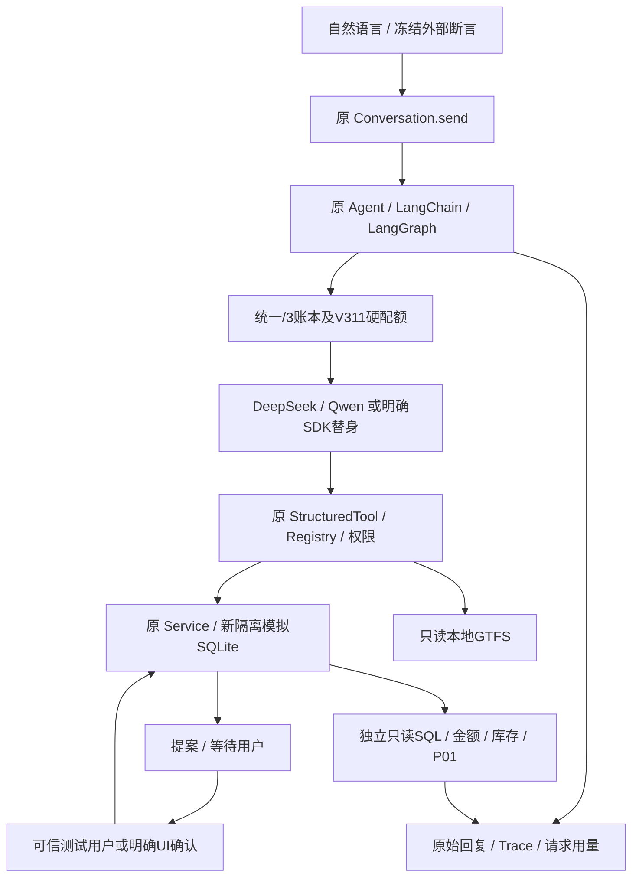

# Ticket Agent V3.11 实施报告

日期：2026-11-10（Asia/Shanghai）。HEAD `2bba4caa379b111aadcefd0369e79cf6259e33e7`，分支 `feat/ticket-agent-v36-stabilization`。整体 **PARTIAL**；未提交、未推送。

## 结论与范围

已实现原 Agent 自然语言验收编排、独立 SQL Oracle、持久化分批预算、可控故障、测试控制台实验区及模式分离计量。它复用原 LangChain/LangGraph 和原 Registry/Service，不把 V310Adapter 回放包装成 Live Agent。

真实验证只完成部分生命周期：Qwen pilot 已支付；DeepSeek 新场景已支付并退一人。改签与后续完整闭环被原单轮 Token 保护阻止，保留失败和未确认提案，不放宽限制。候选到完整自然语言场景编译、全安全矩阵及 RAG质量仍未完成，不能宣称 COMPLETE。

本轮Live案例是操作者手工预审验收，不是AI新生成候选；浏览器生成使用Mock并显式标识。旧真实生成候选、人工批准与DSL成绩不改变、不混算。

## 实现接线

## 修改文件

| 文件 | 修改原因 |
|---|---|
| `target/scenario_live_agent.py` | 原 Conversation/Agent 自然语言编排、独立沙箱、可信用户确认、逐轮不可覆盖证据；无 spec 不计分。 |
| `target/scenario_live_budget.py` | 沿用 /3 持久预算，原子准入 guard、首批24/各12与总50/各25、扩额审计。 |
| `target/scenario_business_oracle.py` | 独立只读 SQL、完整 hold/区间/资金/P01核验，失败及拒绝前后对账，有限回复事实检查。 |
| `target/scenario_faults.py` | 可信测试钩子；模型/工具/数据库/部分业务故障与驾驶器动作留证。 |
| `target/scenario_agent_coverage.py` | DSL、SDK替身、Live分开；互斥整轮计数、失败Trace、已提交退款完成证据。 |
| `scripts/run_v311_acceptance.py` | 显式 --live 启动原Agent双模型pilot，错误后停止对应场景，禁止重跑批次。 |
| `scripts/run_v311_remaining.py` | 有审计释放既有授权余量；只建新场景，不恢复旧Secret、不重放旧提案。 |
| `web/scenario_live_desk.py` | 测试控制台原Agent实验区、审批绑定、费用确认、模拟业务确认、DB/Trace/只读历史。 |
| `web/scenario_generator.py` | 保留已有修改，增加新desk调用、澄清确定性入口、修正/3预算显示。 |
| `tests/test_ai_scenario_v311.py` | 76个隔离测试，真实业务SQLite+原Agent图+SDK替身；32个非法参数场景及反向验证器测试。 |
| `PROJECT_STATUS.md` | 增量记录当前V3.11范围、真实失败、保护例外及未完成事项。 |

以上为本轮代码/状态文件；另新增8份V311报告及独立证据目录。开工已有5个跟踪修改全部保留。target/acceptance_budget.py、target/scenario_generator.py、tests/v39/test_acceptance_budget_v2.py的既有修改本轮未再更改；新例外仅记录用户已批准的预算测试SHA。完整差异见本批次patch和source-manifest。

## 隔离与确认

- 独立数据库、预算账本、会话、Trace及每轮before/after；不存在新模型确认工具。
- 确认预览绑定proposal/action/payload hash，限合成乘客、当前用户和5种模拟动作；拒绝必须证明业务表未改变。
- 工具网络连接被阻断；HTTP仅允许当前模型配置的HTTPS主机；无铁路、支付、Embedding、LangSmith请求。
- 原8工具/11铁路工具、SYSTEM_PROMPT、公共Agent.chat/Trace、D9/P01、Baseline/Override和正式103不变。
- 原进程退出不恢复确认Secret。旧DeepSeek待支付订单保持原状态；后续只用新场景。

## 测试及验收分层

最终R3新增76/0/0；完整1971/11/1，另199子测试通过、退出1。历史失败/Skip逐ID不变。SDK覆盖11工具、6状态、10转换；不能描述为Live全覆盖。主浏览器SDK八规格64/0；真实模型39次/320985Token/费用UNKNOWN。60份已执行数据库只读核验及独立备份不变量通过。

独立只读子Agent：初审BLOCKED、逐项整改、pilot准入、最终限定CONDITIONAL PASS。不是外部人工验收或用户ACCEPTED。

## 遗留与下一步

1. 原单轮Token保护导致两个真实轮次最终回答未完成：先分析有效配置/模型输入与上下文体积，设计受限压缩或更小任务切分，不直接移除保护。
2. Live改签、取消、连续退款和全部状态/安全覆盖尚缺；剩余11HTTP（DeepSeek仅余1、Qwen余10）不自动消耗、不自动开启新账本。
3. 原DSL参考计划有质量门禁不兼容：invalid_parameters及full_refund当前不能批准；保留拒绝证据，不放宽门禁冒充通过。
4. 测试控制台当前新desk检查操作者指定的附加轮次，不是已批准候选的全部DSL断言计分；需另行设计自然语言Spec到完整验收规则的版本化绑定。
5. 7安全维度、11工具各8类细分、RAG质量、真实HTTP故障和吞吐仍PARTIAL/NOT_RUN。正式103仍BLOCKED。

## 证据身份

`artifacts/runtime/v310-v311-20261110-implementation/authorization.json`；SHA256 `b5519df9838dcee7e66066093f9ffdce9144c29933d16ab95347c1420a267bf5`

`artifacts/runtime/v310-v311-20261110-implementation/coverage-final.json`；SHA256 `d74fd76a772f23fdf9cf07b2478bac1a2ea3d170ec66532b81523955bf76a425`

`artifacts/runtime/v310-v311-20261110-implementation/budget-final.json`；SHA256 `239d9bb23b3ffebbe888a49ad0fa6e5aefe218042ad825b3d3696c513dc2333f`

`artifacts/runtime/v310-v311-20261110-implementation/database-verification.json`；SHA256 `0cc7acd2bd8a1f57b4257d36781ab578336a3b345b10dabec39d4d3f5bdd2996`

`artifacts/runtime/v310-v311-20261110-implementation/regression-comparison.json`；SHA256 `c017e1a47884bdd198357bf320a3bcda48ec82ef379c5b09ee43f966ba8c6a45`

`artifacts/runtime/v310-v311-20261110-implementation/protection-final.json`；SHA256 `91740a2751c4bc66d6b992b6159462639c99dcd64f1d35a6e7176fbe43a98ef3`

## 最终补充证据（2026-11-10）

主SDK浏览器r8为64/64，补充控件/历史r7为24/24及16张PNG，两批分别计量，不合并成完整功能覆盖率。主批PageError0/Console24/网络24；补充批PageError0/Console16/网络16，外部字体图标均主动阻断。共25张最终截图，深浅主题真实不同。截图中的SDK批次11请求/165Token是合成记账，不属于真实39请求/320985Token。

批量审批实际数据库有3条APPROVED：原Mock场景及本次两个可批准夹具；审批由脚本代表测试用户点击，仅用于Mock/确定性夹具，不是外部人工身份核验，也未自动批准真实AI候选。details-r5完成5项后定位超时，整批仍未完成；其批量审批子证据由只读SQLite和history旁证，不把该失败脚本改PASS。

独立补充审查确认invalid_parameters/full_refund仍PENDING且原件重新review为REJECTED。这是既有DSL参考夹具与准入门禁不兼容，阻塞完整AI候选业务闭环验收。手工预审Live场景、SDK支付和两个合格夹具均不能替代该缺口。本轮未修改旧执行器或降低门禁；限定CONDITIONAL PASS/项目PARTIAL不变。

证据 `artifacts/runtime/v310-v311-20261110-implementation/browser-r8/results.json`；SHA256 `ba3da5ded63b734172534cd3de30eb934fa3b39c2866f578bf772d34fea24e2d`。

证据 `artifacts/runtime/v310-v311-20261110-implementation/browser-details-r7/results.json`；SHA256 `fafa843b9b51a8119fccd4ac2cf75c06fe5d719cc0f3e408180d3a720f28a622`。

证据 `artifacts/runtime/v310-v311-20261110-implementation/browser-supplement.json`；SHA256 `7fe37d6521745afd24f4cb723a37789d56dd2cbc3b8781d91cab199b98f1eac3`。

证据 `artifacts/runtime/v310-v311-20261110-implementation/browser-candidate-verification.json`；SHA256 `83ab44038e2f5454d9e205db153746b125240ad537f648444fe14f08d43171e4`。

证据 `artifacts/runtime/v310-v311-20261110-implementation/approved-test-id-mapping.json`；SHA256 `302d9b5b60d8b82db60875595d377a66e6d1c16107a890cb4d9b0c3055f85430`。

