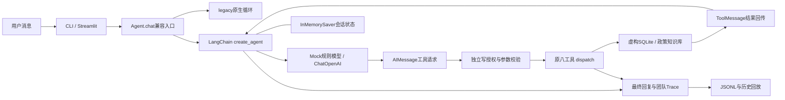

# Ticket Agent V3：功能与代码介绍

日期：2026-10-13。适用于队长了解成员A工作、成员C写作品介绍，以及学习项目代码。

## 项目是什么

Ticket Agent是一个模拟出行助手。用户用自然语言提出查票、订票或政策问题；Agent通过工具访问虚构数据库和政策知识库，再组织回复。所有订单、库存和支付均在本地模拟，不接真实12306、航司或支付系统。

它的价值是让“回答正确吗、工具调用对吗、会不会越权或重复扣库存”等行为有可检查的证据，供比赛团队开展测试。成员A开发目标Agent和本模块自测；B负责正式断言、缺陷与指标；C负责验收、作品文档和录屏。

## 已实现的功能

| 功能 | 用户可以做什么 | 实际实现 | 状态 |
|---|---|---|---|
| 高铁/机票查询 | 输入路线、日期和席别 | query_tickets访问SQLite余票；Mock识别预设相对日期 | 已实现并验证（Mock） |
| 多轮上下文 | “那机票呢”“还是高铁吧”“后天呢” | 会话保留路线/日期，交通方式切换校验席别 | 已实现并验证（Mock） |
| 模拟订票 | 明确要求订票 | query→lock→create；返回pending订单 | 已实现并验证（Mock） |
| 模拟支付与退票 | 明确要求支付/退票 | 后端状态机、本人权限、重复支付幂等、释放库存 | 已实现并验证（Mock） |
| 无票候补 | 明确要求抢票/候补 | 售罄班次返回模拟监控凭据；没有后台持续抢票服务 | 已实现并验证（模拟凭据） |
| 订单查询 | 查询本人订单 | 固定模拟身份，不能查询其他手机号订单 | 已实现并验证（Mock） |
| 政策RAG | 询问锁座时限、退票等 | 检索15条虚构政策，工具结果带doc_id/source | 已实现并验证（关键词检索） |
| Trace | 检查实际工具调用过程 | 记录参数/结果摘要/成功与否/耗时/终止原因，保存JSONL | 已实现并验证 |
| CLI与Web | 命令行或页面操作 | 会话、工具表、JSON、历史回放、通用处理中动画 | 已实现并验证（Mock） |
| 缺陷注入 | 让B验证测试是否能识别故意错误 | 六种开关保留在legacy；LangChain明确不支持 | legacy已验证；LC未实现 |
| 真实模型接入 | 使用支持工具调用的有效模型端点 | ChatOpenAI/原Provider接入，环境变量配置Key | 接入部分已验证；真实模型待实测 |

V3环境已通过56项成员A自测，详见既有交接报告。这是A的工程验证，不是B的正式测试覆盖率、通过率或比赛成绩。

## 核心架构



工具选择由模型或Mock规则产生，LangChain负责运行循环、执行工具和反馈消息。Mock只模拟模型决策，不执行Agent循环；在框架测试里禁止旧Agent._chat参与也能跑通。

## 代码在哪里

下列位置已根据当前源码核对：

| 模块 | 文件与位置 | 主要职责 |
|---|---|---|
| 入口/Prompt | [target/agent.py](../../../target/agent.py#L61) | chat验证输入，选择引擎；SYSTEM_PROMPT定义业务规则 |
| LangChain初始化 | [target/langchain_agent.py](../../../target/langchain_agent.py#L95) | create_agent、模型、工具、Checkpointer、预算 |
| 工具适配 | [adapt_tool](../../../target/langchain_agent.py#L87) | 原Schema变成StructuredTool，复用原dispatch |
| Trace中间件 | [wrap_tool_call](../../../target/langchain_agent.py#L54) | 工具执行前授权，执行后记录并返回ToolMessage |
| 框架Mock | [target/langchain_model.py](../../../target/langchain_model.py#L26) | 标准BaseChatModel，接收实际ToolMessage |
| 独立写授权 | [denial](../../../target/write_authorization.py#L59) | 本轮授权、成功lock_id、订单引用、重复占座限制 |
| 参数与分发 | [target/tools.py](../../../target/tools.py#L176) | Schema校验、直接/HTTP业务调用、错误对象 |
| 票务状态 | [target/mock_core.py](../../../target/mock_core.py) | SQLite库存、锁过期、订单、支付/退款幂等 |
| 政策检索 | [target/rag.py](../../../target/rag.py#L43) | 中文字符/英文词重叠打分；不是BM25 |
| Trace落盘 | [target/trace.py](../../../target/trace.py#L73) | 10顶层字段、JSONL逐行追加 |
| 真实页面 | [web/app.py](../../../web/app.py#L22) | 通用等待图标、原会话与Trace界面 |

设计稿源码是同目录的index.html/showcase.css/showcase.js。它读取demo-data.js展示历史场景，页面交互不调用Agent服务。真实Web入口仍是web/app.py；两种图片在目录和标题上明确区分。

## 四段代码怎么理解

### 1. Agent.chat：稳定的入口

当前函数在target/agent.py:61。它先检查session和message非空，再用锁串行执行。配置为LangChain时转交框架模块，否则调用原循环。B继续使用相同公开接口，已有返回字段不变。

在配置了Mock、all工具集和新隔离数据库的进程中：

```python
from target.agent import Agent
agent = Agent(engine="langchain")
result = agent.chat("demo", "订明天上海到杭州的高铁")
print(result["tool_sequence"])
# Mock示例：query_tickets -> lock_seat -> create_order
```

完整可复现初始化见scripts/v3_api_example.py。直接Agent()默认仍legacy，不能仅看到类名就说是在运行LangChain。

### 2. adapt_tool：复用工具，不复制业务

源码在target/langchain_agent.py:87。它从既有TOOLS中找到name/description/parameters，复制参数Schema交给StructuredTool；函数内部调用原tools.dispatch。这样八工具的名字、参数和业务含义继续保留。

数据与源码索引.json及页面“核心代码导览”中的摘录由AST直接读取这段函数，不手写冒充源码。更新实现后可重新生成并核对。

### 3. wrap_tool_call：真实事件形成Trace

源码在target/langchain_agent.py:54。调用前记录实际工具名、参数和call_id；检查denial；放行后handler调用框架注册的工具；结果转换为ToolMessage；最后record_call记录ok/latency/result。

授权被拒绝时，同样记录一次真实失败尝试（ok=false），但不执行票务后端。不能仅看到tool_sequence含pay_order就断定发生扣款。finish_reason=stop只表示执行结束，不保证业务成功。

result_preview会截断；检查完整结果应看独立原始附件，而不是把截断字符串当完整JSON。模型内部思维链没有记录或展示。

### 4. denial：业务代码独立核验写操作

源码在target/write_authorization.py:59。当前消息必须明确授权相应操作；一轮最多一次成功锁座；创建订单须引用本轮真实成功的锁；支付/退票须引用明确输入或最近实际工具结果里的订单。

底层仍会检查本人订单、锁有效期、乘客一致和状态机。授权识别采用保守中文规则，复杂表达可能拒绝，不能声称它已达到生产级安全或完全杜绝提示注入。该限制需B正式测试。

## 八工具的功能与参数

| 名称 | 用途 | 必填参数 |
|---|---|---|
| query_tickets | 查班次与余票 | from_city、to_city、date |
| monitor_seat | 无票模拟候补凭据 | train_no、date、seat_type |
| lock_seat | 锁座并占库存 | train_no、date、seat_type、passengers |
| create_order | 凭成功锁创建订单 | lock_id、passenger_ids、contact |
| pay_order | 模拟支付，重复请求不重复扣款 | order_id |
| cancel_order | 取消/退票，按模拟政策计算 | order_id |
| query_order | 只查询本人订单 | 无；order_id/phone可选 |
| search_policy | 政策检索并返回来源 | question |

参数枚举、可选参数和错误结构的完整解释以target/tools.py及B_V3手册为准；本介绍不改团队契约。

## 界面图展示了什么

1. 查询图：聊天输入、三个模拟班次、工具入参和执行记录。班次/金额/余票来自历史query_tickets真实Mock返回。
2. 订票图：pending订单和query→lock→create三步。没有自动支付；右侧步骤对应真实保存事件。
3. 政策图：锁座支付期限走search_policy，展示P11及data/policies.md#P11来源，没有支付操作。
4. 处理中图：CSS旋转图标和通用状态；它是等待的视觉展示，不是模型思考过程。静态PNG无法旋转，打开HTML可见动画。
5. 代码导览图：实际4段Python源码、用途和路径，适合讲“框架负责什么、业务负责什么”。
6. 移动端图：独立设计稿的响应式布局，仅代表效果稿；没有宣称现有Streamlit已经完成这种改版。

原界面3张截图与当次Mock Trace一起保存于真实截图目录。图片里的毫秒数和订单ID属于当次运行，不是性能保证，也不是现实订单。

## 当前边界和队长应知道的事

- 真实模型尚未联网实测；SDK桩和Mock不能冒充真实大模型自主规划结果。
- 记忆按session隔离；数据库同一个模拟身份仍共享订单/库存。不同测试用例要独立DB。
- InMemorySaver不跨重启持久化，没有长历史裁剪或正式并发压力结果。
- 候补只模拟任务凭据；向量RAG保留但未实测；六变异只legacy支持。
- B正式测试和成绩、C最终验收/视频仍由队友完成，本展示材料不替代其工作。

一句话介绍：**Ticket Agent V3在虚构票务业务上，使用真正LangChain框架执行八工具，并通过独立写授权、带来源的RAG和契约Trace，让Agent行为可运行、可检查、可测试。当前验证为Mock工程验证。**
