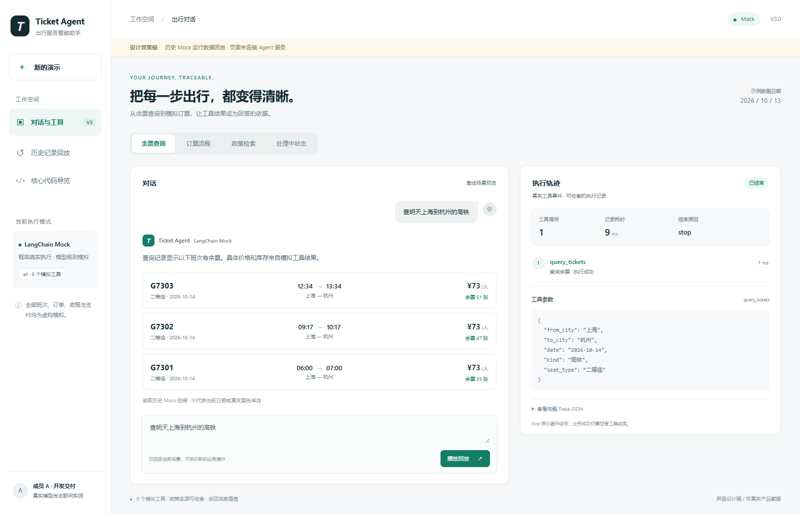
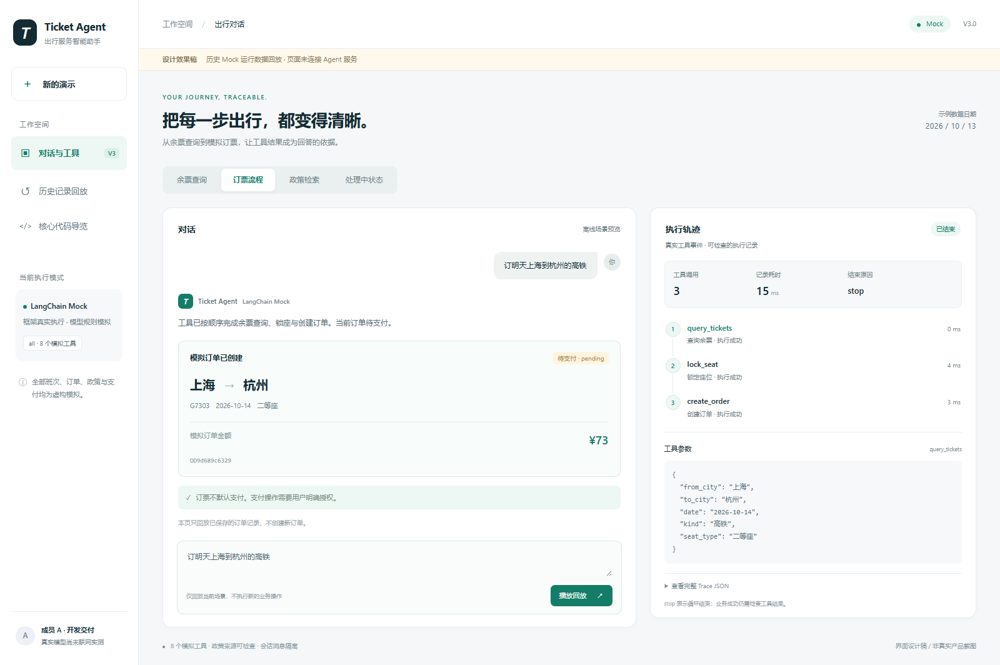
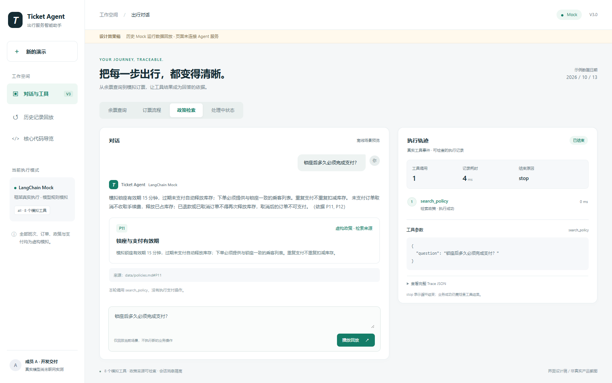
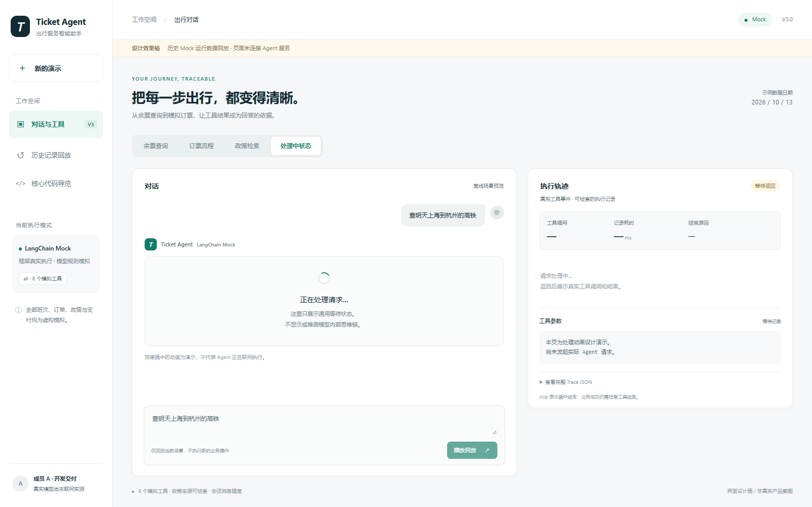
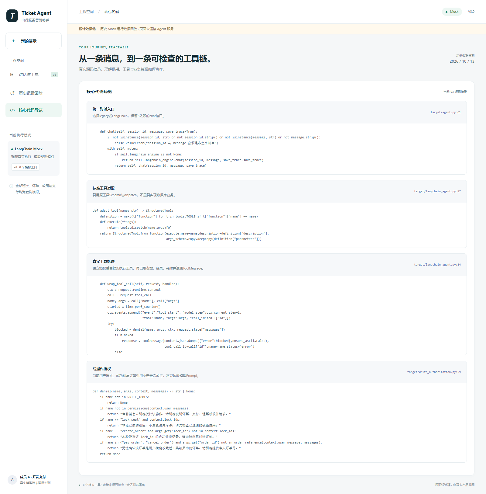
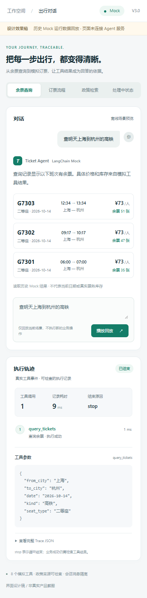
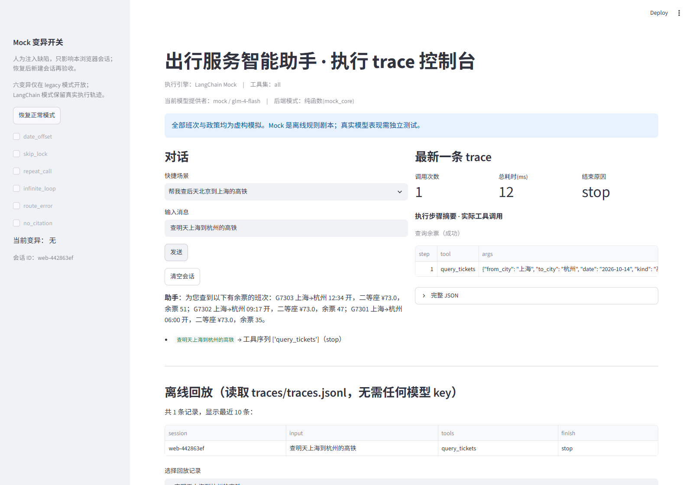
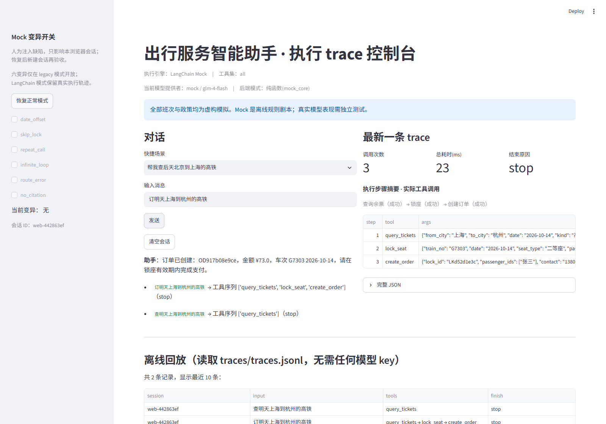
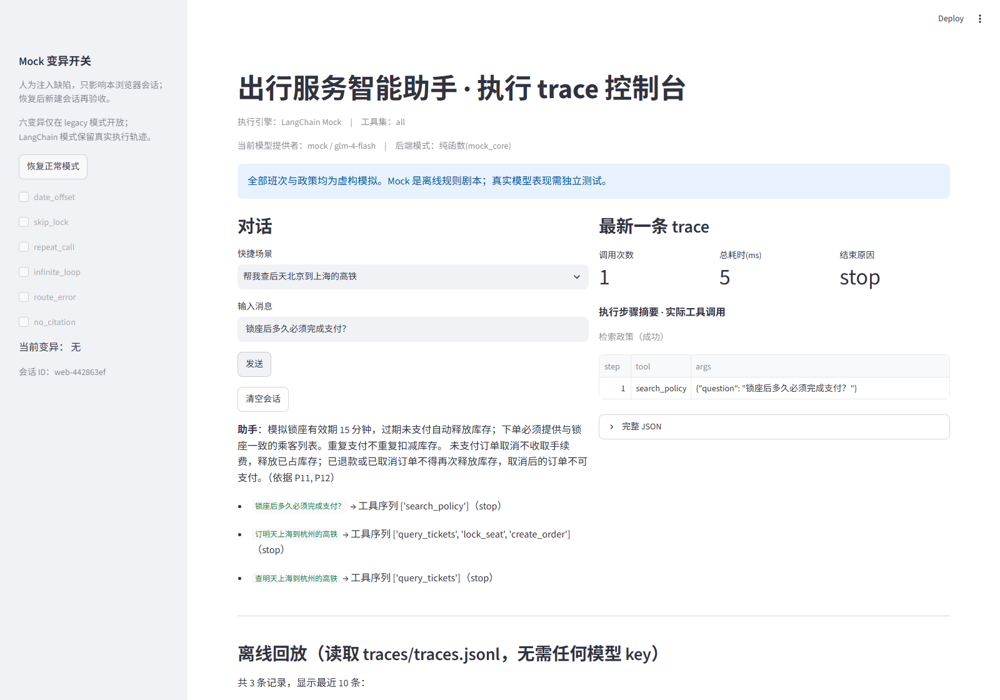

# Ticket Agent V3 图库

效果图使用2026-10-13保存的LangChain Mock数据；真实截图是在新隔离Mock实例实际采集。日期、金额、库存和耗时均属模拟运行。真实大模型尚未联网实测。

## 设计效果图

### 余票查询

可用于介绍票卡、参数和执行证据的视觉方案；不能标成现有Streamlit实装截图。

### 订票工具链

展示query_tickets→lock_seat→create_order，以及待支付订单。

### 政策检索

展示search_policy与P11来源，区别于支付操作。

### 通用处理中

静态图展示布局；HTML页面中的圆圈会旋转。不展示或推测模型内部思维链。

### 核心代码导览

包含实际源码摘录、文件路径及职责。

### 移动端查询布局

仅为独立设计稿的移动端适配；实际浏览器检查390px无横向溢出。

## 现有Streamlit实际Mock截图

### 实际查询

### 实际订票

### 实际政策检索

截图依据见同目录实际Mock运行.json、traces.jsonl与browser_check.json。用于正式实现说明时优先使用本组，并标注“LangChain Mock实际运行”。
